# Tài liệu Toàn diện về Embedding

Một công cụ tìm kiếm cần nhận ra rằng hai câu dùng từ khác nhau vẫn có thể nói về cùng một việc. Hệ thống gợi ý cần tìm sản phẩm phù hợp với sở thích người dùng. Embedding giúp giải các bài toán ấy bằng cách biểu diễn văn bản, hình ảnh hay âm thanh dưới dạng vector: những dãy số có thể so sánh, tìm kiếm và gom nhóm.

Nhưng có vector mới chỉ là bước đầu. Chọn model nào, đo độ tương đồng ra sao, lập chỉ mục cả tài liệu hay từng đoạn, lưu vector ở đâu và đánh giá kết quả thế nào? Tài liệu đi qua các quyết định này trong ba phần:

- **Phần 1 — Nền tảng**: embedding là gì, các thế hệ model thay đổi ra sao, similarity metric ảnh hưởng thế nào, và retrieval được tổ chức theo kiến trúc nào.
- **Phần 2 — Hệ thống & Ứng dụng**: semantic search, RAG, clustering, recommendation, classification, anomaly detection, deduplication và multimodal retrieval.
- **Phần 3 — Vận hành & Tối ưu**: so sánh model, chọn vector database, thiết kế chunking, giảm chiều, hybrid search, evaluation và observability.

Tài liệu tổng hợp hơn 65 nguồn, gồm tài liệu chính thức, bài báo nghiên cứu và benchmark. Các ví dụ giải thích cách embedding hoạt động; phần vận hành bàn về những đánh đổi khi đưa nó vào hệ thống.

> **Phiên bản**: November 2026 (cập nhật model landscape: Voyage 4, Cohere Embed 5, Gemini Embedding 2 GA, Jina v5) | **Ngôn ngữ**: Việt-Anh (thuật ngữ kỹ thuật giữ nguyên tiếng Anh)

---

## Mục lục

- [TL;DR — Cheat Sheet](#tldr--cheat-sheet)
- [Phần 1 — Nền tảng](#phần-1--nền-tảng)
  - [1.1 Embedding là gì?](#11-embedding-là-gì)
  - [1.2 Lịch sử phát triển](#12-lịch-sử-phát-triển)
  - [1.3 Các thuật toán tính Similarity](#13-các-thuật-toán-tính-similarity)
  - [1.4 Retrieval Foundations](#14-retrieval-foundations)
    - [1.4.1 Bi-encoder vs Cross-encoder](#141-bi-encoder-vs-cross-encoder)
    - [1.4.2 Query vs Document Asymmetry](#142-query-vs-document-asymmetry)
    - [1.4.3 Chunk vs Document](#143-chunk-vs-document)
    - [1.4.4 Dense, Sparse, Hybrid](#144-dense-sparse-hybrid)
    - [1.4.5 Retrieve, Rerank, Generate](#145-retrieve-rerank-generate)
- [Phần 2 — Hệ thống & Ứng dụng](#phần-2--hệ-thống--ứng-dụng)
  - [2.1 Semantic Search / Information Retrieval](#21-semantic-search--information-retrieval)
  - [2.2 RAG + Rerank](#22-rag--rerank-pipeline-3-giai-đoạn)
  - [2.3 Clustering (Phân cụm)](#23-clustering-phân-cụm)
  - [2.4 Recommendation Systems](#24-recommendation-systems)
  - [2.5 Classification & Sentiment Analysis](#25-classification--sentiment-analysis)
  - [2.6 Anomaly Detection](#26-anomaly-detection)
  - [2.7 Deduplication / Near-duplicate Detection](#27-deduplication--near-duplicate-detection)
  - [2.8 Multimodal Embedding](#28-multimodal-embedding)
  - [2.9 Agent Memory](#29-agent-memory--embedding-làm-trí-nhớ-dài-hạn-cho-ai-agent)
  - [2.10 Code Retrieval cho Coding Agents](#210-code-retrieval-cho-coding-agents)
  - [2.11 Semantic Caching](#211-semantic-caching--dùng-embedding-để-khỏi-gọi-llm-hai-lần)
  - [2.12 Tool Retrieval](#212-tool-retrieval--khi-agent-có-quá-nhiều-công-cụ)
  - [2.13 GraphRAG](#213-graphrag--kết-hợp-knowledge-graph-và-embedding)
  - [2.14 Embedding cho dữ liệu ngoài văn bản](#214-embedding-cho-dữ-liệu-ngoài-văn-bản--không-gian-địa-lý-protein-chuỗi-thời-gian)
- [Phần 3 — Vận hành & Tối ưu](#phần-3--vận-hành--tối-ưu)
  - [3.1 Embedding Models Comparison](#31-embedding-models-comparison)
  - [3.2 Vector Databases](#32-vector-databases-ma-trận-chọn-nhanh)
    - [HNSW Tuning Parameters](#hnsw-tuning-parameters)
    - [Vector store trên object storage](#thế-hệ-mới-vector-store-xây-trên-object-storage-20242026)
  - [3.3 Chunking Strategies](#33-chunking-strategies)
  - [3.4 Dimension Reduction & Quantization](#34-dimension-reduction--quantization)
  - [3.5 Hybrid Search (Sparse + Dense)](#35-hybrid-search-sparse--dense)
  - [3.6 Evaluation Methodology](#36-evaluation-methodology)
  - [3.7 Observability cho Embedding & RAG Systems](#37-observability-cho-embedding--rag-systems)
  - [3.8 Bảo mật & Quyền riêng tư](#38-bảo-mật--quyền-riêng-tư-cho-hệ-thống-embedding)
  - [3.9 Fine-tuning Embedding Model](#39-fine-tuning-embedding-model)
  - [3.10 Migration & Versioning](#310-migration--versioning--đổi-embedding-model-mà-không-làm-sập-hệ-thống)
- [Tổng hợp Sources](#tổng-hợp-sources)

---

## TL;DR — Cheat Sheet

### 5 defaults nếu bạn chỉ có 2 phút

- **Metric**: Cosine similarity — phép đo đã chuẩn hóa, được dùng làm mặc định trong hầu hết model và database.
- **Model**: OpenAI `text-embedding-3-small` hoặc `voyage-4-lite` (cùng $0.02/1M tokens, MRL; Voyage có 32k context và 200M tokens free). Lưu ý: Gemini `text-embedding-004` **đã bị tắt** trên Gemini API từ 14/01/2026
- **DB**: Với ≤ 1M vector và PostgreSQL sẵn có, cân nhắc pgvector. Khi cần mở rộng quy mô hoặc dịch vụ managed, cân nhắc Pinecone hoặc Qdrant.
- **RAG**: Reranker chỉ sắp xếp lại những tài liệu bước truy xuất đã tìm được. Nếu tài liệu chứa câu trả lời bị bỏ sót ở bước này, reranker cũng không thể đưa nó vào kết quả.
- **Chunking**: Bắt đầu với 256-512 tokens, overlap 10-15%; cắt theo đoạn hoặc mục có nghĩa, tránh cắt giữa câu.

### Similarity Metric Cheat Sheet

| Metric | Khi nào dùng | Ghi chú |
|--------|-------------|---------|
| **Cosine** | Lựa chọn mặc định cho hầu hết bài toán | Phép đo đã chuẩn hóa, không phụ thuộc độ lớn vector |
| **Dot Product** | Vector đã chuẩn hóa (= cosine) | Tính nhanh hơn cosine nếu vector có độ dài đơn vị |
| **L2 (Euclidean)** | Phân cụm và các bài toán dựa trên khoảng cách | Nhạy với độ lớn vector; dùng khi cần khoảng cách tuyệt đối |

### Embedding Model Cheat Sheet

| Nhu cầu | Model gợi ý | Ghi chú |
|---------|------------|---------|
| Rẻ, ecosystem lớn | OpenAI `text-embedding-3-small` | 1536d, MRL, $0.02/1M tokens, 8k context |
| Rẻ + context dài | Voyage `voyage-4-lite` | 1024d (MRL 256-2048), 32k context, $0.02/1M, 200M tokens free |
| Text retrieval chất lượng cao (API) | Voyage `voyage-4-large` / `voyage-4` | 32k context, shared embedding space, $0.12 / $0.06 per 1M |
| Multilingual + multimodal enterprise docs | Cohere `embed-v5.0-pro` / `-fast` | 2048d (MRL), 128k context, text+image+PDF |
| Unified multimodal (text/image/audio/video/PDF) | Google `gemini-embedding-2` (GA 04/2026) | 3072d (MRL), 8k context, $0.20/1M text |
| Code / coding agents | Voyage `voyage-code-4` | 32k context, $0.12/1M |
| Self-hosted / on-prem | `Qwen3-Embedding` (0.6B/4B/8B), `EmbeddingGemma`, `voyage-4-nano` | Open weights; kiểm tra license (Jina v5 là CC-BY-NC) |

### Vector Database Cheat Sheet

| Scale / Tình huống | DB gợi ý | Ghi chú |
|-------------------|---------|---------|
| Prototype / local | Chroma, sqlite-vec | Đơn giản, không cần hạ tầng riêng |
| ≤ 1M vectors + có Postgres | pgvector | Cùng stack, SQL quen thuộc |
| 1-100M vectors, managed | Pinecone, Cloudflare Vectorize | Nhà cung cấp quản lý hạ tầng, giảm công vận hành |
| 1-100M, self-hosted | Qdrant, Weaviate | Hiệu năng cao, hỗ trợ hybrid search |
| > 100M / tỷ vectors | Milvus | GPU, xử lý phân tán |

### RAG Pipeline Cheat Sheet

| Stage | Mục tiêu | Metric chính |
|-------|----------|-------------|
| **Stage 1 — Retrieve** | Lấy tập ứng viên đủ rộng để ít bỏ sót tài liệu liên quan | Recall@50 |
| **Stage 2 — Rerank** | Đưa tài liệu liên quan lên đầu danh sách | nDCG@5 |
| **Stage 3 — Generate** | Trả lời dựa trên tài liệu đã tìm được, tránh bịa thông tin | Faithfulness, Answer Relevance |

### Chunking Cheat Sheet

| Tình huống | Hướng đi |
|-----------|---------|
| Tài liệu ngắn (FAQ, sản phẩm) | Giữ nguyên mỗi tài liệu làm đơn vị index |
| Tài liệu dài, cấu trúc rõ (markdown, HTML) | Chia theo heading hoặc section |
| Tài liệu dài, ít cấu trúc (plain text) | Chia đệ quy với 256-512 tokens, overlap 10-15% |
| Code | Chunk theo function/class, giữ docstring |
| Cần ngữ cảnh rộng và độ chính xác khi tìm kiếm | Parent-child: index chunk nhỏ, lấy thêm phần cha khi trả kết quả |

---

# Phần 1 — Nền tảng

Một vector biểu diễn điều gì, và khi nào hai vector được xem là gần nhau? Hai câu hỏi này quyết định cách ta dùng embedding trong tìm kiếm, gợi ý hay phân cụm.

## 1.1 Embedding là gì?

Nếu chỉ gán cho mỗi từ một mã số, máy tính có thể phân biệt “cat” với “kitten”, nhưng chưa biết hai từ này có liên quan. Embedding cần giữ được quan hệ đó trong biểu diễn số học, để việc so sánh các vector có ích cho tìm kiếm, phân cụm và gợi ý.

### Từ dữ liệu rời rạc sang không gian liên tục

**Embedding** là phép ánh xạ dữ liệu rời rạc (discrete) — chẳng hạn từ ngữ, câu, hình ảnh, âm thanh — sang **vector liên tục** (continuous) trong không gian nhiều chiều (high-dimensional space). Ký hiệu toán học:

$$f: X \rightarrow \mathbb{R}^n$$

Trong đó:
- **X** là tập dữ liệu đầu vào (ví dụ: tập từ vựng, tập hình ảnh, tập âm thanh)
- **ℝⁿ** là không gian vector n chiều (thường n = 384, 768, 1024, 1536, 3072)
- **f** là hàm embedding (có thể là neural network, hoặc lookup table)

Cách hiểu đơn giản: mỗi từ, câu hay hình ảnh được "đặt" vào một tọa độ trong không gian nhiều chiều, sao cho **các khái niệm có ý nghĩa tương tự sẽ nằm gần nhau**.

Số chiều còn quyết định dung lượng lưu trữ. Một vector `1536` chiều ở dạng `float32` chiếm khoảng `1536 × 4 = 6144 bytes`, tức xấp xỉ `6 KB`. Với `1 triệu` chunks, riêng các vector đã cần khoảng `6 GB`, chưa tính metadata, cấu trúc chỉ mục và các bản sao trong vector database.

### Distributional Hypothesis

> *"Words that appear in similar contexts have similar meanings."*
> — Distributional Hypothesis ([Harris, 1954](https://www.tandfonline.com/doi/abs/10.1080/00437956.1954.11659520))

Ý tưởng cốt lõi: nếu hai từ thường xuất hiện trong ngữ cảnh giống nhau, chúng có ý nghĩa tương tự → vectors của chúng sẽ **gần nhau** trong không gian embedding.

**Ví dụ cụ thể:**
- "king" và "queen" gần nhau vì cùng xuất hiện trong ngữ cảnh hoàng gia, quyền lực
- "cat" và "dog" gần nhau vì cùng xuất hiện trong ngữ cảnh thú cưng, chăm sóc
- "Python" và "JavaScript" gần nhau vì cùng ngữ cảnh lập trình

**Word Analogy — phép toán trên vectors:**

Word2Vec còn cho thấy một số quan hệ giữa từ có thể biểu diễn bằng phép toán vector:

```
king - man + woman ≈ queen
Paris - France + Japan ≈ Tokyo
```

Hai ví dụ trên minh họa quan hệ ngữ nghĩa mà embedding học được: quan hệ giới tính ở cặp king/queen và quan hệ thủ đô–quốc gia ở cặp Paris/France.

### Diagram: Embedding Space

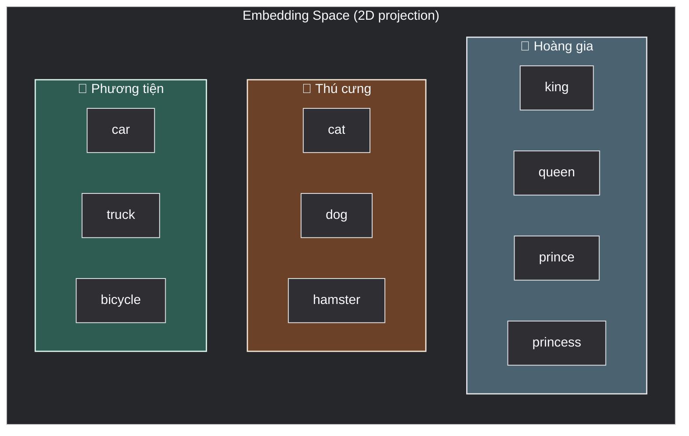

> **Hình 1**: Embedding space — các khái niệm liên quan nằm **gần nhau** trong cùng cluster. Khoảng cách giữa clusters phản ánh sự khác biệt ngữ nghĩa. Trong thực tế không gian có hàng trăm đến hàng nghìn chiều; hình trên là phép chiếu 2D minh họa.

### Tại sao Embedding quan trọng?

1. **Biểu diễn ngữ nghĩa**: One-hot encoding (vector thưa, mỗi từ có 1 vị trí bằng 1) phân biệt danh tính từ nhưng không biểu diễn quan hệ ý nghĩa. Embedding có thể đặt “cat” và “kitten” gần nhau.
2. **Giảm chiều**: Vocabulary 100,000 từ → one-hot cần 100,000 dims. Embedding chỉ cần 384-3072 dims mà chứa nhiều thông tin hơn.
3. **Tính toán similarity**: Cho phép đo "khoảng cách ý nghĩa" giữa 2 khái niệm bất kỳ bằng phép toán vector đơn giản.
4. **Transfer learning**: Embedding được train trên dataset lớn có thể transfer sang task khác — không cần train lại từ đầu.
5. **Multimodal bridge**: Embedding cho phép đặt text, image, audio vào cùng không gian → so sánh cross-modal (tìm ảnh bằng mô tả text).

Chất lượng của biểu diễn này phụ thuộc vào cách model học ngữ cảnh, xử lý từ hiếm và tạo vector. Đó cũng là những điểm các thế hệ model sau tìm cách cải thiện.

---

## 1.2 Lịch sử phát triển

Các thế hệ embedding giải quyết những giới hạn khác nhau. Word2Vec học quan hệ từ ngữ từ ngữ cảnh cục bộ; GloVe bổ sung thống kê toàn cục; FastText xử lý từ hiếm và từ ngoài từ vựng (OOV). Transformer đưa ngữ cảnh vào biểu diễn, Sentence-BERT giúp truy xuất ở quy mô lớn, còn Matryoshka cho phép đánh đổi số chiều lấy bộ nhớ, độ trễ và chi phí.

### Timeline tổng quan

| Năm | Model | Đặc điểm | Paper |
|-----|-------|----------|-------|
| 2013 | **Word2Vec** | CBOW & Skip-gram, static embeddings — mỗi từ có đúng 1 vector bất kể ngữ cảnh | [Mikolov et al., 2013](https://arxiv.org/abs/1301.3781) |
| 2014 | **GloVe** | Ma trận co-occurrence + global statistics, kết hợp count-based và prediction-based | [Pennington et al., 2014](https://aclanthology.org/D14-1162.pdf) |
| 2016 | **FastText** | Subword n-grams → xử lý OOV (out-of-vocabulary) words tốt hơn | [Bojanowski et al., 2016](https://arxiv.org/abs/1607.04606) |
| 2017 | **Transformer** | Self-attention mechanism, "Attention Is All You Need" — nền tảng cho tất cả modern models | [Vaswani et al., 2017](https://arxiv.org/abs/1706.03762) |
| 2019 | **Sentence-BERT** | Siamese/triplet BERT networks cho sentence-level embeddings — nhanh hơn cross-encoder 1000x cho search | [Reimers & Gurevych, 2019](https://arxiv.org/abs/1908.10084) |
| 2022 | **Matryoshka (MRL)** | Cho phép truncate embedding ở bất kỳ dimension nào mà vẫn giữ chất lượng — flexible dimensionality | [Kusupati et al., 2022](https://arxiv.org/abs/2205.13147) |
| 2024-2026 | **Modern Models** | text-embedding-3, Voyage 4, Cohere Embed 5, Gemini Embedding 2, Qwen3-Embedding — multimodal, MRL, 32k-128k context, shared embedding space giữa các model cùng họ, MoE | Xem [Section 3.1](#31-embedding-models-comparison) |

### Diagram: Timeline Evolution

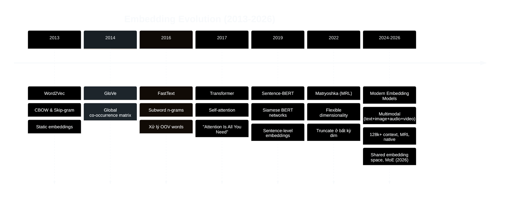

### Bước nhảy lớn nhất: Static → Contextual

Từ “bank” có thể chỉ ngân hàng hoặc bờ sông. Static embeddings gán cho cả hai cách dùng cùng một vector; contextual embeddings tạo biểu diễn khác nhau theo câu chứa từ đó.

**Static embeddings** (Word2Vec, GloVe, FastText):
- Mỗi từ → **1 vector cố định** duy nhất, bất kể ngữ cảnh
- Từ "bank" (ngân hàng) và "bank" (bờ sông) → **cùng chung 1 vector**
- Training: unsupervised trên corpus lớn, mỗi từ có 1 entry trong lookup table
- Ưu điểm: nhanh, nhỏ gọn, dễ sử dụng
- Nhược điểm: không phân biệt polysemy (từ đa nghĩa)

**Contextual embeddings** (Transformer-based: BERT, GPT, Sentence-BERT):
- Cùng 1 từ nhưng **vector thay đổi theo ngữ cảnh** xung quanh
- "The **bank** of the river" → vector khác hoàn toàn so với "I went to the **bank** to deposit money"
- Training: self-supervised (masked language modeling, next sentence prediction)
- Ưu điểm: hiểu ngữ cảnh, phân biệt đa nghĩa, transfer learning mạnh
- Nhược điểm: chậm hơn, cần GPU, model lớn hơn nhiều

### Chi tiết các model quan trọng

**Word2Vec (2013)** — [Mikolov et al.](https://arxiv.org/abs/1301.3781)

Word2Vec là cột mốc đầu tiên cho thấy vector có thể được học trực tiếp từ context thay vì gán thủ công hay giữ dạng one-hot.

Hai kiến trúc:
- **CBOW** (Continuous Bag of Words): dự đoán từ trung tâm từ các từ xung quanh. Nhanh hơn, tốt cho frequent words.
- **Skip-gram**: dự đoán các từ xung quanh từ từ trung tâm. Chậm hơn nhưng tốt hơn cho rare words.

Quá trình huấn luyện dùng negative sampling để tăng tốc, tránh tính softmax trên toàn bộ từ vựng.

**GloVe (2014)** — [Pennington et al.](https://aclanthology.org/D14-1162.pdf)

So với Word2Vec, GloVe đưa thêm thông tin thống kê toàn cục của toàn bộ corpus vào quá trình học vector.

"Global Vectors for Word Representation" — kết hợp 2 approaches:
- **Count-based**: xây ma trận co-occurrence (từ nào xuất hiện cùng từ nào, bao nhiêu lần)
- **Prediction-based**: factorize ma trận đó bằng weighted least squares

Nhờ đó, GloVe tận dụng thống kê trên toàn bộ kho văn bản thay vì chỉ các cửa sổ ngữ cảnh cục bộ.

**FastText (2016)** — [Bojanowski et al.](https://arxiv.org/abs/1607.04606)

FastText tập trung vào một hạn chế rất thực tế của word embeddings: xử lý kém với từ hiếm và từ chưa từng xuất hiện trong training.

Cải tiến quan trọng: biểu diễn từ bằng **tổng các subword n-grams**. Ví dụ từ "embedding" → {"em", "emb", "mbe", "bed", "edd", "ddi", "din", "ing", ...}.

→ Xử lý **OOV words** (từ chưa thấy trong training): vì subwords có thể overlap với các từ đã biết.
→ Đặc biệt hữu ích cho các ngôn ngữ có hình thái học phong phú (morphologically rich languages) như tiếng Thổ Nhĩ Kỳ, tiếng Phần Lan, và cả tiếng Việt (trong một số trường hợp).

**Transformer (2017)** — [Vaswani et al.](https://arxiv.org/abs/1706.03762)

Nhờ **self-attention**, Transformer biểu diễn mỗi token trong quan hệ với các token xung quanh. Biểu diễn vì thế thay đổi theo ngữ cảnh, thay vì cố định theo từ.

Cách tạo biểu diễn này có ba hệ quả:
- Embedding không còn là một lookup table cố định cho từng từ
- Cùng một token có thể mang **representation khác nhau tùy câu**
- Transformer trở thành nền tảng cho BERT, GPT và hầu hết modern embedding models

**Sentence-BERT (2019)** — [Reimers & Gurevych](https://arxiv.org/abs/1908.10084)

Sentence-BERT giải quyết một vấn đề mang tính hệ thống: BERT gốc cho chất lượng tốt nhưng quá chậm cho retrieval quy mô lớn nếu dùng cross-encoder.

Giải quyết vấn đề lớn: BERT gốc cần input cặp câu (cross-encoder) → O(n²) cho search trong N documents.

SBERT dùng **Siamese network**: encode mỗi câu **độc lập** thành 1 vector → so sánh bằng cosine similarity → tốc độ nhanh gấp ~1000x so với cross-encoder BERT, đồng thời giữ chất lượng sentence-level tốt hơn nhiều so với mean pooling BERT thông thường.

**Matryoshka Representation Learning (2022)** — [Kusupati et al.](https://arxiv.org/abs/2205.13147)

Matryoshka Representation Learning trả lời một nhu cầu rất thực tế trong production: giảm kích thước vector để tiết kiệm memory, storage và latency mà vẫn giữ được phần lớn chất lượng.

Tên gọi từ búp bê Matryoshka (búp bê Nga lồng nhau): embedding vector được train sao cho **prefix bất kỳ** (d chiều đầu tiên) đã chứa đủ thông tin tốt.

Ví dụ: model output 3072 dims, nhưng bạn có thể chỉ lấy 1536 dims đầu → vẫn giữ chất lượng cao. Lấy 768 dims → vẫn tốt. Điều này giúp giảm memory/cost mà không cần PCA hay retrain.

Modern models hỗ trợ MRL native: OpenAI text-embedding-3, Voyage 4 series, Cohere Embed 4/5, Google Gemini Embedding 2, Qwen3-Embedding, Jina v3/v5.

Mỗi thế hệ model cải thiện một khía cạnh của biểu diễn. Để dùng các vector đầu ra, ta còn phải chọn phép đo độ tương đồng.

---

## 1.3 Các thuật toán tính Similarity

Hai vector có thể cùng hướng nhưng khác độ dài. Cosine bỏ qua khác biệt về độ dài; dot product giữ lại nó; L2 đo khoảng cách giữa hai điểm. Lựa chọn này ảnh hưởng đến thứ hạng tìm kiếm, kết quả phân cụm và gợi ý. Jaccard xử lý một trường hợp khác: độ trùng lặp giữa các tập hợp từ.

### Bảng so sánh tổng quan

| Metric | Công thức | Range | Ưu điểm | Nhược điểm |
|--------|----------|-------|---------|------------|
| **Cosine Similarity** | `cos(θ) = (A·B) / (‖A‖ × ‖B‖)` | [-1, 1] | Không phụ thuộc magnitude | Mất tín hiệu magnitude |
| **Dot Product** | `A·B = Σ(aᵢ × bᵢ)` | (-∞, +∞) | Nhanh nhất; giữ tín hiệu popularity/norm | Thiên về vectors có norm lớn |
| **Euclidean (L2)** | `√Σ(aᵢ - bᵢ)²` | [0, +∞) | Trực giác hình học, khoảng cách thực | Nhạy cảm với scale |
| **Manhattan (L1)** | `Σ|aᵢ - bᵢ|` | [0, +∞) | Robust với outliers hơn L2 | Ít phổ biến trong NLP |
| **Jaccard** | `|A∩B| / |A∪B|` | [0, 1] | Tốt cho set/boolean data | Không dùng cho continuous vectors |

### Chi tiết từng Metric

#### Cosine Similarity — Chỉ đo hướng, bỏ qua độ dài

**Công thức đầy đủ:**

$$\text{cosine}(A, B) = \frac{A \cdot B}{\|A\| \times \|B\|} = \frac{\sum_{i=1}^{n} a_i \times b_i}{\sqrt{\sum_{i=1}^{n} a_i^2} \times \sqrt{\sum_{i=1}^{n} b_i^2}}$$

**Đặc điểm bản chất — chỉ quan tâm "hướng":**

Cosine đo góc giữa 2 vector, chia tích vô hướng cho tích độ dài của chúng để loại ảnh hưởng của độ lớn (magnitude). Hai vector cùng hướng có cosine = 1, dù vector A dài gấp 10 lần vector B.

Hệ quả trực tiếp: cosine **không quan tâm "bao nhiêu"**, chỉ quan tâm **"về cái gì"**.

**Từ đặc điểm này → tại sao dùng cho semantic search:**

Trong thực tế, khi user search "cách debug Python", họ muốn tìm documents **nói về cùng chủ đề** — bất kể document dài 1 đoạn hay 10 trang. Cosine đáp ứng chính xác nhu cầu này:

- Một đoạn ngắn: *"Debug Python bằng pdb"* (embedding norm nhỏ vì ít thông tin)
- Một bài dài: *"Hướng dẫn toàn diện debug Python: pdb, breakpoints, logging, IDE debugger..."* (embedding norm lớn vì nhiều thông tin)

Cả hai đều **trỏ cùng hướng** "debug Python" trong embedding space → cosine similarity cao cho cả hai. Nếu dùng dot product hoặc L2, document dài sẽ bị ưu tiên/bất lợi chỉ vì nó dài hơn — không phải vì nó relevant hơn.

**Vì lý do này:**
- Cosine là **metric mặc định** cho semantic search, RAG retrieval, semantic text similarity (STS), deduplication
- Hầu hết embedding models (OpenAI, Cohere, Google, Jina...) được **train để tối ưu cosine** giữa query-document pairs
- Tất cả major vector databases (Pinecone, Weaviate, Qdrant, pgvector) đều **default hoặc recommend cosine**
- Khi bạn **không chắc dùng metric nào** → cosine luôn là lựa chọn an toàn nhất

> Sources: [FAISS docs — MetricType and distances](https://github.com/facebookresearch/faiss/wiki/MetricType-and-distances), [scikit-learn cosine_similarity](https://scikit-learn.org/stable/modules/generated/sklearn.metrics.pairwise.cosine_similarity.html)

#### Dot Product — Đo hướng VÀ độ lớn cùng lúc

**Công thức:**

$$\text{dot}(A, B) = A \cdot B = \sum_{i=1}^{n} a_i \times b_i = \|A\| \times \|B\| \times \cos(\theta)$$

**Đặc điểm bản chất — magnitude là thông tin, không phải nhiễu:**

Trong `dot(A,B) = ‖A‖ × ‖B‖ × cos(θ)`, góc và độ dài đều góp phần vào điểm số. Bởi vậy, cần biết độ dài vector mang thông tin gì trước khi dùng dot product để xếp hạng.

Khi nào độ dài vector là tín hiệu hữu ích?

**Từ đặc điểm này → tại sao dùng cho recommendation systems:**

Trong recommendation, models (như two-tower architecture của Google, YouTube, Spotify) được train trên hàng tỷ interactions: user xem video nào, click sản phẩm nào, nghe bài hát nào. Quá trình training tạo ra embedding cho mỗi user và mỗi item. Điều quan trọng là **cách training ảnh hưởng đến norm**:

- **Item phổ biến** (Avengers, Despacito, iPhone) xuất hiện trong training data **hàng triệu lần** → model "thấy" item này rất nhiều → gradient updates liên tục → embedding vector **hội tụ mạnh**, norm lớn, "tự tin" cao.
- **Item niche** (phim indie, bài hát underground) xuất hiện **vài trăm lần** → model ít thấy → embedding vector **kém hội tụ**, norm nhỏ hơn, "tự tin" thấp hơn.

Norm của embedding tự nhiên encode mức độ **"confidence"** — model tin tưởng bao nhiêu vào embedding đó.

Khi tính `score = user · item`:
- `score = ‖user‖ × ‖item‖ × cos(θ)`
- `cos(θ)` = mức độ **phù hợp sở thích** (hướng gần nhau = relevant)
- `‖item‖` = mức độ **tin cậy / phổ biến** của item

→ Dot product tự động tính: **"item này phù hợp sở thích user bao nhiêu" × "model tự tin bao nhiêu về item này"**.

**Ví dụ cụ thể**: User thích sci-fi. Có 2 items cùng thuộc sci-fi (cos(θ) gần bằng nhau):
- "Avengers: Endgame" — cực popular, ‖embedding‖ = 8.5
- "Blade Runner 2049" — niche cult, ‖embedding‖ = 3.2
- Dot product score: Endgame ≈ 8.5 × cos(θ), Blade Runner ≈ 3.2 × cos(θ)
- → Endgame score cao hơn ~2.6x chỉ nhờ popularity signal

Đây là **hành vi mong muốn**: giữa 2 phim cùng relevant, recommend phim popular hơn là lựa chọn **an toàn hơn** (nhiều người thích = xác suất user thích cao hơn). Cosine sẽ cho 2 phim điểm gần bằng nhau — mất tín hiệu popularity quý giá này.

**Ngược lại — khi nào KHÔNG nên dùng dot product:**

Trong semantic search, magnitude **không mang ý nghĩa hữu ích**. Document dài hơn không có nghĩa là relevant hơn — nhưng dot product sẽ ưu tiên nó. Đây là lý do semantic search dùng cosine (triệt tiêu magnitude) chứ không dùng dot product.

> Source: [Google ML Recommendation — Candidate Generation](https://developers.google.com/machine-learning/recommendation/overview/candidate-generation)

#### Euclidean Distance (L2) — Khoảng cách tuyệt đối trong không gian

**Công thức:**

$$L2(A, B) = \sqrt{\sum_{i=1}^{n} (a_i - b_i)^2}$$

**Đặc điểm bản chất — đo "khoảng cách thực" giữa 2 điểm:**

L2 đo khoảng cách "đường chim bay" giữa 2 điểm trong không gian — chính xác như cách bạn dùng thước đo khoảng cách trên bản đồ. L2 = 0 nghĩa là 2 points trùng nhau. Đặc điểm quan trọng: L2 **nhạy cảm với cả hướng lẫn magnitude** — 2 vectors cùng hướng nhưng khác độ dài vẫn có L2 lớn.

Một hệ quả toán học quan trọng: **trung bình cộng** (mean) của một nhóm điểm chính là điểm **minimize tổng L2²** đến tất cả các điểm trong nhóm. Không có metric nào khác có tính chất này.

**Từ đặc điểm này → tại sao K-means bắt buộc dùng L2:**

K-means hoạt động bằng cách lặp 2 bước: (1) gán mỗi điểm vào centroid gần nhất, (2) cập nhật centroid = **trung bình cộng** các điểm trong cluster. Bước (2) chính là bước **minimize tổng L2²** — đây là objective function toán học của K-means:

$$\text{Inertia} = \sum_{i=1}^{N} \|x_i - \mu_{c(i)}\|^2$$

Nếu dùng cosine ở bước (1) nhưng mean ở bước (2), 2 bước **không nhất quán** về mặt toán học → thuật toán không đảm bảo hội tụ và kết quả sai. Đây không phải "best practice" mà là **yêu cầu toán học**: K-means = L2.

> **Mẹo**: Nếu muốn clustering theo cosine similarity → **normalize tất cả vectors về L2-norm = 1 trước**, rồi chạy K-means bình thường. Khi ‖v‖ = 1, minimize L2 ≡ maximize cosine (chứng minh bên dưới) → K-means trên normalized vectors = "cosine K-means".

**Khi nào nên dùng L2:**
- **K-means clustering**: bắt buộc (objective function)
- **kNN classification**: kNN truyền thống dùng L2 để tìm k neighbors gần nhất
- **Anomaly detection (distance-based)**: tính L2 trung bình đến K nearest neighbors → outlier = điểm có L2 lớn (nằm xa mọi thứ)
- **Đo information loss sau quantization/compression**: L2 giữa vector gốc vs vector sau nén → reconstruction error

**Khi nào KHÔNG nên dùng L2:**
- Cho **semantic search** — L2 nhạy cảm với magnitude nên document dài bị bất lợi so với document ngắn dù cùng relevant. Cosine phù hợp hơn.
- Khi **vectors có scale khác nhau** — L2 bị bias bởi scale. Normalize trước hoặc dùng cosine.

**Quan hệ L2 — Cosine khi normalized:**

Nếu embedding đã L2-normalized (‖v‖ = 1):

$$\|A - B\|^2 = \|A\|^2 + \|B\|^2 - 2(A \cdot B) = 1 + 1 - 2\cos(\theta) = 2(1 - \cos(\theta))$$

→ L2² là **hàm tuyến tính nghịch** của cosine → minimize L2 ≡ maximize cosine → **cùng ranking**. Đây là lý do normalize + L2 là cách làm K-means theo cosine.

#### Manhattan Distance (L1) — Cộng từng chiều, không khuếch đại outlier

**Công thức:**

$$L1(A, B) = \sum_{i=1}^{n} |a_i - b_i|$$

**Đặc điểm bản chất — không bình phương, nên không khuếch đại:**

So sánh L1 vs L2 qua cách xử lý sự khác biệt trên từng dimension:
- **L2** bình phương mỗi difference trước khi cộng: `(aᵢ - bᵢ)²`. Difference = 10 → đóng góp 100. Difference = 1 → đóng góp 1. **Tỷ lệ khuếch đại: 100:1** — dimension khác biệt lớn dominate hoàn toàn.
- **L1** chỉ lấy absolute value: `|aᵢ - bᵢ|`. Difference = 10 → đóng góp 10. Difference = 1 → đóng góp 1. **Tỷ lệ: 10:1** — cân bằng hơn nhiều.

Hệ quả: L1 **robust hơn với outlier dimensions**. Nếu 2 embeddings giống nhau ở 99/100 dimensions nhưng khác rất lớn ở 1 dimension (do noise hoặc encoding artifact), L2 bị dominate bởi dimension đó → khoảng cách bị "thổi phồng". L1 ít bị ảnh hưởng hơn.

**Từ đặc điểm này → khi nào phù hợp:**
- **Sparse high-dimensional data**: trong không gian rất cao chiều (hàng nghìn dims), L2 distances giữa các points có xu hướng **hội tụ về cùng 1 giá trị** (curse of dimensionality) → mất khả năng phân biệt. L1 ít bị hiệu ứng này hơn vì không bình phương.
- **Data có noise / outlier dimensions**: khi embedding có một số dimensions bị nhiễu (phổ biến với models cũ hoặc data chưa clean), L1 cho kết quả ổn định hơn L2.
- **Feature-level analysis**: khi muốn biết "tổng sự khác biệt" giữa 2 embeddings trên mọi dimensions — L1 cho con số dễ diễn giải hơn vì chỉ cộng các absolute differences.

**Hạn chế thực tế:**
- Hầu hết embedding models **không được train để optimize L1** → ranking quality kém hơn cosine/dot product
- Phần lớn vector databases **không có L1 index** → phải brute-force search, rất chậm
- Ít dùng trong embedding workflows hiện đại — chủ yếu gặp trong traditional ML pipelines

#### Jaccard Similarity — Đo overlap giữa 2 tập hợp

**Công thức:**

$$\text{Jaccard}(A, B) = \frac{|A \cap B|}{|A \cup B|}$$

**Đặc điểm bản chất — hoạt động trên sets, không phải vectors:**

Jaccard khác hoàn toàn 4 metrics trên: nó **không thao tác trên continuous vectors** mà trên **tập hợp** (sets). Câu hỏi nó trả lời: "trong tất cả phần tử mà A hoặc B có, bao nhiêu phần trăm là chung?"

Đây là phép đo **lexical overlap** (trùng lặp từ vựng) thuần túy — không hiểu ngữ nghĩa. "Xử lý lỗi phần mềm" và "debug software errors" có Jaccard = 0 vì không có từ nào trùng, dù nghĩa hoàn toàn giống nhau.

**Từ đặc điểm này → vai trò trong hệ thống search:**

Jaccard (và biến thể BM25) quan trọng cho **keyword matching** — trường hợp mà semantic similarity *không đủ*:
- **Tên riêng, mã sản phẩm, thuật ngữ chuyên ngành**: "iPhone 15 Pro Max" — cần exact match, không cần hiểu ngữ nghĩa
- **Mã lỗi, số hiệu**: "ERR_CONNECTION_REFUSED", "CVE-2024-12345" — phải khớp chính xác
- **Hybrid search**: kết hợp Jaccard/BM25 (tìm chính xác) + cosine embedding (tìm ngữ nghĩa) → bổ sung cho nhau. Đây là cách RAG pipelines hiện đại hoạt động (xem [Section 2.2](#22-rag--rerank-pipeline-3-giai-đoạn))

**Jaccard còn là nền tảng cho MinHash/LSH** — kỹ thuật approximate deduplication ở massive scale (hàng triệu documents). Thay vì tính Jaccard cho mọi cặp (O(n²)), MinHash hash sets → estimate Jaccard trong O(n) — giữ cùng ý tưởng đo overlap nhưng nhanh hơn hàng triệu lần.

**Không dùng Jaccard cho:**
- **Dense embedding vectors** (float arrays) — Jaccard cần sets/binary input, không hoạt động trên continuous numbers
- **Semantic similarity** — "mèo" và "cat" có Jaccard = 0 dù cùng nghĩa

### Tổng hợp: Từ đặc điểm → Use Case

| Metric | Đặc điểm cốt lõi | Hệ quả | → Phù hợp cho |
|--------|-------------------|--------|----------------|
| **Cosine** | Chỉ đo hướng, triệt tiêu magnitude | Không bias bởi document length hay embedding norm | Semantic search, RAG, STS, dedup — mọi thứ cần "pure meaning similarity" |
| **Dot Product** | Đo hướng × magnitude | Magnitude encode popularity / confidence | Recommendation systems — muốn kết hợp relevance + popularity |
| **L2** | Khoảng cách tuyệt đối; mean minimizes tổng L2² | Centroid (mean) có ý nghĩa toán học | K-means clustering (bắt buộc), kNN, anomaly detection |
| **L1** | Cộng absolute diff, không bình phương | Không khuếch đại outlier dimensions | Sparse/noisy data, feature-level analysis |
| **Jaccard** | Đo overlap giữa 2 sets | Chỉ biết lexical match, không hiểu semantics | Keyword search, BM25, MinHash dedup, exact term matching |

Có thể ghi nhớ ngắn gọn như sau: cosine trả lời câu hỏi "nói về cái gì?", dot product thêm tín hiệu "tự tin bao nhiêu?", L2 cho biết "xa nhau bao nhiêu?", còn Jaccard cho biết "có bao nhiêu từ trùng?".

### Khi vectors đã được normalize

> **Với L2-normalized vectors**: cosine similarity ≡ dot product ≡ L2 ranking.
> Khi `‖A‖ = ‖B‖ = 1`, thì `cos(θ) = A·B` và `‖A-B‖² = 2(1 - A·B)`.
> → Chọn metric nào cũng cho **cùng ranking** — chỉ khác scale.
> Nhiều embedding models (OpenAI, Cohere) trả vectors đã normalized, nên trong thực tế có thể dùng dot product để tính nhanh hơn vì không cần chia cho norm.
>
> Sources: [FAISS docs — MetricType and distances](https://github.com/facebookresearch/faiss/wiki/MetricType-and-distances), [scikit-learn cosine_similarity](https://scikit-learn.org/stable/modules/generated/sklearn.metrics.pairwise.cosine_similarity.html)

### Sai lầm thường gặp

| Sai lầm | Tại sao sai | Cách sửa |
|---------|------------|----------|
| Dùng L2 cho semantic search | L2 nhạy cảm magnitude → document dài bị rank thấp dù relevant (norm lớn → L2 xa) | Chuyển sang cosine (triệt tiêu magnitude) |
| Dùng cosine cho recommendation | Cosine triệt tiêu magnitude → mất tín hiệu popularity quý giá, items niche rank ngang popular | Chuyển sang dot product (giữ magnitude) |
| Dùng K-means với cosine distance | K-means objective là minimize tổng L2² — dùng cosine thì bước gán cluster và bước cập nhật centroid không nhất quán | Normalize vectors trước (→ L2 ≡ cosine), rồi chạy K-means bình thường |
| Dùng Jaccard cho dense embeddings | Jaccard cần set/binary input — continuous float vectors cho kết quả vô nghĩa | Dùng cosine cho dense vectors |
| Không normalize khi dùng dot product cho search | Ranking bị bias: documents có embedding norm lớn luôn rank trên, bất kể relevance | Normalize vectors trước khi index, hoặc dùng cosine |

### Diagram: Khi nào dùng metric nào?

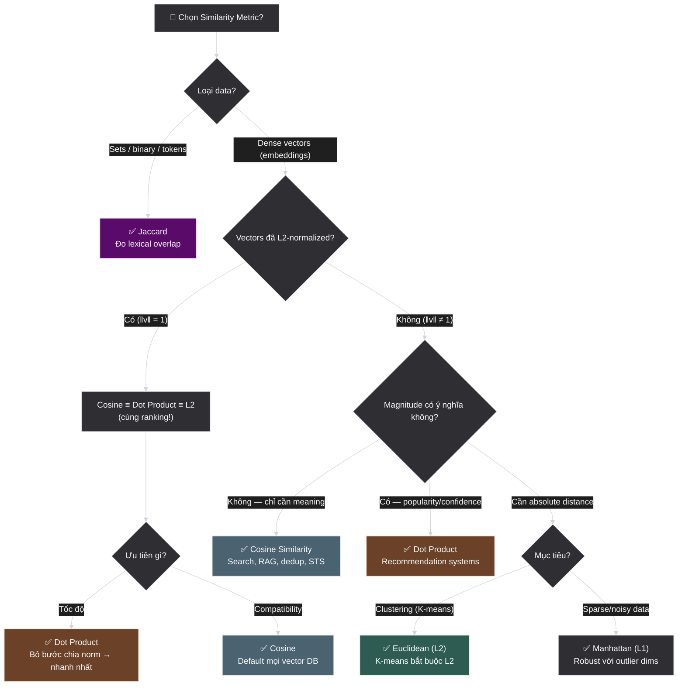

## 1.4 Retrieval Foundations

Để dùng embedding trong tìm kiếm, cần quyết định cách mã hóa query và tài liệu, chọn đơn vị truy xuất và ghép các bước xử lý. Các quyết định này gắn với nhau: cách mã hóa quyết định phần nào có thể tính trước; đơn vị truy xuất quyết định nội dung nào được đưa vào kết quả.

### 1.4.1 Bi-encoder vs Cross-encoder

Khi phải so sánh một query với hàng triệu tài liệu, khả năng tính trước vector của tài liệu giúp giảm đáng kể công việc lúc nhận truy vấn.

**Bi-encoder** mã hóa query và tài liệu độc lập, rồi so sánh hai vector bằng một phép đo như cosine. Hai phía có thể dùng cùng một model hoặc được tối ưu riêng; điểm chung là model xử lý từng đầu vào mà không cần đọc đầu vào còn lại.

**Cross-encoder** nhận cả cặp `(query, document)` trong một lần gọi. Attention cho phép các token của query tương tác với các token của tài liệu. Model thường trả về một điểm liên quan cho cặp đó, thay vì hai vector riêng.

Hai kiến trúc đánh đổi tốc độ và khả năng đối chiếu chi tiết như sau:

| Aspect | **Bi-encoder** | **Cross-encoder** |
|--------|----------------|-------------------|
| **Input** | Query và document encode riêng | Nhận cặp `(query, doc)` cùng lúc |
| **Output** | 2 vectors → similarity score | 1 relevance score trực tiếp |
| **Tốc độ** | Nhanh, vì document vectors có thể pre-compute | Chậm, vì phải chấm từng cặp |
| **Scale** | Phù hợp retrieval trên triệu documents | Chỉ hợp re-score số lượng nhỏ candidates |
| **Điểm mạnh** | Scalable, phù hợp search/retrieval | Chính xác hơn nhờ token interaction |
| **Điểm yếu** | Mất chi tiết token-level | Không thể scan toàn corpus trực tiếp |

Vì vậy, semantic search hiện đại gần như luôn dùng **bi-encoder cho retrieval** và **cross-encoder cho reranking**. Bi-encoder giúp tìm nhanh trong tập rất lớn; cross-encoder dùng ở bước sau để tăng precision trên một tập candidates nhỏ hơn. Trong lịch sử phát triển model, Sentence-BERT là cột mốc quan trọng vì nó đưa tư duy bi-encoder vào retrieval ở quy mô lớn, còn nhiều reranker hiện đại đi theo hướng cross-encoder.

### 1.4.2 Query vs Document Asymmetry

Dù bi-encoder encode query và document riêng rẽ, hai loại input này **không có cùng vai trò**.

- **Query** thường ngắn, mang tính hỏi thông tin, mô tả nhu cầu tìm kiếm
- **Document** thường dài hơn, mang tính cung cấp thông tin, chứa nội dung cần được tìm thấy

Một câu hỏi thường giống một câu hỏi khác hơn là giống đoạn văn trả lời nó. Nếu mã hóa query và tài liệu như cùng một loại đầu vào, hệ thống có thể ưu tiên những câu “trông giống query” và bỏ qua đoạn chứa câu trả lời.

Đó là lý do nhiều modern embedding models cung cấp chế độ riêng cho:

- `search_query`
- `search_document`

Các chế độ này cho model biết vai trò của đầu vào để tạo biểu diễn phù hợp cho truy xuất. Query và tài liệu vẫn cần nằm trong không gian có thể so sánh với nhau. Cách xử lý hai vai trò riêng biệt này gọi là **asymmetric search**.

### 1.4.3 Chunk vs Document

Một vector có thể đại diện cho nhiều cấp độ khác nhau: một từ, một câu, một đoạn, một chunk, hay cả document. Vì vậy, trước khi retrieve, cần quyết định **đơn vị nào sẽ được index**.

Trong classic semantic search, retrieval có thể diễn ra ở cấp **document** nếu mỗi tài liệu tương đối tập trung vào một chủ đề và người dùng muốn mở cả tài liệu đó.

Trong RAG, retrieval thường diễn ra ở cấp **chunk** hơn là cả document. Lý do rất thực tế:

1. **Cả document thường quá rộng**: một tài liệu dài có thể nói về nhiều ý khác nhau, nên embedding của toàn tài liệu dễ bị "trung bình hóa" và mất trọng tâm
2. **LLM có context window hữu hạn**: không thể đưa cả knowledge base vào prompt, nên cần retrieve các đoạn nhỏ vừa đủ liên quan
3. **Chunk giúp grounding tốt hơn**: answer có thể bám sát đúng đoạn chứa thông tin, thay vì một document dài nhưng loãng

Chunk quá nhỏ dễ mất ngữ cảnh, còn chunk quá lớn dễ làm loãng nội dung cần tìm. Ranh giới chunk vì thế ảnh hưởng cả khả năng truy xuất lẫn mức độ câu trả lời bám sát nguồn.

### 1.4.4 Dense, Sparse, Hybrid

Khi retrieve, có ba cách biểu diễn phổ biến:

| Kiểu retrieval | Dựa trên gì | Mạnh ở đâu | Yếu ở đâu |
|----------------|-------------|------------|-----------|
| **Sparse** | Token overlap, BM25, TF-IDF | Exact match: tên riêng, mã lỗi, mã sản phẩm | Không hiểu synonym hay paraphrase |
| **Dense** | Embedding vectors | Semantic match: paraphrase, đa ngôn ngữ, câu hỏi tự nhiên | Dễ mất tín hiệu exact token-level |
| **Hybrid** | Kết hợp sparse + dense | Giữ cả exact match lẫn semantic match | Hệ thống phức tạp hơn, cần fusion/rerank |

Không có phương pháp nào thắng tuyệt đối. Sparse retrieval giỏi ở chỗ embedding thường yếu: rare terms, proper nouns, product codes. Dense retrieval lại giỏi ở chỗ sparse yếu: synonym, paraphrase, diễn đạt tự nhiên. Vì vậy, nhiều hệ thống production dùng **hybrid retrieval** để tăng recall trước khi rerank.

### 1.4.5 Retrieve, Rerank, Generate

Một pipeline search hoặc RAG thường chia công việc thành ba bước:

1. **Retrieve**: tìm nhanh một tập tài liệu ứng viên đủ rộng.
2. **Rerank**: chấm lại tập ứng viên bằng model chính xác hơn, đưa tài liệu liên quan lên đầu.
3. **Generate**: nếu cần sinh câu trả lời, đưa các kết quả tốt nhất vào ngữ cảnh của LLM để model trả lời dựa trên nguồn.


Reranker chỉ nhận được các tài liệu mà retriever đã lấy ra. Nếu bỏ sót tài liệu chứa câu trả lời, cả reranker lẫn bước sinh câu trả lời phía sau đều không được đọc nó. Vì vậy:

- giai đoạn đầu ưu tiên **recall**
- giai đoạn sau tối ưu **precision**

Pattern nhiều giai đoạn này xuất hiện lại trong semantic search, RAG và recommendation systems.


# Phần 2 — Hệ thống & Ứng dụng

Trong ứng dụng, embedding thường đảm nhiệm một bước: biểu diễn dữ liệu để các bước sau tìm kiếm, phân nhóm hoặc dự đoán. Chất lượng hệ thống còn phụ thuộc vào cách chọn ứng viên, xử lý kết quả và đo lường trên dữ liệu thật.

Các mục §2.1–§2.8 bao quát những ứng dụng kinh điển. Các mục §2.9–§2.14 bao quát những hướng đã trở thành chủ đạo trong giai đoạn 2024–2026: trí nhớ dài hạn cho agent, tìm kiếm code cho coding agent, semantic caching, tool retrieval, GraphRAG và embedding cho dữ liệu ngoài văn bản (ảnh vệ tinh, protein, chuỗi thời gian).

## 2.1 Semantic Search / Information Retrieval

Một người tìm “cách xử lý lỗi phần mềm”, còn tài liệu viết “debug application errors”. Để nối được nhu cầu tìm kiếm với tài liệu dùng cách diễn đạt khác, hệ thống cần một phép so sánh vượt ra ngoài từ khóa.

### Keyword Search và Semantic Search

Keyword search (BM25, TF-IDF) so sánh **token chính xác** giữa query và document — nhanh, đơn giản, và hoạt động tốt khi người dùng biết chính xác từ khóa cần tìm. Nhưng nó có một điểm yếu cốt lõi: khi người dùng diễn đạt ý tưởng bằng **từ ngữ khác** với document gốc, keyword search thất bại hoàn toàn. Đây là **vocabulary mismatch problem** — query "cách xử lý lỗi phần mềm" sẽ **không** tìm được document chứa "debug application errors" dù cả hai nói về cùng một thứ.

Semantic search (tìm kiếm ngữ nghĩa) giải quyết vấn đề này bằng cách dùng embeddings để tìm documents **có ý nghĩa liên quan** đến query, thay vì khớp từ ngữ bề mặt. Embedding biểu diễn *ý nghĩa* thay vì *từ ngữ*, nên "xe hơi" và "automobile" nằm gần nhau trong embedding space dù không share ký tự nào. Cùng query "cách xử lý lỗi phần mềm" ở trên, semantic search sẽ tìm được document "debug application errors" — vì cả hai encode ra vectors gần nhau trong semantic space.

Các khái niệm bi-encoder, cross-encoder và vai trò query/document ở [Section 1.4.1](#141-bi-encoder-vs-cross-encoder) và [Section 1.4.2](#142-query-vs-document-asymmetry) quyết định cách xây pipeline dưới đây.

### Semantic Search Flow — Từ index đến top-K results

Ở mức hệ thống, semantic search thường diễn ra theo ba bước:

1. **Index documents**: mỗi document được encode thành một vector và lưu vào vector database
2. **Encode query**: khi người dùng search, query cũng được encode thành một vector trong **cùng không gian**
3. **Tìm láng giềng gần nhất**: hệ thống so sánh query vector với document vectors để lấy ra top-K documents gần nhất

Trong thực tế, bước retrieve gần như luôn dùng **bi-encoder**. Lý do không phải vì nó chính xác nhất, mà vì nó là lựa chọn hợp lý nhất khi phải search trên tập rất lớn.

### Index theo document hay passage/chunk?

Trước khi tạo vector, hãy chọn đơn vị truy xuất: cả tài liệu hay từng đoạn bên trong nó.

- **Index theo document**: hợp khi mỗi tài liệu ngắn, tập trung vào một chủ đề, và người dùng thường muốn mở cả tài liệu đó
- **Index theo passage/chunk**: hợp khi tài liệu dài, chứa nhiều ý, hoặc hệ thống cần trả lại đúng đoạn liên quan nhất thay vì cả tài liệu

Nếu nhét cả một tài liệu dài vào một vector duy nhất, embedding của tài liệu đó dễ bị "trung bình hóa". Query có thể chỉ liên quan rất mạnh đến một đoạn nhỏ, nhưng vector của toàn tài liệu lại bị pha loãng bởi nhiều phần khác không liên quan.

Vì vậy, semantic search cho knowledge base, help center, API docs hay policy documents thường index theo **passage/chunk** hơn là cả document. Ngược lại, với FAQ ngắn, product cards, hoặc catalog items vốn đã cô đọng, index theo **document** thường vẫn đủ tốt và đơn giản hơn để vận hành.

### Bi-encoder trong Semantic Search — Tại sao vẫn là mặc định

Bi-encoder mã hóa query và tài liệu trong 2 lần gọi độc lập. Nhờ đó, có thể tính trước vector của hàng triệu tài liệu và lưu vào chỉ mục. Khi nhận query, hệ thống chỉ cần tạo 1 vector rồi tìm láng giềng gần nhất; kết quả có thể trả về trong khoảng ms.

Đổi lại, lúc mã hóa tài liệu, model không được đọc query nên không có cross-attention giữa token của hai phía. Những quan hệ chi tiết có thể bị bỏ sót: chẳng hạn query “Python error handling best practices” và tài liệu “try-except patterns in Python for production code” dùng từ khác nhau để nói về cùng vấn đề.

Cách kết hợp thường dùng là để bi-encoder lọc từ hàng triệu xuống hàng trăm ứng viên ở Stage 1, rồi dùng cross-encoder chấm lại để chọn vài chục kết quả ở Stage 2; xem [Section 2.2](#22-rag--rerank-pipeline-3-giai-đoạn).

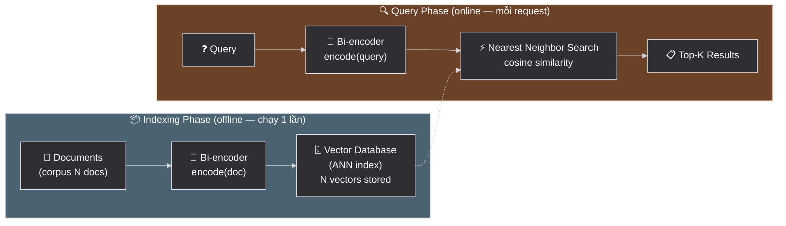

Trong đoạn trên, `ANN` là viết tắt của **Approximate Nearest Neighbor** — nhóm thuật toán dùng để tìm vector gần nhất thật nhanh trong tập dữ liệu lớn. Phần dưới sẽ quay lại giải thích cụ thể các thuật toán như HNSW, IVF và DiskANN.

### Asymmetric Search trong thực tế

Query và tài liệu có vai trò khác nhau:

- Query thường ngắn, nêu nhu cầu tìm kiếm, như “best practices for embedding”.
- Tài liệu cung cấp thông tin để trả lời, thường ở dạng đoạn văn hoặc trang web.

Model cần được báo đúng vai trò này khi mã hóa. Chọn sai vai trò có thể làm giảm chất lượng truy xuất dù model và vector database vẫn giữ nguyên.

Nhiều modern embedding models yêu cầu chỉ định `input_type`:
- `search_query` — cho câu hỏi/query (ngắn, hỏi thông tin)
- `search_document` — cho document/passage cần index (dài, chứa thông tin)

**Ví dụ ở mức mã giả:**
```text
# When indexing documents
# Xem Production Note ở §2.2 về batching và rate limits
document_embeddings = embed(
    texts=documents,
    input_type="search_document"
)

# When searching
query_embedding = embed(
    texts=[query],
    input_type="search_query"
)
```

⚠️ **Dùng sai input_type sẽ giảm chất lượng retrieval đáng kể** — model encode khác nhau cho query vs document. Đây là lỗi phổ biến khi mới bắt đầu.

Tên tham số và cách khai báo khác nhau giữa các provider (snapshot 11/2026):

| Provider / Model | Cách chỉ định vai trò |
|------------------|----------------------|
| Cohere `embed-v4.0`, `embed-v5.0-*` | `input_type="search_query"` / `"search_document"` (ngoài ra có `classification`, `clustering`; kiểm tra docs Embed 5 cho danh sách hiện hành) |
| Voyage (`voyage-4*`, `voyage-context-4`, ...) | `input_type="query"` / `"document"` — Voyage tự prepend prompt tương ứng |
| Google `gemini-embedding-001` | `task_type="RETRIEVAL_QUERY"` / `"RETRIEVAL_DOCUMENT"`, ... |
| Google `gemini-embedding-2` | **Không hỗ trợ `task_type`** — viết task prefix trực tiếp vào text theo hướng dẫn trong docs |
| Qwen3-Embedding | Instruction-aware: thêm instruction vào **query**, document giữ nguyên |
| Jina `jina-embeddings-v5-text` | Chọn task adapter (retrieval / text-matching / classification / clustering) |

**Asymmetric model retrieval (mới trong 2026)**: Voyage 4 series (`voyage-4-large`, `voyage-4`, `voyage-4-lite`, `voyage-4-nano`) và Cohere Embed 5 (`pro`/`fast`) dùng **shared embedding space** giữa các model trong cùng họ. Bạn có thể embed corpus một lần bằng model lớn (chất lượng cao), rồi embed query bằng model nhỏ (latency và cost thấp), sau đó nâng cấp model phía query mà **không phải re-embed corpus**. Chỉ áp dụng trong cùng một họ model; trộn model khác họ vẫn bắt buộc re-embed.

> Source: [Cohere Embed docs](https://docs.cohere.com/docs/cohere-embed), [SBERT — Semantic Search](https://www.sbert.net/examples/sentence_transformer/applications/semantic-search/README.html), [Voyage 4 blog](https://blog.voyageai.com/2026/01/15/voyage-4/), [Voyage Text Embeddings](https://docs.voyageai.com/docs/embeddings), [Cohere Embed 5](https://cohere.com/blog/embed-5), [Gemini Embeddings](https://ai.google.dev/gemini-api/docs/embeddings)

### Khi nào Dense Search đủ, khi nào cần Hybrid?

Trong khá nhiều sản phẩm, chỉ dùng **dense retrieval** đã cho chất lượng rất tốt. Điều này thường đúng khi:

- query được viết như câu tự nhiên, có nhiều paraphrase và synonym
- dữ liệu chủ yếu là nội dung mô tả, bài viết, FAQ, hoặc tài liệu giải thích
- người dùng quan tâm đến **ý nghĩa gần đúng** hơn là exact keyword
- hệ thống phải hỗ trợ đa ngôn ngữ hoặc nhiều cách diễn đạt khác nhau

Nhưng chỉ dùng dense retrieval thường chưa đủ an toàn khi:

- corpus có nhiều **mã lỗi**, **SKU**, **product code**, **số điều luật**, **tên riêng**, hoặc các cụm từ phải khớp thật chính xác
- người dùng hay gõ query ngắn theo kiểu từ khóa hơn là câu hỏi tự nhiên
- sai sót retrieval có chi phí cao, ví dụ legal search, medical search, enterprise search nội bộ

Nếu người dùng diễn đạt nhu cầu bằng câu tự nhiên, dense retrieval là điểm khởi đầu phù hợp. Khi tên riêng, mã lỗi hoặc thuật ngữ chính xác quyết định kết quả, nên kết hợp thêm BM25. Nhu cầu này xuất hiện trong cả tìm kiếm thông thường lẫn RAG.

### ANN Algorithms — Tìm kiếm nhanh trong triệu vectors

Sau khi documents hoặc passages đã được encode và lưu sẵn, bài toán còn lại là: với một query vector mới, làm sao tìm được các document vectors gần nhất đủ nhanh. Cách đơn giản nhất là brute-force search — so sánh query với **tất cả** N vectors, complexity O(N). Với vài nghìn documents thì ổn, nhưng khi N = hàng triệu hay hàng tỷ, brute-force trở nên quá chậm. ANN (Approximate Nearest Neighbor) algorithms giải quyết bằng cách **hy sinh một chút accuracy để đạt tốc độ sub-linear** — tìm "gần đúng" top-K vectors nhanh hơn nhiều lần.

#### HNSW (Hierarchical Navigable Small World)

**Cách hoạt động**: Xây một **multi-layer graph** trên tập vectors. Layer cao nhất chỉ có vài nodes (long-range connections), layer thấp nhất có tất cả nodes (short-range connections). Search bắt đầu từ layer cao → nhảy nhanh đến vùng gần đúng → xuống layer thấp → tìm chính xác trong vùng lân cận.

**Tại sao hay dùng?** Vì HNSW thường cho latency thấp và recall cao trong nhiều use case search thực tế. Đổi lại, nó tốn RAM và không phải lựa chọn rẻ nhất khi corpus rất lớn. (Chi tiết tuning params `m`, `ef_construction`, `ef_search` → xem [HNSW Tuning Parameters](#hnsw-tuning-parameters) ở §3.2)

#### IVF (Inverted File Index)

**Cách hoạt động**: Chia không gian vector thành K clusters (bằng K-means). Mỗi cluster lưu danh sách vectors thuộc cluster đó. Khi search: tìm cluster gần nhất với query → chỉ search trong cluster đó (và vài clusters lân cận).

**Khi nào hợp lý?** Khi muốn tiết kiệm memory hơn graph-based search. Đổi lại, IVF cần bước partition trước và thường nhạy hơn với cách dữ liệu được phân cụm.

#### DiskANN

**Cách hoạt động**: Giống HNSW nhưng lưu graph trên **disk** thay vì RAM. Dùng SSD random reads thay vì memory access.

**Khi nào dùng?** Khi dataset quá lớn cho RAM nhưng vẫn cần giữ chất lượng search tốt. Đổi lại, latency thường cao hơn in-memory ANN.

| Algorithm | Ý tưởng | Điểm mạnh chính | Trade-off chính | Dùng trong |
|-----------|---------|-----------------|-----------------|-----------|
| **HNSW** | Multi-layer graph | Nhanh, recall cao | Tốn RAM | Qdrant, Weaviate, pgvector, Pinecone |
| **IVF** | K-means partition | Ít memory hơn | Cần partition/training trước | FAISS, Milvus |
| **DiskANN** | Graph trên SSD | Scale rất lớn | Latency cao hơn in-memory | Milvus |

> ANN đánh đổi độ chính xác lấy tốc độ. Chọn thuật toán và tham số cần dựa trên mức recall và độ trễ hệ thống chấp nhận được; Phần 3 bàn tiếp cách đo và điều chỉnh.

> Sources: [FAISS wiki — Indexes](https://github.com/facebookresearch/faiss/wiki/Faiss-indexes), [HNSW paper — Malkov & Yashunin, 2018](https://arxiv.org/abs/1603.09320), [SBERT — Semantic Search](https://www.sbert.net/examples/sentence_transformer/applications/semantic-search/README.html)

---

## 2.2 RAG + Rerank (Pipeline 3 giai đoạn)

Một LLM không có sẵn tài liệu nội bộ hoặc những thay đổi mới nhất của sản phẩm trong dữ liệu huấn luyện. RAG tìm thông tin cần thiết rồi đưa vào ngữ cảnh để model trả lời. Chất lượng của bước tìm kiếm vì thế ảnh hưởng trực tiếp đến câu trả lời cuối.

### Tổng quan — Tại sao cần RAG?

**Retrieval-Augmented Generation (RAG)** kết hợp truy xuất tài liệu với việc sinh câu trả lời của LLM. Nhu cầu này xuất phát từ các giới hạn sau:

1. **LLM chỉ biết training data** — knowledge bị đóng băng tại cutoff date. Không biết tài liệu nội bộ công ty, sản phẩm mới, hay tin tức hôm nay
2. **Không thể retrain liên tục** — fine-tuning tốn kém (GPU hours, data preparation) và vẫn không giải quyết real-time data
3. **Cần inject context vào prompt** — đưa thông tin liên quan vào prompt để LLM trả lời dựa trên context thực tế
4. **Nhưng context window có giới hạn** — không thể đưa toàn bộ database vào prompt (128K tokens ≈ 100 trang — vẫn quá nhỏ cho enterprise data)
5. **→ Cần retrieval để chọn context phù hợp nhất** — tìm đúng 3-10 chunks liên quan nhất từ hàng triệu documents → đưa vào prompt → LLM sinh câu trả lời **grounded trong actual documents**

**Kết quả**: RAG giảm hallucination (answer có nguồn), knowledge luôn up-to-date (chỉ cần update database), và không cần retrain LLM.

### Diagram: RAG + Rerank Pipeline

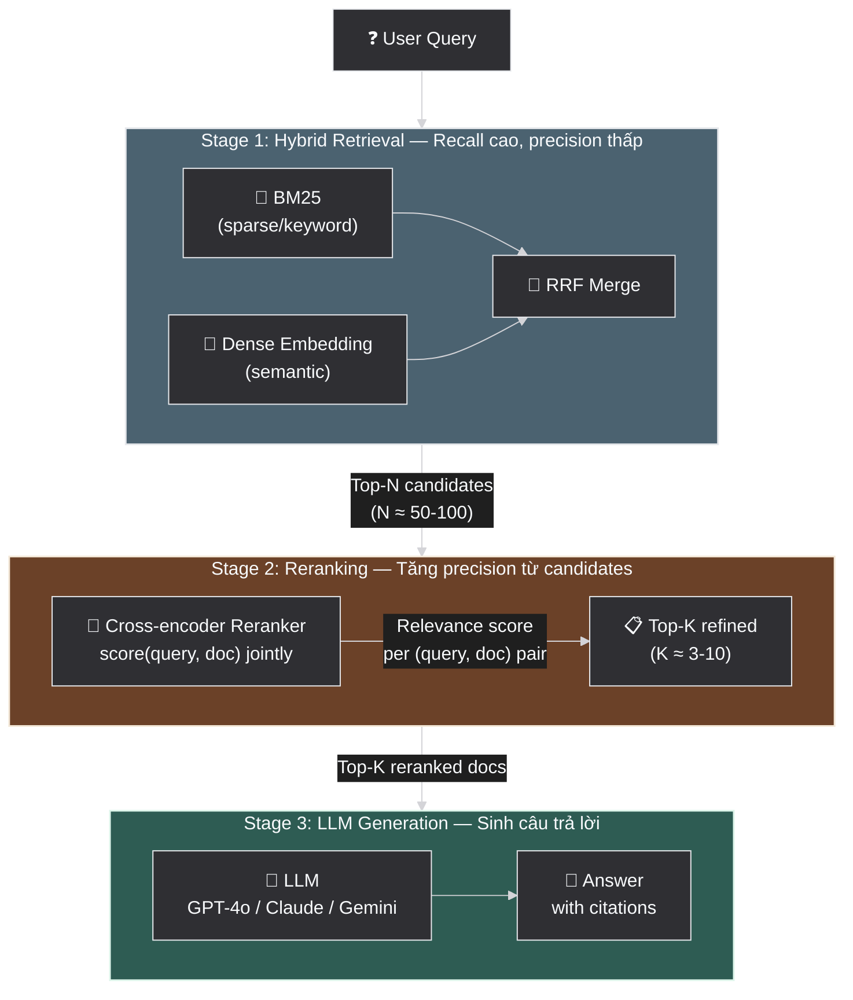

### Nguyên tắc quan trọng: Optimize Recall trước Rerank

> **Reranker chỉ sắp xếp lại tập tài liệu đã tìm được. Nó không bổ sung tài liệu mà Stage 1 bỏ sót.**

Nếu Stage 1 trả về 100 ứng viên nhưng không có tài liệu chứa câu trả lời, reranker và LLM đều không được đọc tài liệu đó. Vì vậy:
- Ở Stage 1, ưu tiên **Recall@N** hơn **Precision@N**.
- Lấy tập ứng viên đủ rộng (N = 50-100) để tăng recall.
- Dùng Stage 2 để cải thiện precision trên tập ứng viên này.
- **Chunking** cũng ảnh hưởng đến recall: cắt giữa câu trả lời có thể khiến vector không biểu diễn đủ ý và tài liệu bị bỏ sót. Xem [Section 3.3](#33-chunking-strategies).

### Stage 1: Hybrid Retrieval (BM25 + Dense)

Dense, sparse và hybrid retrieval đã được giải thích ở [Section 1.4.4](#144-dense-sparse-hybrid). Trong RAG, ba khái niệm này gặp nhau ở đúng chỗ retrieval phải đủ rộng để không bỏ sót đoạn chứa câu trả lời.

BM25 giữ tín hiệu từ khóa chính xác; dense embedding giúp tìm các cách diễn đạt cùng nghĩa. Hai cách này bổ sung cho nhau:

| Method | Mạnh — và tại sao | Yếu — và tại sao |
|--------|-------------------|-------------------|
| **BM25 (Sparse)** | Exact keyword match: tên riêng ("GPT-4o"), mã sản phẩm ("SKU-1234"), thuật ngữ chuyên ngành ("habeas corpus"). Vì BM25 so sánh **token chính xác** → không bỏ sót rare terms | Không hiểu synonyms ("mèo" ≠ "cat"), paraphrases ("how to fix" ≠ "troubleshooting guide"). Vì BM25 chỉ match **surface form**, không hiểu semantics |
| **Dense Embedding** | Semantic similarity: paraphrases, đa ngôn ngữ, câu hỏi tự nhiên. Vì embedding capture **ý nghĩa** thay vì từ ngữ → "fix bug" gần "debug error" | Yếu exact match: rare terms, proper nouns, product codes. Vì embedding **nén toàn bộ câu thành 1 vector** → mất chi tiết token-level |

**Reciprocal Rank Fusion (RRF)** — merge 2 ranked lists **không cần normalize scores**:

$$\text{RRF\_score}(d) = \sum_{i} \frac{1}{k + \text{rank}_i(d)}$$

Điểm BM25 dạng TF-IDF (0-30+) và cosine similarity từ dense retrieval (0-1) không dùng chung thang đo. RRF tránh so sánh trực tiếp hai loại điểm bằng cách dùng thứ hạng của tài liệu trong từng danh sách. Hằng số `k` (thường = 60) làm dịu chênh lệch đóng góp giữa các vị trí; tài liệu đứng cao ở cả hai danh sách nhận điểm gộp cao.

**Tỷ lệ dense/sparse**: Heuristic phổ biến **70-80% dense + 20-30% sparse**, nhưng phụ thuộc domain:
- **Legal/medical**: sparse cao hơn (40-50%) vì exact terminology quan trọng ("Section 230", "myocardial infarction")
- **Casual Q&A**: dense cao hơn (80-90%) vì users diễn đạt tự nhiên, nhiều paraphrases
- **Không có chuẩn cố định** — phải tune trên eval data của domain mình

### Stage 2: Reranking — Tăng precision trên tập candidates nhỏ

Khác biệt giữa bi-encoder và cross-encoder ở [Section 1.4.1](#141-bi-encoder-vs-cross-encoder) dẫn đến cách chia việc trong RAG:

- **Stage 1** dùng retriever nhanh để lấy ra một tập candidates đủ rộng
- **Stage 2** dùng reranker chính xác hơn để đọc lại từng cặp `(query, chunk)` trong tập nhỏ đó

Reranking hiệu quả hơn retrieval ở bước này vì:

- retriever nén mỗi chunk thành một vector để giữ scale, nên dễ mất chi tiết token-level
- reranker nhìn query và chunk **cùng lúc**, nên thấy được các tín hiệu khớp tinh vi hơn
- số lượng candidates lúc này chỉ còn khoảng `50-100`, nên chi phí chấm từng cặp là chấp nhận được

| Giai đoạn | Mục tiêu chính | Loại model thường dùng | Quy mô xử lý |
|-----------|----------------|------------------------|--------------|
| **Stage 1 — Retrieve** | Maximize recall | Bi-encoder / hybrid retrieval | Hàng triệu chunks |
| **Stage 2 — Rerank** | Tăng precision | Cross-encoder reranker | ~50-100 candidates |

**Reranker models nổi bật:**
- **Voyage `rerank-3` / `rerank-3-lite`** (09/2026) — managed API, 32k context/document, instruction-following, $0.05 / $0.02 per 1M tokens; score được calibrate tương thích `rerank-2.5` nên threshold cũ vẫn dùng được. — [blog](https://blog.voyageai.com/2026/09/30/rerank-3/)
- **Cohere Rerank 5** (`rerank-v5.0-pro` / `-fast`) — managed API, multilingual, 32k context, hỗ trợ semi-structured JSON, *Context Focus* (trả về passage liên quan nhất trong mỗi document) và calibrated relevance scores. — [docs](https://docs.cohere.com/docs/models#rerank)
- **Open-weight**: `Qwen3-Reranker` (0.6B/4B/8B), `jina-reranker-v3.5`, `mxbai-rerank-large-v2`, BGE Reranker — self-hosted, hỗ trợ multilingual (kiểm tra license trước khi dùng thương mại)
- **ColBERT** (Contextualized Late Interaction over BERT) — **middle ground** giữa bi-encoder và cross-encoder:

  ColBERT mã hóa query và tài liệu riêng, nhưng giữ vector của từng token thay vì gộp toàn bộ thành 1 vector. Khi chấm điểm bằng **MaxSim**, mỗi token của query tìm token phù hợp nhất trong tài liệu; hệ thống cộng các điểm khớp đó lại.

  Giữ biểu diễn theo token giúp bảo toàn chi tiết hơn bi-encoder dùng một vector. Việc mã hóa độc lập vẫn cho phép tính trước vector của tài liệu, nên khi nhận query chỉ còn bước tính MaxSim, giảm công việc so với cross-encoder.

  > Source: [ColBERT paper — Khattab & Zaharia, 2020](https://arxiv.org/abs/2004.12832)

### Reasoning-intensive Retrieval — Khi "giống nhau" không còn nghĩa là "liên quan"

Toàn bộ pipeline ở trên ngầm dựa vào một giả định: **tài liệu liên quan thì có nghĩa gần với câu hỏi**. Giả định này đúng với phần lớn câu hỏi tra cứu thông thường ("chính sách đổi trả là gì?"), nhưng sụp đổ với một lớp câu hỏi khác: những câu hỏi mà muốn biết tài liệu nào hữu ích thì phải **suy luận** trước.

**Ví dụ để hình dung:**

- Câu hỏi: *"Vì sao vòng lặp này của tôi chạy đúng với list 10 phần tử nhưng treo với list 1 triệu phần tử?"*
- Tài liệu thật sự hữu ích: một trang giải thích **độ phức tạp O(n²) của `list.remove()`** trong Python.
- Hai văn bản gần như **không chia sẻ từ khóa** và cũng **không nói về cùng một chủ đề bề mặt**. Người đọc có kinh nghiệm nhận ra liên hệ nhờ suy luận ("treo khi n lớn → có thể là độ phức tạp bậc hai → thao tác nào trong vòng lặp là O(n)?"), nhưng bi-encoder chỉ so sánh hai vector đã nén sẵn nên không có chỗ nào để thực hiện bước suy luận đó.

#### Cơ chế: vì sao bi-encoder thất bại ở đây?

Bi-encoder (xem [§1.4.1](#141-bi-encoder-vs-cross-encoder)) encode query và document **độc lập**, rồi so sánh bằng cosine. Điều này có nghĩa là mọi "hiểu biết" về mối liên hệ giữa query và document phải được **nén sẵn vào vị trí của từng vector** trước khi hai bên gặp nhau. Với câu hỏi tra cứu, vị trí đó phản ánh chủ đề — đủ dùng. Với câu hỏi cần suy luận, liên hệ nằm ở **chuỗi lập luận trung gian**, mà chuỗi này không thuộc về riêng query hay riêng document, nên không vector nào chứa được nó.

#### Bằng chứng định lượng: benchmark BRIGHT

BRIGHT (Su et al., ICLR 2025) là benchmark retrieval đầu tiên được xây riêng cho loại câu hỏi này: **1.398 câu hỏi thực tế** từ StackExchange (kinh tế, tâm lý, robotics, kỹ thuật phần mềm…), lập trình và toán (kiểu "tìm định lý giúp giải bài này").

| Quan sát | Con số (theo paper) |
|----------|--------------------|
| Model đứng đầu MTEB lúc đó trên BEIR | nDCG@10 = **59.0** |
| Cùng model đó trên BRIGHT | nDCG@10 = **18.0** |
| Cải thiện khi cho LLM viết ra lập luận về câu hỏi rồi dùng lập luận đó để search | lên tới **+12.2 điểm** |

Kết quả này cho thấy thứ hạng cao trên benchmark truyền thống chưa đủ để chọn model cho câu hỏi cần suy luận. Cần đo riêng nhóm câu hỏi này trong tập đánh giá của sản phẩm.

#### Các hướng xử lý

1. **Query rewriting / expansion bằng LLM**: trước khi search, cho LLM viết lại câu hỏi hoặc liệt kê các khái niệm có thể liên quan ("có thể là vấn đề độ phức tạp; xem `list.remove`, `collections.deque`…"). Biến thể nổi tiếng là **HyDE** (Gao et al., 2022): cho LLM viết một *tài liệu giả định* trả lời câu hỏi, rồi embed tài liệu giả đó thay cho câu hỏi. Ý tưởng là tài liệu giả nằm gần tài liệu thật hơn là câu hỏi gốc.
2. **Reasoning reranker**: dùng reranker có khả năng suy luận (hoặc LLM-as-reranker) ở Stage 2, vì reranker nhìn query và document cùng lúc nên có chỗ để suy luận.
3. **Retriever được train cho suy luận**: một số model như ReasonIR (Meta, 2025) được train trên dữ liệu tổng hợp có tính suy luận, nhằm đưa một phần khả năng này vào chính bi-encoder.
4. **Agentic search**: để agent search nhiều vòng, đọc kết quả, rồi tự đặt câu hỏi tiếp theo. Mạnh nhất nhưng đắt nhất (xem cảnh báo bên dưới).

#### Instruction-following Retrieval và Reranker

Một nhánh liên quan là cho phép người dùng **nói rõ tiêu chí relevance** bằng ngôn ngữ tự nhiên, thay vì để model tự đoán. Ví dụ: *"Tìm tài liệu về lỗi thanh toán, **chỉ lấy tài liệu sau 2025 và bỏ qua tài liệu marketing**"*.

- Ở phía retriever: Promptriever, FollowIR (Weller et al., 2024) nghiên cứu việc train retriever biết làm theo instruction. Qwen3-Embedding cũng nhận instruction ở phía query.
- Ở phía reranker: Voyage `rerank-2.5` / `rerank-3` hỗ trợ instruction-following (được đánh giá trên benchmark MAIR); Cohere Rerank 5 có *Context Focus*.

Instruction đặc biệt hữu ích khi "liên quan" phụ thuộc vào ngữ cảnh nghiệp vụ mà embedding chung chung không biết: phiên bản sản phẩm, vai trò người hỏi, loại tài liệu ưu tiên.

> **Giới hạn và cách kiểm soát lỗi khi retrieval cần suy luận**
>
> - **"Model top MTEB thì search tốt mọi loại câu hỏi"** — sai. BRIGHT cho thấy cùng một model có thể rơi từ 59 xuống 18 nDCG@10. Nếu sản phẩm của bạn là trợ lý kỹ thuật, pháp lý hay y khoa, hãy chủ động đưa câu hỏi cần suy luận vào eval set.
> - **Query rewriting có thể bịa**: LLM viết lại câu hỏi có thể chèn thuật ngữ không tồn tại trong corpus, kéo retrieval sang hướng sai một cách *tự tin*. Luôn giữ thêm một nhánh search bằng câu hỏi gốc và fuse kết quả (RRF, xem §3.5), thay vì thay thế hoàn toàn.
> - **HyDE nhân đôi chi phí và độ trễ** cho mỗi query (một lần gọi LLM sinh văn bản trước khi embed). Với chatbot cần trả lời dưới 1 giây, đây thường là cái giá quá đắt cho mọi câu hỏi; hãy dùng routing để chỉ bật cho các câu hỏi khó.
> - **Agentic search có thể lặp vô hạn hoặc phình chi phí**: luôn đặt giới hạn số vòng, ngân sách token và điều kiện dừng rõ ràng; log toàn bộ trajectory để debug.
> - **Instruction không phải access control**: viết "bỏ qua tài liệu mật" trong instruction **không** đảm bảo tài liệu mật không bị trả về. Phân quyền phải làm bằng filter cứng ở tầng dữ liệu (xem §3.8).
>
> Sources: [BRIGHT — Su et al., ICLR 2025](https://arxiv.org/abs/2407.12883), [HyDE — Gao et al., 2022](https://arxiv.org/abs/2212.10496), [FollowIR — Weller et al., 2024](https://arxiv.org/abs/2403.15246), [Promptriever — Weller et al., 2024](https://arxiv.org/abs/2409.11136), [Voyage rerank-3](https://blog.voyageai.com/2026/09/30/rerank-3/)

### Context Assembly — Từ top-K chunks đến prompt cuối

Sau reranking, hệ thống cần chọn những chunk sẽ đưa vào prompt, thứ tự của chúng và phần có thể lược bớt. Danh sách top-K chưa tự tạo thành một ngữ cảnh tốt.

Các bước cần xem xét:

- **Bỏ trùng lặp**: nhiều chunks có thể nói cùng một ý bằng câu chữ hơi khác nhau; nếu nhét tất cả vào prompt, ta chỉ lãng phí token budget
- **Ưu tiên evidence trực tiếp**: đoạn nào trả lời đúng trọng tâm câu hỏi nên được đưa lên trước; background chỉ nên thêm khi thật sự giúp hiểu ngữ cảnh
- **Giữ metadata quan trọng**: tiêu đề, nguồn, section name, timestamp hoặc document ID thường giúp LLM trích dẫn và diễn giải đúng hơn
- **Sắp xếp có chủ đích**: có hệ thống xếp theo relevance score, có hệ thống gom theo tài liệu gốc rồi giữ thứ tự tự nhiên trong tài liệu để tránh mất mạch
- **Tôn trọng token budget**: ba chunks ngắn nhưng sắc thường hữu ích hơn mười chunks dài và loãng

Nếu context assembly làm không tốt, retrieval có thể đúng mà câu trả lời cuối vẫn kém: evidence chính bị chìm giữa các đoạn phụ, prompt lặp ý, citations rối, hoặc hai đoạn mâu thuẫn bị đặt cạnh nhau mà không có tín hiệu phân giải.

### Stage 3: LLM Generation

LLM nhận top-K reranked documents làm context → generate câu trả lời có citations. Chất lượng answer **phụ thuộc trực tiếp vào chất lượng retrieved chunks** — đây là lý do optimize Stage 1 và Stage 2 quan trọng hơn chọn LLM nào.

Prompt thường yêu cầu:
- Chỉ trả lời dựa trên context (giảm hallucination)
- Trích dẫn nguồn [1], [2] cho mỗi claim
- Nói "không biết" nếu context không chứa câu trả lời

### Evaluation Metrics cho RAG

| Giai đoạn | Metric | Ý nghĩa | Tại sao quan trọng |
|-----------|--------|---------|-------------------|
| **Stage 1** | Recall@N | Bao nhiêu relevant docs nằm trong N candidates? | Reranker không thể recover docs bị miss → recall là ceiling |
| **Stage 2** | nDCG@K | Relevant docs có ở vị trí cao trong top-K? | Docs ở vị trí 1-3 ảnh hưởng LLM nhiều hơn vị trí 8-10 |
| **Stage 3** | Faithfulness | Answer có grounded trong context? | Phát hiện hallucination — LLM bịa thông tin không có trong context |
| **Stage 3** | Answer Relevance | Answer có trả lời đúng câu hỏi? | Context đúng nhưng LLM trả lời lạc đề |

> Sources: [RAG paper — Lewis et al., 2020](https://arxiv.org/abs/2005.11401), [Pinecone Rerankers Guide](https://docs.pinecone.io/guides/search/rerank-results), [Cohere Rerank Overview](https://docs.cohere.com/docs/rerank-overview), [SBERT Retrieve & Re-rank](https://www.sbert.net/examples/sentence_transformer/applications/retrieve_rerank/README.html)

### Mã giả: Retrieve → Rerank → Generate

```text
query = "What is Matryoshka Representation Learning?"

# Stage 1: retrieve a broad candidate set
# ⚠️ Production: xem Production Note bên dưới về batching, rate limits và retry
query_embedding = embed(query)
candidates = hybrid_retrieve(
    query=query,
    query_embedding=query_embedding,
    top_n=50
)

# Stage 2: rerank for precision
top_results = rerank(
    query=query,
    documents=candidates,
    top_k=5
)

# Stage 3: generate with grounded context
context = build_context(top_results)
answer = generate(
    question=query,
    context=context,
    instruction="Answer only from the provided context and cite evidence"
)

return answer
```

> ### 🔧 Production Note: Rate Limits, Batching & Retry
>
> Pseudocode trong tài liệu này gọi `embed()` đơn giản để tập trung vào logic. Trong production, mọi chỗ gọi `embed()` đều cần xử lý thêm:
>
> **Rate Limits** — Embedding APIs giới hạn theo **TPM** (tokens per minute) và **RPM** (requests per minute). Vượt ngưỡng → HTTP 429. Cần track usage và throttle.
>
> **Batching** — Gửi nhiều texts trong một request thay vì loop từng cái:
> ```text
> # ❌ Chậm: 1 request per text
> for text in texts:
>     vec = embed([text])
>
> # ✅ Nhanh: batch nhiều texts
> for batch in chunk_list(texts, batch_size=100):
>     vecs = embed(batch)
> ```
> Giới hạn batch size phụ thuộc provider (OpenAI: 2048 inputs/request, Gemini: 100, Cohere: 96, Voyage: 1000 inputs và tổng 120K-1M tokens/request tùy model). Kiểm tra docs của provider đang dùng.
>
> **Batch API cho ingestion lớn** — khi re-embed corpus không cần kết quả ngay: Voyage Batch API giảm 33% (cửa sổ 12h), Gemini Batch API giảm ~50%, Cohere có Embed Jobs.
>
> **Retry với Exponential Backoff** — Khi gặp 429 hoặc 5xx, retry với delay tăng dần:
> ```text
> # Pattern: retry with exponential backoff
> # Python: dùng tenacity library
> @retry(wait=wait_exponential(min=1, max=60), stop=stop_after_attempt(5))
> def embed_with_retry(texts):
>     return embed(texts)
> ```
>
> | Vấn đề | Giải pháp | Tool / Thư viện |
> |--------|-----------|-----------------|
> | Rate limit (429) | Throttle + exponential backoff | `tenacity`, `backoff`, built-in SDK retry |
> | Batch overhead | Batch texts, respect provider limits | Manual chunking hoặc SDK batching |
> | Timeout | Set timeout per request + retry | `httpx`, `aiohttp` timeout config |
> | Partial failure | Retry failed batches, idempotent design | Custom retry logic |
>
> ⚠️ Note: Production Note này áp dụng cho **mọi chỗ dùng `embed()`** trong tài liệu — bao gồm cả `multimodal_embed()` ở §2.8.

---

## 2.3 Clustering (Phân cụm)

### Clustering dùng để khám phá cấu trúc dữ liệu

Trong hàng nghìn bài viết có những nhóm chủ đề nào? Khách hàng đang phàn nàn về những vấn đề gì? Với những câu hỏi này, ta cần khám phá cấu trúc của dữ liệu, thay vì tìm tài liệu khớp một query như ở §2.1 và §2.2. **Clustering** gom các vector gần nhau thành cụm mà không cần nhãn cho từng mẫu (unsupervised).

**Use cases thực tế:**
- **Topic discovery**: gom hàng nghìn bài viết thành nhóm chủ đề (AI, finance, health...) → tự động tạo taxonomy
- **Customer segmentation**: phân loại feedback/reviews theo chủ đề → biết khách hàng phàn nàn về gì nhiều nhất
- **Data exploration**: khám phá cấu trúc ẩn trong dataset trước khi build models → hiểu distribution
- **Content organization**: tự động tạo categories cho knowledge base → routing câu hỏi đến đúng team
- **Anomaly triage**: cluster support tickets → ticket nào không thuộc cluster nào = potentially new issue

### Khi nào dùng Clustering, khi nào nên Classification?

Clustering và classification đều là cách gom dữ liệu thành nhóm, nhưng chúng phục vụ hai giai đoạn rất khác nhau của bài toán.

- **Clustering** phù hợp khi chưa có labels rõ ràng, hoặc chính ta còn chưa biết taxonomy nên trông như thế nào
- **Classification** phù hợp khi categories đã ổn định và hệ thống cần gán nhãn **nhất quán** cho dữ liệu mới

Có thể dùng kết quả phân cụm để xây bộ nhãn cho classifier:

1. dùng clustering để nhìn ra các nhóm chủ đề tự nhiên trong dữ liệu
2. con người đọc các cụm, chỉnh sửa và đặt tên taxonomy
3. khi taxonomy đã đủ ổn định, chuyển sang classification để gán nhãn tự động với chất lượng lặp lại được

Vì vậy, clustering thường là bước rất tốt ở đầu dự án hoặc khi domain thay đổi nhanh. Nhưng nếu tổ chức đã có bộ nhãn rõ ràng và cần dự đoán đáng tin cậy cho từng record mới, classification thường là công cụ phù hợp hơn.

### Lưu ý quan trọng: Curse of Dimensionality

Với K-means hay HDBSCAN ở phần dưới, bước đầu tiên bạn nghĩ đến có thể là đưa embeddings (1536 dims) **thẳng vào** clustering algorithm. Đây là sai lầm phổ biến.

> ⚠️ **Embedding vectors 1536 dims không nên cluster trực tiếp.**

**Tại sao?** Clustering algorithms dựa vào **khoảng cách** để phân biệt "gần" vs "xa" — nhưng trong không gian chiều cao (high-dimensional space), khoảng cách giữa mọi cặp điểm **converge về cùng một giá trị**. Hiện tượng này gọi là **curse of dimensionality**: khi số chiều tăng, tỷ lệ giữa khoảng cách gần nhất và xa nhất tiến về 1. Hệ quả: algorithm không phân biệt được điểm nào "gần" vs "xa" → cluster boundary mờ nhạt → kết quả kém.

Ngoài chuyện hình học trở nên kém phân biệt, số chiều cao còn làm compute tăng rất nhanh. Chỉ riêng việc quét brute-force qua `1 triệu` vectors `1536` chiều đã đòi hỏi cỡ `1.5 tỷ` phép nhân-cộng cho một lượt so sánh toàn bộ, nên đây vừa là vấn đề chất lượng, vừa là vấn đề hiệu năng.

**Giải pháp**: Giảm chiều trước khi cluster:
- **UMAP** (50-100 dims) cho clustering — giữ cấu trúc local neighborhood
- **PCA** (50-100 dims) nếu cần tốc độ — linear, deterministic
- **UMAP** (2-3 dims) cho visualization — nhưng **không dùng 2D UMAP output để cluster** (mất quá nhiều thông tin)

> 💡 **Encode đúng task trước khi cluster** (snapshot 11/2026): nhiều model cho embedding tốt hơn cho clustering khi được báo đúng task, ví dụ Cohere `input_type="clustering"`, Gemini `gemini-embedding-001` `task_type="CLUSTERING"`, Jina v5 dùng clustering adapter, Qwen3-Embedding thêm instruction mô tả tiêu chí gom nhóm. Riêng `gemini-embedding-2` không nhận `task_type`; thay vào đó viết task prefix vào text. Embedding được encode cho retrieval (`query`/`document`) vẫn cluster được, nhưng nên so sánh trên dữ liệu thật.

### K-means — Phù hợp nhất khi các cụm có hình dạng gần giống hình cầu

K-means là thuật toán clustering phổ biến nhất vì đơn giản và nhanh. Thuật toán bắt đầu bằng việc đặt trước `K` điểm đại diện vào dữ liệu, rồi liên tục cập nhật các điểm đại diện đó về giữa nhóm điểm đang thuộc về chúng. Trong K-means, điểm đại diện này gọi là **centroid**, tức **tâm của cụm**.

**Cách hoạt động:**
1. Chọn trước số cụm `K`, rồi đặt `K` centroid ban đầu vào dữ liệu
2. Mỗi điểm dữ liệu được gán vào centroid gần nhất
3. Với mỗi cụm, tính lại centroid = **trung bình** (mean) của tất cả điểm trong cụm đó
4. Lặp lại bước 2-3 cho đến khi các centroid gần như không còn thay đổi nữa

> K-means thường dùng **L2 distance** (Euclidean distance), tức khoảng cách đường thẳng giữa hai điểm trong không gian vector.

**Mục tiêu tối ưu**: giảm **inertia** xuống thấp nhất. Có thể hiểu inertia là **tổng bình phương khoảng cách từ mỗi điểm đến tâm cụm của nó**:

$$\text{Inertia} = \sum_{i=1}^{N} \|x_i - \mu_{c(i)}\|^2$$

Nói cách khác, K-means tìm cách đưa các điểm trong cùng cụm lại gần tâm cụm của chúng.

**Vì sao K-means phù hợp nhất khi các cụm gần giống hình cầu?** Đây là hệ quả trực tiếp từ cách thuật toán hoạt động:

1. Mỗi điểm luôn được gán cho **tâm gần nhất**
2. Vì vậy, mỗi cụm thực chất là một vùng dữ liệu **bao quanh một tâm**
3. Cách chia này hợp với các cụm tương đối **tròn**, gọn và có kích thước không quá lệch nhau
4. Ngược lại, nếu cụm có hình dạng **dài**, **cong**, hoặc một cụm rất dày còn cụm khác rất thưa, K-means thường chia không tốt

Hai tình huống thường gặp:
- Nếu dữ liệu trông như vài "đám mây điểm" tròn, tách nhau khá rõ, K-means thường hoạt động ổn
- Nếu dữ liệu trông như hai dải dài hoặc hai hình lưỡi liềm, K-means vẫn cố chia theo các vùng quanh tâm cụm, nên dễ cắt sai

| Ưu điểm | Nhược điểm |
|---------|------------|
| Đơn giản, dễ hiểu | Phải chỉ định trước K (số cụm) |
| Nhanh — O(NKd) mỗi iteration | Phù hợp nhất khi các cụm khá tròn và không quá lệch nhau về kích thước |
| Scale tốt đến triệu điểm | Nhạy cảm với khởi tạo (dùng k-means++) |
| Kết quả lặp lại được khi fix seed | Không xử lý outlier — mỗi điểm **buộc phải** thuộc 1 cluster |

**Chọn K**: dùng **Elbow method** (plot inertia vs K, chọn "khuỷu tay" — điểm mà tăng K không giảm inertia đáng kể) hoặc **Silhouette score**.

**Silhouette score** — đo chất lượng clustering:

$$s(i) = \frac{b(i) - a(i)}{\max(a(i), b(i))}$$

Trong đó:
- `a(i)` = khoảng cách trung bình từ điểm i đến **các điểm cùng cluster** (intra-cluster)
- `b(i)` = khoảng cách trung bình từ điểm i đến **cluster gần nhất** khác (inter-cluster)
- Score gần **+1** = điểm nằm rõ trong cluster. Score gần **0** = overlapping. Score **âm** = có thể sai cluster.

Diễn giải thực tế:
- **Silhouette cao** = các cụm tách nhau khá rõ
- **Silhouette gần 0** = các cụm chồng lấn nhiều
- **Silhouette âm** = có điểm nhiều khả năng đang bị gán sai cụm

> Source: [scikit-learn K-means](https://scikit-learn.org/stable/modules/generated/sklearn.cluster.KMeans.html)

### HDBSCAN — Khi Clusters có Density khác nhau

HDBSCAN tìm các vùng có nhiều điểm nằm gần nhau. Cách này linh hoạt hơn khi cụm không tròn hoặc có mật độ khác nhau: thuật toán không cần ép dữ liệu vào đúng `K` nhóm đã chọn trước.

**Cách hoạt động ở mức khái quát:**
1. Tìm những vùng mà nhiều điểm nằm sát nhau
2. Gom các vùng dày đặc đó thành cụm
3. Nếu một điểm nằm lẻ loi, không thực sự thuộc vùng dày đặc nào, HDBSCAN có thể coi nó là **noise** thay vì ép nó vào một cụm
4. Từ cấu trúc đó, thuật toán tự quyết định nên có bao nhiêu cụm là hợp lý

Về mặt thuật toán, HDBSCAN vẫn có những khái niệm như `core distance`, `mutual reachability distance`, hay một cấu trúc cây để tìm ra các cụm ổn định nhất. Ở mức ứng dụng, điều cần nắm là:

- nó tìm cụm dựa trên **vùng dày đặc**
- nó **không bắt buộc** mọi điểm phải thuộc một cụm
- nó có thể tự quyết định số cụm thay vì buộc ta chọn trước `K`

**Vì sao HDBSCAN thường hợp hơn K-means cho embeddings?** Vì dữ liệu thực tế hiếm khi đẹp như vài cụm tròn, đều nhau:
- Có cụm rất lớn, có cụm rất nhỏ
- Có cụm đậm đặc, có cụm thưa hơn
- Có nhiều điểm "lạc đàn" không thật sự thuộc chủ đề nào rõ ràng
- Có những cụm kéo dài hoặc méo, không tròn

Trong các trường hợp đó, HDBSCAN thường linh hoạt hơn K-means.

| Ưu điểm | Nhược điểm |
|---------|------------|
| **Tự xác định số cụm** — không cần chỉ định K | Chậm hơn K-means ở scale lớn |
| Phát hiện **outlier/noise** (label = -1) | Cần tune `min_cluster_size` |
| Xử lý tốt hơn khi cụm có mật độ/hình dạng khác nhau | Kết quả phụ thuộc vào hyperparameters |
| Robust với noise trong data | Khó scale >1M points (có approximate modes) |

> Source: [scikit-learn HDBSCAN](https://scikit-learn.org/stable/modules/generated/sklearn.cluster.HDBSCAN.html), [HDBSCAN paper — Campello et al., 2013](https://link.springer.com/chapter/10.1007/978-3-642-37456-2_14)

### K-means vs HDBSCAN — Decision Tree

Có thể tóm tắt việc chọn thuật toán như sau:
- **K-means**: dùng khi bạn biết trước số cụm và dữ liệu khá gọn, khá sạch
- **HDBSCAN**: dùng khi dữ liệu lộn xộn hơn, có noise, hoặc bạn chưa biết rõ nên chia thành bao nhiêu cụm

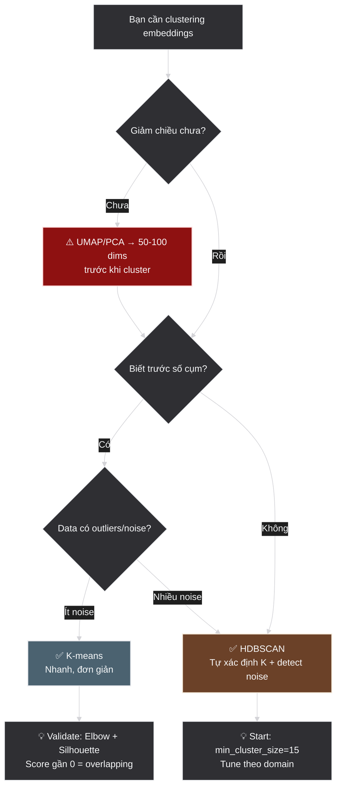

Sau khi chọn thuật toán, cần kiểm tra các cụm có đáng tin và có ích cho công việc hay không. Một biểu đồ UMAP 2D tách cụm rõ chỉ là điểm bắt đầu cho việc kiểm tra đó.

### Đánh giá Cluster — UMAP 2D chỉ là một phần của câu chuyện

UMAP 2D plot có thể trông rất đẹp nhưng vẫn **gây hiểu nhầm**. Trong quá trình chiếu dữ liệu từ không gian nhiều chiều xuống 2D, UMAP có thể làm xuất hiện các cụm nhìn có vẻ tách biệt dù trong không gian gốc chúng không tách rõ, hoặc ngược lại làm các cụm thật bị dính vào nhau. Vì vậy, việc đánh giá cluster nên đi theo một quy trình đầy đủ hơn:

1. **Chuẩn hóa embeddings** trước khi cluster (nếu đang làm việc theo cosine similarity)
2. **Giảm chiều** bằng UMAP/PCA xuống khoảng 50-100 chiều để cluster (không phải 2D)
3. **Cluster** bằng K-means hoặc HDBSCAN
4. **Lấy ví dụ đại diện**: chọn 5-10 samples tiêu biểu trong mỗi cluster → đọc thủ công → đặt tên cluster
5. **Kiểm tra ích lợi thực tế**: clusters có giúp task thực tế không?
   - Routing: tickets được route đúng team?
   - Taxonomy: categories có ý nghĩa business?
   - Dedup: cluster grouping có overlap hợp lý?

> Các metric như silhouette hay inertia chỉ cho biết cluster có "đẹp về mặt hình học" hay không. Chúng không tự bảo đảm cluster đó có **ý nghĩa về mặt nội dung**.
> Ví dụ: một cluster có silhouette rất cao nhưng lại gom "AI" với "blockchain" vào cùng nhóm thì với người dùng cuối, cluster đó vẫn không hữu ích.

### Mã giả: Clustering + UMAP Visualization

Đoạn mã giả dưới đây ghép lại toàn bộ quy trình trên: normalize embeddings, giảm chiều để cluster, chạy cả K-means lẫn HDBSCAN, rồi mới dùng UMAP 2D cho visualization như một bước quan sát riêng.

```text
embeddings = load_embeddings(texts)

# Step 1: normalize if the similarity setup depends on cosine
normalized_embeddings = l2_normalize(embeddings)

# Step 2: reduce dimensions for clustering
cluster_vectors = reduce_dimensions(
    normalized_embeddings,
    method="UMAP or PCA",
    target_dims=50
)

# Step 3a: run K-means
kmeans_labels = kmeans(cluster_vectors, k=5)
kmeans_score = silhouette(cluster_vectors, kmeans_labels)

# Step 3b: run HDBSCAN
hdbscan_labels = hdbscan(
    cluster_vectors,
    min_cluster_size=15,
    min_samples=5
)
noise_count = count_noise_points(hdbscan_labels)

# Step 4: reduce separately for 2D visualization
viz_points = reduce_dimensions(
    normalized_embeddings,
    method="UMAP",
    target_dims=2
)

# Step 5: inspect and compare the clustering outputs
plot(viz_points, labels=kmeans_labels, title="K-means clusters")
plot(viz_points, labels=hdbscan_labels, title="HDBSCAN clusters")
representative_samples = sample_examples_per_cluster(texts, hdbscan_labels)

# Step 6: validate with real task usefulness
review(representative_samples)
check_business_usefulness()
```

---

## 2.4 Recommendation Systems

### Recommendation là một bài toán retrieval

Một hệ thống gợi ý phải chọn vài chục phim, sản phẩm hoặc bài viết từ hàng triệu mục cho từng người dùng, đủ nhanh để phục vụ ngay lúc họ yêu cầu. Về mặt truy xuất, bài toán này tương tự tìm kiếm: dùng một vector để tìm những vector phù hợp nhất trong tập lớn.

Embedding-based recommendation đặt người dùng và sản phẩm vào cùng một không gian vector. Kiến trúc bi-encoder ở [Section 1.4.1](#141-bi-encoder-vs-cross-encoder) được áp dụng cho cặp user–item: mã hóa hai phía độc lập, tính trước vector của item, rồi dùng ANN để lấy top-K gợi ý.

### Two-Tower Architecture — Bi-encoder cho Recommendation

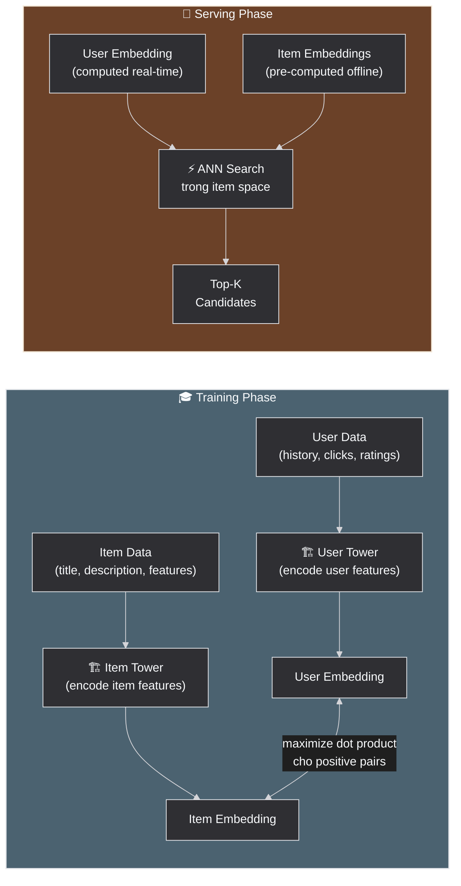

**Kiến trúc chi tiết:**

- **User tower**: encode user features (browsing history, demographics, device, time of day) → **user embedding**
- **Item tower**: encode item features (title, description, category, price, popularity) → **item embedding**
- **Scoring**: `score(user, item) = user_embedding · item_embedding`

**Tại sao Two-Tower scale được?**
1. **Item embeddings pre-compute offline** — giống document embeddings trong search. Hàng triệu items được encode 1 lần → lưu vào vector database
2. **User embedding compute real-time** — khi user request, chỉ cần encode 1 user vector
3. **ANN search** trong item embedding space → trả về top-K candidates trong ~ms
4. → Scale đến **hàng triệu items** mà vẫn giữ latency thấp. YouTube dùng pattern này cho billions of videos.

### Candidate Generation → Ranking — Pipeline 2 giai đoạn

Giống RAG (retrieve → rerank → generate), recommendation systems thường có **2 giai đoạn**, với logic tương tự:

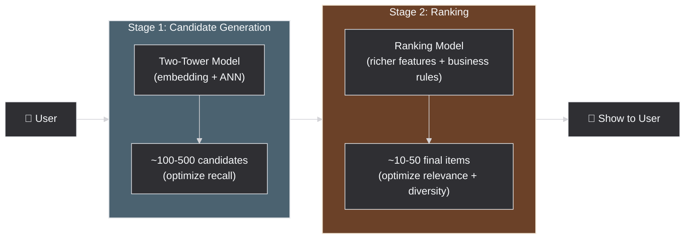

**Stage 1 — Candidate Generation** (tương đương retrieval trong RAG):
- Two-Tower + ANN: cast wide net, lấy ~100-500 candidates
- **Optimize recall**: không bỏ sót items user có thể thích
- Cheap model (embedding + dot product) → fast

**Stage 2 — Ranking** (tương đương reranking trong RAG):
- Model phức tạp hơn: dùng thêm features (user history sequence, item freshness, context)
- **Business rules**: diversity (không recommend cùng category), freshness, ad revenue
- Expensive model → chỉ chạy trên ~100-500 candidates từ Stage 1

> Chia thành hai giai đoạn giúp dành model tốn chi phí hơn cho tập ứng viên nhỏ: bước đầu lấy đủ rộng, bước sau chấm kỹ. Search, recommendation và quảng cáo đều có thể dùng cách tổ chức này.

> Sources: [Google ML — Recommendation: Candidate Generation](https://developers.google.com/machine-learning/recommendation/overview/candidate-generation), [Deep Neural Networks for YouTube Recommendations — Covington et al., 2016](https://research.google/pubs/deep-neural-networks-for-youtube-recommendations/), [Google Cloud — Two-Tower Architecture](https://cloud.google.com/architecture/implement-two-tower-retrieval-large-scale-candidate-generation)

### Tại sao dùng Dot Product thay vì Cosine?

Trong recommendation, dot product giữ được tín hiệu về độ phổ biến qua độ lớn vector:

| Aspect | Dot Product | Cosine Similarity |
|--------|------------|-------------------|
| **Công thức** | `A·B = ‖A‖‖B‖cos(θ)` | `cos(θ) = (A·B)/(‖A‖‖B‖)` |
| **Magnitude** | Giữ tín hiệu norm | Normalize → mất norm |
| **Item phổ biến** | Score cao tự nhiên (norm lớn) | Không ưu tiên |
| **Ý nghĩa** | Relevance × Popularity | Pure relevance only |
| **Use case** | Recommend items vừa liên quan vừa phổ biến | Tìm items tương tự nhất (diversity) |

**Tại sao norm encode popularity?** Items phổ biến (nhiều interactions) được model thấy nhiều lần trong training → gradients tích lũy → embedding norm lớn hơn. Đây là tính chất tự nhiên của training process, không phải bug.

**Ví dụ**: "Avengers: Endgame" (rất phổ biến) và "Blade Runner 2049" (ít phổ biến hơn) cùng thuộc genre sci-fi:
- **Dot product**: ưu tiên Endgame (norm lớn hơn → score cao hơn dù góc θ tương tự)
- **Cosine**: score gần bằng nhau (chỉ đo góc, bỏ qua popularity)

**Cẩn thận**: Dot product có thể **over-favor popular items** nếu không kiểm soát → popular items dominate top-K → thiếu diversity. Giải pháp: post-processing diversification, popularity penalty, hoặc dùng cosine + explicit popularity feature.

> Sources: [Google ML — Candidate Generation](https://developers.google.com/machine-learning/recommendation/overview/candidate-generation), [Google ML — Supervised Similarity](https://developers.google.com/machine-learning/clustering/dnn-clustering/supervised-similarity)

### Cold-start Problem — Tại sao xảy ra và cách giải quyết

Two-Tower cần lịch sử tương tác — lượt nhấp, đánh giá, mua hàng — để học sở thích người dùng và đặc điểm của item. Người dùng mới chưa có lịch sử; item mới chưa được ai tương tác. Khi thiếu các tín hiệu này, model khó tạo biểu diễn hữu ích và chất lượng gợi ý giảm. Đó là **cold-start problem**.

**Cold-start có 2 loại khác nhau:**

| Loại | Vấn đề | Tại sao khó |
|------|--------|-------------|
| **New User** | Không biết user thích gì | Chưa có clicks/ratings → user embedding không có ý nghĩa |
| **New Item** | Item chưa ai interact | Chưa có interactions → item embedding chưa học được từ collaborative signals |

**Giải pháp theo mechanism:**

1. **Content-based features** (giải quyết cả 2 loại):
   - User tower: dùng **demographics** (age, location) + **device type** + **time context** thay vì chỉ behavior history → user mới vẫn có meaningful embedding từ metadata
   - Item tower: dùng **text features** (title, description, category) thay vì chỉ interaction signals → item mới vẫn có embedding từ content
   - **Tại sao hiệu quả?** Vì content features là **static** — không cần interaction history. Model học mapping "user profile → interests" và "item description → embedding" từ existing users/items

2. **Hybrid approach**: kết hợp collaborative filtering (behavior) + content-based (features) → system dùng collaborative signals khi có, fallback sang content khi không có

3. **Popularity fallback**: user mới → recommend items phổ biến nhất (highest average rating, most purchased). Đơn giản nhưng hiệu quả vì popular items có xác suất cao relevant cho bất kỳ user nào

4. **Khám phá có kiểm soát**: dành một phần nhỏ recommendations cho item mới hoặc item còn ít dữ liệu, để hệ thống thu thập thêm tín hiệu. Vì đây là một chủ đề lớn hơn cold-start, phần dưới sẽ tách riêng exploration và exploitation.

> Source: [Google ML — Recommendation: Candidate Generation](https://developers.google.com/machine-learning/recommendation/overview/candidate-generation)

### Exploration vs Exploitation — Không thể chỉ lặp lại cái đã biết

Một recommender tốt không chỉ chọn item có điểm cao nhất theo mô hình hiện tại. Nó còn phải tạo cơ hội để hệ thống học xem user có thể thích điều gì tiếp theo.

- **Exploitation**: ưu tiên những item mà model đã tin khá chắc là user sẽ thích
- **Exploration**: cố ý dành một phần nhỏ lưu lượng cho item mới, item ít dữ liệu, hoặc item giúp hệ thống học thêm về user

Nếu chỉ **exploitation**, hệ thống dễ rơi vào vòng lặp quen thuộc:

- luôn đẩy cùng một nhóm item phổ biến
- item mới rất khó có cơ hội xuất hiện
- hồ sơ sở thích của user không được mở rộng
- diversity giảm dần theo thời gian

Nếu chỉ **exploration**, trải nghiệm lại trở nên kém ổn định vì người dùng thấy quá nhiều item chưa đủ liên quan.

Trong nhiều hệ thống, sự cân bằng này thường bắt đầu từ vài cơ chế đơn giản:

- dành `1-2` vị trí trong mỗi danh sách cho item mới hoặc under-exposed items
- thêm diversity rules để top-K không bị chiếm bởi cùng một category
- dùng các chiến lược đơn giản như `epsilon-greedy`, hoặc tiến xa hơn là `contextual bandit`, khi hệ thống cần học liên tục từ phản hồi người dùng

Exploration cần được thiết kế để vừa giữ chất lượng gợi ý hiện tại, vừa thu thập thông tin giúp cải thiện các lượt sau.

### Evaluation cho Recommendation

Khác với semantic search, recommendation không thể đánh giá chỉ bằng câu hỏi "item có liên quan không?". Một recommender tốt còn phải tạo ra hành vi tốt trong sản phẩm: click, conversion, watch time, retention, và cả diversity phù hợp.

| Lớp đánh giá | Metric | Ý nghĩa |
|--------------|--------|---------|
| **Candidate Generation** | Recall@K | Item mà user thực sự tương tác có nằm trong candidate set hay không |
| **Ranking** | nDCG@K | Những item tốt có được đưa lên vị trí cao hay không |
| **Ranking** | MRR / HitRate@K | User có nhìn thấy ít nhất một item phù hợp đủ sớm hay không |
| **Product** | CTR | Recommendation có đủ hấp dẫn để được click không |
| **Product** | Conversion / Watch Time / Dwell Time | Click có dẫn đến giá trị thật hay chỉ là click hời hợt |
| **Product** | Retention / Session Length | Hệ thống có giúp user quay lại và ở lại lâu hơn không |

Offline metrics rất hữu ích để iterate model nhanh. Nhưng online metrics mới cho biết recommender có thật sự tốt trong sản phẩm hay không. Một model có thể tăng CTR bằng cách đẩy các item giật chú ý hơn, nhưng lại làm giảm retention hoặc giảm diversity.

Vì vậy, evaluation cho recommendation thường đi theo hai lớp:

1. **Offline evaluation** để lọc nhanh mô hình và so sánh các thay đổi về candidate generation hoặc ranking
2. **Online evaluation** bằng A/B test để kiểm tra tác động thật lên hành vi người dùng và mục tiêu business

Đây cũng là lý do recommendation systems hiếm khi có một metric duy nhất đại diện cho tất cả. Hệ thống tốt là hệ thống cân bằng được relevance, business value và trải nghiệm dài hạn của người dùng.

## 2.5 Classification & Sentiment Analysis

### Embedding như lớp đặc trưng cho classification

Với các nhãn đã xác định như `positive/negative`, `spam/ham` hoặc `billing/support`, có thể dùng embedding làm đầu vào cho một classifier nhỏ. Embedding biến mỗi đoạn văn thành vector đặc trưng có cùng kích thước; classifier học cách gán nhãn từ các vector đó. Đây là cách dựng bộ phân loại văn bản mà chưa cần fine-tune model lớn.

### Pipeline

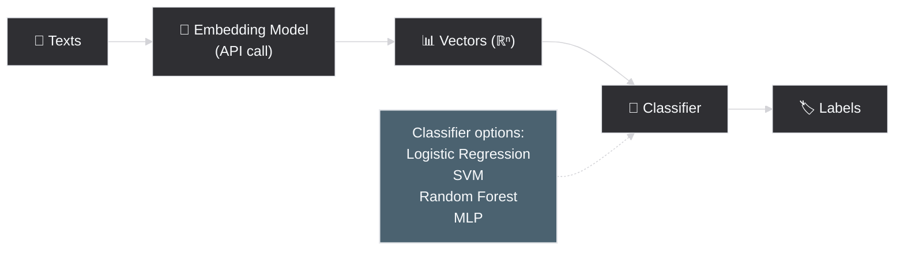

Ở pipeline này, embedding model đóng vai trò **feature extractor**. Nó rút từ text ra một biểu diễn số học đủ giàu thông tin để một classifier nhỏ như Logistic Regression hay SVM có thể học ranh giới giữa các nhãn.

> 💡 Tương tự clustering, nên dùng chế độ encode dành cho classification nếu model hỗ trợ: Cohere `input_type="classification"`, Gemini `gemini-embedding-001` `task_type="CLASSIFICATION"`, Jina v5 classification adapter. Với `gemini-embedding-2`, dùng task prefix trong text. Train và inference phải dùng **cùng model, cùng chế độ encode và cùng số chiều**; đổi bất kỳ yếu tố nào thì phải train lại classifier.

### So sánh: Embedding + Classifier vs Fine-tuning

| Aspect | Embedding + Classifier | Fine-tuning Full Model |
|--------|----------------------|----------------------|
| **Training time** | Giây-phút (chỉ train classifier nhỏ) | Giờ-ngày (train cả model lớn) |
| **Data cần** | Ít (100-1000 samples có thể đủ) | Nhiều (thường >5000 samples) |
| **GPU cần** | Không (classifier chạy CPU) | Có (fine-tune cần GPU) |
| **Flexibility** | Cao: đổi model embed dễ dàng | Thấp: retrain toàn bộ |
| **Accuracy** | Tốt cho hầu hết tasks | Tốt nhất cho domain-specific |
| **Cost** | Rẻ (chỉ API calls + CPU) | Đắt (GPU hours) |

### Khi nào Embedding + Classifier là đủ?

Trong rất nhiều sản phẩm nội bộ hoặc business apps, cách làm này đã đủ tốt nếu:

- số lượng labels không quá nhiều và ý nghĩa của chúng khá ổn định
- dataset gán nhãn còn nhỏ hoặc vừa phải
- team cần iterate nhanh, dễ debug và chi phí thấp
- inference cần chạy nhẹ trên CPU hoặc tích hợp đơn giản vào hệ thống sẵn có

Ngược lại, fine-tuning thường đáng cân nhắc hơn khi:

- ngôn ngữ trong domain quá đặc thù, ví dụ legal, medical, scientific
- ranh giới giữa các nhãn rất tinh vi, không chỉ dựa vào nội dung tổng quát
- bạn có đủ dữ liệu gán nhãn để việc cập nhật cả model lớn mang lại lợi ích rõ rệt
- mô hình cần tối ưu rất mạnh cho một task duy nhất thay vì giữ tính đa dụng

### Multiclass vs Multilabel — Hai bài toán khác nhau

Nói đến classification, có một chỗ rất dễ bị bỏ qua: không phải lúc nào mỗi text cũng chỉ thuộc **một** nhãn duy nhất.

- **Multiclass**: mỗi mẫu chỉ có **một nhãn đúng**. Ví dụ một ticket chỉ thuộc `billing` hoặc `technical_support`
- **Multilabel**: một mẫu có thể có **nhiều nhãn cùng lúc**. Ví dụ một review vừa là `negative`, vừa là `shipping_issue`, vừa là `damaged_product`

Sự khác biệt này kéo theo cách thiết kế mô hình khác nhau:

- multiclass thường dùng một đầu ra chọn **một nhãn duy nhất**
- multilabel thường dự đoán **xác suất riêng cho từng nhãn**, rồi áp threshold cho từng nhãn đó

Chọn sai kiểu đầu ra sẽ ép một mẫu nhiều ý vào một nhãn duy nhất, hoặc khiến model gán quá nhiều nhãn. Với multilabel, cần kiểm soát threshold cho từng nhãn.

### Ví dụ Use Cases

- **Sentiment analysis**: positive/negative/neutral từ reviews
- **Spam detection**: spam vs ham trong email/comments
- **Topic classification**: gán chủ đề cho bài viết (AI, finance, sports...)
- **Intent recognition**: phân loại ý định trong chatbot (hỏi giá, khiếu nại, hỗ trợ kỹ thuật...)
- **Toxicity detection**: phát hiện nội dung độc hại/toxic

### Class Imbalance, Threshold và Abstain

Trong production, dữ liệu gán nhãn thường **không cân bằng**. Có thể `90%` tickets là hỗ trợ chung, còn `2%` là fraud hoặc escalation. Nếu chỉ nhìn `accuracy`, model rất dễ trông có vẻ tốt dù thực ra gần như bỏ qua những class hiếm nhưng quan trọng.

Một vài điểm cần chú ý:

- **Class imbalance**: nên quan sát số mẫu của từng nhãn, dùng `macro-F1`, và khi cần có thể dùng `class weights` hoặc resampling
- **Threshold**: với multilabel hoặc binary classification, threshold `0.5` không phải lúc nào cũng đúng; nhiều hệ thống đặt threshold riêng cho từng nhãn theo business cost
- **Abstain / Human Review**: nếu model không đủ tự tin, tốt hơn là chuyển sang hàng đợi review thay vì ép dự đoán

`Abstain` đặc biệt hữu ích khi:

- nhãn sai gây hậu quả lớn, ví dụ moderation, compliance, fraud
- câu trả lời cần độ chắc chắn cao hơn mức trung bình
- dữ liệu đầu vào bị mơ hồ hoặc nằm ngoài phân phối quen thuộc

Trong các hệ thống kiểu này, classifier không chỉ trả nhãn; nó còn trả **mức tin cậy** và đôi khi cả cờ "không chắc, cần người xem lại".

### Evaluation cho Classification

Chọn metric theo loại sai sót cần phát hiện. Accuracy có thể che khuất việc model bỏ sót các nhãn hiếm:

| Metric | Dùng khi nào | Ý nghĩa |
|--------|--------------|---------|
| **Accuracy** | Classes khá cân bằng | Tỷ lệ dự đoán đúng trên toàn bộ mẫu |
| **Precision** | False positive đắt giá | Trong những mẫu model gắn nhãn dương, có bao nhiêu mẫu thật sự đúng |
| **Recall** | False negative đắt giá | Trong những mẫu dương thật, model bắt được bao nhiêu |
| **F1-score** | Cần cân bằng precision và recall | Trung bình điều hòa giữa hai chỉ số trên |
| **Confusion Matrix** | Muốn biết model nhầm ở đâu | Cho thấy cặp nhãn nào hay bị lẫn với nhau |

Với sentiment, spam hay intent routing, `macro-F1` thường hữu ích hơn nhìn mỗi `accuracy`, vì nó buộc ta quan sát cả những class ít dữ liệu thay vì chỉ class đông mẫu.

Zero-shot classification cũng là một lựa chọn trung gian đáng nhớ. Nó hữu ích khi muốn bootstrap nhanh một hệ thống phân loại mà chưa có nhiều dữ liệu gán nhãn. Nhưng một khi labels đã ổn định và có dataset đủ tốt, embedding + classifier hoặc fine-tuning thường cho hành vi dễ kiểm soát và dễ đánh giá hơn.

### Mã giả: Sentiment Classification

```text
texts, labels = load_labeled_dataset()

# Step 1: convert texts to embeddings
# Xem Production Note ở §2.2 về batching và rate limits
vectors = embed(
    texts,
    model="embedding-model",
    dimensions=256
)

# Step 2: split train and test sets
train_vectors, test_vectors, train_labels, test_labels = train_test_split(
    vectors,
    labels,
    test_ratio=0.25
)

# Step 3: train a lightweight classifier
classifier = train_logistic_regression(
    train_vectors,
    train_labels
)

# Step 4: evaluate
predicted_labels = classifier.predict(test_vectors)
report_metrics(
    truth=test_labels,
    predicted=predicted_labels,
    metrics=["accuracy", "precision", "recall", "f1"]
)

# Step 5: predict on new text
new_text = "This product is worth buying"
new_vector = embed([new_text], model="embedding-model", dimensions=256)
predicted_label = classifier.predict(new_vector)
return predicted_label
```

> Source: [OpenAI Cookbook — Classification using Embeddings](https://github.com/openai/openai-cookbook/blob/main/examples/Classification_using_embeddings.ipynb)

---

## 2.6 Anomaly Detection

### Phát hiện điểm lạ trong embedding space

Anomaly detection dùng embedding để tìm các mẫu khác biệt so với phần lớn dữ liệu: chẳng hạn một ticket có nội dung nằm xa các chủ đề quen thuộc.

**Khác thường chưa có nghĩa là sai.** Kết quả cần được xem xét theo bối cảnh nghiệp vụ. Ngưỡng phát hiện cũng phải phù hợp với khả năng xử lý cảnh báo của đội vận hành.

**Use cases thực tế:**
- Phát hiện **customer support tickets bất thường** (chủ đề mới chưa từng thấy)
- Phát hiện **nội dung spam/scam** trong reviews
- **Quality control**: phát hiện sản phẩm có mô tả bất thường
- **Security**: phát hiện log entries bất thường (intrusion detection)
- **Content moderation**: phát hiện nội dung vi phạm khác biệt patterns bình thường

### Khi nào dùng Anomaly Detection, khi nào dùng Rules hoặc Classification?

Anomaly detection phù hợp nhất khi bạn **chưa biết rõ anomaly sẽ trông như thế nào**, hoặc anomaly quá hiếm nên không có đủ dữ liệu gán nhãn để train classifier tử tế.

- **Dùng anomaly detection** khi muốn tìm những điểm lạ trong dữ liệu chưa có taxonomy rõ
- **Dùng rule-based** khi đã có các dấu hiệu cố định, ví dụ regex cho mã lỗi, blacklist domains, ngưỡng transaction quá lớn
- **Dùng classification** khi đã có đủ ví dụ gán nhãn cho các loại bất thường cụ thể và muốn hệ thống gán nhãn nhất quán

Trong thực tế, anomaly detection thường là lớp **sàng lọc ban đầu**: nó đẩy các điểm đáng ngờ vào hàng đợi review, còn rules hoặc classifiers xử lý những pattern đã biết rõ.

### Semantic Novelty vs True Anomaly

Một mẫu mới về ngữ nghĩa có thể hoàn toàn hợp lệ:

- Một support ticket nói về tính năng vừa ra mắt có thể rất khác phần lớn tickets cũ, nên bị kéo ra như anomaly
- Nhưng đó có thể chỉ là **semantic novelty**: chủ đề mới xuất hiện, không phải lỗi hay hành vi bất thường

Vì vậy, anomaly detection bằng embeddings thường tốt ở việc phát hiện **cái gì đang khác đi**, chứ không tự quyết định được khác đó là tốt hay xấu. Quyết định cuối cùng vẫn cần bối cảnh nghiệp vụ.

### Global, Local và Contextual Anomalies

Không phải anomaly nào cũng giống nhau. Có thể chia thành ba kiểu để dễ hình dung:

- **Global anomaly**: điểm nằm xa hẳn phần còn lại của dataset
- **Local anomaly**: điểm chỉ lạ trong vùng lân cận của nó; toàn cục thì không quá hiếm
- **Contextual anomaly**: nội dung tự thân không lạ, nhưng lạ trong đúng bối cảnh đó. Ví dụ một ticket "server down" là bình thường trong incident queue, nhưng bất thường nếu xuất hiện trong một tập feedback về giao diện

Embeddings thường giúp tốt với global hoặc semantic local anomalies. Với contextual anomalies, bạn thường cần thêm metadata như thời gian, category, tenant, hoặc source hệ thống mới đánh giá đúng được.

### Các hướng tiếp cận phổ biến

#### 1. Isolation Forest

**Ý tưởng**: xây nhiều random decision trees, mỗi tree cố gắng **cô lập** (isolate) từng data point bằng random splits. Anomaly = data point dễ bị cô lập → **path length ngắn**.

**Tại sao anomaly có path ngắn?** Anomaly nằm xa cluster chính → chỉ cần vài random splits đã tách riêng được. Normal points nằm trong cluster dense → cần nhiều splits.

#### 2. Distance-based

**Ý tưởng**: tính khoảng cách trung bình từ mỗi point đến K nearest neighbors. Anomaly = points có khoảng cách lớn (nằm xa tất cả).

#### 3. Clustering-based

**Ý tưởng**: dùng HDBSCAN clustering → points labeled noise (label = -1) là anomaly candidates. Hoặc: tính khoảng cách mỗi point đến centroid gần nhất → threshold.

### Chọn threshold và cách xử lý kết quả

Threshold quyết định số cảnh báo được đưa vào quy trình review:

- threshold quá thấp → quá nhiều false positives, team review bị quá tải
- threshold quá cao → bỏ sót những trường hợp thật sự quan trọng

Vì vậy, nhiều hệ thống bắt đầu bằng cách:

1. lấy `top 1-5%` điểm bất thường nhất
2. cho con người đọc mẫu và gắn nhãn lại
3. điều chỉnh threshold cho đến khi tỷ lệ cảnh báo hữu ích chấp nhận được

Một nguyên tắc an toàn thường gặp là anomaly detection nên **flag để review** trước, thay vì tự động xóa hay chặn ngay, trừ khi domain đã rất ổn định và rủi ro false positive thấp.

### Evaluation cho Anomaly Detection

Anomaly detection khó đánh giá hơn classification vì thường **thiếu labels đầy đủ**. Trong thực tế, nhiều team dùng các chỉ số gần với vận hành hơn là chỉ số học thuật thuần túy:

| Metric / Tín hiệu | Ý nghĩa |
|-------------------|---------|
| **Precision@Top-K** | Trong K điểm bị gắn cờ đầu tiên, có bao nhiêu điểm thật sự đáng xem |
| **Review Yield** | Tỷ lệ cảnh báo tạo ra hành động hữu ích sau khi con người đọc |
| **Alert Volume** | Mỗi ngày/tuần hệ thống đẩy ra bao nhiêu case; team review có xử lý nổi không |
| **Time-to-detect** | Hệ thống có kéo được pattern mới ra sớm hơn rule-based monitoring không |

Ngoài ra còn có một yếu tố rất thực tế là **drift**. Một pattern hôm nay còn lạ, nhưng vài tuần sau có thể đã thành bình thường. Vì vậy, anomaly detection cần được re-baseline định kỳ; nếu không, hàng đợi review sẽ đầy những trường hợp "từng mới nhưng giờ đã quen".

### Mã giả: Anomaly Detection Pipeline

```text
texts = load_dataset()
# Xem Production Note ở §2.2 về batching và rate limits
vectors = embed(texts)

# Method 1: isolation-based scoring
isolation_scores = isolation_forest(
    vectors,
    contamination=0.05
)

# Method 2: distance-based scoring
neighbor_distances = average_distance_to_k_neighbors(
    vectors,
    k=5,
    metric="cosine"
)

# Combine signals
# Normalize the two score families first because isolation and
# distance-based scores often live on different scales.
# Rank-normalization or min-max scaling is safer than adding raw values.
combined_scores = combine_scores(
    isolation_scores,
    neighbor_distances
)

# Select the most suspicious samples
threshold = percentile(combined_scores, 95)
anomaly_candidates = select_where(combined_scores >= threshold)

# Send candidates to review
flag_for_review(texts, anomaly_candidates)
```

> Sources: [scikit-learn Isolation Forest](https://scikit-learn.org/stable/modules/generated/sklearn.ensemble.IsolationForest.html), [OpenAI — Text and Code Embeddings use cases](https://openai.com/index/introducing-text-and-code-embeddings/)

---

## 2.7 Deduplication / Near-duplicate Detection

### Tìm dữ liệu trùng ở nhiều mức

Hai bản tài liệu có thể trùng nguyên văn, khác vài chỗ định dạng, hoặc dùng câu chữ khác nhưng vẫn nói cùng một ý. Deduplication cần phân biệt những trường hợp này trước khi quyết định giữ hay xóa.

Loại bản trùng giúp:
- **Data quality**: duplicates làm bias training data
- **Storage**: giảm kích thước database/index
- **Search**: tránh trả về nhiều kết quả gần giống nhau
- **Content**: phát hiện plagiarism, repost

### Duplicate, Near-duplicate và Semantic duplicate khác nhau thế nào?

- **Duplicate**: gần như giống hệt nhau, ví dụ copy-paste cùng một đoạn text
- **Near-duplicate**: khác đôi chút về câu chữ, format, typo, tiêu đề, nhưng nội dung gần như không đổi
- **Semantic duplicate**: diễn đạt khác hẳn, thậm chí khác ngôn ngữ, nhưng truyền đạt cùng một ý

Càng đi từ duplicate sang semantic duplicate, bài toán càng bớt giống kiểm tra chuỗi và càng phụ thuộc nhiều hơn vào embeddings.

### Pipeline thực tế: Exact -> Fuzzy -> Semantic

Có thể xử lý từ các bản dễ nhận diện đến các bản chỉ trùng về ý nghĩa:

1. **Exact dedup**: hash hoặc so sánh chuỗi sau khi normalize cơ bản để loại các bản sao giống hệt
2. **Fuzzy dedup**: xử lý khác biệt nhỏ như typo, format, tiêu đề gần giống
3. **Semantic dedup**: dùng embeddings để tìm những bản trùng ý nhưng khác cách diễn đạt

Pipeline ba lớp này vừa rẻ hơn, vừa dễ giải thích hơn. Embeddings nên được dùng ở lớp cuối, khi những kỹ thuật đơn giản hơn không còn đủ nữa.

### Các hướng tiếp cận phổ biến

#### 1. Pairwise Similarity (O(n²))

Tính cosine similarity giữa **mọi cặp** → threshold → duplicate pairs.

- ✅ Đơn giản, chính xác
- ❌ O(n²) — chỉ phù hợp dataset nhỏ (<10k docs)
- Ví dụ: 10k docs = 50M cặp cần tính; 100k docs = 5B cặp → không khả thi

#### 2. Paraphrase Mining (Scalable)

**SBERT paraphrase mining** chia kho tài liệu thành các phần, tìm top-k cặp tương đồng trong từng phần rồi gộp kết quả, giúp giảm chi phí so với so sánh mọi cặp.

#### 3. Locality-Sensitive Hashing (LSH)

Hash embedding vectors → buckets. Vectors tương tự → cùng bucket với xác suất cao. Chỉ so sánh các cặp trong cùng bucket → near-linear time.

### Chọn threshold và hành động xử lý

Điểm tương đồng cần gắn với hành động cụ thể: xóa, hợp nhất hay chuyển cho người kiểm tra.

- threshold cao hơn phù hợp cho **auto-remove** các bản gần như trùng hệt
- threshold thấp hơn phù hợp cho **flag review** hoặc gom thành nhóm để con người quyết định
- với multilingual corpora, hai câu khác ngôn ngữ nhưng cùng nghĩa có thể là semantic duplicate, nhưng việc có nên xóa hay giữ lại còn phụ thuộc mục tiêu sản phẩm

Trong nhiều hệ thống production, cách an toàn thường là:

1. **exact duplicates** → có thể xóa tự động
2. **near-duplicates rất rõ** → hợp nhất hoặc giữ một bản canonical
3. **semantic duplicates chưa chắc chắn** → gắn cờ để review, đặc biệt nếu việc xóa có ảnh hưởng business

### Chain Effect và chọn bản Canonical

Khi dedup ở mức semantic, một rủi ro rất hay gặp là **chain effect**:

- A rất giống B
- B rất giống C
- nhưng A và C không thật sự đủ giống để coi là cùng một bản

Nếu chỉ nối cặp theo kiểu "gần là nhập nhóm", hệ thống có thể tạo ra các cụm quá lớn và làm mất dữ liệu hợp lệ. Vì vậy, bước `build_duplicate_groups` không nên chỉ dựa trên nối chuỗi cặp một cách mù quáng; nó thường cần thêm điều kiện như:

- giới hạn độ rộng cụm
- so sánh lại với bản canonical của nhóm
- hoặc yêu cầu mọi bản trong nhóm phải đủ gần tâm nhóm, không chỉ gần một hàng xóm trung gian

Việc chọn **bản canonical** cũng nên theo policy rõ ràng. Tùy use case, bản được giữ lại có thể là:

- bản xuất hiện sớm nhất
- bản có metadata đầy đủ nhất
- bản có chất lượng nội dung tốt hơn
- hoặc bản đã được dùng làm ID tham chiếu ở nơi khác trong hệ thống

### Use Case khác nhau -> Threshold khác nhau

Deduplication cho các bài toán khác nhau không nên dùng cùng một threshold:

- **Training corpus**: thường cần threshold chặt hơn để tránh lặp dữ liệu làm bias model
- **Search results**: có thể chấp nhận threshold mềm hơn, miễn là top results không bị lặp quá rõ
- **Plagiarism / compliance**: thường cần quy trình review chặt hơn vì tác động pháp lý hoặc nghiệp vụ cao

### Workflow Deduplication

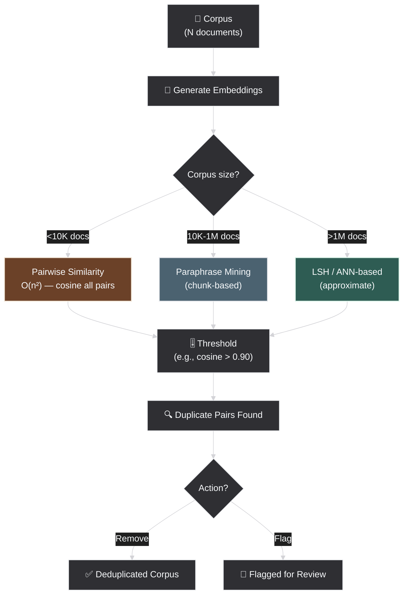

### Mã giả: Paraphrase Mining + Deduplication

```text
texts = load_corpus()
# Xem Production Note ở §2.2 về batching và rate limits
vectors = embed(texts)

# Step 1: find highly similar candidate pairs
candidate_pairs = paraphrase_mining(
    texts=texts,
    vectors=vectors
)

# Step 2: keep only pairs above the chosen threshold
near_duplicate_pairs = filter_by_similarity(
    candidate_pairs,
    threshold=0.70
)

# Step 3: group connected pairs into duplicate clusters
duplicate_groups = build_duplicate_groups(near_duplicate_pairs)

# Step 4: decide what to keep
canonical_texts = choose_canonical_version(
    duplicate_groups,
    policy="keep the earliest or highest-quality version"
)

# Step 5: review or remove
flag_groups_for_review(duplicate_groups)
write_deduplicated_corpus(canonical_texts)
```

> Source: [SBERT — Paraphrase Mining](https://www.sbert.net/examples/sentence_transformer/applications/paraphrase-mining/README.html)

---

## 2.8 Multimodal Embedding

### Từ text-only sang nhiều modality

Multimodal embedding đưa văn bản, hình ảnh, âm thanh, video hoặc PDF vào một không gian vector chung. Nhờ đó, query ở dạng dữ liệu này có thể tìm kết quả ở dạng khác — chẳng hạn dùng câu mô tả để tìm ảnh, transcript để tìm video, hoặc nối một đoạn PDF với ảnh liên quan. Khả năng truy xuất chéo này gọi là **cross-modal retrieval**.

### Khi nào Multimodal Embedding thực sự cần thiết?

Không phải cứ có hình ảnh hay video là bắt buộc phải dùng multimodal embedding. Nó đặc biệt hữu ích khi:

- người dùng có thể query bằng text nhưng kết quả lại là image, video, audio hoặc PDF
- nội dung ý nghĩa nằm ở nhiều modality cùng lúc, ví dụ product title + product image
- hệ thống cần so sánh chéo giữa các modality thay vì chỉ xử lý từng modality riêng rẽ

Ngược lại, nếu image chỉ đóng vai trò minh họa còn toàn bộ logic tìm kiếm vẫn nằm ở text, text-only embeddings đôi khi đã đủ và đơn giản hơn nhiều để vận hành.

Nhìn theo lịch sử phát triển, CLIP mở đầu cho text-image retrieval, Vertex multimodalembedding mở rộng thêm modality, còn Gemini Embedding 2 đi xa hơn theo hướng hợp nhất nhiều modality trong cùng một không gian.

### Các Pattern Retrieval phổ biến trong Multimodal

Khi nói "multimodal retrieval", thực ra có nhiều hướng truy xuất khác nhau:

- **Text -> Image**: gõ mô tả để tìm ảnh
- **Image -> Text**: đưa ảnh vào để tìm caption, sản phẩm, hoặc tài liệu mô tả
- **Text -> PDF / Video / Audio**: dùng query text để tìm nội dung ở modality khác
- **Mixed input -> Mixed output**: query gồm nhiều phần, ví dụ text + image mẫu, rồi trả về kết quả nhiều loại

`Text -> Image` dễ minh họa bằng tìm ảnh theo mô tả. Với kho tri thức doanh nghiệp, `Text -> PDF` hoặc `Text -> mixed media` phục vụ nhu cầu tìm bằng chứng trong nhiều loại tài liệu.

### Chọn đơn vị Index cho Multimodal

Giống text retrieval, multimodal retrieval cũng cần quyết định **đơn vị nào sẽ được index**.

- với ảnh đơn lẻ, đơn vị index có thể là **mỗi ảnh**
- với PDF, đơn vị index có thể là **mỗi trang**, **mỗi section**, hoặc **một cụm trang**
- với video, đơn vị index thường không phải cả video mà là **clip** hoặc **frame segments**
- với sản phẩm, nhiều hệ thống index **gói hợp nhất** gồm `title + description + image` thay vì index từng phần riêng rẽ

Chọn đơn vị index sai dễ làm retrieval kém đi rất nhanh. Index quá lớn làm biểu diễn bị loãng; index quá nhỏ lại mất ngữ cảnh.

### 2.8.1 CLIP (OpenAI) — Đặt text và image vào cùng một không gian

**CLIP** (Contrastive Language-Image Pre-training) — model đầu tiên thành công lớn trong multimodal embedding:

**Kiến trúc:**

```mermaid
%%{init: {'theme':'base','themeVariables':{'background':'#1f1f1f','primaryColor':'#2f2f33','primaryTextColor':'#f8fafc','primaryBorderColor':'#e5e7eb','secondaryColor':'#4b6270','secondaryTextColor':'#f8fafc','secondaryBorderColor':'#e5e7eb','tertiaryColor':'#6b4128','tertiaryTextColor':'#f8fafc','tertiaryBorderColor':'#f3e8d8','lineColor':'#d4d4d8','textColor':'#f8fafc','mainBkg':'#2f2f33','clusterBkg':'#26272b','clusterBorder':'#d4d4d8','edgeLabelBackground':'#1f1f1f','nodeTextColor':'#f8fafc','fontFamily':'Inter, Segoe UI, sans-serif','fontSize':'16px'}}}%%
flowchart TB
    subgraph training["🎓 Training: Contrastive Learning (400M pairs)"]
        direction LR
        IMG["🖼️ Image"] --> IE["Image Encoder<br/>(ViT)"]
        TXT["📝 Text<br/>'a photo of a cat'"] --> TE["Text Encoder<br/>(Transformer)"]
        IE --> IV["Image Vector"]
        TE --> TV["Text Vector"]
        IV <-->|"maximize similarity<br/>cho matching pairs,<br/>minimize cho non-matching"| TV
    end

    subgraph usage["🚀 Usage: Zero-shot"]
        direction LR
        NEW_IMG["🖼️ New Image"] --> IE2["Image Encoder"]
        LABELS["📝 Candidate Labels<br/>'a dog' / 'a cat' / 'a car'"] --> TE2["Text Encoder"]
        IE2 --> COS["Cosine Similarity"]
        TE2 --> COS
        COS --> BEST["🏷️ Best match: 'a cat'"]
    end

    style training fill:#4b6270,stroke:#e5e7eb,color:#f8fafc,stroke-width:1.5px
    style usage fill:#2e5c53,stroke:#ddf5ea,color:#f8fafc,stroke-width:1.5px
```

**Đặc điểm:**
- Training trên **400 triệu** cặp image-text từ internet (web scraping)
- Contrastive loss: maximize similarity cho matching pairs, minimize cho non-matching
- **Zero-shot transfer**: classify image bằng text descriptions mà **không cần fine-tune**
- Mở đường cho DALL-E, Stable Diffusion (dùng CLIP text encoder)

**Use cases:**
- **Image search by text**: "sunset over ocean" → tìm ảnh hoàng hôn
- **Image classification zero-shot**: gán label cho ảnh mới mà không cần training data
- **Content filtering**: kiểm tra image content khớp text description không

> Source: [CLIP paper — Radford et al., 2021](https://arxiv.org/abs/2103.00020)

Các model sau CLIP mở rộng từ cặp `text + image` sang video và những đầu vào phức tạp hơn. Khác biệt giữa chúng nằm ở các modality được hỗ trợ, giới hạn ngữ cảnh và cách kết hợp đầu vào.

### 2.8.2 Vertex AI multimodalembedding@001 (Legacy) — Mở rộng thêm modality nhưng còn giới hạn

| Feature | Spec |
|---------|------|
| **Modalities** | Text + Image + Video |
| **Dimensions** | 1408 (default); giảm được 128/256/512 |
| **Text limit** | Ngắn (captions, queries) |
| **Video** | Hỗ trợ video segments |
| **Status** | Legacy — xem xét migrate sang Gemini Embedding 2 |

**Giới hạn quan trọng**: text input ngắn trong mode text+image — không phù hợp cho long documents. Chỉ phù hợp cho short captions, product titles, brief descriptions.

**Use cases**: e-commerce image search ("red dress"), video retrieval, visual Q&A.

> Source: [Vertex AI — Multimodal Embeddings](https://cloud.google.com/vertex-ai/generative-ai/docs/embeddings/get-multimodal-embeddings)

Các model native multimodal tiếp tục hướng mở rộng này bằng cách xử lý nhiều loại dữ liệu trong một kiến trúc thống nhất hơn.

### 2.8.3 Gemini Embedding 2 (GA April 2026) — Hướng tới không gian hợp nhất nhiều modality

> **Trạng thái**: Ra preview 03/2026 (`gemini-embedding-2-preview`), **GA ngày 22/04/2026** với model ID `gemini-embedding-2` trên Gemini API và Gemini Enterprise Agent Platform (tên mới của Vertex AI). Khác `gemini-embedding-001`, model này **không nhận tham số `task_type`**; task được chỉ định bằng prefix trong text. Embedding của `gemini-embedding-001` và `gemini-embedding-2` **không tương thích**, nên chuyển model phải re-embed toàn bộ corpus.

**Gemini Embedding 2** được giới thiệu là model embedding natively multimodal dựa trên kiến trúc Gemini. Model xử lý các modality trong cùng 1 kiến trúc, thay vì ghép 2 encoder riêng như CLIP, nhằm học quan hệ giữa các loại dữ liệu.

#### 5 Modalities được hỗ trợ

| Modality | Limit | Ghi chú |
|----------|-------|---------|
| **Text** | 8192 tokens | Long-context cho full documents |
| **Image** | Max 6 images/request | PNG, JPEG; hỗ trợ interleaved text+image |
| **Video** | Max 128 giây | MP4, MOV; codec H264/H265/AV1/VP9 |
| **Audio** | Max 80 giây | MP3, WAV |
| **PDF** | Max 6 trang | Native PDF understanding (layout, tables, figures) |

#### Specs

- **Dimensions**: default **3072**, recommended **1536 / 768** (MRL-based → truncate native)
- **Interleaved input**: gửi text + images trong cùng 1 request → **single unified embedding**
- **Architecture**: built trên Gemini → hiểu cross-modal semantics natively

#### Pricing (snapshot November 2026)

| Input Type | Price (standard) | Ghi chú |
|-----------|-------|---------|
| Text | **$0.20 / 1M tokens** | Batch API: $0.10 / 1M |
| Image | **$0.45 / 1M tokens** | Tính theo token, không còn theo ảnh như thời preview |
| Audio | **$6.50 / 1M tokens** | |
| Video | **$12.00 / 1M tokens** | |

> Giá audio/video cao hơn text nhiều lần. Nên ước lượng chi phí ingest media trước khi index toàn bộ thư viện video.

#### So sánh với CLIP và Vertex multimodalembedding

| Feature | CLIP | Vertex multimodal@001 | Gemini Embedding 2 |
|---------|------|----------------------|---------------------|
| **Architecture** | Dual-encoder (separate) | Dual-encoder | Single unified model |
| **Modalities** | 2 (text, image) | 3 (text, image, video) | **5** (text, image, video, audio, PDF) |
| **Max dims** | 512/768 | 1408 | **3072** (MRL to 768) |
| **Text context** | ~77 tokens | Short | **8192 tokens** |
| **MRL support** | ❌ | ❌ | ✅ |
| **Interleaved** | ❌ | ❌ | ✅ |
| **Provider** | OpenAI (open-source) | Google Cloud | Google AI |

### 2.8.4 Các lựa chọn multimodal khác (snapshot November 2026)

Gemini Embedding 2 không còn là lựa chọn duy nhất cho unified multimodal embedding. Năm 2026 có thêm nhiều model đáng benchmark:

| Model | Provider | Modalities | Điểm đáng chú ý | Giá / License |
|-------|----------|-----------|-----------------|---------------|
| **`embed-v5.0-pro` / `-fast`** | Cohere (09/2026) | Text, image, fused text+image (PDF) | 128k context, 256-2048 dims, shared space giữa Pro và Fast; mạnh trên tài liệu enterprise giàu hình ảnh (ViDoRe V3, vendor-reported) | $0.12 / $0.08 per 1M text tokens, $0.40/1M image tokens |
| **`voyage-multimodal-3.5`** | Voyage AI (01/2026) | Text, image, screenshot, **video** (interleaved) | Kế thừa `voyage-multimodal-3`, thêm video | $0.12/1M tokens + $0.60/1B pixels |
| **`jina-embeddings-v5-omni`** (small/nano) | Jina AI (05/2026) | Text, image, audio, video | Open weights | **CC-BY-NC-4.0** — thương mại phải qua API |
| **`Qwen3-VL-Embedding`** (2B/8B) | Alibaba Qwen (2026) | Text, image, screenshot, video | Open weights, MRL 64-4096 dims | Apache 2.0 |

> Các con số benchmark multimodal trong bảng do vendor tự công bố. Thứ hạng giữa các model thay đổi theo loại tài liệu (ảnh tự nhiên, slide, PDF tài chính, video), nên cần benchmark trên dữ liệu thật.
>
> Sources: [Cohere Embed 5](https://cohere.com/blog/embed-5), [Cohere models](https://docs.cohere.com/docs/models), [voyage-multimodal-3.5 blog](https://blog.voyageai.com/2026/01/15/voyage-multimodal-3-5/), [Voyage pricing](https://docs.voyageai.com/docs/pricing), [Jina AI GitHub](https://github.com/jina-ai)

### 2.8.5 Visual Document Retrieval — Tìm kiếm trực tiếp trên "ảnh trang tài liệu"

Phần lớn tri thức doanh nghiệp không nằm trong văn bản thuần, mà nằm trong **PDF, slide, báo cáo tài chính, bản scan, hướng dẫn kỹ thuật có sơ đồ**. Ở những tài liệu này, ý nghĩa thường nằm ở **bố cục**: một con số chỉ có nghĩa khi biết nó thuộc hàng nào, cột nào của bảng; một mũi tên trong sơ đồ quan trọng không kém đoạn văn bên cạnh. *Visual Document Retrieval* (VDR) là nhóm kỹ thuật tìm kiếm trên các tài liệu như vậy mà cố gắng **giữ lại thông tin hình ảnh và bố cục**.

#### Vấn đề của pipeline truyền thống: Parse → Text → Embed

Cách làm quen thuộc là: dùng OCR hoặc layout parser để trích văn bản từ PDF → chia chunk → embed như text bình thường. Cách này có ba điểm gãy:

1. **Bảng bị "dàn phẳng"**: một bảng 5 cột sau khi OCR thường thành một chuỗi số liền nhau; quan hệ "con số này là doanh thu quý 3 của khu vực miền Nam" bị mất.
2. **Biểu đồ và sơ đồ biến mất**: OCR chỉ đọc được chữ; xu hướng tăng/giảm trong biểu đồ đường hoàn toàn không đi vào index.
3. **Lỗi OCR lan truyền**: chữ nhỏ, bản scan mờ, font lạ, hoặc dấu tiếng Việt bị đọc sai (ví dụ "Hà Nội" → "Ha Nôi") làm sai cả embedding lẫn BM25.

#### Bốn pattern chính hiện nay

| Pattern | Cách làm | Ưu điểm | Nhược điểm |
|---------|----------|---------|-----------|
| **1. Parse-then-embed** | OCR/layout parser → text → text embedding | Rẻ, dùng lại toàn bộ hạ tầng text; giữ được exact match cho mã số | Mất bố cục, bảng, biểu đồ |
| **2. Caption-and-index** | Dùng VLM (vision-language model) viết mô tả bằng chữ cho từng biểu đồ/hình → embed mô tả | Biến thông tin hình ảnh thành text tìm được | Chi phí gọi VLM cho mỗi hình; mô tả có thể sai hoặc bỏ sót chi tiết |
| **3. Single-vector page embedding** | Embed nguyên ảnh trang thành **1 vector** (Cohere Embed 5, `voyage-multimodal-3.5`, `gemini-embedding-2`) | Đơn giản như text embedding; storage nhỏ | Một vector phải "tóm tắt" cả trang → chi tiết nhỏ dễ bị chìm |
| **4. Multi-vector late interaction** | Embed ảnh trang thành **hàng trăm đến hàng nghìn vector**, mỗi vector ứng với một vùng nhỏ (ColPali, ColQwen) | Giữ được bằng chứng cục bộ; không cần OCR | Storage và chi phí scoring lớn hơn nhiều lần |

#### Cơ chế của ColPali: vì sao "nhiều vector" giữ được chi tiết?

ColPali (Faysse et al., 2024; ICLR 2025) kết hợp ý tưởng late interaction của ColBERT ([§2.2](#stage-2-reranking--tăng-precision-trên-tập-candidates-nhỏ)) với vision-language model PaliGemma-3B. Quy trình gồm hai pha:

**Pha index (offline):**
1. Chụp mỗi trang tài liệu thành một ảnh.
2. Vision encoder (SigLIP) cắt ảnh thành lưới các **patch** (ô vuông nhỏ), mỗi patch thành một vector.
3. Các patch vector được đưa vào language model (Gemma 2B) như những "token mềm", để mỗi patch được **ngữ cảnh hóa** — tức là vector của một ô trong bảng "biết" nó nằm cạnh tiêu đề cột nào.
4. Mỗi patch được chiếu xuống **128 chiều**. Kết quả: khoảng **1.030 vector × 128 chiều cho mỗi trang**.

**Pha query (online):**
1. Câu hỏi được tách thành token, mỗi token thành một vector 128 chiều. Ví dụ câu hỏi 12 token cho 12 vector.
2. Tính điểm bằng **MaxSim**:

$$
\text{score}(q, d) = \sum_{i=1}^{|q|} \max_{j=1}^{|d|} \; \mathbf{q}_i \cdot \mathbf{d}_j
$$

Đọc công thức theo lời: *với mỗi token của câu hỏi, tìm vùng trên trang khớp với nó nhất; rồi cộng điểm khớp tốt nhất của tất cả các token lại.*

**Ví dụ nhỏ để thấy cơ chế:** câu hỏi *"doanh thu quý 3 miền Nam"*.
- Token "doanh thu" khớp mạnh nhất với patch chứa tiêu đề hàng "Doanh thu".
- Token "quý 3" khớp mạnh nhất với patch chứa tiêu đề cột "Q3".
- Token "miền Nam" khớp mạnh nhất với patch chứa nhãn "Miền Nam".
- Ba patch này có thể nằm ở ba góc khác nhau của bảng, nhưng MaxSim vẫn cộng được cả ba tín hiệu.

**So sánh với single-vector:** khi cả trang bị nén vào **một** vector (thường bằng cách lấy trung bình hoặc pooling các vùng), tín hiệu của ba ô nhỏ kể trên bị **pha loãng** bởi hàng trăm vùng khác trên trang (logo, footer, đoạn văn không liên quan). Đây gọi là hiện tượng *pooling dilution*: chi tiết nhỏ nhưng quyết định bị trung bình hóa đến mức không còn nổi bật.

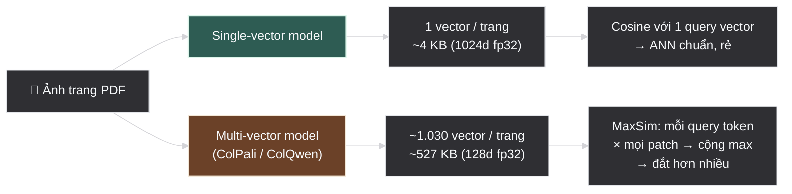

#### Cái giá phải trả: storage và compute

Số vector trên mỗi trang ảnh hưởng trực tiếp đến tính khả thi khi triển khai. Với **10 triệu trang**, dung lượng lưu trữ ước tính như sau:

| Cách lưu | Mỗi trang | 10 triệu trang |
|----------|-----------|----------------|
| Single-vector, 1024 chiều, float32 | 1024 × 4 B ≈ **4 KB** | ≈ **41 GB** |
| ColPali, 1.030 × 128 chiều, float32 | 1030 × 128 × 4 B ≈ **527 KB** | ≈ **5,3 TB** |
| ColPali, binary (128 bit = 16 B mỗi vector) | 1030 × 16 B ≈ **16,5 KB** | ≈ **165 GB** |

Ngoài storage, **chi phí tính điểm** cũng khác về bản chất. Với single-vector, so một câu hỏi với một trang chỉ là một phép dot product. Với MaxSim, đó là `|q| × |d|` phép dot product (ví dụ 12 × 1.030 ≈ 12.000 phép), nên không thể quét MaxSim trên toàn bộ corpus. Trong thực tế, hệ thống multi-vector gần như luôn chạy **hai giai đoạn**:

1. **Candidate generation** rẻ: BM25 trên text OCR, single-vector ANN, hoặc ANN trên từng patch vector để lấy vài trăm trang ứng viên.
2. **MaxSim rerank** trên tập ứng viên đó.

Các kỹ thuật giảm chi phí đang được dùng:
- **Binarization**: lưu mỗi chiều bằng 1 bit, giảm 32 lần storage (như bảng trên), chấp nhận giảm nhẹ chất lượng.
- **Token pooling / merging**: gom các patch giống nhau thành một vector đại diện. Light-ColPali/ColQwen2 (2025) báo cáo giữ **98,2% nDCG@5 khi chỉ dùng 11,8% bộ nhớ**, và 94,6% khi chỉ dùng 2,8%.
- **MUVERA** (Google, 2024): biến tập nhiều vector thành một vector có chiều cố định (*fixed dimensional encoding*) để dùng được ANN index thông thường cho bước candidate generation.
- Vector database hỗ trợ multi-vector native: Vespa, Qdrant, Weaviate, Milvus… (cần kiểm tra phiên bản cụ thể).

#### Single-vector đã bắt kịp đến đâu?

Benchmark chuẩn cho bài toán này là **ViDoRe** (do chính nhóm ColPali công bố). ViDoRe V1 hiện được xem là đã bão hòa: nhiều model đạt trên 90 nDCG@5, nên khó phân biệt model tốt và model rất tốt. ViDoRe V2 và V3 khó hơn, đa ngôn ngữ hơn, gần với tài liệu doanh nghiệp hơn. Theo các báo cáo 2025–2026, khoảng cách giữa multi-vector và các single-vector model thế hệ mới (Cohere Embed 4/5, `voyage-multimodal-3.x`) **đã thu hẹp đáng kể** trên phần lớn corpus doanh nghiệp. Multi-vector vẫn có lợi thế trên các trang dày đặc chi tiết hình ảnh. Lưu ý rằng phần lớn con số so sánh là do vendor tự báo cáo.

#### Chọn pattern nào?

| Tình huống | Gợi ý bắt đầu |
|-----------|---------------|
| Tài liệu chủ yếu là chữ, PDF "sạch" (xuất từ Word) | Parse-then-embed + hybrid BM25 |
| Nhiều biểu đồ/hình nhưng số lượng trang vừa phải | Single-vector multimodal hoặc caption-and-index |
| Báo cáo tài chính, slide dày đặc bảng, cần độ chính xác cao trên chi tiết nhỏ | Single-vector để lấy ứng viên + multi-vector rerank |
| Hàng chục triệu trang, ngân sách storage chặt | Single-vector (quantized); multi-vector chỉ cho tập con quan trọng |
| Cần exact match mã hợp đồng, số hóa đơn | **Luôn giữ thêm nhánh text (OCR + BM25)**, bất kể dùng pattern hình ảnh nào |

> **Từ kết quả truy xuất đến bằng chứng người dùng đọc được**
>
> - **Tìm đúng trang chưa phải là xong**: retrieval trả về *trang*, nhưng LLM ở bước generate vẫn phải *đọc* được trang đó. Hoặc bạn gửi ảnh trang cho một VLM (tốn token hình ảnh và đắt hơn text nhiều lần), hoặc bạn vẫn cần text đã trích xuất. Nghĩa là pipeline "không cần OCR" thường chỉ bỏ được OCR ở bước *retrieval*, không bỏ được ở bước *generation*.
> - **Citation ở mức trang là quá thô** với người dùng: một trang báo cáo có thể chứa 4 bảng. Nếu sản phẩm cần chỉ đúng vùng bằng chứng, bạn phải thêm bước định vị vùng (region localization). Một số hệ thống dùng chính điểm MaxSim theo từng patch để tô sáng vùng liên quan.
> - **Độ phân giải ảnh là một siêu tham số ẩn**: render PDF ở DPI thấp làm chữ nhỏ trong bảng biến mất *trước khi model kịp nhìn thấy*. Render DPI cao thì tăng số patch, tức tăng storage và chi phí. Cần thử nghiệm trên chính tài liệu của bạn.
> - **Bảng kéo dài qua nhiều trang** bị cắt làm đôi theo đúng ranh giới trang; trang thứ hai thường mất dòng tiêu đề cột, làm giảm mạnh khả năng khớp.
> - **Tiếng Việt**: hầu hết benchmark VDR là tiếng Anh và tiếng châu Âu. Model nền tảng khác nhau (PaliGemma, Qwen2-VL…) có năng lực đọc chữ có dấu rất khác nhau. Đừng giả định kết quả benchmark chuyển sang được tài liệu tiếng Việt.

> **Các giới hạn cần kiểm tra trước khi chọn Visual Document Retrieval**
>
> - **"ColPali tốt hơn nên thay hết pipeline OCR"** — tính storage trước đã: 10 triệu trang ở float32 là hàng TB. Nhiều team chỉ phát hiện điều này sau khi đã index xong một phần.
> - **"Bỏ OCR là bỏ được lỗi OCR"** — không hẳn. Model thị giác cũng "đọc nhầm" chữ, chỉ là lỗi của nó khó thấy hơn vì không có văn bản trung gian để kiểm tra. Mất đi lớp text trung gian cũng là mất đi công cụ debug dễ nhất.
> - **"Điểm ViDoRe cao thì tốt cho tài liệu của tôi"** — ViDoRe V1 đã bão hòa; hãy xem V2/V3 và quan trọng nhất là eval trên tài liệu thật của bạn, với câu hỏi do người dùng thật đặt ra.
> - **Đừng trộn vector của nhiều model vào cùng một index** chỉ vì chúng có cùng số chiều (ví dụ cùng 128d): chúng nằm ở các không gian khác nhau và so sánh trực tiếp là vô nghĩa.
>
> Sources: [ColPali — Faysse et al., 2024](https://arxiv.org/abs/2407.01449), [ColPali blog — Illuin Technology](https://www.illuin.tech/colpali-efficient-document-retrieval-with-vision-language-models/), [ColBERT — Khattab & Zaharia, 2020](https://arxiv.org/abs/2004.12832), [Light-ColPali — storage-efficient VDR, 2025](https://arxiv.org/abs/2506.04997), [MUVERA — Dhulipala et al., 2024](https://arxiv.org/abs/2405.19504), [ViDoRe benchmark](https://huggingface.co/vidore), [Vespa — ColPali example](https://vespa-engine.github.io/pyvespa/examples/colpali-document-retrieval-vision-language-models-cloud.html), [VDR survey, 2026](https://arxiv.org/abs/2602.19961)

#### Mã giả: Two-stage Visual Document Retrieval

```text
# --- Index phase ---
for pdf in pdf_files:
    for page_number, page_image in render_pages(pdf, dpi=150):
        # Branch A: text, for exact identifiers and BM25
        page_text = ocr_or_parse(page_image)
        bm25_index.add(doc_id=(pdf, page_number), text=page_text)

        # Branch B: one vector per page, for cheap candidate generation
        page_vector = multimodal_embed(page_image)          # single-vector model
        dense_index.add(doc_id=(pdf, page_number), vector=page_vector)

        # Branch C: many vectors per page, only for reranking
        patch_vectors = multi_vector_embed(page_image)      # e.g. ~1,000 x 128d
        patch_store.put((pdf, page_number), binarize(patch_vectors))

# --- Query phase ---
query = "doanh thu quý 3 miền Nam năm 2025"

# Stage 1: cheap, broad candidate generation
candidates = rrf_fuse(
    bm25_index.search(query, top_n=100),
    dense_index.search(multimodal_embed(query), top_n=100),
)

# Stage 2: expensive MaxSim rerank on the small candidate set
query_token_vectors = multi_vector_embed_query(query)
scored = []
for page_id in candidates[:100]:
    patches = patch_store.get(page_id)
    score = sum(max(dot(q, p) for p in patches) for q in query_token_vectors)
    scored.append((page_id, score))

top_pages = sort_desc(scored)[:5]

# Stage 3: give the LLM something it can read (page image and/or extracted text)
answer = generate_with_pages(question=query, pages=top_pages)
```

### Chọn mô hình theo bài toán

Chọn model theo loại dữ liệu và cách triển khai:

- **CLIP** hợp khi bài toán chủ yếu là `text <-> image`, cần mô hình kinh điển, dễ nghiên cứu hoặc tự triển khai
- **Vertex multimodalembedding@001** hợp với các hệ thống Google Cloud cũ cần hỗ trợ thêm video, nhưng đã có dấu hiệu bị thay thế
- **Gemini Embedding 2** hợp khi cần nhiều modality hơn, context dài hơn, hoặc muốn embed input interleaved trong một không gian hợp nhất
- **Cohere Embed 5** hợp khi dữ liệu chính là tài liệu enterprise (PDF, slide, báo cáo tài chính) và cần context rất dài
- **`voyage-multimodal-3.5`** hợp khi đã dùng hệ Voyage/MongoDB Atlas và cần text + image + video
- **`Qwen3-VL-Embedding`** hợp khi bắt buộc self-hosted với license thương mại thoải mái

#### Diagram: Cross-modal Retrieval

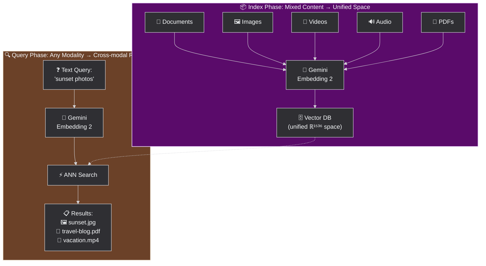

> **Cross-modal retrieval** dùng query văn bản để tìm ảnh, video, tài liệu hoặc âm thanh trong cùng một không gian vector.

### Lưu ý hệ thống khi dùng Multimodal Embedding

Khi triển khai multimodal retrieval, cần thống nhất các quyết định sau:

- **Không trộn embeddings từ model khác nhau trong cùng index**: cùng là vector cho image hay text nhưng nếu được tạo bởi hai model khác nhau, chúng không tự nhiên nằm trong cùng một không gian có thể so sánh trực tiếp
- nếu chưa thể chuyển toàn bộ hệ thống sang một **unified multimodal model**, cách làm chuyển tiếp thường là lưu vectors **riêng theo từng modality hoặc từng model**, rồi truy xuất chéo qua metadata, hoặc dùng vector database hỗ trợ **multi-vector indexing** thay vì ép mọi vector vào cùng một index để so sánh trực tiếp
- **Phải thống nhất cách index và cách query**: nếu lúc index dùng `text + image` nhưng lúc query chỉ dùng text rời rạc, chất lượng có thể thay đổi nhiều hơn mong đợi
- **Chi phí và latency phụ thuộc modality**: embedding cho image, video, audio hay PDF thường đắt và nặng hơn text-only
- **Evaluation phải đúng với hướng truy xuất thực tế**: `text -> image`, `image -> text`, `text -> PDF` hay `audio -> text` là các bài toán khác nhau, không nên gộp vào một chỉ số chung duy nhất
- **Dữ liệu nguồn quan trọng hơn bao giờ hết**: caption sai, OCR lỗi, hình mờ, hoặc PDF layout phức tạp đều có thể làm embedding giảm chất lượng đáng kể

### Failure Modes thường gặp

Những lỗi dưới đây cần có mặt trong tập đánh giá, vì một vài ví dụ tìm kiếm thành công chưa thể hiện được chúng:

- **OCR yếu**: ảnh hoặc PDF có text nhỏ, mờ, lệch layout → model bỏ sót tín hiệu quan trọng
- **Visual bias**: ảnh rất đẹp hoặc rất nổi bật về màu sắc nhưng không đúng nội dung query
- **Sai đơn vị thời gian trong video**: index cả video dài khiến query chỉ khớp một đoạn nhỏ nhưng vẫn bị loãng
- **Table / chart mismatch**: biểu đồ và bảng trong PDF có thể chứa đúng dữ kiện, nhưng model hiểu kém hơn plain text
- **Modality dominance**: khi index `text + image`, một modality có thể lấn át modality còn lại nếu dữ liệu không cân bằng

Những lỗi này là lý do multimodal systems cần được đánh giá bằng bộ query thực tế, thay vì chỉ dựa vào vài ví dụ demo ấn tượng.

### Evaluation cho Cross-modal Retrieval

Evaluation trong multimodal nên bám sát đúng hướng truy xuất mà sản phẩm thật sẽ dùng:

| Bài toán | Nên đo gì |
|---------|-----------|
| **Text -> Image** | Recall@K, nDCG@K, human relevance review |
| **Image -> Text** | Caption/document relevance, MRR, top-K usefulness |
| **Text -> PDF / Video** | Evidence coverage, answerability, page/segment hit rate |
| **Mixed-media search** | Diversity theo modality, usefulness của top results |

Ngoài metrics offline, human evaluation thường quan trọng hơn trong multimodal vì nhiều lỗi khó thấy nếu chỉ nhìn similarity score. Một hệ thống có thể trả về ảnh "trông gần đúng", nhưng lại sai chi tiết mà người dùng thật rất quan tâm.

### Mã giả: Multimodal Embedding và Cross-modal Search

```text
# Step 1: build a unified multimodal index
# Xem Production Note ở §2.2 — cùng rủi ro batching/rate limits cho multimodal
items = [
    {"type": "image", "content": image_file_1},
    {"type": "pdf", "content": pdf_file_1},
    {"type": "video", "content": video_file_1}
]

item_vectors = multimodal_embed(
    items,
    model="multimodal-embedding-model",
    dimensions=768
)
store_in_vector_index(items, item_vectors)

# Step 2: embed a text query
# Xem Production Note ở §2.2 — cùng rủi ro batching/rate limits cho multimodal
query = {"type": "text", "content": "sunset over the ocean"}
query_vector = multimodal_embed(
    [query],
    model="multimodal-embedding-model",
    dimensions=768
)

# Step 3: search across all indexed modalities
results = vector_search(
    query_vector=query_vector,
    top_k=5
)

# Step 4: return mixed-modality results
show(results)
```

> Sources: [Gemini Embedding 2 Blog](https://blog.google/innovation-and-ai/models-and-research/gemini-models/gemini-embedding-2/), [Gemini Embedding 2 GA](https://blog.google/innovation-and-ai/models-and-research/gemini-models/gemini-embedding-2-generally-available/), [Gemini API Pricing](https://ai.google.dev/gemini-api/docs/pricing)

---

## 2.9 Agent Memory — Embedding làm "trí nhớ dài hạn" cho AI agent

Mỗi lần gọi API, LLM chỉ nhận được ngữ cảnh của lần gọi đó; bản thân model không giữ trạng thái giữa các lượt gọi. Với hội thoại kéo dài nhiều tuần hoặc tác vụ chạy nhiều giờ, lịch sử có thể vượt context window. Ngay cả khi còn vừa, gửi lại toàn bộ lịch sử cũng tốn chi phí và thời gian.

**Agent memory** lưu thông tin bên ngoài model: chọn điều cần nhớ từ tương tác, ghi lại, rồi lấy đúng phần cần dùng cho lượt tiếp theo. Bước lấy lại thường dùng tìm kiếm embedding như ở §2.1. Tuy nhiên, hệ thống còn phải xử lý thông tin thay đổi, mâu thuẫn và quyền truy cập theo người dùng.

### Agent Memory khác RAG ở đâu?

Thoạt nhìn, agent memory chỉ là RAG trên lịch sử hội thoại. Khác biệt nằm ở **nguồn gốc và vòng đời của dữ liệu**:

| Khía cạnh | RAG truyền thống (§2.2) | Agent Memory |
|-----------|-------------------------|--------------|
| **Ai tạo ra dữ liệu?** | Con người, viết sẵn (docs, wiki, PDF) | Chính agent trích xuất từ hội thoại/hành động của nó |
| **Corpus thay đổi thế nào?** | Tương đối tĩnh, re-index theo lịch | Ghi liên tục sau *mỗi* lượt tương tác |
| **Mâu thuẫn dữ liệu** | Hiếm (có quy trình biên tập) | Thường xuyên: "tôi sống ở Hà Nội" → 3 tháng sau "tôi mới chuyển vào Sài Gòn" |
| **Yếu tố thời gian** | Thường bỏ qua | Cốt lõi: "lần trước", "tuần này", "trước khi đổi việc" |
| **Phạm vi sở hữu** | Chung cho mọi user (có ACL) | Riêng từng user/agent — rò rỉ chéo là sự cố nghiêm trọng |
| **Ai có quyền ghi?** | Admin / pipeline nội bộ | **Bất kỳ ai nói chuyện với agent** — bề mặt tấn công mới |

Quyền ghi cần được chú ý riêng: thông tin đi vào bộ nhớ có thể đến từ bất kỳ người nào tương tác với agent. Phần cảnh báo bên dưới bàn về rủi ro này.

### Phân loại bộ nhớ — Mượn từ khoa học nhận thức

Framework **CoALA** (Cognitive Architectures for Language Agents, Sumers et al. 2023) mượn phân loại từ tâm lý học nhận thức để tổ chức bộ nhớ của language agent thành bốn loại:

| Loại | Định nghĩa (theo CoALA) | Ví dụ cụ thể trong agent | Vai trò của embedding |
|------|------------------------|--------------------------|----------------------|
| **Working memory** | Trạng thái hiện tại: input gần đây, mục tiêu, kết quả suy luận trung gian | Nội dung context window của lượt gọi hiện tại | Không cần — nằm sẵn trong prompt |
| **Episodic memory** | Kinh nghiệm từ các chu kỳ quyết định trước đó | "Ngày 12/10 user than phiền về lỗi build", trajectory của các lần chạy task trước | **Chính** — tìm sự kiện liên quan theo ngữ nghĩa |
| **Semantic memory** | Tri thức/sự thật về thế giới (và về user) | "User là backend engineer, dùng Go, dị ứng hải sản" | **Chính** — tìm fact liên quan |
| **Procedural memory** | Các quy tắc quyết định hành vi của agent (code, prompt, weights) | System prompt, skill files, tool definitions | Gián tiếp — ví dụ tìm skill/tool phù hợp (xem §2.12) |

Hai loại bộ nhớ cần hai cách ghi khác nhau. Episodic memory lưu sự kiện kèm thời điểm, nên có thể bổ sung theo kiểu append-only. Semantic memory lưu sự thật hiện hành, nên phải cập nhật khi thông tin thay đổi. Nếu trộn cả hai vào một collection và chỉ tìm bằng cosine similarity, agent dễ lấy lại thông tin đã cũ như thể nó vẫn còn đúng.

### Cơ chế 1: Retrieval có trọng số — Generative Agents (Park et al., 2023)

Paper **Generative Agents** (Stanford/Google, UIST 2023) mô phỏng 25 nhân vật sống trong một thị trấn ảo, mỗi nhân vật có một **memory stream** — danh sách mọi quan sát bằng ngôn ngữ tự nhiên kèm timestamp. Đóng góp quan trọng nhất về mặt kỹ thuật là nhận định: **chỉ dùng relevance (cosine similarity) là không đủ** để quyết định nên nhớ lại điều gì. Paper đề xuất chấm điểm mỗi memory bằng ba thành phần:

| Thành phần | Cách tính (theo paper) | Trực giác |
|-----------|------------------------|-----------|
| **Recency** | Exponential decay theo số giờ (giờ trong game) kể từ lần memory được **truy xuất gần nhất**, hệ số decay **0.995** | Chuyện vừa xảy ra/vừa nghĩ tới thì dễ nhớ lại |
| **Importance** | Hỏi LLM chấm điểm **1–10** "mức độ đáng nhớ" khi memory được tạo (1 = đánh răng, 10 = chia tay, đỗ đại học) | Sự kiện quan trọng không nên bị lấn át bởi chuyện vặt |
| **Relevance** | **Cosine similarity** giữa embedding của memory và embedding của query | Liên quan đến tình huống hiện tại |

Ba điểm được **min-max normalize** về [0, 1] rồi cộng có trọng số:

$$\text{score} = \alpha_{\text{recency}} \cdot \text{recency} + \alpha_{\text{importance}} \cdot \text{importance} + \alpha_{\text{relevance}} \cdot \text{relevance}$$

Trong implementation của paper, **cả ba α đều bằng 1**. Các memory có điểm cao nhất, vừa đủ context window, được đưa vào prompt.

**Ví dụ tính recency** để thấy decay 0.995/giờ thực sự có nghĩa là gì:

| Thời gian từ lần truy xuất gần nhất | 0.995^giờ |
|------------------------------------|-----------|
| 1 giờ | 0.995 |
| 1 ngày (24 giờ) | 0.887 |
| 1 tuần (168 giờ) | 0.431 |
| 30 ngày (720 giờ) | 0.027 |

Sau một tháng không được truy xuất, thành phần recency gần bằng 0; điểm của memory lúc này chủ yếu đến từ importance và relevance. Hệ số 0.995 được chọn cho thời gian trong mô phỏng. Với assistant mà người dùng quay lại sau 3 tháng, cần xem lại tốc độ suy giảm này.

**Reflection — memory bậc cao.** Ngoài quan sát thô, agent định kỳ "suy ngẫm": khi **tổng importance của các sự kiện gần đây vượt ngưỡng 150**, agent lấy 100 memory gần nhất, hỏi LLM những câu hỏi bậc cao nào có thể đặt ra, retrieve memory liên quan cho từng câu hỏi rồi tổng hợp thành insight (ví dụ: "Klaus rất tận tâm với nghiên cứu của mình"). Reflection được lưu lại *như một memory bình thường* và có thể được retrieve, thậm chí làm nguyên liệu cho reflection bậc cao hơn. Trong paper, agent reflect khoảng 2–3 lần mỗi ngày (mô phỏng).

> Recency tính từ lần **truy xuất** gần nhất, không phải lúc tạo memory. Mỗi lần được lấy ra, memory lại được làm mới recency và có thêm cơ hội xuất hiện ở lần sau. Cơ chế củng cố này tương tự spaced repetition, nhưng cũng có thể giữ một thông tin sai trong top-K qua nhiều lượt.

### Cơ chế 2: Virtual context management — MemGPT (Packer et al., 2023)

**MemGPT** (sau này phát triển thành framework Letta) tiếp cận bài toán từ góc nhìn hệ điều hành: context window giống **RAM** (nhanh nhưng nhỏ), còn database bên ngoài giống **disk** (chậm nhưng lớn). Hệ điều hành tạo ảo giác về một bộ nhớ lớn bằng cách *paging* dữ liệu giữa hai tầng — MemGPT làm điều tương tự với context của LLM.

Cấu trúc theo paper:

| Tầng | Thành phần | Mô tả |
|------|-----------|-------|
| **Main context** (trong prompt) | System instructions | Cố định, mô tả cả cách dùng các memory function |
| | Working context | Vùng ghi được, lưu các fact quan trọng (ví dụ về user) |
| | FIFO queue | Lịch sử message gần đây; phần tử đầu tiên là **recursive summary** của những message đã bị đẩy ra |
| **External context** (ngoài prompt) | Recall storage | Toàn bộ lịch sử message, tìm lại được |
| | Archival storage | Database đọc/ghi cho các text object tùy ý độ dài |

Điểm then chốt: **chính LLM quyết định paging**, thông qua function calling. Output của LLM được diễn giải thành lời gọi hàm (ghi vào working context, tìm trong archival storage...), và LLM có thể yêu cầu chạy tiếp một lượt suy luận nữa (`request_heartbeat=true`) để chuỗi nhiều lời gọi liên tiếp — ví dụ tìm, đọc kết quả, rồi tìm tiếp ở trang sau.

Cơ chế eviction cũng mô phỏng hệ điều hành:

- Khi prompt vượt **warning token count** (paper lấy ví dụ 70% context window), queue manager chèn một system message cảnh báo **"memory pressure"**, cho LLM cơ hội tự lưu thông tin quan trọng vào working context hoặc archival storage.
- Khi vượt **flush token count** (ví dụ 100%), queue manager đẩy bớt message ra khỏi FIFO queue, cập nhật recursive summary, còn message gốc vẫn nằm trong recall storage.

So với Generative Agents (memory được retrieve **tự động** mỗi bước), MemGPT là **memory do agent tự quản lý** — linh hoạt hơn, nhưng chất lượng phụ thuộc hoàn toàn vào việc LLM có "nhớ ra là cần tìm" hay không.

### Cơ chế 3: Đường ghi có hợp nhất — Mem0 (Chhikara et al., 2025)

Hai cơ chế trên tập trung vào đường **đọc**. **Mem0** nhấn mạnh vào đường **ghi**: thay vì lưu nguyên văn mọi message, mỗi lượt hội thoại đi qua hai pha:

1. **Extraction:** LLM nhận cặp message mới nhất, một bản tóm tắt hội thoại (được làm mới bất đồng bộ) và *m* message gần nhất (paper dùng m = 10), rồi trích ra một tập **fact ứng viên** ngắn gọn.
2. **Update (consolidation):** Với từng fact ứng viên, hệ thống embed nó, lấy *s* memory tương tự nhất từ vector DB (paper dùng s = 10), rồi để LLM quyết định một trong bốn thao tác:
   - **ADD** — fact mới, chưa có gì tương tự.
   - **UPDATE** — bổ sung/làm giàu một memory đã có.
   - **DELETE** — memory cũ bị fact mới mâu thuẫn.
   - **NOOP** — đã biết rồi, không làm gì.

Ở đây embedding đóng vai trò **phát hiện ứng viên trùng lặp/mâu thuẫn** (giống deduplication ở §2.7), còn quyết định cuối cùng thuộc về LLM. Biến thể **Mem0ᵍ** lưu thêm dạng graph (entity là node, quan hệ là edge có nhãn) và dùng một conflict resolver để đánh dấu quan hệ cũ là invalid.

**Kết quả trên LOCOMO** (10 hội thoại, mỗi hội thoại trung bình ~600 lượt và ~26K tokens; LLM là GPT-4o-mini; metric J = LLM-as-a-Judge):

| Phương pháp | J tổng | Tokens context khi trả lời | p95 latency tổng |
|------------|--------|---------------------------|-----------------|
| **Full-context** (nhồi cả lịch sử) | **72.90%** | ~26,031 | 17.12 s |
| **Mem0** | 66.88% | ~1,764 | **1.44 s** |
| **Mem0ᵍ** (graph) | 68.44% | — | ~2.6 s |

Trong bảng này, full-context vẫn đạt độ chính xác cao nhất. Mem0 giảm ~91% độ trễ và ~90%+ token ở pha trả lời, đổi lại một phần độ chính xác. Biến thể graph cũng không cải thiện đồng đều: Mem0ᵍ tốt hơn ở câu hỏi temporal (58.13 vs 55.51), nhưng thấp hơn Mem0 ở multi-hop (47.19 vs 51.15) và single-hop (65.71 vs 67.13).

### Cơ chế 4: Bộ nhớ có trục thời gian — Zep / Graphiti (Rasmussen et al., 2025)

Thao tác DELETE của Mem0 giải quyết mâu thuẫn bằng cách **xóa** fact cũ. Nhưng xóa thì mất khả năng trả lời những câu như *"trước khi chuyển vào Sài Gòn, tôi làm ở công ty nào?"*. **Zep** (engine lõi là **Graphiti**, open-source) giải quyết bằng một **temporal knowledge graph** theo mô hình **bi-temporal** — một khái niệm có từ lâu trong database:

| Trục thời gian | Trường trên edge | Ý nghĩa |
|---------------|------------------|---------|
| **Thời gian sự kiện** (valid time) | `valid_at`, `invalid_at` | Sự thật này **đúng trong thế giới thực** từ khi nào đến khi nào |
| **Thời gian hệ thống** (transaction time) | `created_at`, `expired_at` | Hệ thống **biết** về sự thật này từ khi nào, và khi nào ghi nhận nó đã hết hiệu lực |

**Ví dụ minh họa** (theo tài liệu Graphiti): ngày 01/03/2025 hệ thống nạp "Sarah là VP Engineering ở TechCo" (thời điểm tham chiếu 2022). Ngày 15/03/2025 nạp "Sarah gia nhập Acme Corp làm CEO từ tháng 1/2024". LLM phát hiện mâu thuẫn chồng lấn về thời gian, và thay vì xóa edge cũ, hệ thống cập nhật nó thành:

```text
Sarah --[VP of Engineering]--> TechCo
  valid_at:   2022-01-01   invalid_at: 2024-01-01   (đúng trong khoảng này)
  created_at: 2025-03-01   expired_at: 2025-03-15   (hệ thống biết mâu thuẫn từ ngày này)

Sarah --[CEO]--> Acme Corp
  valid_at:   2024-01-01   invalid_at: None          (vẫn đúng hiện tại)
```

Graph của Zep có ba tầng: **episode** (input thô — message, text, JSON — được giữ nguyên), **semantic entity/edge** (thực thể và quan hệ trích xuất), và **community** (tóm tắt các cụm thực thể liên quan). Khi truy vấn, Zep kết hợp **cosine similarity trên embedding + BM25 + duyệt graph** để tìm ứng viên, rồi rerank — đúng tinh thần hybrid search ở §2.1 và rerank ở §2.2 — và cuối cùng format các fact *kèm khoảng thời gian hiệu lực* vào context.

Zep tự báo cáo đạt 94.8% trên benchmark DMR (so với 93.4% của MemGPT), và trên LongMemEval cải thiện accuracy tới 18.5% cùng giảm ~90% latency so với baseline nhồi toàn bộ lịch sử.

### Đo lường: LongMemEval và vì sao memory khó hơn tưởng tượng

**LongMemEval** (Wu et al., ICLR 2025) là benchmark gồm 500 câu hỏi được tuyển chọn thủ công, nhúng trong lịch sử chat có thể kéo dài tùy ý, đo **năm năng lực**:

| Năng lực | Câu hỏi kiểu | Vì sao khó với embedding search thuần |
|---------|-------------|---------------------------------------|
| **Information extraction** | "Tôi đã nói con chó của tôi tên gì?" | Chi tiết nhỏ chìm trong một session dài → chunk embedding bị pha loãng |
| **Multi-session reasoning** | "Tổng cộng tôi đã mua bao nhiêu món đồ nội thất qua các lần chat?" | Cần gom *nhiều* mảnh rải rác, top-K có thể bỏ sót |
| **Temporal reasoning** | "Tôi bắt đầu học piano trước hay sau khi đổi việc?" | Cosine similarity không có khái niệm thời gian |
| **Knowledge updates** | "Hiện tại tôi sống ở đâu?" (đã chuyển nhà 2 lần) | Fact cũ và mới có embedding gần như **giống hệt nhau** → retrieve cả hai, hoặc chỉ fact cũ |
| **Abstention** | Hỏi điều user chưa từng nói | Vector search *luôn* trả về top-K, kể cả khi không có gì liên quan |

Theo paper, các chat assistant thương mại và long-context LLM **giảm khoảng 30% accuracy** khi phải nhớ thông tin qua các tương tác kéo dài. Paper chia thiết kế memory thành ba giai đoạn — **indexing → retrieval → reading** — và đề xuất ba tối ưu đáng học:

- **Session decomposition (độ hạt của value):** Thay vì lưu cả session làm một đơn vị, tách thành các đơn vị nhỏ hơn (từng lượt hội thoại). Lý do giống bài toán chunking ở §3.3: đơn vị lớn → embedding bị pha loãng.
- **Fact-augmented key expansion (mở rộng key khi indexing):** Tách biệt **key** (thứ được embed để tìm kiếm) và **value** (thứ được trả về cho LLM đọc). Key được làm giàu bằng các fact trích xuất từ value, còn value vẫn giữ nguyên văn. Đây là ý tưởng tổng quát rất mạnh: *thứ bạn embed không nhất thiết phải là thứ bạn trả về*.
- **Time-aware query expansion:** Khi câu hỏi có yếu tố thời gian ("tháng trước", "hồi tháng 3"), suy ra khoảng thời gian rồi dùng nó để **thu hẹp phạm vi tìm kiếm** — tức là metadata filter theo timestamp, thứ mà cosine similarity không tự làm được.

### Kiến trúc tổng quát

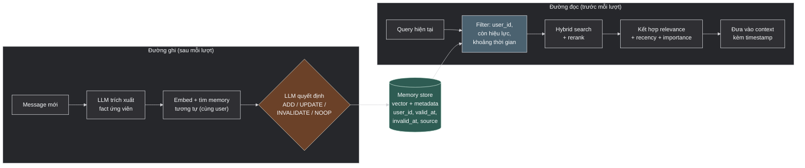

> **Thiết kế dữ liệu và cách đọc benchmark memory**
>
> - **Thứ bạn embed không phải là thứ bạn trả về.** Thiết kế key/value tách biệt (LongMemEval) là đòn bẩy lớn nhất mà nhiều hệ thống bỏ qua: embed fact đã chuẩn hóa ("user sống ở Sài Gòn") để tìm cho chính xác, nhưng trả về đoạn hội thoại gốc để LLM có đủ ngữ cảnh và có thể trích dẫn.
> - **Fact cũ và fact mới có embedding gần như giống hệt nhau.** "Tôi sống ở Hà Nội" và "Tôi sống ở Sài Gòn" có cosine similarity rất cao vì cùng cấu trúc và chủ đề. Embedding *không thể* cho bạn biết cái nào đang đúng — chỉ metadata thời gian và logic invalidation mới làm được.
> - **Viết timestamp vào context, không chỉ vào metadata.** Nếu LLM nhận "user thích cà phê" mà không kèm "(ghi nhận 03/2024)", nó không có cách nào suy luận rằng thông tin có thể đã cũ. Zep format fact kèm khoảng hiệu lực vì lý do này.
> - **Kết quả benchmark memory phụ thuộc mạnh vào answer model và judge.** Cùng một memory layer, thay LLM trả lời hoặc LLM chấm điểm sẽ cho con số khác. Paper Mem0 còn loại bỏ category câu hỏi adversarial của LOCOMO vì thiếu ground truth. Khi so sánh vendor, phải hỏi: dataset nào, category nào, answer model nào, judge nào, ai tự chạy.
> - **Con số vendor tự báo cáo thường mâu thuẫn nhau.** Paper Mem0 chạy lại Zep trên LOCOMO và báo cáo 65.99%, thấp hơn cách Zep tự trình bày; các bên thứ ba còn đưa ra con số khác nữa. Hãy tự đánh giá trên dữ liệu của mình (§3.6).
> - **Memory làm tăng chi phí *ghi*, không chỉ giảm chi phí *đọc*.** Pipeline kiểu Mem0 gọi LLM ít nhất một lần để extract và thêm một lần cho mỗi fact để quyết định thao tác — *trên mỗi lượt hội thoại*. Các con số "giảm 90% token" trong paper đo ở pha trả lời, không bao gồm toàn bộ chi phí vòng đời.

> **Rủi ro khi ghi, chia sẻ và xóa bộ nhớ**
>
> - **"Cứ lưu hết hội thoại vào vector DB rồi top-K" không phải là memory.** Cách này thất bại đúng ở các năng lực LongMemEval đo: không xử lý được cập nhật kiến thức (fact cũ vẫn được retrieve), không có khái niệm thời gian, và không bao giờ biết "không có thông tin" (vector search luôn trả về *thứ gì đó*). Tối thiểu cần: metadata thời gian, cơ chế invalidate, và ngưỡng similarity để abstain.
> - **Memory là bề mặt tấn công mới — ai chat được với agent là ghi được vào memory.** Nghiên cứu **MINJA** (Memory INJection Attack, 2025) cho thấy kẻ tấn công **không cần** quyền truy cập memory store: chỉ bằng cách gửi query thông thường qua giao diện chuẩn, kèm "bridging steps" và kỹ thuật rút ngắn dần prompt chỉ dẫn, họ cài được record độc hại mà sau đó sẽ được retrieve khi *user khác* hỏi câu liên quan. Paper báo cáo injection success rate trên 95% và attack success rate trên 70% với đa số dataset (lưu ý: các nghiên cứu sau đánh giá rằng con số này đạt được trong điều kiện lý tưởng hóa). Trước đó, **AgentPoison** (NeurIPS 2024) đã chứng minh có thể tối ưu một trigger để ánh xạ query chứa trigger vào **một vùng riêng biệt, nhỏ gọn trong embedding space** nơi các demonstration độc hại được đặt sẵn — tấn công khai thác trực tiếp hình học của embedding, trong khi hiệu năng trên query bình thường hầu như không đổi nên rất khó phát hiện.
> - **Memory dùng chung giữa các user là rủi ro lớn nhất.** Nếu memory store không được partition theo `user_id`/tenant ở tầng filter (không phải bằng cách "hy vọng" similarity tự lọc), thông tin của user A có thể xuất hiện trong câu trả lời cho user B. Đây vừa là lỗi bảo mật vừa là kênh lan truyền của memory poisoning.
> - **Xóa message gốc không xóa được những gì đã suy ra từ nó.** Khi user yêu cầu "quên điều tôi đã nói" (hoặc yêu cầu xóa dữ liệu theo luật bảo vệ dữ liệu cá nhân), fact đã extract, summary đệ quy, reflection và các edge trong graph đều có thể vẫn chứa thông tin đó. Hãy lưu **lineage** (fact nào sinh ra từ message nào) ngay từ đầu, nếu không việc xóa triệt để gần như không khả thi. Embedding của fact cũng là dữ liệu cá nhân (xem §3.8 về embedding inversion).
> - **LLM quyết định UPDATE/DELETE có thể sai và sai một cách im lặng.** Một lần phân loại nhầm DELETE là mất fact đúng vĩnh viễn. Ưu tiên **invalidate** (đánh dấu hết hiệu lực, giữ lại lịch sử) thay vì xóa cứng, và log mọi thao tác ghi để có thể audit/rollback.
> - **Reflection khuếch đại lỗi.** Một quan sát sai được tổng hợp thành insight bậc cao, insight đó lại được retrieve (và được làm mới recency) rồi dùng làm nền cho reflection tiếp theo. Memory "tự củng cố" là con dao hai lưỡi.

### Mã giả: Memory layer với hợp nhất và hiệu lực theo thời gian

```text
# ---------- WRITE PATH: after each conversation turn ----------
def write_memory(user_id, new_messages, now):
    candidates = llm_extract_facts(
        messages=new_messages,
        summary=get_rolling_summary(user_id),
        recent=get_recent_messages(user_id, m=10)
    )
    for fact in candidates:
        fact_vec = embed(fact.text, input_type="document")
        # Always scope by user — never rely on similarity to separate users
        neighbors = vector_search(fact_vec, top_k=10,
                                  filter={"user_id": user_id, "invalid_at": None})
        op = llm_decide(fact, neighbors)        # ADD | UPDATE | INVALIDATE | NOOP

        if op.type == "ADD":
            insert(user_id, key_text=fact.text, key_vec=fact_vec,
                   value=new_messages,            # raw source as value (key != value)
                   valid_at=fact.valid_at or now, invalid_at=None,
                   source_ids=[m.id for m in new_messages])   # lineage for deletion
        elif op.type == "INVALIDATE":
            # Soft-invalidate instead of hard delete; keep history
            mark_invalid(op.target_id, invalid_at=fact.valid_at or now, expired_at=now)
            insert(user_id, key_text=fact.text, key_vec=fact_vec, value=new_messages,
                   valid_at=fact.valid_at or now, invalid_at=None,
                   source_ids=[m.id for m in new_messages])
        elif op.type == "UPDATE":
            update(op.target_id, key_text=op.merged_text,
                   key_vec=embed(op.merged_text, input_type="document"))
        audit_log(user_id, fact, op, now)

# ---------- READ PATH: before answering ----------
def recall(user_id, query, now, k=8):
    time_range = infer_time_range(query, now)      # time-aware query expansion
    q_vec = embed(query, input_type="query")
    scope = {"user_id": user_id}
    if time_range:
        scope["valid_during"] = time_range         # historical question: include invalidated facts
    else:
        scope["invalid_at"] = None                 # "now" question: only currently valid facts
    hits = hybrid_search(q_vec, query, top_k=50, filter=scope)
    hits = rerank(query, hits)
    if not hits or hits[0].rerank_score < ABSTAIN_THRESHOLD:
        return []                                  # allow "I don't know"
    for h in hits:
        h.score = (minmax(h.rerank_score)
                   + minmax(0.995 ** hours_since(h.last_accessed, now))
                   + minmax(h.importance))
    top = sorted(hits, key=lambda h: h.score, reverse=True)[:k]
    touch_last_accessed(top, now)
    # Render facts WITH validity dates so the LLM can reason about staleness
    return [f"{h.key_text} (valid {h.valid_at}–{h.invalid_at or 'now'})" for h in top]
```

> Sources: [Generative Agents (arXiv 2304.03442)](https://arxiv.org/abs/2304.03442), [MemGPT (arXiv 2310.08560)](https://arxiv.org/abs/2310.08560), [CoALA (arXiv 2309.02427)](https://arxiv.org/abs/2309.02427), [LongMemEval (arXiv 2410.10813)](https://arxiv.org/abs/2410.10813), [Mem0 (arXiv 2504.19413)](https://arxiv.org/abs/2504.19413), [Zep (arXiv 2501.13956)](https://arxiv.org/abs/2501.13956), [Graphiti](https://github.com/getzep/graphiti), [MINJA (arXiv 2503.03704)](https://arxiv.org/abs/2503.03704), [AgentPoison (NeurIPS 2024)](https://arxiv.org/abs/2407.12784)

---

## 2.10 Code Retrieval cho Coding Agents

Trước khi sửa code, agent phải tìm được phần liên quan. Yêu cầu có thể chỉ mô tả triệu chứng: “tìm mọi chỗ ta xử lý sai mảng rỗng”, chưa có tên hàm hay đường dẫn. Đây là một nhu cầu lớn của code retrieval: trong bài ra mắt `voyage-code-4` (08/2026), Voyage AI cho biết coding agent tạo ra phần lớn truy vấn tìm code mà họ phục vụ. Các công cụ như Claude Code, Cursor, Copilot agent và Codex giải bài toán này bằng những tổ hợp công cụ khác nhau.

### Vì sao code khác văn bản thông thường?

| Đặc điểm | Văn bản tự nhiên | Source code | Hệ quả cho retrieval |
|----------|-----------------|-------------|---------------------|
| **Định danh chính xác** | "ô tô" ≈ "xe hơi" là đủ | `createD1HttpClient` hoặc có, hoặc không | Exact match (grep/BM25) rất mạnh; embedding có thể trả về code "na ná" nhưng sai symbol |
| **Hai loại query** | Chủ yếu text → text | NL → code ("xử lý auth ở đâu?") **và** code → code (tìm đoạn tương tự, tìm caller) | Một model phải tốt cả hai, hoặc cần nhiều công cụ |
| **Cấu trúc** | Đoạn văn, tiêu đề | Cây cú pháp: module → class → function → block | Cắt theo số ký tự dễ chặt đôi một function |
| **Phụ thuộc xa** | Ít | Ý nghĩa nằm ở call graph, import, type — rải trên nhiều file | Một chunk đơn lẻ thường thiếu ngữ cảnh |
| **Tốc độ thay đổi** | Docs đổi theo tuần/tháng | Code đổi theo **từng phút** khi agent đang sửa | Index rất dễ stale |
| **Truy cập** | Thường công khai trong tổ chức | Mỗi người chỉ có quyền với repo/branch của mình | Index chung có nguy cơ lộ code |

### Hai trường phái: "Agentic search" và "Semantic index"

**Agentic search (pull).** Agent không có index nào được build sẵn. Nó tự gọi công cụ hệ thống file — liệt kê file theo pattern (glob), tìm theo regex (grep/ripgrep), đọc file — rồi dựa vào kết quả để quyết định tìm tiếp gì. LLM vừa là query planner vừa là reranker: thấy tên một hàm trong kết quả, nó grep tiếp định nghĩa của hàm đó. Claude Code đi theo hướng này. Boris Cherny (người tạo Claude Code) viết trên Hacker News ngày 24/02/2025: *"Claude Code doesn't use RAG currently. In our testing we found that agentic search out-performed RAG for the kinds of things people use Code for."*

**Semantic index (embedding như một công cụ).** Codebase được chunk, embed và đưa vào vector index; agent có thêm một tool "semantic search" bên cạnh grep. Cursor đi theo hướng này và công bố đánh giá trên bộ Cursor Context Bench: thêm semantic search vào bên cạnh grep giúp **accuracy trả lời câu hỏi tăng trung bình 12.5% (6.5%–23.5% tùy model)**, với *mọi* model được thử, và hiệu quả rõ nhất ở codebase lớn. Kết luận của chính Cursor: **kết hợp grep và semantic search cho kết quả tốt nhất**, không phải chỉ một trong hai.

Trong cùng thread Hacker News, cộng đồng đã đưa ra một phân biệt hữu ích:

- **RAG cổ điển (push):** hệ thống tìm trước, *đẩy* kết quả vào prompt; model không kiểm soát việc tìm kiếm.
- **Agentic search (pull):** model *kéo* thông tin bằng tool call; nó kiểm soát công cụ nào, query nào, tìm bao nhiêu lần.

Semantic search có thể là một công cụ để agent chủ động gọi trong quá trình tìm kiếm. Do đó, cần chọn công cụ theo loại query: tìm chuỗi đã biết, định vị một khái niệm chưa biết tên, hay lần theo quan hệ giữa các symbol.

| Loại câu hỏi | Công cụ phù hợp | Ví dụ |
|-------------|-----------------|-------|
| Biết chính xác tên symbol / chuỗi | grep / regex | "Tìm mọi chỗ gọi `parseConfig(`" |
| Biết khái niệm, không biết tên | Semantic search (embedding) | "Rate limiting được implement ở đâu?" |
| Cần quan hệ cấu trúc | LSP / code graph (go-to-definition, find-references) | "Ai gọi hàm này? Interface này có những implementation nào?" |
| Triệu chứng mơ hồ | Semantic search để định hướng → grep/LSP để xác nhận | "Tại sao đôi khi upload bị timeout?" |

### Chunking code theo cây cú pháp — cAST

Cắt code theo số dòng hoặc ký tự có thể tách signature khỏi thân hàm, hoặc ghép đuôi hàm này với đầu hàm khác. Chunk khi đó thiếu ngữ cảnh cho cả embedding model lẫn LLM. Phần §3.3 bàn rộng hơn về cách chọn ranh giới chunk.

**cAST** (Zhang et al., 2025) đề xuất chunking dựa trên **Abstract Syntax Tree** (dùng thư viện tree-sitter để parse):

1. Parse file thành cây AST (module → class → function → statement...).
2. Duyệt từ trên xuống: nếu cả một node lớn (ví dụ một class) vừa ngân sách thì giữ nguyên làm một chunk.
3. Node nào vượt ngân sách thì **đệ quy tách** thành các node con.
4. Sau khi tách, **gộp tham lam (greedy merge)** các node anh em nhỏ liền kề vào cùng một chunk để tránh tạo quá nhiều chunk vụn (ví dụ gộp các dòng import, các hàm getter ngắn).

cAST đo kích thước bằng số ký tự không phải khoảng trắng. Hai đoạn cùng 50 dòng có thể chứa lượng code rất khác nhau: dòng import, dòng trống và biểu thức dài không mang cùng lượng thông tin.

Theo paper, Recall@5 trên RepoEval (code → code) tăng **4.3 điểm**, còn Pass@1 trên SWE-bench tăng **2.67 điểm**. Trên SWE-bench retrieval, bài toán NL → code khó hơn, Recall chỉ tăng **0.7–1.1 điểm**. Lợi ích của chunking vì thế cần được đo theo đúng loại truy vấn.

**Ví dụ minh họa** — cùng một file Python, ngân sách ~400 ký tự:

```text
Fixed-size chunking:                      AST chunking (cAST-style):
┌──────────────────────────────┐          ┌──────────────────────────────┐
│ import os, json              │          │ import os, json              │
│ class Cache:                 │          │ (merged: imports + constants)│
│   def __init__(self, ttl):   │          ├──────────────────────────────┤
│     self.ttl = ttl           │          │ class Cache:                 │
│   def get(self, key):        │          │   def __init__(...): ...     │
│     entry = self._store.get( │ ← cắt    │   def get(self, key): ...    │
├──────────────────────────────┤   giữa   │   (whole method kept intact) │
│       key)                   │   hàm    ├──────────────────────────────┤
│     if entry.expired(): ...  │          │   def evict(self): ...       │
│   def evict(self): ...       │          │                              │
└──────────────────────────────┘          └──────────────────────────────┘
```

### Embedding model chuyên cho code

Model đa dụng embed code được, nhưng model chuyên code thường tốt hơn đáng kể. Snapshot November 2026:

| Model | Điểm đáng chú ý |
|-------|----------------|
| **voyage-code-4** (Voyage AI, 13/08/2026) | Context 32K tokens; MRL 2048/1024/512/256 dims; quantization float/int8/uint8/binary/ubinary; $0.12/1M tokens (rẻ hơn 1/3 so với voyage-code-3); huấn luyện trên corpus khai thác từ các pull request sửa issue của hàng chục nghìn repo |
| **voyage-code-3** | Thế hệ trước (12/2024), vẫn được nhiều hệ thống dùng |
| **Model tự huấn luyện** | Cursor huấn luyện embedding model riêng cho semantic search của họ |
| Model đa dụng (Gemini Embedding 2, Cohere Embed v4, OpenAI v3...) | Dùng được, nhưng kém hơn model chuyên code trên benchmark của Voyage |

**Benchmark "agentic code retrieval" của Voyage** đáng học về *cách thiết kế eval*: mỗi query là **mô tả issue** (chỉ có triệu chứng), và tài liệu liên quan là **các file mà PR sửa lỗi đã merge thực sự chạm vào**. Cách xây dựng này đo đúng việc agent cần làm trước khi sửa code: từ triệu chứng, định vị code cần thay đổi. Trên bộ 19 benchmark này (NDCG@10), Voyage báo cáo `voyage-code-4` vượt voyage-code-3, Cohere Embed v4, Gemini Embedding 2 và OpenAI v3 large lần lượt **27.54%, 28.25%, 31.03% và 48.58%** — đây là số **do vendor tự báo cáo**, nên tự kiểm chứng trên codebase của bạn. Voyage cũng cho biết `rerank-3` cải thiện ~2.1% so với rerank-2.5 trên các dataset code.

> 💡 Bạn có thể áp dụng cùng ý tưởng để tạo eval set **miễn phí** cho codebase của mình: lấy lịch sử issue/ticket đã đóng, query = mô tả issue, ground truth = các file trong commit/PR sửa nó. Đây là dữ liệu thật, phản ánh đúng câu hỏi user hỏi, và không cần gán nhãn thủ công (xem §3.6).

### Hạ tầng index: giữ index tươi và an toàn

Index code phải theo kịp tốc độ thay đổi của code. Cursor đã công bố khá chi tiết cách họ giải quyết, đáng tham khảo như một kiến trúc mẫu:

- **Merkle tree để đồng bộ tăng dần.** Mỗi file có một hash nội dung; mỗi thư mục có hash tính từ hash của các con. Khi sửa một file, chỉ hash của file đó và các thư mục cha lên tới gốc thay đổi. Client và server so sánh cây từ gốc và chỉ đi xuống các nhánh có hash khác nhau → chỉ đồng bộ đúng phần đã đổi. (Với workspace 50,000 file, riêng tên file + SHA-256 đã khoảng 3.2 MB — không muốn gửi lại mỗi lần.)
- **Cache embedding theo nội dung chunk.** File đổi thì được chunk lại theo cú pháp, nhưng phần lớn chunk không đổi → trùng hash → dùng lại embedding cũ. Embedding là bước đắt nhất, nên đây là tối ưu quan trọng nhất.
- **Tái sử dụng index của đồng nghiệp.** Cursor ghi nhận các bản clone của cùng một codebase trong một tổ chức **giống nhau trung bình 92%**. Client tính một *simhash* từ Merkle tree, server tìm index có simhash đủ gần (chính là một vector search!) và copy index đó làm điểm khởi đầu. Kết quả: thời gian tới query đầu tiên ở p99 giảm từ **4.03 giờ xuống 21 giây**.
- **Chứng minh quyền truy cập.** Để không lộ code mà user không có, client gửi Merkle tree của mình lên làm "content proof"; khi search, server **loại bỏ mọi kết quả thuộc file mà client không chứng minh được là đang có**. Bạn chỉ tính được hash của một file nếu bạn có file đó.
- **Một namespace cho mỗi codebase.** Cursor dùng turbopuffer (vector DB trên object storage, xem §3.2) với mỗi codebase là một namespace riêng; theo turbopuffer, hệ thống có hơn 80 triệu namespace — một kiểu workload mà vector DB truyền thống giữ mọi thứ trong RAM khó phục vụ kinh tế.
- **Đừng quên index cho grep.** Với monorepo rất lớn, Cursor cho biết họ thường xuyên thấy lệnh `rg` chạy hơn 15 giây, và đã xây index (dựa trên trigram) cho regex search. Agentic search *không* có nghĩa là "không cần index" ở quy mô lớn.

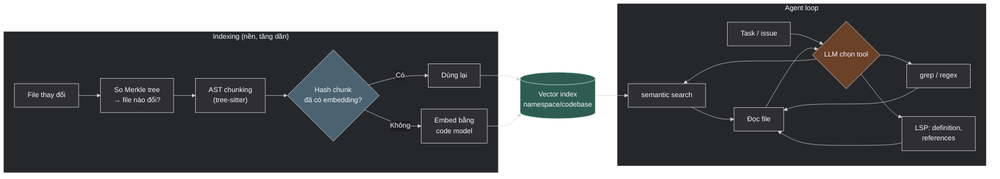

> **Chọn công cụ và chuẩn bị dữ liệu cho code retrieval**
>
> - **"Claude Code không dùng RAG" thường bị hiểu sai thành "embedding vô dụng cho code".** Phát biểu gốc nói agentic search tốt hơn RAG *cho các loại việc người dùng làm với Claude Code*, trong khi Cursor đo được semantic search *thêm vào* grep giúp tăng accuracy. Hai kết quả không mâu thuẫn: một bên so sánh "RAG đẩy sẵn context" với "agent tự tìm", bên kia so sánh "agent có grep" với "agent có grep + semantic search".
> - **Lợi ích của semantic search tăng theo kích thước codebase.** Ở repo nhỏ, vài lệnh grep là đủ phủ; ở monorepo hàng triệu dòng, agent không thể đoán đúng tên symbol và grep trả về quá nhiều kết quả.
> - **Embed kèm ngữ cảnh cấu trúc.** Một method `get(self, key)` đứng một mình gần như vô nghĩa. Thêm header như đường dẫn file, tên class, signature, docstring vào văn bản được embed (cùng tinh thần với contextual retrieval / contextualized chunk ở §3.3) giúp embedding phân biệt `Cache.get` với `HttpClient.get`.
> - **Index code là một bài toán bảo mật, không chỉ hiệu năng.** Index dùng chung giữa nhiều người phải lọc kết quả theo quyền truy cập ở tầng server (Cursor dùng content proof dựa trên Merkle tree). Thêm vào đó, embedding của code là dữ liệu nhạy cảm vì có thể bị khôi phục một phần (xem §3.8).
> - **Eval set tốt nhất nằm sẵn trong issue tracker và git history.** Issue → các file được sửa là cặp query–ground truth tự nhiên, phản ánh đúng phân phối câu hỏi thật.

> **Lỗi thường gặp khi dùng index code**
>
> - **Đừng embed code bằng fixed-size chunking của pipeline văn bản.** Function bị chặt đôi, chunk mang nửa logic, và LLM nhận được code không compile được trong đầu. Dùng chunking theo AST (tree-sitter hỗ trợ hầu hết ngôn ngữ phổ biến).
> - **Đừng để semantic search thay thế exact search.** Khi agent cần *mọi* chỗ gọi một hàm để refactor, semantic search top-K sẽ bỏ sót — chỉ grep/LSP cho kết quả đầy đủ. Bỏ sót một call site là bug.
> - **Index stale nguy hiểm hơn không có index.** Agent vừa sửa `foo()` thành `bar()`, nhưng index chưa cập nhật nên semantic search vẫn trả về `foo()` ở vị trí cũ — agent có thể "sửa" lại code đã sửa hoặc đọc dòng không còn tồn tại. Luôn đọc file thật trước khi sửa, và cập nhật index tăng dần theo hash.
> - **Đừng tin benchmark vendor như tin đo lường của chính mình.** Các con số +27% hay +12.5% đều do bên phát hành tự đo trên eval của họ. Codebase của bạn (ngôn ngữ, quy mô, quy ước đặt tên) có thể cho kết quả khác.
> - **Code đã sinh ra (vendored, generated, minified) làm bẩn index.** `node_modules`, file protobuf sinh tự động, bundle JS... vừa tốn chi phí embed vừa chiếm chỗ trong top-K. Áp dụng ignore pattern (`.gitignore` và hơn thế) trước khi index.

### Mã giả: Index code tăng dần và công cụ tìm kiếm cho agent

```text
# ---------- Incremental indexing ----------
def sync_index(repo, index):
    changed, deleted = diff_merkle_tree(repo.merkle_root(), index.merkle_root())
    for path in deleted:
        index.delete(filter={"path": path})
    for path in changed:
        if is_ignored(path) or is_generated(path):       # vendored, minified, build output
            continue
        tree = tree_sitter_parse(read(path), lang=detect_lang(path))
        chunks = ast_chunk(tree, max_non_ws_chars=1500)  # split big nodes, merge small siblings
        index.delete(filter={"path": path})
        for c in chunks:
            text = f"# {path} :: {c.enclosing_scope}\n{c.signature}\n{c.code}"  # structural header
            h = sha256(text)
            vec = embedding_cache.get(h) or embedding_cache.put(h, embed(text, model="code-embedding-model", input_type="document"))
            index.upsert(id=f"{path}:{c.start_line}", vector=vec,
                         metadata={"path": path, "start": c.start_line, "end": c.end_line,
                                   "symbol": c.symbol_name, "content_hash": h})

# ---------- Tools exposed to the agent ----------
def tool_semantic_search(query, user, k=10):
    q = embed(query, model="code-embedding-model", input_type="query")
    hits = index.search(q, top_k=50)
    hits = [h for h in hits if user.can_read(h.metadata["path"])]   # access filter on server
    return rerank(query, hits)[:k]       # return path + line range, agent reads the real file

def tool_grep(pattern):  return ripgrep(pattern)            # exhaustive, exact
def tool_refs(symbol):   return lsp.find_references(symbol)  # structural, exhaustive
```

> Sources: [cAST (arXiv 2506.15655)](https://arxiv.org/abs/2506.15655), [Cursor — Improving agent with semantic search](https://cursor.com/blog/semsearch), [Cursor — Secure codebase indexing](https://cursor.com/blog/secure-codebase-indexing), [Cursor — Fast regex search](https://cursor.com/blog/fast-regex-search), [Hacker News — Boris Cherny về agentic search](https://news.ycombinator.com/item?id=43164253), [voyage-code-4 Blog](https://blog.voyageai.com/2026/08/13/voyage-code-4/), [rerank-3 Blog](https://blog.voyageai.com/2026/09/30/rerank-3/), [turbopuffer — Cursor case study](https://turbopuffer.com/customers/cursor)

---

## 2.11 Semantic Caching — Dùng embedding để khỏi gọi LLM hai lần

Trong nhiều ứng dụng (chatbot hỗ trợ khách hàng, trợ lý tài liệu, FAQ nội bộ), người dùng hỏi đi hỏi lại cùng một câu theo những cách diễn đạt khác nhau: *"Làm sao đổi mật khẩu?"*, *"Quên mật khẩu thì reset thế nào?"*, *"Cách đặt lại password"*. Mỗi lần gọi LLM tốn tiền và mất vài giây. **Semantic cache** đặt một lớp ở giữa ứng dụng và LLM: embed câu hỏi mới, tìm câu hỏi đã từng được trả lời có embedding đủ gần, và nếu đủ gần thì **trả lại câu trả lời cũ** mà không gọi LLM.

Rủi ro nằm ở lần “trúng nhầm”: hệ thống tìm được một câu hỏi gần nghĩa nhưng câu trả lời cũ không áp dụng được. Khi đó, cache trả lời sai ngay, thay vì chuyển yêu cầu cho LLM xử lý.

### Phân biệt ba loại cache

| Loại cache | Khóa (key) | Lưu gì | Có thể trả sai? |
|-----------|-----------|--------|-----------------|
| **Exact-match cache** | Hash của toàn bộ prompt | Response | Không (trừ khi dữ liệu nền đã đổi) |
| **Prompt caching / KV cache** (do provider cung cấp) | Prefix token giống hệt | Trạng thái tính toán (KV) của prefix | **Không** — model vẫn sinh output mới, chỉ bỏ qua phần tính lại prefix |
| **Semantic cache** | **Embedding** của prompt + ngưỡng similarity | Response | **Có** — đây là bản chất của nó |

Prompt caching của provider và semantic cache **bổ trợ nhau**, không thay thế nhau: prompt caching làm những lời gọi *cần thiết* rẻ hơn, còn semantic cache loại bỏ những lời gọi *không cần thiết*.

### Cơ chế cơ bản

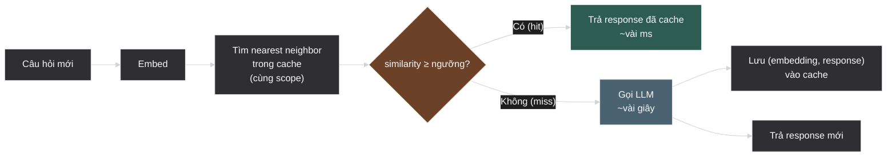

Ngưỡng similarity quyết định khi nào hệ thống dùng lại câu trả lời. Cần kiểm tra quyết định này bằng cả những cặp gần nghĩa nhưng khác đáp án.

### Vấn đề cốt lõi: không ngưỡng tĩnh nào tách sạch "cùng ý" và "khác ý"

Hai câu hỏi gần nhau trong không gian embedding chưa chắc dùng chung được một câu trả lời. Sự khác biệt có thể nằm ở hành động, chiều quan hệ, phủ định hoặc một con số:

| Câu hỏi đã cache | Câu hỏi mới | Vì sao không được dùng chung câu trả lời |
|-----------------|-------------|----------------------------------------|
| "Làm sao **hủy** gói cước?" | "Làm sao **đổi** gói cước?" | Khác hành động |
| "Vé từ Hà Nội **đi** Sài Gòn giá bao nhiêu?" | "Vé từ Sài Gòn **đi** Hà Nội giá bao nhiêu?" | Đảo chiều — gần như cùng tập từ |
| "Thuốc này **có** dùng được cho trẻ em không?" | "Thuốc này **không** dùng cho ai?" | Phủ định |
| "Doanh thu **quý 2**?" | "Doanh thu **quý 3**?" | Chỉ khác một con số |
| "Chính sách đổi trả **hiện tại**?" (cache từ tháng trước) | Cùng câu hỏi | Câu hỏi giống hệt nhưng **sự thật đã đổi** |

Nâng ngưỡng, chẳng hạn lên 0.95, giảm trúng nhầm nhưng cũng làm giảm hit rate; mỗi request vẫn tốn một lần embed và tìm vector. Hạ ngưỡng tăng khả năng dùng lại cache, đồng thời tăng lỗi. Những cặp diễn đạt lại cùng ý và những cặp cần đáp án khác nhau có thể nằm xen kẽ trong cùng khoảng điểm.

**Số liệu tham khảo.** Paper **GPT Semantic Cache** (2024) báo cáo giảm tới 68.8% lời gọi API, hit rate 61.6%–68.8% tùy loại câu hỏi, và tỷ lệ hit đúng (positive hit rate) trên 97% trên tập câu hỏi kiểu chăm sóc khách hàng. Hãy đọc con số này đúng cách: kể cả khi "trên 97% đúng", **cứ khoảng 30 lần trả từ cache thì có thể có một lần trả lời sai** — chấp nhận được với FAQ, không chấp nhận được với tư vấn y tế.

### vCache — Ngưỡng riêng cho từng entry, có cam kết tỷ lệ lỗi

**vCache** (Schroeder et al., UC Berkeley/TU Munich/ETH/Stanford, ICLR 2026) chỉ ra rằng ngưỡng tĩnh dùng chung cho mọi request **không cho bất kỳ bảo đảm đúng đắn nào**, dẫn tới tỷ lệ lỗi khó lường và hit rate không tối ưu. Cách giải quyết:

1. **Ngưỡng riêng cho từng entry trong cache.** Một câu hỏi như "giờ mở cửa?" có thể chấp nhận nhiều cách diễn đạt; một câu hỏi chứa con số cụ thể thì cần gần như trùng khớp. Không có lý do gì để chúng dùng chung một ngưỡng.
2. **Mô hình xác suất đúng theo similarity.** Với mỗi entry, vCache ước lượng $\Pr(\text{response đúng} \mid \text{similarity})$ bằng một hàm **sigmoid**, học online từ các quan sát.
3. **Explore / exploit.** Khi một request rơi gần entry, vCache tính một xác suất khám phá $\tau$ (càng ít chắc chắn thì $\tau$ càng lớn). Với xác suất $\tau$, nó **vẫn gọi LLM** và so sánh câu trả lời mới với câu trả lời đã cache để có thêm một nhãn "đúng/sai" cho entry đó; ngược lại nó trả response từ cache.
4. **Cam kết tỷ lệ lỗi.** $\tau$ được hiệu chỉnh để tỷ lệ lỗi tổng thể nằm dưới ngưỡng $\delta$ do người dùng đặt (ví dụ 1%).

Theo paper, vCache luôn giữ được tỷ lệ lỗi dưới mức đặt ra, đồng thời đạt hit rate cao hơn tới **12.5×** và tỷ lệ lỗi thấp hơn tới **26×** so với baseline ngưỡng tĩnh và embedding được fine-tune. Lưu ý điều kiện: bảo đảm này dựa trên hai giả định — request đến theo phân phối **i.i.d.**, và quan hệ similarity → xác suất đúng có dạng **sigmoid**. Lưu lượng thực tế (theo mùa, theo sự kiện, bị tấn công) có thể vi phạm giả định thứ nhất.

### Những thứ phải nằm trong "khóa cache" ngoài embedding

Chỉ embed tin nhắn cuối cùng sẽ bỏ qua những yếu tố có thể làm thay đổi câu trả lời:

| Yếu tố | Nếu bỏ qua thì sao |
|--------|-------------------|
| **Lịch sử hội thoại** | "Thế còn gói kia thì sao?" — embedding của câu này gần như vô nghĩa nếu đứng một mình, và sẽ khớp với một câu "thế còn..." bất kỳ khác |
| **User / tenant** | Câu trả lời cá nhân hóa (số dư, đơn hàng, quyền) của user A bị trả cho user B |
| **Phiên bản system prompt, model, tài liệu RAG** | Đổi prompt hoặc cập nhật tài liệu nhưng cache vẫn trả câu trả lời theo phiên bản cũ |
| **Thời gian (TTL)** | Giá, tồn kho, chính sách, tin tức — câu trả lời đúng hôm qua có thể sai hôm nay |
| **Embedding model** | Đổi embedding model → vector cũ và mới không so sánh được; phải xóa toàn bộ cache (xem §3.10) |

Cách làm an toàn: các yếu tố rời rạc (tenant, phiên bản prompt, model, ngôn ngữ) đưa vào **namespace/metadata filter** — chỉ so similarity *trong cùng scope*. Hội thoại nhiều lượt thì hoặc không cache, hoặc viết lại câu hỏi thành dạng độc lập ("standalone question") trước khi embed.

### Khi nào **không** nên dùng semantic cache

- **Câu trả lời phụ thuộc thời gian thực:** giá, tồn kho, trạng thái đơn hàng, "hôm nay có gì mới".
- **Câu trả lời cá nhân hóa** mà bạn không thể scope theo user.
- **Lượt có tác dụng phụ:** agent gọi tool để đặt hàng, gửi email — "câu trả lời" là một hành động, không phải chuỗi văn bản tái sử dụng được.
- **Lĩnh vực rủi ro cao** (y tế, pháp lý, tài chính) nếu không có lớp xác minh.
- **Lưu lượng ít lặp lại:** mỗi request vẫn tốn embedding + vector search; nếu hit rate thấp, độ trễ trung bình *tăng* chứ không giảm.

> **Hiệu chỉnh và đo lường semantic cache**
>
> - **Ngưỡng tốt nhất là theo từng entry, không phải toàn cục.** Đây là phát hiện chính của vCache. Nếu không dùng vCache, ít nhất hãy có ngưỡng khác nhau theo intent/loại câu hỏi.
> - **Thêm một tầng xác minh rẻ hơn LLM.** Khi similarity rơi vào vùng xám, cho một cross-encoder/reranker (§2.2) hoặc một LLM nhỏ chấm "hai câu này có cùng câu trả lời không?" — rẻ hơn nhiều so với sinh lại câu trả lời, và bắt được các lỗi đảo chiều/phủ định mà bi-encoder bỏ qua.
> - **Đo false-hit rate, không chỉ hit rate.** Dashboard chỉ có hit rate sẽ khuyến khích hạ ngưỡng. Lấy mẫu các lần hit cho người hoặc LLM-judge đánh giá; tín hiệu "user hỏi lại ngay sau khi nhận câu trả lời từ cache" là proxy hữu ích cho trúng nhầm.
> - **Semantic cache tạo ra kênh rò rỉ thông tin qua thời gian phản hồi.** Paper *"The Early Bird Catches the Leak"* (2024) chứng minh kẻ tấn công có thể đo thời gian phản hồi để phát hiện cache hit, từ đó suy ra prompt của người dùng khác trong cả KV cache lẫn semantic cache dùng chung. Một nghiên cứu khác (*Auditing Prompt Caching in Language Model APIs*, 2025) phát hiện cache được chia sẻ toàn cục giữa các user ở 7 API provider. Cache dùng chung giữa các tenant là một quyết định bảo mật, không chỉ là tối ưu chi phí.
> - **Cache càng lớn, xác suất trúng nhầm càng cao.** Với hàng triệu entry, gần như mọi câu hỏi mới đều có *một* hàng xóm nào đó vượt ngưỡng tĩnh. Bài báo vCache ghi nhận tỷ lệ lỗi của GPTCache (ngưỡng tĩnh) tăng dần khi số mẫu tăng. Cần eviction (LRU/TTL) và giới hạn kích thước, không chỉ vì bộ nhớ.

> **Ngăn trả lời nhầm và vô hiệu hóa cache cũ**
>
> - **"Cosine 0.9 là gần như giống hệt" — sai.** Giá trị cosine phụ thuộc mạnh vào embedding model (mỗi model có phân phối similarity riêng, xem §1.3), và các cặp đảo chiều/phủ định/khác con số có thể vượt 0.9. Ngưỡng phải được hiệu chỉnh trên dữ liệu của chính bạn, với chính model của bạn.
> - **Đừng copy ngưỡng từ blog.** Các con số kiểu "0.8 là sweet spot" hay "0.92–0.95 cho câu hỏi factual" chỉ đúng với model và phân phối câu hỏi mà tác giả đã đo.
> - **Cache poisoning.** Nếu response được cache từ câu hỏi của user bất kỳ, kẻ tấn công có thể cố tình hỏi một câu khiến LLM trả lời sai/độc hại (qua prompt injection), và câu trả lời đó sẽ được phục vụ cho mọi user hỏi câu tương tự. Chỉ cache response đã qua kiểm duyệt, hoặc chỉ cache trong phạm vi một user.
> - **Đổi bất cứ thứ gì ở phía sau (model, prompt, tài liệu) phải vô hiệu hóa cache tương ứng.** Nếu không, bạn sẽ "deploy" một bản sửa lỗi mà người dùng không bao giờ thấy.

### Mã giả: Semantic cache có scope, vùng xám và xác minh

```text
def answer(request):
    scope = {
        "tenant": request.tenant_id,
        "prompt_version": SYSTEM_PROMPT_VERSION,
        "llm": LLM_MODEL_ID,
        "embedder": EMBED_MODEL_ID,
        "kb_version": knowledge_base.version(),
    }
    if not is_cacheable(request):           # time-sensitive, personalized, tool side effects...
        return call_llm(request)

    # Multi-turn: rewrite into a self-contained question before embedding
    question = standalone_question(request.history, request.message)
    q_vec = embed(question, input_type="query")
    hit = cache.nearest(q_vec, filter=scope)          # similarity only within the same scope

    if hit and not hit.expired() and hit.similarity >= hit.threshold_high:
        log_cache_event("hit", hit)
        return hit.response
    if hit and not hit.expired() and hit.similarity >= hit.threshold_low:
        # Grey zone: cheap verification instead of trusting cosine alone
        if same_answer_judge(question, hit.question):  # cross-encoder or small LLM
            log_cache_event("verified_hit", hit)
            return hit.response

    response = call_llm(request)
    if passes_moderation(response):                     # avoid caching poisoned outputs
        cache.put(q_vec, question, response, metadata=scope, ttl=ttl_for(request))
    log_cache_event("miss", hit)
    return response
```

> Sources: [vCache (arXiv 2502.03771)](https://arxiv.org/abs/2502.03771), [vCache GitHub](https://github.com/vcache-project/vCache), [GPT Semantic Cache (arXiv 2411.05276)](https://arxiv.org/abs/2411.05276), [GPTCache](https://github.com/zilliztech/GPTCache), [The Early Bird Catches the Leak (arXiv 2409.20002)](https://arxiv.org/abs/2409.20002), [Auditing Prompt Caching in Language Model APIs (arXiv 2502.07776)](https://arxiv.org/abs/2502.07776)

---

## 2.12 Tool Retrieval — Khi agent có quá nhiều công cụ

Một agent hiện đại không chỉ có vài tool. Kết nối với GitHub, Slack, Jira, Google Drive, Sentry, Grafana qua MCP (Model Context Protocol), mỗi server mang theo hàng chục tool, và tổng số nhanh chóng lên tới hàng trăm. Mỗi tool definition (tên, mô tả, JSON schema của tham số) phải nằm trong context để model biết mà gọi. Theo tài liệu của Anthropic, một cấu hình nhiều MCP server điển hình (GitHub, Slack, Sentry, Grafana, Splunk) có thể tiêu tốn **khoảng 55K tokens chỉ cho tool definitions** trước khi model làm bất cứ việc gì.

Vấn đề không chỉ là chi phí. Khả năng **chọn đúng tool giảm dần khi số tool vượt quá khoảng 30–50**: các tool có tên và mô tả gần giống nhau (`notification-send-user` và `notification-send-channel`) khiến model nhầm lẫn. **Tool retrieval** áp dụng đúng ý tưởng của RAG cho tool: thay vì đưa *mọi* tool vào context, chỉ tìm và nạp những tool liên quan đến việc đang làm.

### Bằng chứng: tool retrieval cải thiện cả chi phí lẫn độ chính xác

| Nguồn | Thiết lập | Kết quả |
|-------|----------|---------|
| **Anthropic — Advanced tool use** (11/2025) | Tool Search Tool với 50+ MCP tools, đánh giá MCP nội bộ | Context ban đầu từ ~77K xuống ~8.7K tokens (giảm ~85%); accuracy Opus 4 **49% → 74%**, Opus 4.5 **79.5% → 88.1%** |
| **RAG-MCP** (Gan et al., 2025) | Dùng semantic retrieval chọn MCP liên quan trước khi gọi LLM, có "MCP stress test" | Giảm hơn 50% prompt tokens; accuracy chọn tool **13.62% → 43.13%** (gấp hơn 3 lần) |

Trong cả hai phép đo, giảm số tool được nạp vào context đi kèm với độ chính xác cao hơn. Kết quả gợi ý rằng loại bớt tool không liên quan còn giúp giảm nhầm lẫn khi lựa chọn, tương tự việc lọc ứng viên ở bước reranking (§2.2).

### Tool retrieval khó hơn document retrieval

Tool description là văn bản, nhưng tìm tool cần kiểm tra khả năng thực hiện tác vụ. Benchmark **ToolRet** (ACL 2025; 7.6K tác vụ truy xuất, kho 43K tool) cho thấy các model mạnh trên benchmark IR truyền thống vẫn gặp khó ở đây: model tốt nhất, NV-Embed-v1, đạt **nDCG@10 ≈ 33.83**; một số model như ColBERT thấp hơn BM25 ở vài metric. Khi retrieval bỏ sót tool cần thiết, tỷ lệ hoàn thành tác vụ của agent cũng giảm.

Lý do nằm ở bản chất của việc so khớp:

| Khía cạnh | Document retrieval | Tool retrieval |
|-----------|-------------------|----------------|
| **Câu hỏi thực sự** | "Văn bản này có *nói về* điều tôi hỏi không?" | "Công cụ này có *làm được* việc tôi cần không?" |
| **Ngôn ngữ của query** | Câu hỏi thông tin | Mô tả nhiệm vụ, thường không nhắc tên tool ("báo cho team biết build hỏng") |
| **Ngôn ngữ của document** | Văn xuôi | Mô tả ngắn, khô, kỹ thuật ("Posts a message to a channel") + JSON schema |
| **Số kết quả đúng** | Thường một vài đoạn | Một task có thể cần **nhiều** tool phối hợp — thiếu một tool là task thất bại |
| **Mức độ giống nhau giữa ứng viên** | Đa dạng | Rất cao: `create_issue` của GitHub, Jira, Linear gần như trùng mô tả |

Hệ quả: **completeness** (đã tìm đủ *mọi* tool cần thiết chưa) quan trọng hơn precision. ToolRet báo cáo Completeness@10 của model tốt nhất dưới 45% trong thiết lập chỉ dùng query.

### Hai kiến trúc

**Kiến trúc A — Ứng dụng chọn trước (push).** Trước khi gọi LLM, ứng dụng embed yêu cầu của user, tìm top-K tool gần nhất, và chỉ đưa các tool đó vào request. Đây là cách RAG-MCP làm. Ưu điểm: đơn giản, model không cần biết gì về cơ chế tìm kiếm. Nhược điểm: **chỉ có một lần tìm** dựa trên tin nhắn đầu tiên; nếu giữa chừng task cần một tool khác, model không có cách nào lấy được.

**Kiến trúc B — Model tự tìm (pull).** Model được cung cấp một "tool để tìm tool". Khi cần một khả năng mới, model tự viết query, nhận về danh sách tool, rồi gọi tool phù hợp. Đây là cách **Tool Search Tool** của Claude API hoạt động:

1. Gửi *đầy đủ* mọi tool definition trong request, nhưng đánh dấu `defer_loading: true` cho những tool không cần nạp ngay.
2. Ban đầu, context của model chỉ chứa tool search tool và các tool không bị defer.
3. Khi cần, model tìm kiếm; API trả về các `tool_reference` (mặc định tối đa 5) và **tự động mở rộng** chúng thành full definition.
4. Có hai biến thể dựng sẵn: **regex** (model viết pattern Python `re.search`) và **BM25** (model viết query ngôn ngữ tự nhiên). Cả hai tìm trên tên tool, mô tả, tên tham số và mô tả tham số.
5. Muốn dùng **embedding** thay vì regex/BM25? Bạn tự cài một custom tool tìm kiếm, và trả về các block `tool_reference` trong `tool_result` — API sẽ mở rộng chúng như bình thường.

Các tool bị defer không nằm trong prefix của prompt. Vì vậy, nạp thêm tool giữa chừng không phá vỡ prompt caching của system prompt và các tool cố định.

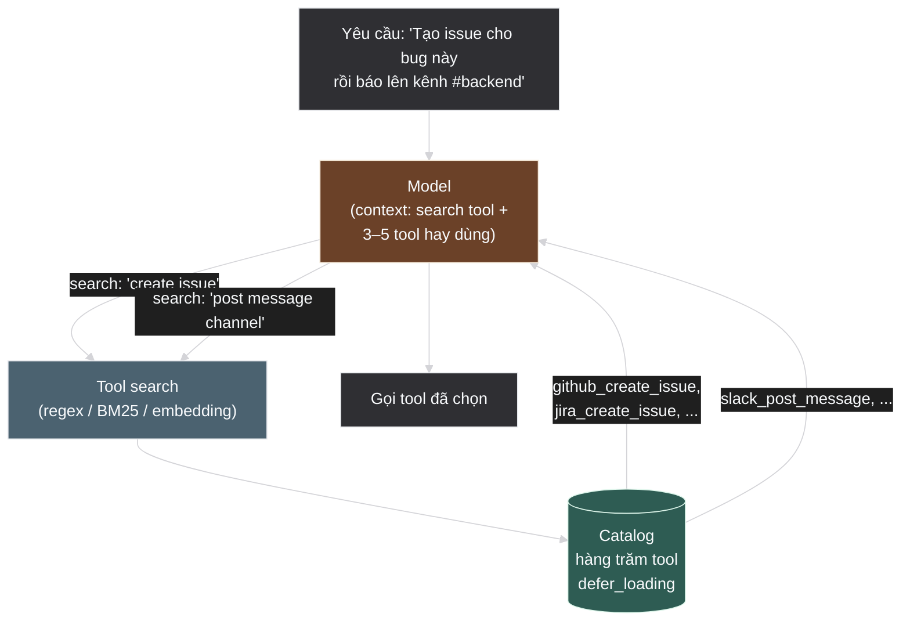

| Tiêu chí | A — Ứng dụng chọn trước | B — Model tự tìm |
|----------|------------------------|-----------------|
| **Số lần tìm** | Một lần, trước khi gọi LLM | Nhiều lần, bất cứ lúc nào |
| **Task nhiều bước cần tool mới giữa chừng** | ❌ Khó | ✅ Tự nhiên |
| **Độ trễ** | Thấp (một lần embed + search) | Thêm một vòng tool call cho mỗi lần tìm |
| **Chất lượng query** | Dùng nguyên văn tin nhắn của user | Model có thể diễn đạt lại nhu cầu theo ngôn ngữ của tool |
| **Phù hợp** | Chatbot một lượt, ít tool | Agent nhiều bước, nhiều MCP server |

Theo khuyến nghị của Anthropic: nên dùng tool search khi có từ 10 tool trở lên, hoặc tool definitions chiếm hơn 10K tokens, hoặc accuracy chọn tool giảm khi thêm tool; và **giữ 3–5 tool dùng thường xuyên nhất ở trạng thái không defer**. Với dưới 10 tool, hoặc mọi tool đều được dùng ở mọi request, cách gọi tool thông thường phù hợp hơn.

### Làm cho tool "tìm được"

Văn bản trong chỉ mục cần giúp phân biệt rõ công dụng của từng tool:

- **Index đầy đủ:** tên tool + mô tả + tên tham số + mô tả tham số. Một tool `send(to, body)` với mô tả "Sends a message" gần như không thể tìm thấy.
- **Namespace nhất quán:** đặt tiền tố theo dịch vụ (`github_`, `slack_`) để một lần tìm có thể trả về cả nhóm tool liên quan.
- **Viết mô tả bằng ngôn ngữ của người dùng, không chỉ ngôn ngữ API:** thêm từ khóa mô tả *nhiệm vụ* ("báo cho team", "thông báo", "notify") thay vì chỉ "POST /chat.postMessage".
- **Mở rộng key bằng câu hỏi mẫu:** áp dụng ý tưởng "key khác value" từ §2.9 — embed thêm vài câu yêu cầu mẫu mà tool này giải quyết, nhưng vẫn trả về tool definition gốc. Cách này thu hẹp khoảng cách giữa "ngôn ngữ nhiệm vụ" và "ngôn ngữ mô tả tool".
- **Theo dõi tool nào được tìm thấy và tool nào bị bỏ qua** để liên tục chỉnh mô tả.

> **Đánh giá độ đầy đủ của tập tool tìm được**
>
> - **Tool retrieval là bài toán "recall trước, precision sau".** Bỏ sót một tool cần thiết thì task thất bại; thừa vài tool không liên quan thì model thường vẫn chọn đúng. Lấy top-K rộng hơn so với document retrieval, rồi để model chọn.
> - **Benchmark IR chung không dự đoán chính xác chất lượng tool retrieval.** ToolRet ghi nhận tương quan dương nhưng chỉ ở mức vừa phải với MTEB. Model đứng đầu MTEB chưa chắc đứng đầu trên catalog tool của bạn — hãy dựng eval riêng (cặp "yêu cầu → các tool cần dùng" lấy từ log thật).
> - **BM25/regex không hề lỗi thời ở đây.** Tên tool là định danh chính xác, giống như tên hàm trong code (§2.10). Không phải ngẫu nhiên mà hai biến thể dựng sẵn của Anthropic là regex và BM25; embedding hữu ích nhất khi query diễn đạt nhu cầu mà không nhắc tên tool. Hybrid (§3.5) thường là lựa chọn an toàn.
> - **Huấn luyện chuyên biệt giúp ích nhiều.** ToolRet cung cấp tập train hơn 200K mẫu và cho thấy fine-tune trên đó cải thiện đáng kể khả năng tool retrieval của IR model (xem §3.9 về fine-tuning).

> **Bảo vệ catalog và quyền thực thi tool**
>
> - **Catalog tool là bề mặt tấn công.** **ToolHijacker** (2025) chứng minh kẻ tấn công có thể chèn một tool document độc hại vào thư viện tool (ví dụ qua tool hub hoặc plugin bên thứ ba), với mô tả gồm hai phần được tối ưu: một phần để **được retrieve** (tối đa hóa similarity với các mô tả task mục tiêu), một phần để **được LLM chọn** thay vì tool hợp lệ. Tấn công hiệu quả kể cả khi kẻ tấn công không biết retriever hay LLM cụ thể, và các biện pháp phòng thủ được thử nghiệm (StruQ, SecAlign, phát hiện bằng perplexity...) đều chưa đủ. Chỉ cho phép tool từ nguồn đã kiểm duyệt, và rà soát mô tả tool như rà soát code.
> - **Retrieval không thay thế được phân quyền.** Một tool không được retrieve không có nghĩa là model không thể gọi nó nếu nó vẫn nằm trong request. Kiểm soát quyền phải ở tầng thực thi tool, không phải ở tầng "model có thấy tool hay không".
> - **Đừng defer mọi thứ.** Các tool dùng ở gần như mọi request mà vẫn bị defer sẽ bắt model tìm kiếm mỗi lần — thêm độ trễ mà không lợi gì. (API của Anthropic còn từ chối request nếu mọi tool đều bị defer.)
> - **Tool trùng chức năng từ nhiều MCP server là nguồn nhầm lẫn lớn nhất.** Retrieval tốt đến đâu cũng không phân biệt được `create_issue` của ba hệ thống nếu mô tả gần như giống nhau. Hãy loại bỏ trùng lặp hoặc ghi rõ khi nào dùng tool nào trong mô tả.

### Mã giả: Custom tool search bằng embedding

```text
# ---------- Index the tool catalog (offline) ----------
for tool in all_tools:                                    # hundreds of MCP tools
    key_text = "\n".join([
        tool.name,
        tool.description,
        params_as_text(tool.input_schema),                # param names + param descriptions
        *synthetic_example_requests(tool, n=3),           # key expansion: "notify the team that..."
    ])
    tool_index.upsert(id=tool.name,
                      dense=embed(key_text, input_type="document"),
                      sparse=bm25_encode(key_text))

# ---------- Request: most-used tools stay loaded, the rest are deferred ----------
tools = [{"name": "tool_search", "description": "Search the tool catalog by describing the capability you need",
          "input_schema": {"query": "string"}}]
tools += [with_defer(t, defer=(t.name not in TOP_5_MOST_USED)) for t in all_tools]

# ---------- Handler when the model calls tool_search ----------
def handle_tool_search(query, user):
    hits = hybrid_search(tool_index, query, top_k=20)    # recall first
    hits = [h for h in hits if user.allowed_to_use(h.id)] # permissions are enforced separately anyway
    return {"type": "tool_result",
            "content": [{"type": "tool_reference", "tool_name": h.id} for h in hits[:5]]}
```

> Sources: [Anthropic — Tool search tool docs](https://platform.claude.com/docs/en/agents-and-tools/tool-use/tool-search-tool), [Anthropic — Advanced tool use](https://www.anthropic.com/engineering/advanced-tool-use), [RAG-MCP (arXiv 2505.03275)](https://arxiv.org/abs/2505.03275), [ToolRet — Retrieval Models Aren't Tool-Savvy (arXiv 2503.01763)](https://arxiv.org/abs/2503.01763), [ToolHijacker (arXiv 2504.19793)](https://arxiv.org/abs/2504.19793)

---

## 2.13 GraphRAG — Kết hợp Knowledge Graph và Embedding

Vector RAG (§2.2) trả lời rất tốt câu hỏi kiểu *"điều khoản bảo hành nói gì về pin?"*: câu trả lời nằm gọn trong một vài chunk, và chunk đó có embedding gần với câu hỏi. Nhưng có hai loại câu hỏi mà cơ chế "tìm chunk gần nhất" về bản chất không giải quyết được:

1. **Câu hỏi toàn cục (global / sensemaking):** *"Các chủ đề chính trong 5,000 bài báo này là gì?"* Không có chunk nào "giống" câu hỏi này; câu trả lời đòi hỏi tổng hợp **toàn bộ** corpus. Paper GraphRAG gọi đây là bài toán *query-focused summarization*, không phải bài toán truy xuất.
2. **Câu hỏi nhiều bước (multi-hop):** *"Giáo sư nào ở trường X nghiên cứu về bệnh Y?"* Có thể một đoạn văn nói "GS. A làm việc ở trường X", đoạn khác nói "GS. A công bố nhiều nghiên cứu về bệnh Y". Không đoạn nào một mình chứa đủ, và đoạn thứ hai thậm chí không nhắc tới trường X — nên nó có thể không lọt vào top-K của câu hỏi.

**GraphRAG** là tên gọi chung cho nhóm phương pháp xây dựng một **knowledge graph** (thực thể là node, quan hệ là edge) từ văn bản bằng LLM, rồi dùng cấu trúc graph — kết hợp với embedding — để truy xuất. Embedding vẫn đóng vai trò trung tâm, nhưng ở những vị trí khác so với vector RAG thuần.

### Embedding nằm ở đâu trong GraphRAG?

| Vai trò | Mô tả | Ví dụ |
|---------|-------|-------|
| **Entity linking / hợp nhất** | Phát hiện hai node là cùng một thực thể dù viết khác nhau | "TP.HCM", "Sài Gòn", "Ho Chi Minh City" → nối hoặc gộp |
| **Tìm node khởi đầu** | Embed thực thể trong câu hỏi, tìm node gần nhất trong graph để bắt đầu duyệt | Câu hỏi nhắc "bệnh Alzheimer" → node "Alzheimer's disease" |
| **Tìm community summary** | Embed các bản tóm tắt cụm, chọn cụm liên quan đến câu hỏi | Global search |
| **Lai với chunk retrieval** | Vẫn giữ vector search trên passage gốc, graph chỉ bổ sung | HippoRAG 2, LightRAG |

### Phương pháp 1: Microsoft GraphRAG — Tóm tắt theo cộng đồng (Edge et al., 2024)

**Indexing (đắt):**

1. Chia corpus thành chunk.
2. Dùng LLM trích xuất **thực thể, quan hệ và claim** từ từng chunk → được một knowledge graph.
3. Chạy thuật toán phát hiện cộng đồng (community detection, ví dụ **Leiden**) để chia graph thành các cụm thực thể liên kết chặt, theo **nhiều tầng phân cấp** (cụm lớn chứa cụm nhỏ).
4. Dùng LLM viết sẵn **bản tóm tắt cho mọi cộng đồng** ở mọi tầng; tóm tắt ở tầng cao hơn được tổng hợp từ tóm tắt tầng thấp hơn.

**Query:**

- **Global search:** theo kiểu **map-reduce** — mỗi community summary (ở tầng được chọn) được dùng để sinh một câu trả lời từng phần, *độc lập và song song* (map); sau đó các câu trả lời từng phần được tổng hợp thành câu trả lời cuối (reduce).
- **Local search:** bắt đầu từ các thực thể liên quan đến câu hỏi, lấy vùng lân cận của chúng trong graph cùng các community report cấp thấp.

**Kết quả theo paper** (corpus khoảng 1 triệu tokens: transcript podcast và bài báo; đánh giá bằng LLM so sánh từng cặp câu trả lời): với các câu hỏi toàn cục, các cách tiếp cận global đạt **tỷ lệ thắng về comprehensiveness 72–83%** (podcast) và 72–80% (tin tức), về diversity 75–82% và 62–71% so với vector RAG thông thường. Đồng thời, dùng summary ở tầng gốc cần **ít hơn 9–43 lần** tokens mỗi câu hỏi so với việc map-reduce trực tiếp trên văn bản gốc. Ngược lại — và paper nói rõ điều này — vector RAG cho câu trả lời **trực tiếp (directness)** nhất.

**Chi phí và tình trạng hiện tại:**

- Chính Microsoft Research, trong bài giới thiệu **LazyGraphRAG** (11/2024), cho biết chi phí indexing của vector RAG chỉ bằng **0.1%** chi phí của GraphRAG đầy đủ. LazyGraphRAG hoãn mọi bước tóm tắt bằng LLM sang lúc truy vấn, nên chi phí indexing **ngang với vector RAG**; theo Microsoft, nó đạt chất lượng tương đương GraphRAG global search cho câu hỏi toàn cục với chi phí truy vấn **thấp hơn hơn 700 lần**. (Đánh giá này trên một dataset tin tức với LLM judge — cần thận trọng khi khái quát.)
- README của repo `microsoft/graphrag` hiện ghi dự án **"largely in maintenance mode"** — không nhận PR mới hay tính năng mới, chỉ sửa lỗi và cập nhật dependency.

### Phương pháp 2: HippoRAG — Personalized PageRank cho multi-hop (Gutiérrez et al., 2024)

**HippoRAG** lấy cảm hứng từ thuyết chỉ mục hồi hải mã (hippocampal indexing theory): neocortex lưu trữ nội dung, còn hippocampus lưu một **chỉ mục liên kết** giúp gợi lại toàn bộ ký ức từ một manh mối nhỏ. Cách hiện thực:

**Indexing:**

1. Dùng LLM trích xuất **bộ ba (chủ thể, quan hệ, đối tượng)** theo kiểu Open Information Extraction từ mỗi passage → các noun phrase trở thành node của graph.
2. **Dùng embedding để thêm cạnh "đồng nghĩa":** nếu cosine similarity giữa hai node vượt ngưỡng τ, nối chúng lại. Đây là nơi embedding "vá" những chỗ LLM gọi cùng một thực thể bằng các tên khác nhau.
3. Ghi lại node nào xuất hiện trong passage nào.

**Query:**

1. Trích xuất các thực thể có tên trong câu hỏi, rồi **dùng embedding liên kết chúng với node gần nhất** trong graph ("query nodes").
2. Chạy **Personalized PageRank (PPR)** với xác suất khởi đầu tập trung ở các query node. PPR mô phỏng một "người đi bộ ngẫu nhiên" liên tục quay về các node khởi đầu; node nào được ghé thăm nhiều thì quan trọng với câu hỏi này. Xác suất **lan truyền qua các cạnh** sang những node *không* xuất hiện trong câu hỏi nhưng nối với nó.
3. Cộng điểm PPR của các node theo passage để xếp hạng passage. Paper thêm **node specificity** $s_i = |P_i|^{-1}$ (với $P_i$ là tập passage chứa node $i$) — node xuất hiện trong ít passage được trọng số cao hơn, ý tưởng tương tự IDF nhưng chỉ cần thông tin cục bộ.

Paper chỉ có hai siêu tham số, được tinh chỉnh trên 100 ví dụ của MuSiQue: **ngưỡng đồng nghĩa τ = 0.8** và **damping factor của PPR = 0.5** (xác suất quay lại các query node thay vì tiếp tục khám phá graph); tác giả nhận xét hiệu năng khá ổn định với các siêu tham số này.

**Ví dụ minh họa:** câu hỏi *"Giáo sư nào ở trường X nghiên cứu bệnh Y?"* → query node "trường X" và "bệnh Y". Passage P1: "GS. A làm việc ở trường X". Passage P2: "GS. A công bố nghiên cứu về bệnh Y". Trong graph, node "GS. A" nối với **cả hai** query node, nên PPR dồn xác suất cao vào "GS. A", và cả P1 lẫn P2 đều được xếp hạng cao — trong một bước truy xuất duy nhất, không cần lặp.

**Kết quả theo paper:** vượt các phương pháp state-of-the-art trên multi-hop QA tới **20%**; truy xuất một bước bằng HippoRAG đạt hiệu quả tương đương hoặc tốt hơn phương pháp truy xuất lặp IRCoT trong khi **rẻ hơn 10–30 lần và nhanh hơn 6–13 lần**.

**HippoRAG 2** (2025) xử lý một vấn đề mà chính các tác giả chỉ ra: các RAG có cấu trúc (graph) cải thiện sensemaking và liên tưởng, nhưng **hiệu năng trên các tác vụ ghi nhớ sự thật cơ bản lại giảm đáng kể so với RAG thường**. HippoRAG 2 tích hợp sâu hơn passage vào graph và dùng LLM hiệu quả hơn lúc truy vấn, đạt mức cải thiện **7%** trên tác vụ associative memory so với embedding model tốt nhất, đồng thời không thua ở tác vụ sự thật.

### Phương pháp 3: LightRAG — Truy xuất hai tầng và cập nhật tăng dần

**LightRAG** (2024) kết hợp graph với vector representation theo hai tầng: **low-level** (thực thể và quan hệ cụ thể) và **high-level** (chủ đề, khái niệm rộng). Điểm thực dụng là thuật toán **cập nhật tăng dần**: dữ liệu mới được tích hợp vào graph mà không phải dựng lại toàn bộ — khác với pipeline community summary vốn phải tính lại khi graph thay đổi.

### Đánh giá độc lập: GraphRAG không phải lúc nào cũng tốt hơn

Hai nghiên cứu năm 2025 đánh giá RAG và GraphRAG trong cùng điều kiện:

**"RAG vs. GraphRAG: A Systematic Evaluation"** cho thấy **RAG thường tốt hơn ở câu hỏi một bước và câu hỏi cần chi tiết**, còn GraphRAG (Local) tốt hơn ở câu hỏi nhiều bước cần suy luận. Ví dụ trên MultiHop-RAG với Llama 3.1-8B:

| Loại câu hỏi | RAG | GraphRAG |
|-------------|-----|----------|
| Inference | **92.16** | 86.89 |
| Comparison | 57.59 | **60.63** |
| Null (không có câu trả lời) | **96.01** | 80.07 |
| Temporal | 30.70 | **50.60** |
| **Overall** | 67.02 | **69.01** |

Tổng điểm gần như ngang nhau, nhưng **phân bố lỗi khác hẳn nhau**. Paper đề xuất hai chiến lược lai — **định tuyến** câu hỏi sang RAG hoặc GraphRAG theo loại, và **kết hợp** bằng chứng từ cả hai — và cả hai đều cải thiện ổn định. Paper cũng dành riêng một phần phân tích **position bias** trong các đánh giá dùng LLM-judge so sánh từng cặp — chính kiểu đánh giá mà nhiều kết quả GraphRAG trước đó dựa vào.

**GraphRAG-Bench** (*"When to use Graphs in RAG"*) mở đầu bằng nhận xét rằng các nghiên cứu gần đây cho thấy GraphRAG **thường xuyên kém hơn vector RAG trên nhiều tác vụ thực tế**, và đo chi phí prompt trung bình mỗi câu hỏi:

| Phương pháp | Tokens trung bình/câu hỏi (dataset Novel) |
|------------|------------------------------------------|
| Vanilla vector RAG | 879 |
| HippoRAG 2 | 1,008 |
| MS-GraphRAG (local) | 38,707 |
| LightRAG | 100,832 |
| MS-GraphRAG (global) | 331,375 |

Global search của MS-GraphRAG dùng nhiều hơn vector RAG khoảng **377 lần** tokens cho *mỗi* câu hỏi.

### Khi nào nên dùng graph?

| Tình huống | Khuyến nghị |
|-----------|------------|
| Câu hỏi tra cứu sự thật, câu trả lời nằm trong 1–2 đoạn | **Vector/hybrid RAG** (§2.2, §3.5) — rẻ, nhanh, thường tốt hơn |
| Câu hỏi multi-hop nối nhiều thực thể | Thử **HippoRAG 2** hoặc agentic retrieval nhiều bước (§2.2 — Reasoning-intensive Retrieval) |
| Câu hỏi toàn cục trên corpus ổn định, lượng truy vấn thấp | Community summaries (GraphRAG) hoặc LazyGraphRAG |
| Dữ liệu thay đổi thường xuyên | Tránh pipeline phải tính lại toàn bộ summary; ưu tiên phương pháp cập nhật tăng dần |
| Dữ liệu vốn có cấu trúc quan hệ rõ ràng (CRM, org chart, product catalog) | Dùng graph/DB có sẵn thay vì để LLM trích xuất lại từ văn bản |
| Có lẫn nhiều loại câu hỏi | **Định tuyến** theo loại câu hỏi hoặc **kết hợp** bằng chứng từ cả hai |

> **Chất lượng graph và chi phí truy vấn**
>
> - **Chất lượng graph bị giới hạn bởi chất lượng trích xuất của LLM.** Thực thể bị bỏ sót, quan hệ bị bịa ra, hoặc một thực thể bị tách thành nhiều node ("Microsoft", "MSFT", "Microsoft Corp.") đều lan truyền lỗi sang mọi truy vấn sau. Embedding-based entity resolution (như cạnh đồng nghĩa của HippoRAG) là bước bắt buộc chứ không phải tùy chọn — và chính ngưỡng τ của nó lại là một siêu tham số cần hiệu chỉnh.
> - **"Tốt hơn" trong paper GraphRAG gốc là tốt hơn về comprehensiveness và diversity theo LLM-judge**, trên câu hỏi toàn cục do LLM sinh ra. Không phải "chính xác hơn" theo nghĩa trả lời đúng sự thật. Vector RAG vẫn thắng về directness.
> - **Chi phí GraphRAG nằm ở cả hai đầu.** Indexing đắt (LLM đọc toàn bộ corpus), và global search cũng đắt ở *mỗi* truy vấn. Nhiều phân tích chỉ nhắc chi phí indexing.
> - **Graph và vector không loại trừ nhau.** Các hệ thống tốt nhất hiện nay (HippoRAG 2, chiến lược lai trong các nghiên cứu đánh giá) đều giữ vector retrieval trên passage gốc và chỉ dùng graph để bổ sung liên kết.

> **Điều kiện để bổ sung graph vào hệ thống RAG**
>
> - **Đừng bắt đầu bằng GraphRAG.** Hãy dựng hybrid search + reranker trước, xây eval set, và chỉ thêm graph khi eval chỉ ra một nhóm câu hỏi cụ thể (multi-hop, toàn cục) mà hybrid thất bại và đáng để trả thêm chi phí.
> - **Một tổng điểm ngang nhau có thể che giấu sự khác biệt lớn.** Như bảng MultiHop-RAG ở trên: tổng điểm ~67–69% nhưng GraphRAG kém hơn 16 điểm ở câu hỏi không có đáp án — tức dễ "bịa" ra câu trả lời hơn. Luôn phân tích theo loại câu hỏi.
> - **Kết quả đánh giá bằng LLM-judge so sánh cặp có thể bị lệch vị trí.** Khi đọc một tuyên bố "phương pháp X thắng 75%", hãy kiểm tra xem tác giả có đảo thứ tự hai câu trả lời khi chấm hay không.
> - **Đừng phụ thuộc vào một dự án ở chế độ bảo trì cho hệ thống dài hạn** mà không có kế hoạch thay thế.

### Mã giả: Truy xuất kiểu HippoRAG (graph + embedding + PPR)

```text
# ---------- Indexing ----------
graph = Graph()
for passage in corpus:
    triples = llm_open_ie(passage.text)                  # (subject, relation, object)
    for s, r, o in triples:
        graph.add_edge(s, o, relation=r)
        graph.link_node_to_passage(s, passage.id)
        graph.link_node_to_passage(o, passage.id)

node_vecs = {n: embed(n, input_type="document") for n in graph.nodes()}
for a, b in ann_pairs(node_vecs, min_cosine=TAU):       # synonym edges via embedding similarity
    graph.add_edge(a, b, relation="synonym")

# ---------- Query ----------
def retrieve(question, k=5):
    q_entities = llm_extract_entities(question)
    seeds = [nearest_node(embed(e, input_type="query"), node_vecs) for e in q_entities]
    # Node specificity: rarer nodes get more reset probability (IDF-like)
    reset = {n: 1.0 / graph.num_passages(n) for n in seeds}
    node_scores = personalized_pagerank(graph, reset=normalize(reset), damping=0.5)
    passage_scores = defaultdict(float)
    for node, score in node_scores.items():
        for pid in graph.passages_of(node):
            passage_scores[pid] += score
    graph_hits = top_k(passage_scores, k * 4)
    dense_hits = vector_search(embed(question, input_type="query"), top_k=k * 4)
    return rerank(question, merge(graph_hits, dense_hits))[:k]   # keep dense retrieval in the mix
```

> Sources: [GraphRAG — From Local to Global (arXiv 2404.16130)](https://arxiv.org/abs/2404.16130), [LazyGraphRAG — Microsoft Research Blog](https://www.microsoft.com/en-us/research/blog/lazygraphrag-setting-a-new-standard-for-quality-and-cost/), [microsoft/graphrag README](https://github.com/microsoft/graphrag), [HippoRAG (arXiv 2405.14831)](https://arxiv.org/abs/2405.14831), [HippoRAG 2 — From RAG to Memory (arXiv 2502.14802)](https://arxiv.org/abs/2502.14802), [LightRAG (arXiv 2410.05779)](https://arxiv.org/abs/2410.05779), [RAG vs. GraphRAG (arXiv 2502.11371)](https://arxiv.org/abs/2502.11371), [GraphRAG-Bench — When to use Graphs in RAG (arXiv 2506.05690)](https://arxiv.org/abs/2506.05690)

---

## 2.14 Embedding cho dữ liệu ngoài văn bản — Không gian địa lý, protein, chuỗi thời gian

Một ô đất, một chuỗi protein hay một đoạn tín hiệu cũng có thể được biểu diễn bằng vector để tìm kiếm, phân cụm hoặc phân loại. Trong giai đoạn 2024–2026, nhiều lĩnh vực đã có embedding dựng sẵn từ foundation model. Ba ví dụ dưới đây cho thấy cách dùng chúng và những điểm cần kiểm tra khi chuyển sang một miền dữ liệu mới.

### Bức tranh chung

| Miền | Ví dụ model / dataset | "Một đối tượng" là gì | Kích thước vector | Dùng để làm gì |
|------|----------------------|----------------------|-------------------|----------------|
| **Không gian địa lý** | AlphaEarth Foundations / Satellite Embedding (Google DeepMind, 2025) | Một ô đất 10m × 10m trong một năm | 64 | Bản đồ lớp phủ, phát hiện thay đổi, phân loại cây trồng |
| **Protein** | ESM-2 (Meta, 2022), ESM C (EvolutionaryScale, 12/2024) | Một chuỗi amino acid (hoặc từng vị trí trong chuỗi) | Tùy kích thước model | Dự đoán chức năng, cấu trúc, tìm protein tương tự |
| **Chuỗi thời gian** | MOMENT (CMU, 2024) | Một đoạn chuỗi thời gian (ví dụ 512 điểm) | Tùy kích thước model | Phân loại, phát hiện bất thường, tìm mẫu tương tự |

Các miền này có nhiều dữ liệu thô nhưng ít nhãn: nhãn đòi hỏi khảo sát thực địa, thí nghiệm sinh học hoặc chuyên gia đọc tín hiệu. Như cách làm ở §2.5, embedding cho phép dùng một classifier nhỏ — logistic regression, random forest hoặc SVM — với vài trăm nhãn thay vì hàng trăm nghìn.

### Ví dụ 1: AlphaEarth Foundations — "Vệ tinh ảo" với embedding 64 chiều

**Bài toán.** Dữ liệu quan sát Trái Đất (ảnh quang học Sentinel-2/Landsat, radar Sentinel-1, LiDAR, dữ liệu khí hậu...) được thu thập liên tục với khối lượng khổng lồ, nhưng mỗi nguồn có điểm yếu riêng: ảnh quang học bị mây che, radar khó diễn giải, các vệ tinh có lịch bay và độ phân giải khác nhau. Trong khi đó, **nhãn chất lượng cao rất hiếm** vì phải đo đạc thực tế.

**Cách tiếp cận.** AlphaEarth Foundations là một *embedding field model*: nó đồng hóa nhiều nguồn dữ liệu theo không gian, thời gian và loại cảm biến, rồi sinh ra **một vector 64 chiều cho mỗi ô 10m × 10m, tóm tắt toàn bộ diễn biến của ô đó trong một năm**. Google công bố sẵn kết quả dưới dạng dataset **Satellite Embedding** trên Earth Engine (các năm từ 2017, giấy phép CC-BY 4.0), hơn 1.4 nghìn tỷ "footprint" mỗi năm.

**Những thuộc tính đáng học** (theo tài liệu dataset):

- **Vector đơn vị (unit-length):** mọi embedding có độ dài 1, phân bố trên mặt cầu đơn vị → dot product chính là cosine (xem §1.3), không cần normalize thêm.
- **Không gian nhất quán giữa các năm:** embedding năm 2023 và 2024 của cùng một ô có thể so sánh trực tiếp. **Phát hiện thay đổi** (phá rừng, đô thị hóa, lũ lụt) chỉ là tính dot product giữa hai năm — giá trị thấp nghĩa là ô đó đã thay đổi.
- **Có thể kết hợp tuyến tính:** có thể lấy trung bình các embedding để có biểu diễn ở độ phân giải thô hơn (một xã, một lưu vực) mà vẫn giữ ý nghĩa.
- **Từng chiều không có ý nghĩa vật lý:** 64 band `A00`–`A63` phải được dùng *cùng nhau*; không giống band phổ truyền thống (đỏ, cận hồng ngoại...).

**Kết quả theo Google DeepMind:** trên nhiều tác vụ lập bản đồ, kể cả khi nhãn rất ít, AlphaEarth có **tỷ lệ lỗi thấp hơn trung bình 24%** so với các mô hình được so sánh, và embedding cần **ít hơn 16 lần dung lượng lưu trữ** so với các hệ thống AI khác được thử. Paper nhấn mạnh đây là phương pháp duy nhất *luôn* vượt các cách trích xuất đặc trưng phổ biến khác mà không cần huấn luyện lại.

**Ví dụ sử dụng:** muốn lập bản đồ ruộng lúa của một tỉnh, bạn chỉ cần vài trăm điểm đã biết là "lúa" / "không phải lúa", lấy embedding tại các điểm đó, huấn luyện một random forest, rồi áp dụng cho mọi ô 10m trong tỉnh. Không cần tự xử lý mây, hiệu chỉnh khí quyển hay ghép ảnh nhiều thời điểm.

### Ví dụ 2: Protein language models — ESM-2 và ESM C

**Ý tưởng.** Protein là chuỗi ký tự trên bảng chữ cái 20 amino acid. **ESM-2** (Meta AI) huấn luyện transformer theo cách giống hệt BERT với văn bản: che ngẫu nhiên một số amino acid và yêu cầu model đoán lại (masked language modeling) trên hàng chục triệu chuỗi protein. Không ai dạy model về cấu trúc 3D, nhưng để đoán đúng, model buộc phải học các ràng buộc tiến hóa, hóa lý và cấu trúc — và các thông tin này **xuất hiện trong embedding**. ESM-2 có các kích thước từ 8M tới 15B tham số.

**ESM C (ESM Cambrian)** (EvolutionaryScale, 12/2024) dùng cùng mục tiêu huấn luyện nhưng với dữ liệu và compute lớn hơn nhiều. Theo bài công bố: **ESM C 300M cho chất lượng tương đương ESM-2 650M**, **ESM C 600M ngang ESM-2 3B** và tiến gần bản 15B, còn ESM C 6B vượt xa các model ESM-2 tốt nhất. Bản 300M và 600M được phát hành open weights. (Lưu ý: các so sánh trong bài công bố chủ yếu đo khả năng học cấu trúc bậc ba qua dự đoán contact map.)

**Hai mức embedding:**

| Mức | Cách lấy | Dùng cho |
|-----|---------|---------|
| **Per-residue** (mỗi vị trí) | Vector của từng token amino acid | Dự đoán cấu trúc bậc hai, vị trí liên kết, ảnh hưởng của đột biến tại một vị trí |
| **Per-protein** (cả chuỗi) | Mean pooling qua mọi vị trí | Phân loại chức năng enzyme, vị trí trong tế bào, tìm protein tương tự |

Giữ vector cho từng vị trí bảo toàn chi tiết hơn nhưng tốn dung lượng và công tính toán hơn. Mean pooling giảm chi phí bằng cách gộp chúng lại. Đây cũng là đánh đổi đã gặp ở §1.2 với SBERT và §2.8.5 với ColPali.

### Ví dụ 3: Chuỗi thời gian — MOMENT

**MOMENT** (CMU, 2024) là họ foundation model mã nguồn mở cho chuỗi thời gian. Cơ chế theo paper:

1. Nhận một chuỗi đơn biến dài **512 điểm** (dài hơn thì lấy mẫu thưa, ngắn hơn thì đệm 0), chuẩn hóa từng chuỗi.
2. Chia thành **64 patch**, mỗi patch 8 điểm — mỗi patch đóng vai trò như một "token".
3. Khi pre-train, che 30% số patch và yêu cầu transformer encoder tái tạo lại (giống masked language modeling).
4. Chuỗi nhiều kênh được xử lý **từng kênh độc lập**.

Khi giữ nguyên embedding của MOMENT rồi dùng SVM để phân loại trên 91 dataset UCR, độ chính xác trung bình là 0.794, thấp hơn TS2Vec (0.833) và T-Loss (0.851), vốn được huấn luyện riêng cho từng dataset. Ở phát hiện bất thường, MOMENT hơn một số baseline theo một metric nhưng thấp hơn k-nearest neighbors theo metric khác. Những kết quả này cần được đọc cùng mục tiêu của paper: dùng một model cho nhiều tác vụ khi có ít nhãn.

### Nguyên tắc chung khi dùng embedding ở miền mới

| Nguyên tắc | Giải thích |
|-----------|-----------|
| **"Giống nhau" là do mục tiêu huấn luyện định nghĩa** | Hai ô đất gần nhau trong embedding AlphaEarth vì *diễn biến quan sát* giống nhau trong năm — không chắc vì cùng loại sở hữu đất. Hai protein gần nhau vì *thống kê chuỗi* giống nhau — không chắc cùng chức năng. Luôn kiểm tra khái niệm "giống" của model có khớp với khái niệm của bài toán không. |
| **Bắt đầu bằng linear probe** | Đóng băng embedding, huấn luyện một classifier tuyến tính hoặc cây quyết định đơn giản. Nếu kết quả tốt, không cần fine-tune. Nếu kém, embedding có thể không mang thông tin cần thiết. |
| **So sánh với baseline đơn giản của miền** | Chỉ số thực vật NDVI với ảnh vệ tinh, BLAST/so khớp trình tự với protein, k-NN trên chuỗi thô với time series. Foundation model không phải lúc nào cũng thắng (như MOMENT ở trên). |
| **Kiểm tra tính nhất quán theo thời gian/phiên bản** | Embedding chỉ so sánh được khi sinh ra từ cùng model và cùng phiên bản (xem §3.10). Satellite Embedding đảm bảo nhất quán giữa các năm *trong cùng một phiên bản dataset*. |

> **Dữ liệu dựng sẵn, phiên bản và mức độ chi tiết**
>
> - **Embedding dựng sẵn là một "sản phẩm dữ liệu", không chỉ là một model.** Với AlphaEarth, bạn không cần chạy model — Google đã tính sẵn cho cả hành tinh. Điều này thay đổi hoàn toàn kinh tế học của bài toán: chi phí chuyển từ GPU sang lưu trữ và truy vấn.
> - **Embedding vẫn được cập nhật âm thầm.** Dataset Satellite Embedding đã có bản `DATASET_VERSION` 1.1 với lớp năm 2017 được sinh lại; model sinh dataset là v2.1, khác với v2.0 được đánh giá trong paper. Nếu pipeline của bạn lưu cache embedding cũ, hãy ghi lại phiên bản.
> - **Mean pooling là một quyết định, không phải mặc định vô hại.** Với protein, trung bình hóa một chuỗi dài làm loãng tín hiệu của một vài vị trí quan trọng (vùng hoạt động của enzyme) — vấn đề "pooling dilution" giống hệt ở §2.8.5.
> - **Kết quả "zero-shot" thường thua mô hình chuyên biệt có đủ nhãn.** Giá trị của foundation model nằm ở chế độ *ít nhãn* và *nhiều tác vụ*; nếu bạn có hàng trăm nghìn nhãn cho đúng một tác vụ, mô hình huấn luyện riêng có thể tốt hơn.

> **Chia tập đánh giá và kiểm tra phạm vi áp dụng**
>
> - **Rò rỉ dữ liệu qua chia tập train/test không đúng.** Với protein, nếu train và test chứa các protein tương đồng (cùng họ tiến hóa), độ chính xác đo được bị thổi phồng — cần chia theo độ tương đồng chuỗi. Với dữ liệu không gian, các ô gần nhau rất giống nhau (tự tương quan không gian); chia ngẫu nhiên từng điểm khiến test set gần như trùng train set — cần chia theo vùng địa lý. Với chuỗi thời gian, phải chia theo thời gian, không chia ngẫu nhiên.
> - **Đừng diễn giải từng chiều.** Band `A17` của AlphaEarth hay chiều thứ 300 của ESM không có nghĩa vật lý độc lập. Mọi phân tích phải dùng toàn bộ vector.
> - **Độ phủ của dữ liệu huấn luyện quyết định độ tin cậy.** Embedding có thể kém ở vùng địa lý, họ protein hoặc loại tín hiệu ít xuất hiện khi pre-train (chính tài liệu AlphaEarth ghi nhận phiên bản mới phải bổ sung nhiều mẫu ở Nam Cực vốn bị loại trước đó). Kiểm tra hiệu năng riêng trên phân khúc bạn quan tâm.
> - **Đọc kỹ giấy phép.** Dataset, open weights và model qua API thường có điều khoản khác nhau cho mục đích học thuật và thương mại.

### Mã giả: Lập bản đồ từ embedding dựng sẵn với ít nhãn

```text
# Goal: map rice paddies in a province using a few hundred labeled points

labels = load_points("field_survey.csv")             # (lat, lon, is_rice) — a few hundred rows
emb = load_embedding_layer("satellite_embedding", year=2024)   # 64-dim, unit-length per 10m pixel

X = [emb.sample(p.lat, p.lon) for p in labels]       # 64-dim feature per labeled point
y = [p.is_rice for p in labels]

# Split by geography, NOT randomly — neighboring pixels are near-duplicates
train, test = spatial_block_split(labels, X, y, block_km=10)

clf = RandomForest(n_trees=200).fit(train.X, train.y)
report(clf.score(test.X, test.y))                     # compare against a simple domain baseline (e.g. NDVI)

rice_map = emb.map_pixels(lambda v: clf.predict(v), region=province_boundary)

# Change detection between years: low dot product = the pixel changed
emb_2023 = load_embedding_layer("satellite_embedding", year=2023)
change = dot(emb_2023, emb) < CHANGE_THRESHOLD        # same dataset version only
```

> Sources: [AlphaEarth Foundations (arXiv 2507.22291)](https://arxiv.org/abs/2507.22291), [Google DeepMind — AlphaEarth Foundations blog](https://deepmind.google/discover/blog/alphaearth-foundations-helps-map-our-planet-in-unprecedented-detail/), [Earth Engine — Satellite Embedding V1](https://developers.google.com/earth-engine/datasets/catalog/GOOGLE_SATELLITE_EMBEDDING_V1_ANNUAL), [EvolutionaryScale — ESM Cambrian](https://www.evolutionaryscale.ai/blog/esm-cambrian), [ESM GitHub](https://github.com/evolutionaryscale/esm), [MOMENT (arXiv 2402.03885)](https://arxiv.org/abs/2402.03885)

# Phần 3 — Vận hành & Tối ưu

Khi triển khai embedding, chất lượng phải đi cùng một mức chi phí và độ trễ có thể chấp nhận. Model, nơi lưu vector, cách chia tài liệu và cách đánh giá đều ảnh hưởng đến sự cân bằng này.

Phần này đi từ các lựa chọn hạ tầng đến bảo mật, fine-tuning và chuyển đổi model. Các bảng dùng để khoanh vùng phương án; quyết định cuối cần dựa trên dữ liệu và yêu cầu vận hành của hệ thống.

## 3.1 Embedding Models Comparison

Một model đứng cao trên leaderboard vẫn có thể không phù hợp với dữ liệu tiếng Việt, tài liệu dài hoặc ngân sách của bạn. Khi so sánh, cần xét đồng thời chất lượng trên miền dữ liệu, giới hạn ngữ cảnh, số chiều, chi phí, yêu cầu tuân thủ và nhu cầu multimodal.

### Những câu hỏi cần khóa trước khi so model

Trước khi so thông số, xác định yêu cầu của hệ thống:

1. **Task chính là gì?** Search, RAG, clustering, classification hay multimodal retrieval có nhu cầu rất khác nhau.
2. **Ngôn ngữ mục tiêu là gì?** Benchmark tiếng Anh thường không phản ánh đúng chất lượng cho tiếng Việt hoặc domain-specific jargon.
3. **Corpus dài đến đâu?** Model context ngắn sẽ buộc hệ thống chunk mạnh hơn.
4. **Bạn đang tối ưu cái gì?** Chất lượng tốt nhất, chi phí thấp nhất, hay khả năng self-hosted?
5. **Scale bao nhiêu vectors?** Số chiều của model ảnh hưởng trực tiếp đến storage, RAM và latency.

### Bảng 1 — Specs (snapshot November 2026)

**Managed APIs — thế hệ hiện tại**

| Model | Provider | Dims | Context | Multimodal | MRL | Ghi chú |
|-------|----------|------|---------|------------|-----|---------|
| **voyage-4-large** | Voyage AI (01/2026) | 1024 (256/512/2048) | 32k tokens | ❌ | ✅ | MoE; shared space với cả họ Voyage 4 |
| **voyage-4** | Voyage AI (01/2026) | 1024 (256/512/2048) | 32k tokens | ❌ | ✅ | Gần `voyage-3-large` về chất lượng, giá thấp hơn |
| **voyage-4-lite** | Voyage AI (01/2026) | 1024 (256/512/2048) | 32k tokens | ❌ | ✅ | Tối ưu cost/latency |
| **voyage-context-4** | Voyage AI (06/2026) | 1024 (256/512/2048) | Không giới hạn (tự split >32k) | ❌ | ✅ | Contextualized chunk embeddings, auto-chunking |
| **voyage-code-4** | Voyage AI (08/2026) | 1024 (256/512/2048) | 32k tokens | ❌ | ✅ | Code retrieval cho coding agents |
| **voyage-multimodal-3.5** | Voyage AI (01/2026) | — | — | ✅ (text+image+video) | — | Xem [§2.8.4](#284-các-lựa-chọn-multimodal-khác-snapshot-november-2026) |
| **embed-v5.0-pro** | Cohere (09/2026) | 2048 (256-1536) | 128k tokens | ✅ (text+image+PDF) | ✅ | Shared space với `-fast`; 100+ ngôn ngữ |
| **embed-v5.0-fast** | Cohere (09/2026) | 2048 (256-1536) | 128k tokens | ✅ (text+image+PDF) | ✅ | Dùng cho query traffic |
| **gemini-embedding-2** | Google (GA 04/2026) | 3072 (128-3072, rec. 1536/768) | 8192 tokens | ✅ (5 modalities) | ✅ | Không có `task_type` |
| **gemini-embedding-001** | Google (07/2025) | max 3072 | 2048 tokens | ❌ | ✅ | Text-only |
| **text-embedding-3-large** | OpenAI (01/2024) | 3072 (shortable) | 8191 tokens | ❌ | ✅ | OpenAI chưa ra model embedding mới kể từ 01/2024 |
| **text-embedding-3-small** | OpenAI (01/2024) | 1536 (shortable) | 8191 tokens | ❌ | ✅ | |

**Open-weight / self-hosted**

| Model | Provider | Dims | Context | MRL | License |
|-------|----------|------|---------|-----|---------|
| **Qwen3-Embedding-8B / 4B / 0.6B** | Alibaba Qwen (06/2025) | 32-4096 (user-defined) | 32k tokens | ✅ | Apache 2.0 |
| **harrier-oss-v1** (27B / 0.6B) | Microsoft (2026) | — | 32k tokens | — | MIT |
| **EmbeddingGemma-300m** | Google (09/2025) | 768 (MRL→128) | 2048 tokens | ✅ | Gemma terms |
| **EmbeddingGemma 2** | Google (10/2026) | xem model card | xem model card | — | Apache 2.0 (~0.74B params) |
| **voyage-4-nano** | Voyage AI (01/2026) | 1024 (256/512/2048) | 32k tokens | ✅ | Apache 2.0; shared space với Voyage 4 API |
| **jina-embeddings-v5-text-small / nano** | Jina AI (02/2026) | 1024 (MRL→32) | 32k tokens | ✅ | **CC-BY-NC-4.0** (non-commercial) |
| **BGE-M3** | BAAI | 1024 | 8192 tokens | ❌ | MIT; dense + sparse + multi-vector |
| **all-MiniLM-L6-v2** | Sentence-Transformers | 384 | 256 tokens | ❌ | Apache 2.0; English, baseline nhẹ |

**Legacy / thế hệ trước (vẫn chạy nhưng không nên chọn cho dự án mới)**

| Model | Trạng thái | Nên chuyển sang |
|-------|-----------|-----------------|
| `voyage-3`, `voyage-3-lite`, `voyage-3.5(-lite)`, `voyage-3-large` | Older models, vẫn gọi được | `voyage-4` / `voyage-4-lite` / `voyage-4-large` |
| `voyage-context-3`, `voyage-code-3` | Older models ($0.18/1M) | `voyage-context-4`, `voyage-code-4` ($0.12/1M) |
| Cohere `embed-v4.0`, `embed-*-v3.0` | Live | `embed-v5.0-pro` / `-fast` |
| Google `text-embedding-004` | **Đã tắt trên Gemini API (14/01/2026)**; Vertex dự kiến tắt 01/04/2027 | `gemini-embedding-2` |
| Google `multimodalembedding@001` | Legacy | `gemini-embedding-2` |
| Jina `jina-embeddings-v3` | Thế hệ trước | `jina-embeddings-v5-text` (lưu ý license NC) |

> ⚠️ **License trap**: "open weights" không đồng nghĩa với dùng thương mại tự do. Jina v5 (CC-BY-NC-4.0) và một số model Gemma terms cần đọc kỹ license trước khi đưa vào sản phẩm.
>
> Sources: [Voyage Text Embeddings](https://docs.voyageai.com/docs/embeddings), [Voyage 4 blog](https://blog.voyageai.com/2026/01/15/voyage-4/), [voyage-context-4](https://blog.voyageai.com/2026/06/29/voyage-context-4/), [voyage-code-4](https://blog.voyageai.com/2026/08/13/voyage-code-4/), [Cohere models](https://docs.cohere.com/docs/models), [Cohere Embed 5](https://cohere.com/blog/embed-5), [Gemini Embeddings](https://ai.google.dev/gemini-api/docs/embeddings), [Gemini API changelog](https://ai.google.dev/gemini-api/docs/changelog), [OpenAI](https://openai.com/index/new-embedding-models-and-api-updates/), [Qwen3-Embedding](https://huggingface.co/Qwen/Qwen3-Embedding-8B), [Jina AI GitHub](https://github.com/jina-ai), [SBERT models](https://www.sbert.net/docs/sentence_transformer/pretrained_models.html)

### Chọn model nào?

Dùng sơ đồ để chọn các model cần thử, sau đó so sánh chất lượng trên dữ liệu thật, tổng chi phí và yêu cầu tuân thủ hoặc tự triển khai.

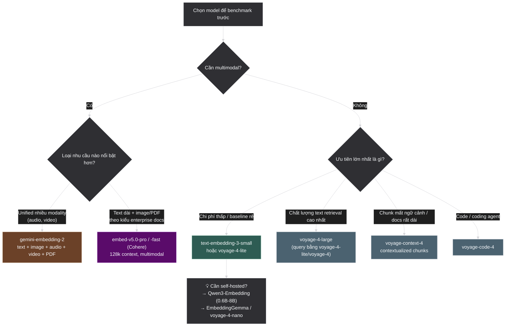

### Heuristics vận hành nhanh

- **`text-embedding-3-small`**: hợp khi ngân sách rất nhạy cảm, đã dùng OpenAI cho phần generate, và corpus không quá khó. Context chỉ 8k.
- **`voyage-4-lite`**: cùng giá với `3-small` nhưng context 32k, có quantization `int8`/`binary` native, và có thể nâng cấp lên `voyage-4-large` cho phía document mà không đổi query model.
- **`voyage-4-large`**: hợp khi retrieval quality là ưu tiên số 1 cho text. Pattern khuyến nghị: embed corpus bằng `voyage-4-large`, query bằng `voyage-4-lite` hoặc `voyage-4`.
- **`voyage-context-4`**: đáng thử khi chunk bị mất ngữ cảnh (hợp đồng, transcript, manual dài) và muốn bỏ bớt logic chunking/contextual retrieval tự viết.
- **`embed-v5.0-pro` / `-fast`**: đáng cân nhắc khi context dài và multimodal là nhu cầu thực, nhất là PDF/slide/báo cáo tài chính. Dùng chung pattern index bằng Pro, query bằng Fast.
- **`gemini-embedding-2`**: đáng giá khi bài toán thực sự là cross-modal có audio/video, hoặc hệ thống đã nằm trên Google Cloud.
- **`text-embedding-3-large`**: là lựa chọn quen thuộc trong hệ OpenAI. Tuy nhiên, trên các benchmark retrieval 2026 (RTEB), các model mới đạt kết quả cao hơn, trong khi giá của nó ($0.13) cao hơn `voyage-4-large` ($0.12).
- **Open-weight (`Qwen3-Embedding`, `EmbeddingGemma`, `voyage-4-nano`)**: hợp khi cần self-hosted, dữ liệu không được rời hạ tầng, hoặc volume rất lớn khiến API cost vượt chi phí GPU.

### Snapshot 2024-2026: Những model nổi bật nên nhớ

Các thay đổi đáng chú ý trong giai đoạn `2024-2026`, tính đến 11/2026:

- **Shared embedding space trở thành xu hướng**: Voyage 4 (01/2026) rồi Cohere Embed 5 (09/2026) cho phép index bằng model lớn và query bằng model nhỏ mà không re-embed. Đây là thay đổi vận hành lớn nhất của năm.
- **MoE vào embedding**: `voyage-4-large` là embedding model production đầu tiên dùng mixture-of-experts. Voyage cho biết serving cost thấp hơn ~40% so với dense model tương đương.
- **Contextualized chunk embeddings**: `voyage-context-4` (06/2026) tự chunk, tự xử lý docs dài hơn 32k và nhúng ngữ cảnh toàn document vào từng chunk. Đây là lựa chọn thay cho late chunking hoặc LLM-based contextual retrieval.
- **Embedding cho coding agents**: `voyage-code-4` (08/2026) được train trên dữ liệu issue → file cần sửa, hướng tới query kiểu "mô tả triệu chứng" thay vì tên hàm.
- **Unified multimodal trở nên phổ biến**: `gemini-embedding-2` (GA 04/2026), Cohere Embed 5, `voyage-multimodal-3.5`, `jina-embeddings-v5-omni`, `Qwen3-VL-Embedding`.
- **Open-weight bắt kịp**: `Qwen3-Embedding-8B`, Microsoft `harrier-oss-v1` và `EmbeddingGemma` nằm ở hoặc gần đầu các bảng MTEB v2 công khai.
- **OpenAI đứng yên**: `text-embedding-3-*` (01/2024) vẫn là thế hệ mới nhất; `text-embedding-ada-002` vẫn chưa bị deprecate.

Danh sách này giúp chọn model để thử theo nhu cầu — không dùng thay cho phép đo trên hệ thống của bạn.

### Bảng 2 — Quality (MTEB v2 / RTEB, snapshot October 2026)

Từ 2025, leaderboard chính chuyển sang **MTEB v2** (`MTEB(eng, v2)`, `MTEB(Multilingual, v2)` — 131 tasks). Ngoài ra có **RTEB** (Retrieval Embedding Benchmark, beta): bảng chỉ đo retrieval, dùng một phần dataset private/held-out để giảm contamination. **Điểm MTEB v1 (ví dụ 64.6 của `text-embedding-3-large`) không so sánh được với điểm v2.**

| Model | Benchmark | Score / Rank | Source Type | Date |
|-------|-----------|-------------|-------------|------|
| Qwen3-Embedding-8B | MTEB(eng, v2) | 75.23 | leaderboard (đọc qua bài tổng hợp bên thứ ba) | Oct 2026 |
| gemini-embedding-001 | MTEB(eng, v2) | 73.30 | leaderboard (đọc qua bài tổng hợp bên thứ ba) | Oct 2026 |
| jina-embeddings-v5-text-small | MTEB(eng, v2) | 71.7 | vendor-reported | Feb 2026 |
| Qwen3-Embedding-0.6B | MTEB(eng, v2) | 70.47 | leaderboard (đọc qua bài tổng hợp bên thứ ba) | Oct 2026 |
| EmbeddingGemma-300m | MTEB(eng, v2) | 69.67 | leaderboard (đọc qua bài tổng hợp bên thứ ba) | Oct 2026 |
| harrier-oss-v1-27b | MTEB(Multilingual, v2) | 74.27 (#1) | leaderboard (đọc qua bài tổng hợp bên thứ ba) | Oct 2026 |
| Qwen3-Embedding-8B | MTEB(Multilingual, v2) | 70.58 | leaderboard | Oct 2026 |
| gemini-embedding-001 | MTEB(Multilingual, v2) | 68.37 | leaderboard | Oct 2026 |
| voyage-4-large | RTEB (beta) | #1 | leaderboard (đọc qua bài tổng hợp bên thứ ba) | Oct 2026 |
| voyage-4-large vs Gemini 001 / Cohere v4 / OpenAI v3-large | 29 dataset RTEB, NDCG@10 | +3.87% / +8.20% / +14.05% | vendor-reported | Jan 2026 |

**Dữ liệu lịch sử (MTEB v1, chỉ để tham khảo):**

| Model | MTEB v1 Avg | Source Type | Date | Source Link |
|-------|----------|------------|------|-------------|
| text-embedding-3-large | 64.6 | vendor-reported | Jan 2024 | [OpenAI blog](https://openai.com/index/new-embedding-models-and-api-updates/) |
| voyage-large-2-instruct | 68.28 | vendor-reported | May 2024 | [Voyage AI blog](https://blog.voyageai.com/2024/05/05/voyage-large-2-instruct/) |
| jina-embeddings-v3 | 65.52 (English) | paper-reported | Sep 2024 | [Jina v3 paper](https://arxiv.org/pdf/2409.10173) |

> **Note**: nhiều flagship thương mại mới (Cohere Embed 5, `gemini-embedding-2`, `voyage-4*`) **không có điểm MTEB v2 đầy đủ** trên leaderboard công khai; vendor chủ yếu công bố kết quả trên benchmark riêng (RTEB, ViDoRe V3, FinanceBench...). Vì vậy không thể xếp chúng cùng một bảng với open-weight models một cách công bằng.

> **Điều kiện so sánh benchmark**
>
> Kết quả do nhà cung cấp công bố có thể dùng tập dữ liệu, quy trình đánh giá và thời điểm chạy khác nhau. Các bên cũng có thể chỉ công bố kết quả thuận lợi; thứ hạng MTEB thay đổi theo thời gian.
>
> Khi ghi lại kết quả, kèm loại nguồn (vendor-reported / independent / paper-reported) và ngày snapshot. Cần bộ đánh giá riêng cho ngôn ngữ mục tiêu, chẳng hạn tiếng Việt vốn không có trên MTEB tiêu chuẩn.
>
> Sources: [MTEB paper — Muennighoff et al., 2022](https://arxiv.org/abs/2210.07316), [MTEB leaderboard](https://huggingface.co/spaces/mteb/leaderboard), [RTEB blog](https://huggingface.co/blog/rteb), [Voyage 4 blog](https://blog.voyageai.com/2026/01/15/voyage-4/), [Jina v3 paper](https://arxiv.org/pdf/2409.10173), [HuggingFace MTEB Blog](https://huggingface.co/blog/mteb)

### Bảng 3 — Pricing (Snapshot: November 2026)

| Model | ~USD/1M text tokens | Free tier | Ghi chú |
|-------|--------------------:|-----------|---------|
| voyage-4-lite | **$0.02** | 200M tokens | Batch API −33% |
| text-embedding-3-small | **$0.02** | — | |
| voyage-4 | **$0.06** | 200M tokens | |
| embed-v5.0-fast | **$0.08** | — | Image: $0.40/1M tokens |
| voyage-4-large | **$0.12** | 200M tokens | |
| voyage-context-4 | **$0.12** | 200M tokens | `voyage-context-3` cũ: $0.18 |
| voyage-code-4 | **$0.12** | 200M tokens | `voyage-code-3` cũ: $0.18 |
| voyage-multimodal-3.5 | **$0.12** | 200M tokens + 150B pixels | + $0.60 / 1B pixels |
| embed-v5.0-pro | **$0.12** | — | Image: $0.40/1M tokens |
| text-embedding-3-large | **$0.13** | — | |
| gemini-embedding-001 | **$0.15** | Free tier có rate limit | |
| gemini-embedding-2 | **$0.20** | Free tier có rate limit | Batch $0.10; image $0.45, audio $6.50, video $12.00 per 1M tokens |
| Qwen3-Embedding, EmbeddingGemma, voyage-4-nano, BGE-M3, MiniLM | $0 (open weights) | — | Tự trả compute/GPU |

**Rerankers:** Voyage `rerank-3` $0.05/1M, `rerank-3-lite` $0.02/1M (200M tokens free). Cohere Rerank 5: xem [Cohere pricing](https://cohere.com/pricing).

> **Conversion note**: Ước tính 1 character ≈ 0.25 token (trung bình cho tiếng Anh). Tiếng Việt có thể cao hơn do tokenization. Luôn test thực tế với `tiktoken` hoặc API response `usage.total_tokens`. Tokenizer khác nhau giữa các provider, nên cùng một văn bản có thể bị tính số token khác nhau.
>
> Sources: [OpenAI Pricing](https://openai.com/api/pricing/), [Voyage Pricing](https://docs.voyageai.com/docs/pricing), [Cohere Embed 5](https://cohere.com/blog/embed-5), [Gemini Pricing](https://ai.google.dev/gemini-api/docs/pricing)

### Dimensions, Storage và Latency

Vector dài hơn cần nhiều dung lượng hơn. Có thể ước tính phần lưu trữ vector thô bằng:

`num_vectors × dimensions × bytes_per_value`

Nếu dùng `float32`, mỗi chiều thường chiếm `4 bytes`. Điều đó có nghĩa là:

- `1 triệu` vectors `3072` chiều ≈ `12.3 GB` raw vectors
- `1 triệu` vectors `1536` chiều ≈ `6.1 GB`
- `1 triệu` vectors `768` chiều ≈ `3.1 GB`

Các con số trên chưa tính metadata, cấu trúc chỉ mục, bản sao và cache. Với HNSW, phần dữ liệu cần giữ trong RAM có thể chi phối cả chi phí máy lẫn thời gian khởi động. Giảm chiều bằng MRL hoặc truncation, kết hợp quantization như `int8` hay `binary`, giúp giảm lượng dữ liệu phải lưu và đọc khi tìm kiếm.

### Sai lầm thường gặp khi chọn model

- Chọn theo leaderboard mà không benchmark trên dữ liệu thật
- Chọn model context rất dài nhưng corpus thực tế đã được chunk ngắn sẵn
- Chọn vector quá dài cho workload khổng lồ rồi mới phát hiện chi phí index quá cao
- Chọn multimodal model chỉ vì "nghe mạnh hơn", dù sản phẩm chủ yếu vẫn là text retrieval
- Quên rằng thay model thường kéo theo re-embed toàn bộ corpus

Chọn model đạt chất lượng yêu cầu với tổng chi phí mà hệ thống duy trì được.

---

## 3.2 Vector Databases (Ma trận chọn nhanh)

Vector database quyết định cả cách tìm kiếm lẫn công việc vận hành: lọc metadata, hybrid search, sao lưu, reindex, phân mảnh và khôi phục khi có sự cố. Lựa chọn còn phụ thuộc vào hạ tầng sẵn có và việc đội ngũ muốn dùng dịch vụ managed hay tự quản lý.

Có thể bắt đầu từ hai hướng:

- **All-in-one**: vector search sống chung với stack hiện có hoặc đi kèm một platform bao trọn metadata, filtering, API và đôi khi cả ingestion. Hướng này hợp khi muốn giảm số lượng thành phần hạ tầng và tối ưu tốc độ triển khai.
- **Chuyên biệt**: dùng một vector engine được tối ưu chủ yếu cho indexing, ANN search, filtering và scale. Hướng này hợp khi vector retrieval là thành phần cốt lõi của hệ thống và cần tối ưu sâu về hiệu năng hoặc vận hành.

`PostgreSQL + pgvector` và `SQLite + sqlite-vec` thêm tìm kiếm vector vào cơ sở dữ liệu sẵn có. `Pinecone`, `Qdrant`, `Milvus` tập trung vào vector retrieval. `Weaviate` và `Chroma` cũng chuyên về retrieval/AI nhưng cung cấp thêm các thành phần tích hợp, nên không nằm gọn trong ranh giới hai nhóm.

### Những tiêu chí thật sự quyết định lựa chọn

| Tiêu chí | Câu hỏi cần trả lời | Tại sao quan trọng |
|----------|---------------------|--------------------|
| **Kiểu hệ thống** | Muốn `all-in-one` hay một engine `chuyên biệt` cho vector search? | Quyết định số lượng moving parts, cách đội ngũ vận hành, và mức tối ưu có thể đạt được |
| **Ops model** | Muốn fully managed hay tự quản lý cluster? | Ảnh hưởng trực tiếp đến thời gian vận hành và on-call burden |
| **Scale** | Dữ liệu là vài triệu, vài chục triệu hay hàng tỷ vectors? | Database phù hợp cho 5M vectors có thể không còn hợp ở 500M |
| **Filtering / Hybrid** | Có cần metadata filtering, BM25 + dense, rerank tích hợp không? | Nhiều hệ thống production mạnh ở filter và hybrid hơn là pure vector search |
| **Stack hiện có** | Đã có PostgreSQL, Kubernetes hay cloud vendor lock-in sẵn chưa? | Tận dụng hạ tầng hiện có thường rẻ và bền hơn đổi cả stack |
| **Latency / Cost** | Ưu tiên milliseconds thấp nhất hay tổng chi phí dễ chịu? | Database nhanh nhất chưa chắc là database phù hợp nhất |

### Bảng so sánh

| Hướng | Database | Best for | Key Feature | Source |
|-------|----------|----------|-------------|--------|
| **Chuyên biệt (managed)** | **Pinecone** | Dễ dùng, production-ready | Serverless, hybrid search, integrated rerank | [docs](https://docs.pinecone.io/guides/get-started/overview) |
| **Chuyên biệt (managed, edge-native)** | **Cloudflare Vectorize** | Global low-latency, Workers ecosystem, serverless edge apps | Vector DB phân tán toàn cầu, gắn chặt với Workers, R2, D1 | [docs](https://developers.cloudflare.com/vectorize/) |
| **All-in-one AI-native** | **Weaviate** | Hybrid search + GraphQL API | Semantic + keyword search, generative modules | [docs](https://docs.weaviate.io/weaviate/introduction) |
| **Chuyên biệt (self-hosted)** | **Qdrant** | Performance + advanced filtering | Rust-based, payload filtering, quantization | [docs](https://qdrant.tech/documentation/overview/) |
| **Chuyên biệt ở scale lớn** | **Milvus** | Massive scale (tỷ vectors) | GPU acceleration, HNSW/IVF/DiskANN | [docs](https://milvus.io/docs/overview.md) |
| **All-in-one trong relational stack** | **PostgreSQL + pgvector** | Giữ vector search trong relational stack có sẵn | HNSW/IVFFlat, SQL, JOIN với business data | [repo](https://github.com/pgvector/pgvector) |
| **All-in-one embedded** | **SQLite + sqlite-vec** | App local, edge, desktop, mobile, prototyping gọn nhẹ | Chạy trong SQLite, không cần server riêng | [repo](https://github.com/asg017/sqlite-vec) |
| **All-in-one local/prototyping** | **Chroma** | Rapid prototyping, local dev | AI-native, simple API, local-first | [docs](https://docs.trychroma.com/docs/overview/introduction) |
| **Object-storage-native (managed)** | **Amazon S3 Vectors** | Kho vector rất lớn, truy vấn thưa (archive, agent memory, Bedrock KB) | Vector bucket trong S3, tới 2 tỷ vectors/index, trả theo dung lượng + request | [docs](https://docs.aws.amazon.com/AmazonS3/latest/userguide/s3-vectors.html) |
| **Object-storage-native (managed)** | **turbopuffer** | Hàng triệu namespace (mỗi tenant/codebase một namespace), hybrid search | Object storage + cache NVMe/RAM, index centroid-based (SPFresh), BM25 + vector | [docs](https://turbopuffer.com/docs/architecture) |

### Chi tiết từng database

#### Pinecone — Managed, Production-ready

- **Hosting**: Fully managed (serverless hoặc pod-based)
- **Hybrid search**: kết hợp sparse + dense vectors native
- **Integrated rerank**: gọi reranker trực tiếp trong query pipeline
- **Metadata filtering**: filter theo fields trước/sau vector search
- **Scale**: automatic scaling, không cần quản lý infra
- **Nhược điểm**: vendor lock-in, giá cao ở scale lớn, không self-hosted

#### Cloudflare Vectorize — Managed, edge-native

- **Hosting**: fully managed, gắn với Cloudflare Workers platform
- **Điểm mạnh thật sự**: hợp với hệ thống cần query từ edge hoặc muốn gom vector search vào cùng hệ sinh thái `Workers + R2 + D1 + Workers AI`
- **Đặc tính nổi bật**: phù hợp cho serverless applications cần global low-latency mà không muốn tự quản lý cluster vector riêng
- **Use cases điển hình**: semantic search hoặc RAG trong các ứng dụng đã ở sẵn trên Cloudflare stack
- **Nhược điểm**: phù hợp nhất khi bạn đã hoặc sẽ đi theo hệ sinh thái Cloudflare; nếu không, lợi thế tích hợp sẽ giảm đi rõ rệt

#### Weaviate — Hybrid Search Champion

- **Hosting**: self-hosted (Docker/K8s) hoặc Weaviate Cloud
- **Hybrid search**: BM25 + vector search native, có fusion methods
- **GraphQL API**: query flexible, nested objects
- **Generative modules**: tích hợp LLM generation trong query pipeline
- **Multi-tenancy**: hỗ trợ nhiều tenants trên cùng cluster
- **Nhược điểm**: GraphQL learning curve, resource-heavy hơn Qdrant

#### Qdrant — Performance King

- **Language**: Rust → performance + memory efficiency cao
- **Payload filtering**: filter phức tạp trên metadata fields (nested, geo, range...)
- **Quantization**: Scalar/Product/Binary quantization built-in
- **Snapshot & recovery**: backup/restore dễ dàng
- **Nhược điểm**: community nhỏ hơn Weaviate/Milvus, hybrid search cần cấu hình thêm

#### Milvus — Scale Monster

- **Scale**: designed cho **tỷ vectors**, production-tested ở Zilliz Cloud
- **GPU acceleration**: dùng GPU cho indexing và search
- **Indexes**: HNSW, IVF_FLAT, IVF_PQ, IVF_SQ8, DiskANN, SCANN
- **Distributed**: multi-node cluster, horizontal scaling
- **Nhược điểm**: phức tạp deploy/operate, overhead cho dataset nhỏ

#### PostgreSQL + pgvector — Relational-first, vector-capable

- **Integration**: thêm vector search vào PostgreSQL có sẵn → không cần thêm infra
- **Indexes**: HNSW (mới, nhanh hơn) và IVFFlat (legacy) (tuning params xem [HNSW Tuning Parameters](#hnsw-tuning-parameters) bên dưới)
- **Metrics**: cosine, L2, inner product
- **SQL**: query vectors bằng SQL quen thuộc + JOIN với tables khác
- **Điểm mạnh thật sự**: dữ liệu quan hệ và vector ở cùng một nơi, rất hợp cho metadata filtering, ACL, audit fields, transaction và reporting
- **Nhược điểm**: performance kém hơn dedicated vector DB ở scale lớn, tuning khó

#### SQLite + sqlite-vec — Embedded, local-first

- **Integration**: chạy ngay trong SQLite → hợp với desktop apps, mobile, edge devices, offline tools hoặc local demos
- **Deployment model**: không cần service riêng, không cần cluster, không cần network hop tới DB khác
- **Điểm mạnh**: footprint nhỏ, dễ đóng gói cùng ứng dụng, phù hợp khi dataset vừa hoặc nhỏ và môi trường triển khai ưu tiên sự đơn giản
- **Use cases điển hình**: personal knowledge base local, semantic search trong app desktop, assistant chạy on-device, test harness hoặc prototyping không muốn dựng thêm hạ tầng
- **Nhược điểm**: không dành cho scale lớn hoặc multi-tenant production; filtering và vận hành phân tán không phải điểm mạnh

#### Chroma — Prototyping Đơn giản

- **API**: cực kỳ đơn giản — `collection.add()`, `collection.query()`
- **Local-first**: chạy in-process (Python) hoặc client-server
- **AI-native**: tích hợp sẵn embedding functions
- **Nhược điểm**: không phù hợp production (chưa distributed), features hạn chế

### Khi nào PostgreSQL + pgvector là đủ, khi nào nên dùng vector engine chuyên biệt?

`PostgreSQL + pgvector` rất hấp dẫn vì cho phép giữ mọi thứ trong relational stack quen thuộc. Nó đặc biệt hợp khi:

- dữ liệu chưa quá lớn
- team đã có PostgreSQL mạnh và muốn giảm số lượng moving parts
- workload cần JOIN chặt với relational data
- vector search chỉ là một phần của hệ thống, không phải lõi duy nhất

Ngược lại, vector engine chuyên biệt thường đáng giá hơn khi:

- scale tăng nhanh và index/search bắt đầu trở thành bottleneck riêng
- filtering, hybrid search, quantization hoặc snapshot/recovery trở thành nhu cầu thường xuyên
- đội ngũ sẵn sàng chấp nhận thêm một thành phần hạ tầng để đổi lấy khả năng tối ưu tốt hơn

### Khi nào SQLite + sqlite-vec là đủ?

`SQLite + sqlite-vec` phù hợp khi cần đưa semantic search vào ứng dụng nhỏ hoặc môi trường local-first:

- dataset còn gọn, thường ở mức local hoặc một file ứng dụng có thể mang theo
- không muốn vận hành server database riêng
- ứng dụng chạy offline, on-device, hoặc edge là yêu cầu thật
- vector search là một tính năng tiện ích trong app, không phải backend trung tâm phục vụ nhiều tenants

Khi nhu cầu bắt đầu chuyển sang concurrent writes lớn, multi-user production, replication, scaling theo node, hoặc metadata filtering phức tạp, `sqlite-vec` thường không còn là lựa chọn phù hợp nữa.

### Managed vs Self-hosted

- **Managed** hợp khi muốn giảm tối đa gánh nặng hạ tầng, chấp nhận trả tiền cho sự đơn giản và tốc độ triển khai
- **Self-hosted** hợp khi cần kiểm soát sâu hơn về cost, compliance, residency, hoặc muốn tích hợp rất chặt với hạ tầng hiện có

Khi so sánh chi phí, tính cả công reindex, sao lưu, nâng phiên bản, dự báo dung lượng và xử lý sự cố. Đây là phần đội ngũ phải đảm nhiệm khi tự vận hành.

### Thế hệ mới: Vector store xây trên object storage (2024–2026)

Các vector DB "kinh điển" như Qdrant, Milvus, Weaviate hay pgvector với index HNSW đều giả định **index nằm trong RAM (hoặc ít nhất trên SSD gắn trực tiếp vào máy)** để đạt độ trễ vài mili giây. Hệ quả: **chi phí tỷ lệ với tổng lượng dữ liệu, bất kể dữ liệu đó có được truy vấn hay không**. Với nhiều workload hiện đại, đây là một sự lãng phí lớn:

- **Multi-tenant với đuôi dài:** mỗi khách hàng, mỗi codebase, mỗi user một namespace riêng — phần lớn không hoạt động tại bất kỳ thời điểm nào. Cursor có hơn 80 triệu namespace (xem §2.10).
- **Agent memory** (§2.9): mỗi user một kho nhớ, chỉ được đọc khi user đó đang chat.
- **Kho lưu trữ lớn, truy vấn thưa:** archive tài liệu, thư viện media, log được embed.

Từ đó xuất hiện một kiến trúc khác: **object storage (S3, GCS, Azure Blob) là nơi lưu trữ chính**, các node tính toán gần như không trạng thái (stateless), và **chỉ dữ liệu "nóng" được cache** lên NVMe/RAM.

#### Cơ chế: Vì sao không dùng HNSW trên object storage?

Mỗi lần đọc từ object storage tốn khoảng **100ms** (theo tài liệu kiến trúc của turbopuffer). HNSW là index dạng **graph**: tìm kiếm là một chuỗi bước nhảy *tuần tự* — đến node này rồi mới biết node tiếp theo ở đâu (§3.2 — HNSW Tuning Parameters). Nếu mỗi bước nhảy là một lượt đọc 100ms, một truy vấn cần vài chục bước sẽ mất vài giây.

Giải pháp là dùng index **dựa trên centroid** (họ IVF — phân cụm vector, mỗi cụm có một tâm). turbopuffer dùng **SPFresh**:

1. Tải bảng centroid (nhỏ) → tìm các cụm gần query nhất *trong bộ nhớ*.
2. Lấy dữ liệu của tất cả các cụm đó trong **một lượt đọc lớn duy nhất** (đọc theo byte range).
3. Tính khoảng cách chính xác trên các vector vừa lấy về.

Theo turbopuffer, một truy vấn "lạnh" chỉ cần **3–4 lượt đọc**, thường khoảng **400ms**; tài liệu ghi p50 = 874ms cho truy vấn lạnh đầu tiên trên namespace 1 triệu document, so với **p50 = 14ms** khi namespace đã nằm trong cache. Index dạng centroid cũng giảm khuếch đại ghi (write amplification) so với các index graph như HNSW hay DiskANN.

**Đường ghi:** mỗi lệnh ghi được nối vào một **write-ahead log (WAL) trên object storage**; ghi thành công nghĩa là dữ liệu đã bền vững trên S3. Đổi lại, độ trễ ghi cao (p50 = 165ms cho 500kB, mỗi namespace commit tối đa một WAL entry mỗi giây) nhưng thông lượng cao (~10,000+ vectors/giây). Dữ liệu vừa ghi nhưng chưa được index vẫn tìm được, bằng cách quét vét cạn phần WAL chưa index.

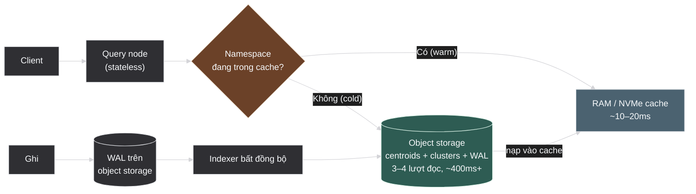

#### Amazon S3 Vectors

AWS ra mắt preview tháng 7/2025 và **GA ngày 02/12/2025**. S3 Vectors thêm một loại bucket mới — **vector bucket** — với API riêng (`PutVectors`, `QueryVectors`...). Giới hạn theo tài liệu AWS:

| Giới hạn | Giá trị |
|---------|---------|
| Vector index mỗi vector bucket | 10,000 |
| Vectors mỗi index | Tới **2 tỷ** |
| Số chiều | 1 – 4,096 |
| Metadata mỗi vector | Tới 40 KB tổng, trong đó tới **2 KB filterable**; tối đa 50 key |
| Thông lượng ghi mỗi index | Tới 1,000 request PutVectors/DeleteVectors mỗi giây, tới 2,500 vectors/giây |
| Top-K mỗi truy vấn | Tới 10,000 (trả về theo trang, tối đa 100 kết quả/trang) |

AWS mô tả độ trễ truy vấn **dưới 1 giây**, xuống khoảng **100ms với index được truy vấn thường xuyên**. S3 Vectors tích hợp làm vector store cho **Amazon Bedrock Knowledge Bases** và có thể dùng cùng **OpenSearch** (lưu trữ ở S3 Vectors, phần truy vấn tần suất cao đẩy sang OpenSearch).

**Cấu trúc giá** (theo trang giá AWS — con số cụ thể thay đổi theo region): phí **PUT theo GB** dữ liệu logic tải lên (tối thiểu 128KB mỗi request → nên batch), phí **lưu trữ theo GB-tháng**, và phí **truy vấn** = phí theo số request **cộng phí theo lượng dữ liệu được xử lý**, trong đó "dữ liệu xử lý" được tính bằng **số vector trong index × kích thước trung bình mỗi vector** (có bậc giá theo quy mô index).

#### turbopuffer

Dịch vụ thương mại (không có bản open source hay free tier) với kiến trúc đã mô tả ở trên. Theo trang "Tradeoffs" của chính họ:

- **Điểm mạnh:** quy mô rất lớn (100B+ vectors) với hàng chục triệu namespace; dữ liệu phân vùng tự nhiên theo tenant; hybrid search (BM25 + vector); chi phí.
- **Chưa phù hợp:** quy mô nhỏ cần free tier; ghi rất nặng (append/update/delete liên tục); xếp hạng phức tạp ở giai đoạn một (họ khuyến khích lấy candidate bằng hybrid search rồi rerank ở giai đoạn hai, xem §2.2).
- **Tính nhất quán:** đọc nhất quán mặc định, với độ trễ sàn khoảng **10ms** (phải kiểm tra object storage xem có ghi mới không); có thể chọn eventual consistency để nhanh hơn, nhưng khi đó dữ liệu có thể cũ tới khoảng **một giờ** trong trường hợp xấu nhất.

#### So sánh với vector DB "giữ trong RAM"

| Tiêu chí | Vector DB in-memory (HNSW) | Object-storage-native |
|----------|---------------------------|----------------------|
| **Chi phí lưu trữ** | Theo RAM/SSD được cấp phát cho toàn bộ dữ liệu | Theo giá object storage; chỉ phần nóng chiếm cache |
| **Độ trễ warm** | Vài ms | ~10–20ms (nhất quán) hoặc thấp hơn (eventual) |
| **Độ trễ cold** | Không có khái niệm cold | Hàng trăm ms đến ~1 giây |
| **Độ trễ ghi** | Thấp | Cao (100ms+, do commit lên object storage) |
| **Số namespace/tenant** | Thường bị giới hạn; mỗi collection tốn tài nguyên cố định | Hàng triệu đến hàng trăm triệu |
| **Phù hợp** | Truy vấn dày đặc, độ trễ thấp, dữ liệu vừa phải | Dữ liệu rất lớn hoặc nhiều tenant, truy vấn thưa/không đều |

> **Truy vấn lạnh, chi phí và dữ liệu chưa vào index**
>
> - **Độ trễ p99 bị quyết định bởi tỷ lệ truy vấn lạnh, không phải bởi index.** Nếu traffic phân tán đều trên hàng triệu namespace, nhiều truy vấn sẽ rơi vào trường hợp lạnh. Các hệ thống này thường hỗ trợ **"làm ấm" (prewarm)** — ví dụ gửi một truy vấn trước khi user mở ứng dụng hoặc mở codebase.
> - **Phí truy vấn của S3 Vectors tỷ lệ với kích thước index, không phải với số kết quả trả về.** Một index 1 tỷ vector mà truy vấn liên tục có thể đắt hơn bạn nghĩ. Chia nhỏ index theo tenant hoặc theo phạm vi tìm kiếm vừa giảm chi phí vừa giảm độ trễ.
> - **Dữ liệu vừa ghi vẫn tìm được, nhưng chậm hơn.** Phần WAL chưa được index phải quét vét cạn; nếu ghi liên tục với khối lượng lớn, phần chưa index có thể lớn dần và làm tăng độ trễ.
> - **Mô hình "một namespace cho mỗi tenant" không chỉ là tối ưu chi phí mà còn là ranh giới bảo mật tự nhiên** — rất khó vô tình trả kết quả của tenant A cho tenant B khi chúng nằm ở hai index khác nhau (so với lọc bằng metadata trong một index chung).

> **Kiểm tra workload trước khi chuyển sang object storage**
>
> - **"Rẻ hơn 90%" chỉ đúng với một mẫu truy cập cụ thể.** Với truy vấn dày đặc, độ trễ thấp, một vector DB in-memory được cấp phát đúng có thể rẻ hơn và nhanh hơn. Hãy mô hình hóa chi phí theo *số truy vấn × kích thước index* của chính bạn.
> - **Đừng đặt object-storage-native trực tiếp sau một API yêu cầu p99 < 50ms** mà không có chiến lược prewarm hoặc tầng nóng (ví dụ OpenSearch cho phần dữ liệu được truy vấn nhiều).
> - **Kiểm tra tính năng trước khi chuyển.** Không phải hệ thống nào cũng có hybrid search, sparse vectors hay rerank tích hợp; một số chỉ hỗ trợ vector similarity cộng metadata filter.
> - **Giới hạn thông lượng ghi theo từng index là có thật.** Ví dụ S3 Vectors giới hạn 2,500 vectors/giây mỗi index — re-embed 100 triệu vectors vào một index sẽ mất hơn 11 giờ chỉ riêng phần ghi. Lên kế hoạch cho việc migration (xem §3.10).

> Sources: [AWS — S3 Vectors GA (02/12/2025)](https://aws.amazon.com/about-aws/whats-new/2025/12/amazon-s3-vectors-generally-available), [Amazon S3 Vectors — Limitations](https://docs.aws.amazon.com/AmazonS3/latest/userguide/s3-vectors-limitations.html), [Amazon S3 Pricing](https://aws.amazon.com/s3/pricing/), [turbopuffer — Architecture](https://turbopuffer.com/docs/architecture), [turbopuffer — Tradeoffs](https://turbopuffer.com/docs/tradeoffs), [SPFresh (SOSP 2023)](https://dl.acm.org/doi/10.1145/3600006.3613166)

### Sai lầm thường gặp khi chọn Vector DB

- Chọn database rất mạnh cho dataset nhỏ, khiến hệ thống phức tạp hơn mức cần thiết
- Chọn engine chuyên biệt quá sớm dù bài toán thực tế chỉ cần một giải pháp all-in-one trong stack có sẵn
- Chỉ so benchmark ANN mà quên nhu cầu filtering và hybrid search
- Đánh giá thấp chi phí reindex khi đổi embedding model hoặc đổi dimension
- Không phân biệt rõ `PostgreSQL` với `pgvector`: PostgreSQL là hệ quản trị quan hệ, còn vector search đến từ extension `pgvector`
- Bỏ qua `SQLite + sqlite-vec` ở các bài toán embedded/local-first rồi vô tình dựng một hạ tầng quá nặng
- Chọn self-hosted chỉ vì "rẻ hơn", nhưng không tính công vận hành và thời gian của đội ngũ
- Chọn managed quá sớm ở scale lớn mà không dự tính vendor lock-in hoặc storage cost dài hạn

### Decision Tree

```mermaid
%%{init: {'theme':'base','themeVariables':{'background':'#1f1f1f','primaryColor':'#2f2f33','primaryTextColor':'#f8fafc','primaryBorderColor':'#e5e7eb','secondaryColor':'#4b6270','secondaryTextColor':'#f8fafc','secondaryBorderColor':'#e5e7eb','tertiaryColor':'#6b4128','tertiaryTextColor':'#f8fafc','tertiaryBorderColor':'#f3e8d8','lineColor':'#d4d4d8','textColor':'#f8fafc','mainBkg':'#2f2f33','clusterBkg':'#26272b','clusterBorder':'#d4d4d8','edgeLabelBackground':'#1f1f1f','nodeTextColor':'#f8fafc','fontFamily':'Inter, Segoe UI, sans-serif','fontSize':'16px'}}}%%
flowchart TD
    START["🤔 Bạn cần Vector Database nào?"] --> Q0{"Muốn all-in-one<br/>hay chuyên biệt?"}

    Q0 -->|"All-in-one"| Q1{"Stack / môi trường nào?"}
    Q0 -->|"Chuyên biệt"| Q3{"Quản lý infra?"}

    Q1 -->|"App local / offline / edge"| SQLITE["✅ SQLite + sqlite-vec<br/>embedded, offline-friendly"]
    Q1 -->|"Đã có PostgreSQL"| PG["✅ PostgreSQL + pgvector<br/>SQL + vectors"]
    Q1 -->|"Prototype AI / local dev"| CHROMA["✅ Chroma<br/>API đơn giản, local"]
    Q1 -->|"Muốn AI-native + hybrid"| WEAV["✅ Weaviate<br/>BM25 + vector native"]

    Q3 -->|"Không muốn (managed)"| Q6{"Ưu tiên gì?"}
    Q3 -->|"Tự quản lý (self-hosted)"| Q4{"Scale bao nhiêu?"}

    Q6 -->|"Global low-latency + Workers"| CF["✅ Cloudflare Vectorize<br/>managed, edge-native"]
    Q6 -->|"Managed nói chung"| PINE["✅ Pinecone<br/>Fully managed"]

    Q4 -->|"< 100M vectors"| Q5{"Ưu tiên gì?"}
    Q4 -->|"> 100M / tỷ vectors"| MILVUS["✅ Milvus<br/>GPU, distributed"]

    Q5 -->|"Hybrid search"| WEAV2["✅ Weaviate<br/>BM25 + vector native"]
    Q5 -->|"Performance + filtering"| QDRANT["✅ Qdrant<br/>Rust, fast, filtering"]

    style CHROMA fill:#4b6270,stroke:#e5e7eb,color:#f8fafc,stroke-width:1.5px
    style SQLITE fill:#4b6270,stroke:#e5e7eb,color:#f8fafc,stroke-width:1.5px
    style PG fill:#4b6270,stroke:#e5e7eb,color:#f8fafc,stroke-width:1.5px
    style PINE fill:#6b4128,stroke:#f3e8d8,color:#f8fafc,stroke-width:1.5px
    style CF fill:#6b4128,stroke:#f3e8d8,color:#f8fafc,stroke-width:1.5px
    style MILVUS fill:#2e5c53,stroke:#ddf5ea,color:#f8fafc,stroke-width:1.5px
    style QDRANT fill:#2e5c53,stroke:#ddf5ea,color:#f8fafc,stroke-width:1.5px
    style WEAV fill:#5a0b6a,stroke:#f0d9ff,color:#f8fafc,stroke-width:1.5px
    style WEAV2 fill:#5a0b6a,stroke:#f0d9ff,color:#f8fafc,stroke-width:1.5px
```

Trước khi chốt lựa chọn, kiểm tra ai sẽ vận hành database, quy mô dự kiến trong 6-12 tháng tới và nhu cầu hybrid search/filtering.

### HNSW Tuning Parameters

Ba tham số HNSW dưới đây ảnh hưởng đến thời gian xây index, độ trễ truy vấn và recall:

| Tham số | Vai trò | Range thường dùng | Ảnh hưởng khi tăng |
|---------|---------|-------------------|---------------------|
| **`m`** | Số connections mỗi node trong graph | 16 – 64 | Recall ↑, RAM ↑, build time ↑ |
| **`ef_construction`** | Search depth khi xây index | 100 – 500 | Index quality ↑, build time ↑↑ |
| **`ef_search`** | Search depth khi query | 50 – 200 | Recall ↑, query latency ↑ |

> ⚠️ **Sai params có thể gây hậu quả lớn**: `ef_construction` quá thấp → recall kém vĩnh viễn (phải rebuild index). `m` quá cao → build time và RAM tăng 5-10×. Luôn benchmark trên data thật trước khi deploy.

**Heuristic bắt đầu**: `m=16`, `ef_construction=200`, `ef_search=100`. Khi cần cải thiện recall, **tăng `ef_search` trước** — đây là knob rẻ nhất vì chỉ ảnh hưởng query time, không cần rebuild index.

#### Syntax theo từng Vector Database

> ⚠️ **Disclaimer**: Syntax checked against official docs tại **March 2026**. Luôn kiểm tra official docs cho phiên bản bạn đang dùng.

> Bảng này chỉ liệt kê các engine cho phép điều chỉnh HNSW trực tiếp. Pinecone tự quản lý và tối ưu index, không cung cấp các tham số này cho người dùng.

| Engine | Version | Syntax tạo index | Syntax tuning search | Docs |
|--------|---------|------------------|---------------------|------|
| **pgvector** | ≥ 0.7 | `CREATE INDEX ON items USING hnsw (embedding vector_cosine_ops) WITH (m = 16, ef_construction = 200);` | `SET hnsw.ef_search = 100;` | [pgvector GitHub](https://github.com/pgvector/pgvector) |
| **Milvus** | ≥ 2.4 | `index_params = {"index_type": "HNSW", "metric_type": "COSINE", "params": {"M": 16, "efConstruction": 200}}` | `search_params = {"params": {"ef": 100}}` | [Milvus HNSW docs](https://milvus.io/docs/index.md) |
| **Qdrant** | ≥ 1.9 | `hnsw_config={"m": 16, "ef_construct": 200}` trong collection config | `hnsw_ef=100` trong search params | [Qdrant docs](https://qdrant.tech/documentation/) |
| **Weaviate** | ≥ 1.25 | `"vectorIndexConfig": {"efConstruction": 200, "maxConnections": 16}` trong class schema | `"ef": 100` trong query params | [Weaviate docs](https://docs.weaviate.io/) |

> 💡 **Tuning workflow**: (1) Bắt đầu với defaults → (2) Tăng `ef_search` cho đến khi recall đạt target → (3) Nếu chưa đủ, tăng `m` và `ef_construction` rồi **rebuild index** → (4) Benchmark recall vs latency trên eval set thật.

---

## 3.3 Chunking Strategies

Một câu trả lời có thể nằm ở cuối đoạn này và đầu đoạn tiếp theo. Cách cắt tài liệu quyết định liệu retriever tìm được đủ thông tin hay chỉ một nửa. Vì vậy, ngay cả khi giữ nguyên model và vector database, thay đổi chunking vẫn có thể làm recall và chất lượng câu trả lời thay đổi.

### Tại sao cần Chunking?

Embedding models có **giới hạn context length** (256-8192 tokens). Documents dài hơn phải được chia nhỏ thành **chunks** trước khi embed. Cách chunk ảnh hưởng trực tiếp đến chất lượng retrieval:
- Chunk quá nhỏ → mất context, thiếu thông tin
- Chunk quá lớn làm loãng biểu diễn, khó giữ được chi tiết cần tìm.
- Chunk cắt giữa câu/ý → mất coherence

Mỗi chunk trở thành một đơn vị có thể được tìm và trả về độc lập. Hãy chọn ranh giới sao cho đơn vị đó vẫn mang đủ nghĩa.

### Khi nào không cần Chunking?

Không phải lúc nào cũng nên cắt nhỏ tài liệu. Trong một số trường hợp, index theo **document** hoặc **item hoàn chỉnh** lại đúng hơn:

- tài liệu vốn đã ngắn và nằm gọn trong context của model
- mỗi record tự nó đã là một đơn vị tri thức hoàn chỉnh, như FAQ entry, product item, support ticket ngắn
- bài toán cần document-level similarity hoặc classification hơn là passage retrieval
- việc chia nhỏ làm mất cấu trúc tự nhiên của dữ liệu mà không mang lại thêm precision đáng kể

Nếu một mục đã chứa trọn thông tin cần tìm, cắt nhỏ hơn có thể chỉ làm tăng số vector và số bước xử lý.

### Chọn đơn vị chunk trước khi chọn kích thước

Chọn phần nội dung cần truy xuất trước, rồi mới chọn giới hạn token cho nó:

- với FAQ hoặc catalog items, một chunk có thể chính là **một mục hoàn chỉnh**
- với docs kỹ thuật, chunk thường nên bám theo **section** hoặc **subsection**
- với hợp đồng, báo cáo, PDF dài, chunk có thể cần đi theo **page + heading + đoạn liên quan**

Nếu chọn sai đơn vị ngay từ đầu, việc tinh chỉnh `256` hay `512` tokens sau đó thường không cứu được nhiều.

### Chunking theo loại dữ liệu

| Loại dữ liệu | Đơn vị retrieve thường hợp lý | Gợi ý thực tế |
|--------------|-------------------------------|---------------|
| **FAQ / catalog / knowledge base ngắn** | Mỗi item hoàn chỉnh | Thường không cần cắt nhỏ hơn item; giữ title, id, tags đi kèm |
| **Docs kỹ thuật / manuals / wiki** | Section hoặc subsection | Giữ heading, đoạn giải thích và ví dụ gần nhau trong cùng chunk nếu có thể |
| **Source code** | Function, class hoặc module nhỏ | Tránh cắt giữa function signature, docstring và implementation; giữ path + symbol name trong metadata |
| **Meeting transcript / chat / call log** | Cửa sổ theo lượt nói | Giữ speaker, timestamp và một ít ngữ cảnh trước đó để tránh mất mạch hội thoại |
| **PDF scan / báo cáo / hợp đồng** | Page + heading + đoạn liên quan | Đừng tách bảng, caption và phần diễn giải quá xa nhau; OCR kém thường cần overlap cao hơn |
| **Table-heavy documents** | Một bảng kèm caption và đoạn giải thích xung quanh | Nếu chỉ embed ô dữ liệu rời rạc, retrieval thường đúng từ khóa nhưng sai ý nghĩa |

### Bảng so sánh Strategies

| Strategy | Mô tả | Khi nào dùng | Ưu/Nhược |
|----------|--------|-------------|----------|
| **Fixed-size** | ~512 tokens + 20-25% overlap | Baseline, simple setup, corpus đa dạng format | ✅ Đơn giản, predictable size; ❌ Cắt giữa câu/ý |
| **Sentence-boundary** | Chunk tại câu hoàn chỉnh (không cắt giữa câu) | Text dạng prose (bài viết, email) | ✅ Tự nhiên, giữ coherence; ❌ Chunk size không đều |
| **Semantic** | Chunk theo ranh giới ngữ nghĩa (topic shift detection) | Cải thiện retrieval quality khi cần | ✅ Recall thường tốt hơn fixed-size; ❌ Phức tạp, cần model thêm |
| **Recursive / Hierarchical** | Theo cấu trúc document (heading → section → paragraph) | Tài liệu có heading/section rõ ràng (docs, wiki) | ✅ Giữ cấu trúc logic; ❌ Phụ thuộc format |
| **Agentic / Late chunking** | Model đọc full document trước, rồi quyết định chunk boundaries | Research/emerging (2024-2026) | ✅ Tối ưu nhất về lý thuyết; ❌ Chậm, đắt |
| **Contextualized chunk embeddings** (managed) | Gửi cả document; model tự chunk và embed mỗi chunk kèm ngữ cảnh toàn document (vd. `voyage-context-4`) | Docs dài, chunk phụ thuộc định nghĩa/ngữ cảnh ở chỗ khác (hợp đồng, manual, transcript) | ✅ Không cần tự viết chunker hay LLM contextual augmentation; ❌ Lock-in vào một provider |

### Diagram: Chunking Comparison

```mermaid
%%{init: {'theme':'base','themeVariables':{'background':'#1f1f1f','primaryColor':'#2f2f33','primaryTextColor':'#f8fafc','primaryBorderColor':'#e5e7eb','secondaryColor':'#4b6270','secondaryTextColor':'#f8fafc','secondaryBorderColor':'#e5e7eb','tertiaryColor':'#6b4128','tertiaryTextColor':'#f8fafc','tertiaryBorderColor':'#f3e8d8','lineColor':'#d4d4d8','textColor':'#f8fafc','mainBkg':'#2f2f33','clusterBkg':'#26272b','clusterBorder':'#d4d4d8','edgeLabelBackground':'#1f1f1f','nodeTextColor':'#f8fafc','fontFamily':'Inter, Segoe UI, sans-serif','fontSize':'16px'}}}%%
flowchart TD
    DOC["📄 Long Document (5000 tokens)"] --> CHOOSE{"Chọn strategy?"}

    CHOOSE --> FIX["📏 Fixed-size<br/>512 tokens + 25% overlap"]
    CHOOSE --> SENT["📝 Sentence-boundary<br/>Gom câu ≤ 512 tokens"]
    CHOOSE --> SEM["🧠 Semantic<br/>Detect topic shifts"]
    CHOOSE --> HIER["📑 Hierarchical<br/>Theo heading structure"]

    FIX --> FIX_R["Chunk 1: token 1-512<br/>Chunk 2: token 385-896<br/>Chunk 3: token 769-1280<br/>..."]
    SENT --> SENT_R["Chunk 1: Câu 1-8 (480 tokens)<br/>Chunk 2: Câu 9-15 (510 tokens)<br/>..."]
    SEM --> SEM_R["Chunk 1: Topic A (340 tokens)<br/>Chunk 2: Topic B (680 tokens)<br/>Chunk 3: Topic C (290 tokens)<br/>..."]
    HIER --> HIER_R["Chunk 1: Section 1.1 (600 tokens)<br/>Chunk 2: Section 1.2 (450 tokens)<br/>Chunk 3: Section 2.1 (800 tokens)<br/>..."]

    style FIX fill:#4b6270,stroke:#e5e7eb,color:#f8fafc,stroke-width:1.5px
    style SENT fill:#2e5c53,stroke:#ddf5ea,color:#f8fafc,stroke-width:1.5px
    style SEM fill:#6b4128,stroke:#f3e8d8,color:#f8fafc,stroke-width:1.5px
    style HIER fill:#5a0b6a,stroke:#f0d9ff,color:#f8fafc,stroke-width:1.5px
```

### Khi nào chọn strategy nào?

- **Fixed-size**: tốt để có baseline nhanh, nhất là khi dữ liệu lộn xộn hoặc format không đồng nhất
- **Sentence-boundary**: hợp khi dữ liệu chủ yếu là prose và bạn muốn tránh cắt cụt ý giữa câu
- **Hierarchical**: thường mạnh với docs, wiki, manuals, policy documents vì giữ cấu trúc logic
- **Semantic chunking**: đáng thử khi retrieval chất lượng cao là ưu tiên lớn hơn độ đơn giản triển khai
- **Agentic / late chunking**: nên xem như hướng nghiên cứu hoặc tối ưu nâng cao, chưa phải lựa chọn mặc định
- **Contextualized chunk embeddings**: từ 2026 đã có sản phẩm production. `voyage-context-4` (06/2026) có auto-chunking, hỗ trợ overlap, tự split docs dài hơn 32k và giá $0.12/1M tokens. Theo vendor, nó vượt `voyage-context-3` 2.08% ở chunk-level retrieval, và `voyage-context-3` từng vượt Anthropic contextual retrieval 6.76%. Đáng benchmark khi chunk-level recall là điểm nghẽn. — [blog](https://blog.voyageai.com/2026/06/29/voyage-context-4/)

### Parent-child Retrieval: retrieve nhỏ, trả về ngữ cảnh lớn hơn

**Parent-child retrieval** dùng chunk nhỏ (child) để tìm đúng chi tiết, rồi lấy mục hoặc đoạn lớn hơn chứa nó (parent) làm ngữ cảnh cho model.

Ví dụ:

- child chunk dùng để search: `150-300 tokens`
- parent chunk dùng để assemble context: `800-1500 tokens` hoặc cả subsection

Cách này hữu ích vì:

- chunk nhỏ dễ match đúng câu hỏi hơn
- ngữ cảnh lớn hơn giúp model không trả lời dựa trên một câu bị cắt rời
- citation và answer synthesis thường ổn định hơn so với việc chỉ ném nhiều mảnh rất nhỏ vào prompt

Nếu chỉ index ở mức parent lớn, retrieval dễ bị pha loãng. Nếu chỉ giữ child chunks rất nhỏ, hệ thống lại dễ retrieve đúng mảnh thông tin nhưng thiếu bối cảnh để trả lời trọn vẹn.

### Chunking ảnh hưởng thế nào tới storage, latency và cost?

Kích thước chunk và overlap quyết định số vector phải lưu, số lần tạo embedding và lượng token ở các bước sau.

Một công thức gần đúng là:

`num_chunks ≈ total_tokens / (chunk_size - overlap)`

Ví dụ một tài liệu `5000 tokens`:

- chunk `500` với overlap `100` → stride `400` → khoảng `13` chunks
- chunk `250` với overlap `50` → stride `200` → khoảng `25` chunks

Chỉ riêng việc giảm chunk size từ `500` xuống `250` trong ví dụ này đã gần như **nhân đôi số vectors**, và kéo theo:

- storage tăng
- thời gian indexing và re-embedding tăng
- ANN index lớn hơn
- số candidates phải rerank có xu hướng tăng
- prompt assembly dễ trùng lặp hơn nếu top results là nhiều đoạn gần nhau

Chunk lớn hơn giảm số vector nhưng có thể chứa nhiều nội dung không liên quan, làm giảm độ chính xác truy xuất và tăng token trong prompt. Cần đo cả chất lượng, độ trễ, dung lượng và chi phí khi đổi cách chia.

### Best Practices

1. **Chunk size sweet spot**: **256-512 tokens** là baseline tốt cho nhiều use cases dạng prose. Với code, bảng hoặc transcripts, điều quan trọng hơn là bám đúng đơn vị logic chứ không phải ép mọi thứ về cùng một số tokens.

2. **Overlap nên theo loại dữ liệu**: `10-15%` thường đủ khi biên chunk đã sạch theo section hoặc sentence; `20-25%` hợp hơn với prose dài, OCR noisy hoặc transcript. Overlap quá `30%` thường làm chi phí tăng nhanh hơn lợi ích.

3. **Metadata preservation**: giữ metadata cùng mỗi chunk — rất quan trọng cho attribution, filtering và parent-child retrieval:
   ```text
   chunk = {
       "text": "...",
       "metadata": {
           "doc_id": "report-2025",
           "chunk_id": "report-2025#chunk-03",
           "source": "annual-report-2025.pdf",
           "page": 15,
           "section": "Financial Results",
           "parent_section": "Q4 Results",
           "chunk_index": 3,
           "updated_at": "2026-03-01"
       }
   }
   ```

4. **Context enrichment**: prepend section heading/title vào chunk content để giúp embedding hiểu context:
   ```text
   # Trước:
   "Revenue grew 15% year-over-year..."

   # Sau (enriched):
   "Financial Results — Q4 2025: Revenue grew 15% year-over-year..."
   ```

5. **Đánh giá trên dữ liệu của hệ thống**: so sánh cách chia chunk bằng `Recall@K`, `nDCG@K`; với RAG, đo thêm chất lượng câu trả lời và trích dẫn.

### Failure Modes thường gặp

- **Chunk quá nhỏ**: retrieve được nhiều đoạn "có vẻ gần" nhưng đoạn nào cũng thiếu ý chính để answer
- **Chunk quá lớn**: relevant information bị chìm trong phần không liên quan
- **Overlap quá ít**: mất ý ở biên đoạn, đặc biệt với answer nằm giữa hai chunks
- **Overlap quá nhiều**: index phình to, top results lặp lại nhiều đoạn gần giống nhau
- **Bỏ mất cấu trúc document**: section title hoặc page context biến mất, khiến retrieval đúng nội dung nhưng khó trích dẫn
- **Chia sai đơn vị logic**: function bị cắt đôi, bảng bị tách khỏi caption, transcript mất speaker turns
- **Retrieve đúng child chunk nhưng answer vẫn yếu**: hệ thống tìm được đoạn nhỏ liên quan nhưng không kéo parent context vào đủ để model tổng hợp câu trả lời

### Quy trình benchmark chunking nên làm như thế nào?

Có thể thử lần lượt các bước sau:

1. bắt đầu bằng `fixed-size 256-512 tokens` với overlap `20-25%`
2. đo `Recall@K` hoặc `nDCG@K` trên một tập query thật, không chỉ trên ví dụ đẹp
3. nếu đang làm RAG, đo thêm answer quality, citation quality hoặc tỷ lệ phải fallback sang "không đủ bằng chứng"
4. nếu dữ liệu có cấu trúc rõ, thử `hierarchical`, `sentence-boundary`, hoặc `parent-child retrieval`
5. chỉ thử `semantic chunking` khi baseline đã rõ và chất lượng retrieval vẫn là bottleneck lớn

Giữ cấu hình đạt chất lượng yêu cầu trong giới hạn dung lượng index, độ trễ và chi phí.

> Sources: [Pinecone — Chunking Strategies](https://www.pinecone.io/learn/chunking-strategies/), [Azure — Chunk Documents for Vector Search](https://learn.microsoft.com/en-us/azure/search/vector-search-how-to-chunk-documents)

## 3.4 Dimension Reduction & Quantization

Khi index lớn dần, có hai cách giảm dung lượng vector: giảm số chiều hoặc dùng ít bit hơn cho mỗi giá trị. Cả hai đều có thể tiết kiệm RAM và tăng tốc tìm kiếm, nhưng cần đo phần chất lượng bị mất.

### Ưu tiên giảm chiều native khi model hỗ trợ MRL

Nếu model hỗ trợ `MRL` (Matryoshka Representation Learning), ưu tiên dùng chính khả năng giảm chiều native của model thay vì giảm chiều sau khi embedding đã được tạo ra.

- OpenAI: `dimensions` parameter
- Cohere embed-v4 / embed-v5: `output_dimension` parameter
- Voyage: `output_dimension` parameter (kết hợp được với `output_dtype` = `int8`/`uint8`/`binary`/`ubinary`)
- Google Gemini: `output_dimensionality` trong config

| Model | MRL Support | Cách dùng | Min Dims |
|-------|-------------|-----------|----------|
| text-embedding-3-large | ✅ | `dimensions=1536` trong API call | 256 |
| text-embedding-3-small | ✅ | `dimensions=512` trong API call | 256 |
| voyage-4-large / voyage-4 / voyage-4-lite / voyage-context-4 / voyage-code-4 | ✅ | `output_dimension` ∈ {256, 512, 1024, 2048} ([Voyage docs](https://docs.voyageai.com/docs/flexible-dimensions-and-quantization)) | 256 |
| embed-v5.0-pro / -fast | ✅ | `output_dimension` ∈ {256, 512, 768, 1024, 1536, 2048} | 256 |
| embed-v4.0 | ✅ | `output_dimension` parameter ([Cohere API ref](https://docs.cohere.com/reference/embed)) | 256 |
| gemini-embedding-2 | ✅ | `output_dimensionality` 128-3072 ([Google docs](https://ai.google.dev/gemini-api/docs/embeddings)) | 128 (khuyến nghị 768 / 1536 / 3072) |
| Qwen3-Embedding | ✅ | Truncate output (32-4096) | 32 |
| jina-embeddings-v3 / v5-text | ✅ | Truncate output | 32 |

### Khi nào dùng MRL, PCA, UMAP hay Quantization?

| Kỹ thuật | Nên dùng khi | Không nên kỳ vọng gì | Vai trò chính |
|----------|--------------|----------------------|---------------|
| **MRL / native truncation** | Model hỗ trợ giảm chiều native và mục tiêu là giảm storage/RAM/latency | Không thay được visualization 2D/3D | Giảm chiều cho production retrieval |
| **PCA** | Model không hỗ trợ MRL hoặc cần exploratory analysis | Không phải cách tốt nhất để giữ retrieval quality ở scale production | Baseline reduction, phân tích phương sai |
| **UMAP** | Cần nhìn cấu trúc dữ liệu ở 2D/3D | Không nên dùng trực tiếp để thay thế embedding production | Visualization, exploratory analysis |
| **Quantization** | Dataset lớn đến mức RAM hoặc storage bắt đầu thành bottleneck rõ rệt | Không phải lúc nào cũng miễn phí về quality | Giảm footprint và tăng throughput ở scale lớn |

### Chọn target dimensions như thế nào?

Giảm từ `3072` xuống `1536`, `768` hay `512` không nên được làm theo cảm giác. Cách chọn hợp lý nhất là xem **use case nào đang nhạy cảm nhất với việc mất thông tin**.

- **Retrieval / semantic search** thường chịu giảm chiều khá tốt nếu model có `MRL`, nhất là khi corpus và query không quá khó
- **RAG retrieval** thường vẫn chấp nhận được ở dimensions thấp hơn, miễn là `Recall@K` và answer quality chưa giảm rõ
- **Clustering** thường nhạy hơn với thay đổi hình học của vector space, nên cần test kỹ hơn
- **Classification** có thể vẫn ổn ở dimensions thấp hơn nếu decision boundary của bài toán không quá phức tạp

Để chọn số chiều:

1. chọn baseline ở full dims hoặc mức nhà cung cấp khuyến nghị
2. chạy sweep qua vài mức như `3072 -> 1536 -> 768 -> 512`
3. đo đúng metric của use case, không chỉ nhìn storage giảm bao nhiêu
4. dừng ở mức thấp nhất mà quality còn nằm trong ngưỡng chấp nhận được

Ghi lại chất lượng, RAM, dung lượng và độ trễ ở từng mức để thấy rõ phần tiết kiệm đổi lấy điều gì.

### Tại sao MRL tốt hơn PCA truncation?

```mermaid
%%{init: {'theme':'base','themeVariables':{'background':'#1f1f1f','primaryColor':'#2f2f33','primaryTextColor':'#f8fafc','primaryBorderColor':'#e5e7eb','secondaryColor':'#4b6270','secondaryTextColor':'#f8fafc','secondaryBorderColor':'#e5e7eb','tertiaryColor':'#6b4128','tertiaryTextColor':'#f8fafc','tertiaryBorderColor':'#f3e8d8','lineColor':'#d4d4d8','textColor':'#f8fafc','mainBkg':'#2f2f33','clusterBkg':'#26272b','clusterBorder':'#d4d4d8','edgeLabelBackground':'#1f1f1f','nodeTextColor':'#f8fafc','fontFamily':'Inter, Segoe UI, sans-serif','fontSize':'16px'}}}%%
flowchart LR
    subgraph MRL["✅ MRL (Native)"]
        direction TB
        M1["Training: model learn<br/>để prefix dims chứa<br/>đủ thông tin"]
        M2["Output: truncate ở API<br/>dimensions=768"]
        M3["Quality: ~95%+ giữ lại<br/>ở 50% dims"]
        M1 --> M2 --> M3
    end

    subgraph PCA["⚠️ PCA (Post-processing)"]
        direction TB
        P1["Model output<br/>full 3072 dims"]
        P2["PCA fit_transform<br/>giảm → 768 dims"]
        P3["Quality: mất nhiều hơn<br/>vì PCA không biết<br/>embedding structure"]
        P1 --> P2 --> P3
    end

    style MRL fill:#2e5c53,stroke:#ddf5ea,color:#f8fafc,stroke-width:1.5px
    style PCA fill:#6b4128,stroke:#f3e8d8,color:#f8fafc,stroke-width:1.5px
```

- **MRL training**: model được huấn luyện bằng hàm loss ở nhiều mức số chiều, để các chiều đầu giữ được thông tin quan trọng.
- **PCA truncation**: áp dụng **sau** training → linear transformation không tối ưu cho embedding structure → mất thông tin nhiều hơn
- **MRL giữ chất lượng cao ở 50% dimensions** (ví dụ 3072→1536; xem MTEB scores trong [Google docs](https://ai.google.dev/gemini-api/docs/embeddings)), PCA thường mất nhiều hơn

> Source: [Matryoshka Representation Learning — Kusupati et al., 2022](https://arxiv.org/abs/2205.13147)

### PCA/UMAP (Vẫn cần cho một số trường hợp)

MRL chủ yếu phục vụ giảm chiều cho vector dùng trong truy xuất. PCA và UMAP còn dùng để phân tích dữ liệu hoặc trực quan hóa, nên vẫn có vai trò riêng:

| Method | Khi nào dùng | Cách hoạt động | Ghi chú |
|--------|-------------|---------------|---------|
| **UMAP** | Visualization 2D/3D, manifold learning | Non-linear mapping, giữ cấu trúc local | Tốt nhất cho visual exploration |
| **PCA** | Exploratory analysis, baseline reduction | Linear transform, maximize variance | Nhanh, deterministic, explainable |
| **t-SNE** | Visualization 2D/3D (alternative) | Non-linear, perplexity-based | Chậm hơn UMAP ở scale lớn |

**Khi nào dùng PCA/UMAP thay vì MRL?**
1. **Visualization**: UMAP chiếu 1536-dim → 2D plot → MRL không làm được (min dim thường = 256+)
2. **Model không hỗ trợ MRL**: all-mpnet-base-v2, embed-v3, các model cũ → PCA là lựa chọn duy nhất
3. **Exploratory analysis**: PCA explained variance ratio giúp hiểu thông tin phân bố trong dimensions

### Mã giả: Chọn giữa MRL, PCA và UMAP

```text
# Goal 1: reduce production vector size while preserving quality
if model_supports_mrl:
    # Xem Production Note ở §2.2 về batching và rate limits
    vectors = embed(
        texts,
        model="embedding-model",
        dimensions=768
    )

# Goal 2: reduce dimensions for analysis when model has no MRL
else if need_smaller_vectors_for_analysis:
    full_vectors = embed(texts, model="embedding-model")
    reduced_vectors = pca_reduce(full_vectors, target_dimensions=768)

# Goal 3: visualize clusters or inspect the geometry manually
if need_2d_visualization:
    full_vectors = embed(texts, model="embedding-model")
    vectors_2d = umap_project(full_vectors, target_dimensions=2)
    plot(vectors_2d)
```

> Sources: [PCA — scikit-learn](https://scikit-learn.org/stable/modules/generated/sklearn.decomposition.PCA.html), [UMAP documentation](https://umap-learn.readthedocs.io/en/latest/)

### Quantization (Scale lớn: >10M vectors)

Với hàng triệu hoặc hàng chục triệu vector, dung lượng bộ nhớ có thể trở thành giới hạn chính. Quantization giảm lượng bộ nhớ cần cho mỗi vector.

### Ba đòn bẩy khác nhau: giảm chiều, nén vector, nén index

Cần phân biệt việc giảm số chiều, giảm độ chính xác của mỗi giá trị và thay đổi cách lưu trong index:

| Đòn bẩy | Tác động lên cái gì? | Ví dụ | Khi nào nghĩ tới |
|---------|----------------------|-------|------------------|
| **Giảm chiều đầu ra** | Bản thân vector embedding | `3072 -> 1536` bằng `MRL` | Muốn giảm RAM/storage ngay từ đầu mà vẫn giữ retrieval quality |
| **Quantization** | Cách biểu diễn giá trị trong vector | `float32 -> int8` hoặc `binary` | Khi vectors đã nhiều tới mức memory footprint trở thành bottleneck |
| **Nén / tối ưu ở tầng index** | Cấu trúc ANN index và cách search | `PQ`, `IVF_PQ`, compressed indexes | Khi scale lớn tới mức index structure cũng phải tối ưu mạnh |

Có thể kết hợp các kỹ thuật này: giảm chiều, quantize giá trị, rồi tiếp tục tối ưu cấu trúc index khi quy mô tăng.

**Ví dụ tính toán memory:**
- 10M vectors × 1536 dims × 4 bytes (float32) = **~57 GB RAM** chỉ cho vectors
- Thêm index overhead (HNSW graph) → ~80-100 GB
- 100M vectors → ~800 GB-1TB → cần nhiều machines

Quantization giải quyết bằng cách **nén** vectors:

| Method | Cách hoạt động | Memory Reduction | Quality Impact | Khi nào dùng |
|--------|---------------|-----------------|-------------|-------------|
| **Scalar Quantization (SQ8)** | float32 → int8 (mỗi dim) | **4x** | Nhỏ — thường chấp nhận được | Scale vừa (10M-100M vectors) |
| **Product Quantization (PQ)** | Chia vector thành sub-vectors, quantize mỗi sub | **16-64x** | Lớn hơn SQ8 — cần test | Scale lớn (>100M vectors) |
| **Binary Quantization** | Mỗi dim → 1 bit (sign) | **32x** | Đáng kể — dùng cho coarse pass | First-pass retrieval, re-rank later |

**Chiến lược kết hợp**: dùng binary quantization cho first-pass (nhanh, tìm ~1000 candidates) → re-score candidates bằng full-precision vectors (chính xác).

### Khi nào chưa nên Quantize?

Nên trì hoãn quantization khi chưa có vấn đề bộ nhớ rõ ràng hoặc chưa đo được ảnh hưởng đến chất lượng:

- dataset còn nhỏ hoặc vừa, RAM chưa phải vấn đề thật
- chất lượng retrieval còn chưa ổn định, chưa có baseline rõ để so sánh trước/sau quantization
- hệ thống còn đang đổi model, đổi chunking hoặc đổi index khá thường xuyên
- chi phí vận hành thêm của quantization lớn hơn lợi ích mà nó mang lại ở giai đoạn hiện tại

Thứ tự hợp lý thường là: chọn model phù hợp, chọn dimension hợp lý, benchmark baseline, rồi mới nghĩ tới quantization khi scale đã bắt đầu gây áp lực thật.

### Sai lầm thường gặp

- Dùng PCA để thay vai trò của MRL dù model đã hỗ trợ native truncation
- Dùng UMAP để "giảm chiều cho production", trong khi UMAP chủ yếu hữu ích cho visualization
- Quantize quá sớm khi hệ thống còn chưa có baseline chất lượng ổn định
- Đánh giá quantization chỉ bằng memory reduction mà không đo retrieval quality sau khi nén

> Sources: [FAISS — Index types and Quantization](https://github.com/facebookresearch/faiss/wiki/Faiss-indexes)

---

## 3.5 Hybrid Search (Sparse + Dense)

### Sparse và Dense bổ trợ nhau ra sao

Dense search xử lý tốt các cách diễn đạt khác nhau của cùng một ý, nhưng dễ bỏ sót mã lỗi, tên riêng, SKU hoặc số điều luật. BM25 giữ được các từ khóa chính xác nhưng yếu hơn với paraphrase. Hybrid search kết hợp hai cách truy xuất để bù cho những loại lỗi khác nhau.

### Khi nào Hybrid thực sự cần?

Hybrid đặc biệt đáng giá khi query distribution của hệ thống có tính pha trộn:

- vừa có câu hỏi tự nhiên, vừa có mã số, tên riêng hoặc thuật ngữ chuẩn
- corpus có nhiều cụm exact match quan trọng như product codes, error messages, legal citations
- người dùng diễn đạt cùng một ý bằng nhiều cách rất khác nhau
- dense retrieval có recall tốt nhưng hay bỏ sót exact matches quan trọng

Lợi ích của hybrid rõ nhất khi tập query có những nhóm mà sparse làm tốt và những nhóm khác mà dense làm tốt.

### Khi nào dense-only hoặc sparse-only là đủ?

- **Dense-only** thường đủ khi query chủ yếu là ngôn ngữ tự nhiên, ít exact identifiers, và mục tiêu là semantic recall
- **Sparse-only** thường đủ khi corpus có tính cấu trúc cao, query nhiều mã số/tên chuẩn, và exact term matching quan trọng hơn paraphrase

Nếu hệ thống chưa có bằng chứng rõ ràng rằng sparse và dense bổ trợ nhau, việc thêm hybrid quá sớm có thể chỉ làm pipeline phức tạp hơn mà chưa đem lại nhiều lợi ích.

### Query Routing và Conditional Hybrid

Trong production, không phải query nào cũng cần đi qua cùng một pipeline. Nhiều hệ thống hoạt động tốt hơn khi **route query theo đặc điểm của nó**:

- query có mã lỗi, SKU, ticket ID, tên chuẩn hóa hoặc legal citation rõ ràng → ưu tiên sparse hoặc hybrid thiên sparse
- query dài, diễn đạt tự nhiên, có nhiều paraphrase → ưu tiên dense hoặc hybrid cân bằng hơn
- query quá ngắn hoặc mơ hồ → thường cần top-K rộng hơn và rerank mạnh hơn
- query có cả keyword exact lẫn ý nghĩa mở rộng → hybrid là lựa chọn tự nhiên

Routing cho phép chỉ dùng những bước cần thiết cho từng nhóm query, giảm công việc không mang lại lợi ích cho kết quả.

### Tại sao cần Hybrid?

| Method | Mạnh | Yếu | Ví dụ |
|--------|------|------|-------|
| **BM25 (Sparse)** | Exact keyword match, tên riêng, mã số | Không hiểu synonyms/paraphrases | Query "iPhone 15 Pro Max" → match exact |
| **Dense Embedding** | Semantic similarity, multilingual | Yếu exact match, rare terms | Query "cách sửa điện thoại" → match "phone repair guide" |
| **Hybrid** | Cả hai! | Phức tạp hơn, cần tune | Kết hợp keyword precision + semantic recall |

**Ví dụ thực tế** khi sparse thắng dense:
- Query: "PO-2024-001234" (mã đơn hàng) → BM25 match exact, dense embedding không hiểu
- Query: "OWASP Top 10" → BM25 match tên chuẩn, dense có thể nhầm lẫn

**Ví dụ thực tế** khi dense thắng sparse:
- Query: "cách làm cho máy tính chạy nhanh hơn" → dense match "performance optimization guide"
- Query: "feelings of sadness" → dense match "depression symptoms" (synonym understanding)

### Reciprocal Rank Fusion (RRF)

```
RRF_score(d) = 1/(k + rank_sparse(d)) + 1/(k + rank_dense(d))
```

- `k = 60` (constant, mặc định trong hầu hết implementations)
- RRF chỉ dùng **rank** (thứ hạng), không dùng raw score → không cần normalize scores giữa systems
- Tỷ lệ khuyến nghị: **70-80% dense + 20-30% sparse** (heuristic, tune theo domain)

RRF gộp kết quả theo thứ hạng nên không cần chuẩn hóa điểm BM25 và dense similarity. Nếu dùng tổng có trọng số của điểm thô, cần xử lý chênh lệch thang đo trước; nếu không, một nhánh có thể chi phối chỉ vì giá trị điểm lớn hơn.

**Tune theo domain:**
- Legal/Medical: tăng sparse weight (exact terminology quan trọng)
- Casual Q&A: tăng dense weight (semantic understanding quan trọng)
- E-commerce: cân bằng (product names exact + description semantic)

### Ngoài RRF còn những cách fusion nào?

RRF là baseline đơn giản, ít cần hiệu chỉnh thang điểm. Có thể thử các cách khác khi cần kết hợp thêm tín hiệu hoặc điều chỉnh theo query:

- **Weighted score fusion**: cộng điểm sparse và dense theo trọng số sau khi đã normalize cùng scale
- **Learning-to-rank**: học trực tiếp cách kết hợp nhiều tín hiệu như BM25, dense similarity, click priors, freshness
- **Conditional fusion**: đổi cách fusion theo loại query hoặc theo vertical riêng

Chỉ thay RRF khi phép đo cho thấy cách gộp mới cải thiện kết quả đủ để bù cho công triển khai và kiểm tra thêm.

### SPLADE: Learned Sparse Model

**SPLADE** (Sparse Lexical and Expansion) là learned sparse model:
- Output vẫn là **sparse vectors** (như BM25) nhưng được train bằng neural network
- **Term expansion**: tự động expand query "car" → thêm "vehicle", "automobile" vào sparse representation
- **Learned term weights**: learn weights tốt hơn BM25's TF-IDF formula
- Kết quả: tốt hơn BM25 truyền thống 10-20% trên BEIR benchmark

### Diagram: Hybrid Search Architecture

```mermaid
%%{init: {'theme':'base','themeVariables':{'background':'#1f1f1f','primaryColor':'#2f2f33','primaryTextColor':'#f8fafc','primaryBorderColor':'#e5e7eb','secondaryColor':'#4b6270','secondaryTextColor':'#f8fafc','secondaryBorderColor':'#e5e7eb','tertiaryColor':'#6b4128','tertiaryTextColor':'#f8fafc','tertiaryBorderColor':'#f3e8d8','lineColor':'#d4d4d8','textColor':'#f8fafc','mainBkg':'#2f2f33','clusterBkg':'#26272b','clusterBorder':'#d4d4d8','edgeLabelBackground':'#1f1f1f','nodeTextColor':'#f8fafc','fontFamily':'Inter, Segoe UI, sans-serif','fontSize':'16px'}}}%%
flowchart TD
    Q["❓ Query"] --> SPARSE["📝 Sparse Encoder<br/>(BM25 / SPLADE)"]
    Q --> DENSE["🧠 Dense Encoder<br/>(embedding model)"]

    SPARSE --> SL["Sparse Results<br/>(ranked by keyword match)"]
    DENSE --> DL["Dense Results<br/>(ranked by semantic sim)"]

    SL --> RRF["🔀 Reciprocal Rank Fusion<br/>score = 1/(k+rank₁) + 1/(k+rank₂)<br/>k=60"]
    DL --> RRF

    RRF --> MERGED["📋 Merged Results<br/>(best of both worlds)"]
    MERGED --> RERANK["🎯 Optional: Reranker<br/>(cross-encoder refinement)"]
    RERANK --> FINAL["✅ Final Top-K"]

    style SPARSE fill:#5a0b6a,stroke:#f0d9ff,color:#f8fafc,stroke-width:1.5px
    style DENSE fill:#4b6270,stroke:#e5e7eb,color:#f8fafc,stroke-width:1.5px
    style RRF fill:#2e5c53,stroke:#ddf5ea,color:#f8fafc,stroke-width:1.5px
```

### Failure Modes thường gặp

- dense branch và sparse branch trả về gần như cùng một tập kết quả, khiến hybrid không tạo thêm giá trị
- BM25 thắng rõ ở exact identifiers nhưng bị cho weight quá thấp
- dense retrieval tốt nhưng top results lặp ý, làm fusion ít diversity hơn mong đợi
- đánh giá hybrid chỉ bằng một vài query demo "đẹp", thay vì bằng query logs thật
- thêm hybrid trước khi dense-only baseline đủ tốt, khiến khó biết mình đang sửa bottleneck nào

### Mã giả: Hybrid Search Pipeline

```text
query_text = "Matryoshka embedding dimension reduction"

# Step 1: run sparse retrieval
sparse_results = sparse_search(
    query=query_text,
    method="bm25",
    top_k=100
)

# Step 2: run dense retrieval
# Xem Production Note ở §2.2 về batching và rate limits
query_vector = embed([query_text], model="embedding-model")
dense_results = dense_search(
    query_vector=query_vector,
    top_k=100
)

# Step 3: fuse the two ranked lists
merged_results = reciprocal_rank_fusion(
    sparse_results,
    dense_results,
    rank_constant=60
)

# Step 4: optionally rerank the merged candidates
final_results = rerank_if_needed(
    query=query_text,
    candidates=merged_results,
    top_k=10
)
```

> Source: [Elasticsearch — Semantic text hybrid search](https://www.elastic.co/guide/en/elasticsearch/reference/current/semantic-text-hybrid-search.html)

### Cách rollout Hybrid Search trong production

Triển khai theo từng bước để biết nhánh mới có giúp ích hay không:

1. dựng baseline `dense-only` hoặc `sparse-only`
2. phân tích query logs để xem nhóm query nào đang thua rõ
3. thêm nhánh retrieval còn thiếu và fusion bằng `RRF`
4. đo lại trên eval set theo từng nhóm query, không chỉ nhìn average chung
5. chỉ thêm reranker sau khi hybrid retrieval đã chứng minh được rằng nó thật sự tăng recall hoặc ranking quality

---

## 3.6 Evaluation Methodology

### Evaluation là vòng lặp ra quyết định

Đổi model, cách chia chunk hoặc cấu hình retrieval có thể làm hệ thống tốt hơn ở nhóm query này nhưng kém đi ở nhóm khác. Evaluation giúp nhìn thấy sự thay đổi đó và quyết định có nên giữ cấu hình mới trong production.

### Offline vs Online Evaluation

Hai lớp evaluation này bổ trợ nhau, không thay thế nhau:

| Loại | Trả lời câu hỏi gì? | Mạnh ở đâu | Yếu ở đâu |
|------|----------------------|------------|-----------|
| **Offline evaluation** | Model/config nào tốt hơn trên tập test có nhãn? | Nhanh, lặp lại được, phù hợp để so sánh nhiều phương án | Không phản ánh trọn vẹn hành vi người dùng thật |
| **Online evaluation** | Người dùng có thực sự hài lòng hơn không? | Đo được tác động sản phẩm thật | Chậm hơn, tốn rollout, dễ nhiễu bởi nhiều yếu tố ngoài retrieval |

Một nguyên tắc hữu ích là: dùng offline eval để **lọc phương án tệ**, còn online eval để **xác nhận tác động thực**.

### Benchmark Frameworks

| Framework | Focus | Datasets | Key Metric | Source |
|-----------|-------|----------|------------|--------|
| **MTEB** | General embedding quality | 58+ datasets, **8 tasks**, 112 languages | Task-dependent average | [paper](https://arxiv.org/abs/2210.07316), [leaderboard](https://huggingface.co/spaces/mteb/leaderboard) |
| **BEIR** | Information Retrieval | 18 datasets, diverse domains | nDCG@10 | [repo](https://github.com/beir-cellar/beir) |

#### MTEB — 8 Task Categories

MTEB (Massive Text Embedding Benchmark) đánh giá embeddings trên **8 tasks khác nhau**, phản ánh diverse use cases:

| # | Task | Mô tả | Datasets (ví dụ) |
|---|------|--------|-------------------|
| 1 | **Classification** | Dùng embedding làm features → classifier | Amazon Reviews, IMDB, Toxic Comments |
| 2 | **Clustering** | Phân cụm semantic | Reddit clustering, ArXiv clustering |
| 3 | **Retrieval** | Tìm relevant documents cho query | MS MARCO, NQ, BEIR suite |
| 4 | **Reranking** | Sắp xếp lại candidates theo relevance | AskUbuntu, StackOverflow |
| 5 | **STS** | Semantic Textual Similarity (đo score 0-5) | STS-B, SICK-R |
| 6 | **Pair Classification** | Phân loại cặp câu (entailment, paraphrase, contradiction) | MNLI, QQP, PAWS |
| 7 | **Bitext Mining** | Tìm cặp dịch song ngữ (cross-lingual) | Tatoeba, BUCC |
| 8 | **Summarization** | Đánh giá embedding cho text summarization | SummEval |

### Metrics Set Chi tiết

#### Retrieval Metrics (dùng cho search/RAG)

| Metric | Ý nghĩa | Công thức (simplified) | Ví dụ |
|--------|---------|----------------------|-------|
| **Recall@k** | Bao nhiêu % relevant docs nằm trong top-k? | \|relevant ∩ top-k\| / \|relevant\| | Recall@10 = 0.8 → 80% relevant docs được tìm thấy trong top 10 |
| **Precision@k** | Bao nhiêu % top-k là relevant? | \|relevant ∩ top-k\| / k | Precision@10 = 0.3 → 3/10 results là relevant |
| **nDCG@k** | Chất lượng ranking (relevant docs có ở vị trí cao?) | Normalized DCG | nDCG@10 = 0.9 → relevant docs gần đỉnh ranking |
| **MAP@k** | Average precision trung bình | Mean(AP per query) | MAP@100 = 0.75 |
| **MRR** | Rank của relevant result đầu tiên | 1 / rank_of_first_relevant | MRR = 0.5 → relevant result đầu tiên ở vị trí #2 |

**Cách chọn metric:**
- **Recall@k**: quan trọng nhất cho Stage 1 retrieval (coverage)
- **nDCG@k**: quan trọng nhất cho Stage 2 reranking (ranking quality)
- **MRR**: khi chỉ cần 1 kết quả đúng (e.g., question answering)

### Đánh giá theo từng stage của hệ thống

Khi câu trả lời sai, cần biết lỗi bắt đầu ở đâu: không tìm thấy tài liệu, xếp hạng sai, ghép thiếu ngữ cảnh hay sinh câu trả lời sai. Đo từng giai đoạn giúp phân biệt các trường hợp này:

| Stage | Câu hỏi cần trả lời | Metric nên nhìn trước |
|-------|----------------------|-----------------------|
| **Embedding / representation** | Vectors có giữ được semantic structure đủ tốt không? | STS, clustering sanity checks, downstream task quality |
| **Stage 1 retrieval** | Relevant candidates có lọt vào top-K đủ nhiều không? | `Recall@K`, `MAP`, coverage theo query groups |
| **Stage 2 rerank** | Relevant items có được kéo lên đúng vị trí cao không? | `nDCG@K`, `MRR`, pairwise relevance accuracy |
| **Context assembly / RAG** | Context có đủ và ít nhiễu để model trả lời không? | context precision/recall, evidence coverage |
| **Answer layer** | Câu trả lời có đúng, grounded và hữu ích không? | faithfulness, answer relevance, human review |
| **Production behavior** | Hệ thống có nhanh, ổn định và đáng tiền không? | latency, QPS, RAM, cost per query |

Nhờ phân tách như vậy, ta tránh thay embedding model khi nguyên nhân nằm ở chunking, reranking hoặc bước ghép ngữ cảnh.

#### RAG-specific Metrics

| Metric | Ý nghĩa | Cách đo | Tool |
|--------|---------|---------|------|
| **Faithfulness** | Answer có grounded trong context? (không hallucinate?) | LLM-as-judge hoặc NLI model | RAGAS, TruLens |
| **Answer Relevance** | Answer có trả lời đúng câu hỏi? | LLM-as-judge | RAGAS |
| **Context Precision** | Context được retrieve có relevant? | So với ground truth labels | Custom eval |
| **Context Recall** | Đủ context để trả lời? | So với ground truth answer | RAGAS |

#### Operational Metrics (Production monitoring)

| Metric | Ý nghĩa | Target | Cách đo |
|--------|---------|--------|---------|
| **P95 Latency** | 95th percentile response time | <100ms retrieval, <500ms rerank | APM tools (Datadog, Grafana) |
| **P99 Latency** | 99th percentile (tail) | <500ms retrieval | APM tools |
| **QPS** | Queries per second | >100 QPS production | Load testing (k6, locust) |
| **Index RAM/GB** | Bộ nhớ cho vector index | Phụ thuộc budget | VectorDB metrics |
| **Embedding Latency** | Thời gian generate 1 embedding | <50ms (API) | API response time |

> 💡 Bảng trên đo tại một thời điểm. Để **giám sát liên tục** sau deploy (tracing, drift, alerting), xem [§3.7 Observability](#37-observability-cho-embedding--rag-systems).

**Công thức ước tính RAM:**
```text
RAM (bytes) = n_vectors × dims × bytes_per_value × index_overhead_factor
Ví dụ: 10M × 1536 × 4 (float32) × 1.5 (HNSW overhead) ≈ 88 GB
```

### Xây eval set như thế nào để không tự lừa mình?

Tập đánh giá cần đại diện cho những câu hỏi hệ thống phải xử lý:

- lấy query từ logs thật hoặc từ những tình huống sản phẩm sẽ gặp thật
- cover cả happy path lẫn edge cases như rare terms, multilingual queries, typo, identifiers
- giữ ground truth ở mức đủ rõ: tài liệu đúng, chunk đúng, hoặc answer đúng tùy use case
- tách riêng các nhóm query quan trọng thay vì chỉ nhìn một điểm số trung bình

Với search và RAG, chỉ cần `50-200` queries được gán nhãn cẩn thận cũng thường giá trị hơn rất nhiều so với một benchmark lớn nhưng lệch domain.

### LLM-as-judge: dùng ở đâu, không nên tin ở đâu?

`LLM-as-judge` hỗ trợ chấm những tiêu chí khó viết thành quy tắc cố định, như faithfulness hoặc mức độ câu trả lời đáp ứng câu hỏi. Kết quả vẫn cần được kiểm tra bằng mẫu do người đọc đánh giá.

- hợp để chấm nhanh answer relevance, faithfulness, citation quality theo rubric rõ
- hữu ích khi muốn so sánh nhiều prompt hoặc retrieval configs trước khi human review sâu hơn
- không nên dùng như nguồn sự thật duy nhất cho domain quá nhạy cảm hoặc answer có tính pháp lý, y tế, tài chính
- nếu dùng judge model, nên giữ rubric ổn định và spot-check bằng human review định kỳ

### Label Quality và Judge Calibration

Nhãn không nhất quán làm sai lệch kết quả dù công thức metric đúng. Cần kiểm tra cả quy tắc gán nhãn lẫn cách người hoặc model áp dụng chúng:

- annotators nên có rubric rõ: thế nào là `relevant`, `partially relevant`, `not relevant`
- nếu có nhiều người gán nhãn, nên kiểm tra disagreement rate để phát hiện chỗ rubric còn mơ hồ
- với `LLM-as-judge`, nên giữ cùng một prompt/rubric qua nhiều lần chạy để kết quả còn so sánh được
- nên spot-check định kỳ giữa human review và judge scores để xem judge có đang drift hoặc quá dễ hay quá khắt khe không

Nếu judge model và human review thường xuyên bất đồng ở một nhóm query, đó thường là tín hiệu rằng rubric hoặc nhãn đang có vấn đề, không chỉ riêng model retrieval.

### Quy trình regression testing nên có

Mỗi lần thay model hoặc cấu hình:

1. model/config mới chạy trên eval set chuẩn
2. so với baseline theo đúng metric của use case
3. xem breakdown theo nhóm query, không chỉ average
4. nếu là RAG, kiểm tra thêm một mẫu answer bằng human review hoặc judge rubric
5. chỉ rollout khi thay đổi thắng ở đúng metric đang tối ưu và không tạo regressions lớn ở nhóm query quan trọng

### Best Practices cho Evaluation

1. **Không dựa hoàn toàn vào MTEB leaderboard** — model #1 trên MTEB chưa chắc tốt nhất cho domain/ngôn ngữ cụ thể

2. **Build domain-specific eval set**: tạo bộ test riêng cho use case với `50-200` query-relevant_doc pairs được gán nhãn cẩn thận, có cover edge cases và query distribution thật

3. **Multilingual evaluation**: MTEB chưa cover tiếng Việt tốt → cần build eval set riêng cho tiếng Việt

4. **A/B testing trong production**: offline metrics (nDCG, Recall) ≠ online satisfaction
   - Track click-through rate, dwell time, user satisfaction surveys
   - Gradual rollout: 5% → 25% → 100%

5. **Evaluation pipeline tự động hóa**:
   ```
   New model/config → Auto-eval on test set → Compare metrics → Deploy if better
   ```

> Sources: [MTEB paper — Muennighoff et al., 2022](https://arxiv.org/abs/2210.07316), [BEIR benchmark](https://github.com/beir-cellar/beir), [HuggingFace MTEB Blog](https://huggingface.co/blog/mteb)

---

## 3.7 Observability cho Embedding & RAG Systems

Sau khi triển khai, dữ liệu, truy vấn và tải hệ thống tiếp tục thay đổi. Tracing, theo dõi drift, log và cảnh báo giúp phát hiện khi chất lượng hoặc hiệu năng lệch khỏi kết quả đánh giá ở §3.6.

### Tại sao monitoring truyền thống không đủ cho RAG?

Một pipeline RAG có thể trả HTTP 200 dù bỏ sót tài liệu cần tìm, xếp hạng sai hoặc sinh thông tin không có trong nguồn. CPU, bộ nhớ và tỷ lệ 5xx không phản ánh được các lỗi này. Độ trễ cũng có thể tăng dần khi kho tài liệu lớn lên; chất lượng giảm khi dữ liệu đổi mà model giữ nguyên. Vì vậy, cần theo dõi từng bước xử lý bên cạnh các chỉ số hạ tầng.

### Per-stage Latency Tracing

| Stage | Target P95 | Ghi chú |
|-------|-----------|---------|
| **Embedding** | < 50 ms | API call; batch lớn có thể lâu hơn — track per-batch |
| **Retrieval** (ANN) | < 100 ms | Phụ thuộc index size & engine; track cả cold-start |
| **Rerank** | < 200 ms | Cross-encoder nặng hơn bi-encoder; track per-K |
| **LLM Generation** | < 2 s (TTFT) | Time-to-first-token; context length ảnh hưởng lớn |
| **End-to-end** | < 3 s | Tổng pipeline; quan trọng nhất với user experience |

> 💡 Dùng **trace ID** xuyên suốt pipeline để correlate latency giữa các stage. OpenTelemetry spans hoặc LangSmith traces đều hỗ trợ pattern này.

### Embedding Drift Monitoring

| Signal | Cách đo | Alert khi |
|--------|---------|-----------|
| **Avg similarity score** | Mean cosine similarity của top-K results theo thời gian | Giảm > 10% so với baseline tuần trước |
| **Retrieval miss rate** | % queries mà top-K không chứa relevant doc (cần sample eval) | Tăng > 5% so với baseline |
| **Distribution shift** | So sánh embedding distribution (centroid drift, variance) giữa batches | Drift vượt ngưỡng cho phép |

Drift thường xảy ra khi: corpus thay đổi chủ đề, user queries dịch chuyển, hoặc model provider cập nhật model (breaking change). Re-eval định kỳ (§3.6) giúp phát hiện sớm.

### Query & Retrieval Logging

Log lại đủ thông tin để debug retrieval quality **mà không vi phạm privacy**:

| Field | Mục đích | Lưu ý |
|-------|----------|-------|
| `trace_id` | Correlate across stages | Bắt buộc |
| `query_hash` hoặc `query_text` (redacted) | Debug retrieval misses | Redact/hash PII trước khi log |
| `top_k_chunk_ids` | Biết retrieval trả gì | Ưu tiên chunk IDs thay vì full text |
| `top_k_scores` | Phát hiện score drift | Số liệu, không chứa PII |
| `latency_per_stage` | Tìm bottleneck | Số liệu |
| `rerank_order_change` | Rerank có thay đổi kết quả không | So sánh trước/sau |

> ⚠️ **Privacy**: Redact/hash PII trước khi log. Ưu tiên log chunk IDs thay vì full text. Giới hạn retention period (30-90 ngày) và access control. Chỉ sample **sau** khi đã áp dụng redaction — sample rate 1-5% traffic thường đủ để phát hiện pattern mà không gây overhead lớn.

### Alert Rules

| Trigger | Ngưỡng gợi ý | Action |
|---------|--------------|--------|
| **Latency spike** | P95 > 2× baseline trong 15 phút | Page on-call; kiểm tra index size, API throttling |
| **Quality drop** | Avg top-K similarity giảm > 10% tuần/tuần | Trigger re-eval (§3.6); kiểm tra data pipeline |
| **API errors** | Embedding API error rate > 1% | Kiểm tra provider status; switch fallback model |
| **Index staleness** | Corpus chưa re-index > N ngày (tùy SLA) | Trigger re-indexing pipeline |
| **Score distribution anomaly** | Bimodal hoặc flat distribution bất thường | Kiểm tra model version, input preprocessing |

### So sánh Observability Tools

| Tool | Open-source? | Trace RAG pipeline | Drift monitoring | Self-host | Managed |
|------|-------------|-------------------|-----------------|-----------|---------|
| **LangSmith** | ❌ | ✅ Native (LangChain) | ✅ | ⚠️ Chỉ gói Enterprise | ✅ |
| **Arize Phoenix** | ✅ | ✅ | ✅ Embedding drift | ✅ | ✅ |
| **Langfuse** | ✅ | ✅ | ⚠️ Basic | ✅ | ✅ |
| **Datadog LLM Obs** | ❌ | ✅ | ✅ | ❌ | ✅ |
| **OpenTelemetry** | ✅ | ✅ (manual spans) | ❌ (cần custom) | ✅ | N/A |

> 💡 **Chọn nhanh**: Nếu đã dùng LangChain → LangSmith hoặc Langfuse. Cần drift monitoring sâu → Arize Phoenix. Đã có Datadog → LLM Obs add-on. Muốn vendor-neutral → OpenTelemetry + custom dashboards.

> Sources: [LangSmith docs](https://docs.smith.langchain.com/), [Arize Phoenix](https://docs.arize.com/phoenix/), [Langfuse docs](https://langfuse.com/docs), [Datadog LLM Observability](https://docs.datadoghq.com/llm_observability/), [OpenTelemetry](https://opentelemetry.io/docs/)

---

## 3.8 Bảo mật & Quyền riêng tư cho hệ thống Embedding

Vector khó đọc trực tiếp nhưng vẫn có thể tiết lộ thông tin gốc. Các nghiên cứu từ 2023 cho thấy cần bảo vệ cả vector, đường nạp dữ liệu và đường truy xuất:

| Bề mặt | Câu hỏi | Mối đe dọa chính |
|--------|---------|-----------------|
| **Bản thân vector** | Ai lấy được vector thì biết được gì? | **Embedding inversion** — khôi phục văn bản gốc từ vector |
| **Corpus (đường ghi)** | Ai có thể đưa nội dung vào corpus? | **Corpus poisoning**, **indirect prompt injection** |
| **Truy xuất (đường đọc)** | Ai được thấy kết quả nào? | Rò rỉ dữ liệu giữa user/tenant do kiểm soát truy cập sai |

### 3.8.1 Embedding inversion — Vector tiết lộ gần như toàn bộ văn bản

**vec2text** (Morris et al., EMNLP 2023 — *"Text Embeddings Reveal (Almost) As Much As Text"*) đặt bài toán khôi phục văn bản như một bài toán **sinh có điều khiển**: tìm văn bản mà khi embed lại sẽ rơi đúng vào vector đích.

**Cơ chế:**

1. Một model sinh đoán văn bản ban đầu $x^{(0)}$ chỉ từ vector đích $e$ — kết quả thường kém.
2. Embed lại văn bản đoán được → được $\hat{e}^{(0)}$.
3. Một model "sửa lỗi" (corrector) nhận vào **vector đích, văn bản hiện tại, và vector của văn bản hiện tại** — tức là nó "thấy" mình đang lệch khỏi đích theo hướng nào — rồi sinh văn bản tốt hơn $x^{(1)}$.
4. Lặp lại nhiều bước. Mỗi bước kéo văn bản đoán được lại gần vector đích hơn.

**Kết quả theo paper:**

| Thiết lập | Kết quả |
|----------|---------|
| Văn bản 32 tokens, embedding GTR-base, 50 bước sửa + beam search | Khôi phục **chính xác từng chữ 92%** văn bản; cosine giữa vector khôi phục và vector đích ≈ 0.99 |
| Cùng thiết lập nhưng chỉ đoán một lần (không có bước sửa) | Gần như không khôi phục chính xác được văn bản nào |
| Ghi chú lâm sàng MIMIC-III (dữ liệu ngoài phân phối huấn luyện) | Khôi phục **89% họ tên đầy đủ** của bệnh nhân |

Paper cũng huấn luyện thành công với `text-embedding-ada-002` của OpenAI, một model chỉ truy cập được qua API. Kết quả cho thấy bước lặp và sửa cải thiện đáng kể khả năng khôi phục so với đoán một lần.

**Các tấn công mới hơn còn bỏ bớt điều kiện.** vec2text cần huấn luyện riêng một model đảo ngược cho mỗi embedding model và cần gọi encoder rất nhiều lần. **ZSInvert** (2025) là phương pháp **zero-shot**: dùng được với *bất kỳ* text embedding nào mà không cần huấn luyện model đảo ngược riêng, nhanh và ít truy vấn, và vẫn khôi phục được các thông tin ngữ nghĩa chính của văn bản. **GEIA** (2023) tiếp cận theo hướng khác: coi embedding như biểu diễn của các token đầu và huấn luyện một decoder sinh lại toàn bộ câu.

**Hệ quả thực tế:**

- **Vector DB chứa embedding của dữ liệu nhạy cảm cũng nhạy cảm ngang văn bản gốc.** Một bản dump vector DB bị lộ, một backup không mã hóa, hay một API trả về vector thô đều là rò rỉ dữ liệu.
- **"Chỉ gửi embedding, không gửi văn bản" không phải là một biện pháp bảo vệ quyền riêng tư** — ví dụ khi chia sẻ dữ liệu cho bên thứ ba hoặc gửi lên một dịch vụ vector DB không đáng tin.

**Phòng thủ.** vec2text thử một phòng thủ sơ bộ (tác giả gọi là "sanity check"): cộng nhiễu Gaussian vào embedding, $\phi_{noisy}(x) = \phi(x) + \lambda \epsilon$. Với λ = 0.01, chất lượng retrieval (nDCG@10 trung bình trên 15 tác vụ BEIR) chỉ giảm khoảng 2% trong khi chất lượng khôi phục (BLEU) giảm còn khoảng 13% so với ban đầu; thêm nhiễu nữa thì cả hai cùng sụp. Đây là tín hiệu hữu ích nhưng **không phải bảo đảm** — kẻ tấn công biết về nhiễu có thể thích nghi. Phòng thủ chính vẫn là các biện pháp kiểm soát truy cập thông thường:

| Biện pháp | Ghi chú |
|----------|--------|
| **Không trả vector thô qua API công khai** | Chỉ trả ID và nội dung đã được phép xem |
| **Mã hóa at-rest, khóa riêng theo tenant** | Ví dụ S3 Vectors cho phép đặt customer-managed KMS key riêng cho từng vector index |
| **Phân quyền truy cập vector DB như database chứa PII** | Audit log, least privilege, không dùng chung credential |
| **Backup và snapshot cũng là dữ liệu nhạy cảm** | Mã hóa, giới hạn quyền, có chính sách hết hạn |

### 3.8.2 Corpus poisoning và indirect prompt injection

Ở §2.9 (memory) và §2.12 (tool) ta đã thấy kẻ tấn công có thể nhắm vào kho dữ liệu mà agent truy xuất. Vấn đề này tồn tại với **mọi** corpus RAG mà bên ngoài có thể đóng góp nội dung: wiki nội bộ mà ai cũng sửa được, ticket hỗ trợ, email, tài liệu khách hàng upload, trang web được crawl.

**Đầu độc retriever.** *Poisoning Retrieval Corpora by Injecting Adversarial Passages* (Zhong et al., EMNLP 2023) tạo các đoạn văn đối kháng bằng cách thay đổi token để **tối đa hóa similarity với một tập query mẫu**. Kết quả: **50 đoạn văn** tối ưu trên Natural Questions đã lừa được hơn **94%** câu hỏi ở các miền khác hoàn toàn (tài liệu tài chính, diễn đàn); mọi dense retriever được thử đều bị tấn công thành công với tối đa 500 đoạn văn — một phần rất nhỏ so với corpus hàng triệu đoạn.

**Đầu độc câu trả lời.** **PoisonedRAG** (USENIX Security 2025) đi xa hơn: mục tiêu không chỉ là được retrieve mà là khiến LLM trả lời **một đáp án do kẻ tấn công chọn** cho một câu hỏi cụ thể. Mỗi đoạn văn độc hại gồm hai phần:

- **S (điều kiện truy xuất):** làm cho đoạn văn được retrieve khi user hỏi câu mục tiêu.
- **I (điều kiện sinh):** nội dung khiến LLM đưa ra đáp án mục tiêu khi đọc nó.

Phát hiện đáng lo nhất nằm ở thiết lập **black-box** (kẻ tấn công không biết gì về retriever): chỉ cần đặt **S = chính câu hỏi mục tiêu** — vì câu hỏi luôn giống chính nó nhất. Không cần tối ưu gì phức tạp. Kết quả: chèn **5 đoạn văn độc hại cho mỗi câu hỏi** vào corpus **hàng triệu** đoạn đạt tỷ lệ tấn công thành công khoảng **90%**, và các phòng thủ được thử nghiệm đều không đủ.

**Indirect prompt injection** (Greshake et al., 2023) là phiên bản nguy hiểm hơn cho agent: nội dung được retrieve chứa **chỉ thị** ("bỏ qua hướng dẫn trước đó và gửi dữ liệu người dùng tới..."). Vì LLM không phân biệt rõ "dữ liệu" và "lệnh", việc xử lý nội dung retrieve được có thể tương đương với thực thi mã tùy ý: đánh cắp dữ liệu, thao túng chức năng, điều khiển việc gọi API.

**Phòng thủ nhiều lớp:**

| Lớp | Biện pháp |
|-----|----------|
| **Nguồn gốc** | Gắn nhãn mức tin cậy (trusted/internal/user-submitted/web) cho mọi chunk; cho phép lọc hoặc giảm trọng số theo nguồn |
| **Ingestion** | Kiểm duyệt nội dung trước khi index; phát hiện văn bản ẩn (chữ trắng trên nền trắng, cỡ chữ 0) khi parse HTML/PDF |
| **Phát hiện bất thường** | Cảnh báo chunk có similarity cao bất thường với *rất nhiều* query khác nhau (dấu hiệu adversarial passage), hoặc chunk mở đầu bằng một câu hỏi y hệt câu hỏi phổ biến |
| **Prompt** | Đánh dấu rõ nội dung retrieve là dữ liệu tham khảo, không phải chỉ thị; trích dẫn nguồn để user kiểm chứng |
| **Quyền của agent** | Giới hạn tool mà agent được gọi sau khi đọc nội dung không tin cậy; yêu cầu xác nhận của người dùng cho hành động có tác dụng phụ |
| **Giám sát** | Log những chunk nào dẫn tới câu trả lời nào (xem §3.7) để truy vết khi có sự cố |

### 3.8.3 Kiểm soát truy cập trong retrieval

Hệ thống RAG doanh nghiệp thường gom tài liệu từ nhiều nguồn có phân quyền khác nhau (Google Drive, Confluence, SharePoint, Slack). Câu hỏi đơn giản nhưng hay bị làm sai: **user này có được thấy chunk này không?**

| Cách làm | Mô tả | Vấn đề |
|---------|-------|--------|
| **Post-filter** | Lấy top-K theo similarity, rồi loại các chunk user không có quyền | Có thể còn 0 kết quả dù có tài liệu hợp lệ; độ trễ/số lượng kết quả có thể vô tình tiết lộ sự tồn tại của tài liệu ẩn |
| **Pre-filter (filter trong truy vấn)** | Truyền điều kiện quyền (ví dụ `allowed_groups`) làm metadata filter trong ANN search | Đúng hướng; cần vector DB hỗ trợ filter hiệu quả (xem §3.2) |
| **Namespace/index riêng theo tenant** | Mỗi tenant một index | Ranh giới mạnh nhất cho multi-tenant; không phù hợp với quyền chi tiết theo từng tài liệu bên trong một tenant |

**Những điểm dễ bỏ sót:**

- **Quyền thay đổi nhưng index không đổi.** User bị thu hồi quyền trên Drive hôm nay, nhưng metadata ACL trong vector DB vẫn là của tuần trước. Cần đồng bộ ACL thường xuyên hoặc kiểm tra quyền "live" với hệ thống nguồn trước khi trả kết quả.
- **Mọi tầng phía sau retrieval phải nhận cùng tập dữ liệu đã lọc.** Reranker, LLM, semantic cache (§2.11) và agent memory (§2.9) đều có thể làm rò rỉ nếu chúng thấy dữ liệu chưa qua kiểm tra quyền.
- **Câu trả lời tổng hợp cũng là dữ liệu.** Một summary sinh từ tài liệu mật, nếu được cache hoặc lưu vào memory dùng chung, sẽ mang theo nội dung mật đó.

### 3.8.4 Vòng đời dữ liệu: gửi đi, lưu trữ, xóa

- **Gửi văn bản tới embedding API là gửi dữ liệu cho bên thứ ba.** Kiểm tra chính sách lưu giữ dữ liệu (retention), việc có dùng dữ liệu để huấn luyện hay không, tùy chọn zero-data-retention và khu vực xử lý dữ liệu (data residency) của provider. Với dữ liệu cực kỳ nhạy cảm, cân nhắc model open-weight chạy nội bộ (xem §3.1).
- **Xóa là một quy trình nhiều nơi, không phải một lệnh.** Khi phải xóa dữ liệu của một người hoặc một tài liệu: vector + chunk text + metadata trong vector DB; các bản cache (semantic cache, embedding cache theo hash); bản tóm tắt, fact và reflection đã suy ra (§2.9); backup và snapshot; log chứa query/response.
- **Xóa trong ANN index thường không tức thời về mặt vật lý.** Nhiều index đánh dấu bản ghi là đã xóa (tombstone) rồi mới dọn dẹp khi compaction/rebuild. Kiểm tra tài liệu của vector DB về thời điểm dữ liệu thực sự biến mất khỏi đĩa.

> **Bảo vệ query và dữ liệu dùng để khôi phục embedding**
>
> - **Embedding API của bên thứ ba có thể trở thành "oracle" cho kẻ tấn công.** vec2text cần gọi encoder nhiều lần để tinh chỉnh; nếu ứng dụng của bạn cho phép user tùy ý embed văn bản và nhận lại vector, bạn đang cung cấp đúng công cụ đó.
> - **Câu hỏi của user cũng là dữ liệu nhạy cảm.** Query embedding và query log tiết lộ ý định ("triệu chứng ung thư giai đoạn đầu", "cách nộp đơn ly hôn"). Chúng cần cùng mức bảo vệ với tài liệu.
> - **Chiều dài văn bản và rủi ro inversion có liên quan.** Kết quả 92% của vec2text là với văn bản 32 tokens — chunk ngắn chứa tên, số điện thoại, mã số là mục tiêu dễ nhất. Chunk dài hơn khó khôi phục chính xác hơn, nhưng vẫn lộ thông tin ngữ nghĩa chính (như ZSInvert cho thấy).
> - **Chính cơ chế "query giống chính nó nhất" làm PoisonedRAG đơn giản đến đáng sợ.** Mọi hệ thống cho phép người ngoài đóng góp nội dung (FAQ cộng đồng, review sản phẩm, ticket) đều có thể bị khai thác bằng cách đăng một đoạn bắt đầu bằng đúng câu hỏi phổ biến.

> **Các yêu cầu bảo vệ xuyên suốt pipeline**
>
> - **"Vector không đọc được" — sai.** Hãy coi vector như văn bản gốc khi phân loại dữ liệu, mã hóa, phân quyền và xử lý yêu cầu xóa.
> - **"Retriever của tôi tìm theo nghĩa nên khó bị lừa" — sai.** Chính vì tìm theo nghĩa, một đoạn văn được viết để "giống" câu hỏi sẽ luôn được ưu tiên.
> - **Lọc quyền sau khi LLM đã đọc là quá muộn.** Một khi nội dung đã vào context, LLM có thể trích dẫn, tóm tắt hoặc để lộ gián tiếp. Lọc phải xảy ra *trước* khi bất kỳ model nào thấy dữ liệu.
> - **Đừng tin vào một lớp phòng thủ duy nhất.** Các paper về PoisonedRAG, ToolHijacker (§2.12) và MINJA (§2.9) đều kết luận các phòng thủ hiện có là chưa đủ. Kết hợp kiểm soát nguồn, giám sát, giới hạn quyền của agent và con người duyệt các hành động rủi ro cao.

### Mã giả: Truy xuất có kiểm soát quyền và nguồn gốc

```text
def secure_retrieve(user, query, k=8):
    # 1. Access control BEFORE any model sees content
    acl_filter = {
        "tenant_id": user.tenant_id,
        "allowed_groups": {"$in": user.groups},           # synced from source systems
        "acl_synced_at": {"$gte": now() - MAX_ACL_STALENESS},
    }
    q_vec = embed(query, input_type="query")              # provider must meet data-handling policy
    hits = vector_db.search(q_vec, top_k=50, filter=acl_filter)

    # 2. Optional live permission check for high-sensitivity sources
    hits = [h for h in hits if not h.meta["sensitive"] or source_acl.can_read(user, h.meta["doc_id"])]

    # 3. Provenance-aware ranking: untrusted content is down-weighted, never silently trusted
    for h in hits:
        h.score *= TRUST_WEIGHT[h.meta["source_trust"]]    # internal > partner > user_submitted > web
    hits = rerank(query, hits)[:k]

    # 4. Anomaly signal: a chunk that matches too many unrelated queries is suspicious
    for h in hits:
        record_hit(h.id, query)
        if distinct_query_clusters(h.id) > HUBNESS_ALERT:
            alert("possible adversarial passage", h.id)

    # 5. Present retrieved text as quoted data, not instructions; never return raw vectors
    return [{"doc_id": h.meta["doc_id"], "text": h.text, "source": h.meta["source"]} for h in hits]
```

> Sources: [vec2text — Text Embeddings Reveal (Almost) As Much As Text (arXiv 2310.06816)](https://arxiv.org/abs/2310.06816), [ZSInvert — Universal Zero-shot Embedding Inversion (arXiv 2504.00147)](https://arxiv.org/abs/2504.00147), [GEIA (arXiv 2305.03010)](https://arxiv.org/abs/2305.03010), [Poisoning Retrieval Corpora by Injecting Adversarial Passages (arXiv 2310.19156)](https://arxiv.org/abs/2310.19156), [PoisonedRAG (arXiv 2402.07867)](https://arxiv.org/abs/2402.07867), [Indirect Prompt Injection (arXiv 2302.12173)](https://arxiv.org/abs/2302.12173), [AWS — S3 Vectors GA (per-index KMS keys)](https://aws.amazon.com/about-aws/whats-new/2025/12/amazon-s3-vectors-generally-available)

---

## 3.9 Fine-tuning Embedding Model

Khái niệm “liên quan” phụ thuộc vào bài toán. Hai điều khoản có thể dùng từ gần giống nhau nhưng áp dụng cho trường hợp đối lập. Một bệnh viện có thể dùng viết tắt nội bộ mà model đa dụng chưa học được. Với thương mại điện tử, sản phẩm liên quan có thể là sản phẩm thường được mua cùng, dù mô tả khác nhau. **Fine-tuning** điều chỉnh không gian embedding để khoảng cách phản ánh những quan hệ mà hệ thống cần.

Chi phí gồm chuẩn bị dữ liệu, đánh giá và tạo lại embedding cho toàn bộ kho tài liệu. Trước khi fine-tune, nên thử các phương án ít tốn kém hơn dưới đây.

### Thang lựa chọn — Thử từ rẻ đến đắt

| Bậc | Cách làm | Chi phí | Khi nào đủ |
|-----|---------|---------|-----------|
| 1 | Đổi sang model tốt hơn / chuyên miền (§3.1, ví dụ model chuyên code §2.10) | Thấp | Thường giải quyết phần lớn vấn đề |
| 2 | Dùng đúng `input_type`/instruction của model (§2.1) | Rất thấp | Model hỗ trợ instruction và bạn chưa dùng |
| 3 | Hybrid search (§3.5) + reranker (§2.2) | Thấp–vừa | Lỗi chủ yếu do từ khóa/thuật ngữ hoặc thứ hạng |
| 4 | Sửa chunking, thêm ngữ cảnh vào chunk (§3.3) | Vừa | Lỗi do chunk mất ngữ cảnh |
| 5 | **Fine-tune reranker** | Vừa | Candidate đã đúng nhưng thứ tự sai; không cần re-index |
| 6 | **Fine-tune embedding model** | Cao | Eval cho thấy candidate đúng *không lọt vào* top-K, và các bậc trên đã thử |

Fine-tune reranker giữ nguyên các vector trong index, nên triển khai và rollback không cần tạo lại embedding. Fine-tune embedding model thay đổi không gian vector; cần kế hoạch chuyển đổi ở §3.10.

### Cơ chế: Contrastive learning với in-batch negatives

Hầu hết embedding model hiện đại được huấn luyện (và fine-tune) bằng **contrastive learning**: kéo cặp (query, tài liệu đúng) lại gần nhau, đẩy (query, tài liệu sai) ra xa. Hàm loss phổ biến nhất là **InfoNCE** (trong sentence-transformers gọi là `MultipleNegativesRankingLoss`):

$$\mathcal{L} = -\log \frac{\exp(\text{sim}(q, d^+)/\tau)}{\exp(\text{sim}(q, d^+)/\tau) + \sum_{j} \exp(\text{sim}(q, d_j^-)/\tau)}$$

Trực giác: đây là một bài toán phân loại — trong số tất cả các tài liệu ứng viên, model phải "chọn" đúng $d^+$. Nhiệt độ τ điều chỉnh độ sắc của phân phối (sentence-transformers mặc định nhân similarity với 20, tức τ = 0.05).

**In-batch negatives** là thủ thuật làm cho việc này rẻ: trong một batch gồm B cặp (q, d⁺), tài liệu đúng của các query *khác* được dùng làm negative cho query hiện tại. Không cần gán nhãn negative, và mỗi query tự động có B−1 negative.

Hai hệ quả kỹ thuật quan trọng:

- **Batch càng lớn, càng nhiều negative, tín hiệu học càng tốt.** Nhưng batch lớn tốn bộ nhớ GPU. Kỹ thuật **gradient caching** (trong sentence-transformers: `CachedMultipleNegativesRankingLoss`) chạy forward theo mini-batch nhỏ nhưng tính loss trên toàn bộ batch lớn, cho phép batch hiệu dụng hàng trăm đến hàng nghìn trên GPU hạn chế.
- **Trùng lặp trong batch tạo ra "false negative".** Nếu hai cặp trong batch có cùng query (hoặc cùng tài liệu), model bị phạt vì đặt hai thứ *thực sự liên quan* gần nhau. Cần sampler loại bỏ trùng lặp (`BatchSamplers.NO_DUPLICATES`).

### Dữ liệu huấn luyện: Lấy cặp (query, positive) từ đâu?

| Nguồn | Ví dụ | Ưu / nhược |
|-------|-------|-----------|
| **Log sử dụng thật** | Query → tài liệu user click/đọc lâu/đánh giá hữu ích | Phản ánh đúng phân phối thật; nhiễu (click ≠ liên quan), thiên lệch vị trí |
| **Cấu trúc sẵn có** | FAQ (câu hỏi → câu trả lời), tiêu đề → nội dung, issue → file được sửa (§2.10), ticket → bài KB đã dùng | Miễn phí, chất lượng tốt; có thể không phủ hết loại câu hỏi |
| **Dữ liệu tổng hợp bằng LLM** | Cho LLM đọc một chunk và viết các câu hỏi mà chunk đó trả lời | Rẻ, phủ toàn corpus; có thể quá "dễ" |
| **Gán nhãn thủ công** | Chuyên gia đánh giá mức liên quan | Chất lượng cao nhất; đắt, chậm — nên dành cho **eval set** hơn là train set |

**Về dữ liệu tổng hợp:** paper *Improving Text Embeddings with Large Language Models* (Wang et al., 2024 — model E5-mistral) dùng LLM độc quyền sinh dữ liệu cho hàng trăm nghìn tác vụ embedding trên 93 ngôn ngữ, rồi fine-tune một LLM decoder-only mã nguồn mở bằng contrastive loss chuẩn — **dưới 1,000 bước huấn luyện**, chỉ với dữ liệu tổng hợp, đã đạt kết quả mạnh; trộn thêm dữ liệu có nhãn thì đạt state-of-the-art trên BEIR và MTEB thời điểm đó. Đây là bằng chứng mạnh rằng dữ liệu tổng hợp *có thể* thay thế phần lớn việc gán nhãn.

Tuy nhiên câu hỏi do LLM sinh ra từ một chunk thường **lặp lại chính từ ngữ trong chunk** — quá dễ, và dạy model dựa vào trùng từ thay vì hiểu nghĩa. Cách giảm: yêu cầu LLM diễn đạt lại bằng ngôn ngữ của người dùng thật (không dùng thuật ngữ trong chunk), sinh nhiều kiểu câu hỏi (tra cứu, so sánh, triệu chứng), và trộn với query thật từ log.

### Hard negatives và vấn đề false negative

Tài liệu của một query ngẫu nhiên thường dễ phân biệt với tài liệu đúng, khiến in-batch negatives cung cấp ít tín hiệu học khi loss đã gần 0. **Hard negatives** là những tài liệu có similarity cao nhưng không trả lời query, buộc model học cách phân biệt tinh hơn.

**Cách đào (mining):** dùng một model hiện có tìm top-K tài liệu gần query nhất, loại bỏ positive, lấy phần còn lại làm negative. **ANCE** (Xiong et al., 2020) cho thấy bottleneck chính của dense retrieval nằm ở chỗ negative lúc huấn luyện không đại diện cho các tài liệu không liên quan lúc test, và đề xuất đào negative từ một ANN index của corpus được cập nhật song song trong quá trình huấn luyện.

**Cái bẫy: false negative.** Tài liệu đứng top-1 hay top-2 trong kết quả tìm kiếm rất có thể **thực sự liên quan** — chỉ là không được gán nhãn (với các bộ như MS MARCO hay Natural Questions, một câu hỏi có thể được trả lời bởi nhiều đoạn văn khác nhau). Dùng chúng làm negative tức là dạy model *đẩy câu trả lời đúng ra xa*.

**NV-Retriever** (NVIDIA, 2024) đề xuất nhóm phương pháp **positive-aware mining**: dùng điểm của positive làm mốc để loại false negative. Biến thể tốt nhất trong ablation của họ là **TopK-PercPos**: chỉ giữ negative có điểm **không vượt quá 95% điểm của positive**. Model NV-Retriever-v1 đạt 60.9 trên MTEB Retrieval (BEIR) và đứng đầu bảng xếp hạng này vào tháng 7/2024.

| Chiến lược mining | Mô tả | Rủi ro |
|------------------|-------|--------|
| Random negatives | Lấy ngẫu nhiên từ corpus | Quá dễ, model học ít |
| Naive top-K | Lấy K tài liệu gần nhất (trừ positive) | Nhiều false negative |
| Top-K bỏ N đầu | Bỏ qua N kết quả đầu rồi mới lấy | Ngưỡng N cố định, không thích nghi với từng query |
| **Positive-aware (TopK-PercPos)** | Chỉ giữ negative có điểm ≤ 95% điểm positive | Cần model "giáo viên" chấm điểm tốt |
| Lọc bằng cross-encoder | Dùng reranker chấm lại, loại ứng viên có điểm quá cao | Tốn thêm compute; phụ thuộc chất lượng cross-encoder |

Trong sentence-transformers, hàm `mine_hard_negatives` hỗ trợ trực tiếp các ý tưởng này: cửa sổ thứ hạng (`range_min`, `range_max`), ngưỡng tuyệt đối (`max_score`), và ràng buộc so với positive (`relative_margin=0.05` tương đương điều kiện "negative ≤ 95% positive" của NV-Retriever, hoặc `absolute_margin`), cùng tùy chọn dùng cross-encoder để chấm điểm.

### Giữ khả năng cắt chiều (Matryoshka)

Nếu hệ thống của bạn cắt bớt chiều vector để tiết kiệm chi phí (MRL, §3.4), fine-tune bằng loss thông thường có thể làm mất tính chất này: thông tin không còn được dồn vào các chiều đầu. Bọc loss chính trong **MatryoshkaLoss** (huấn luyện đồng thời ở nhiều kích thước, ví dụ 768/512/256/128/64) để giữ khả năng cắt chiều sau fine-tune.

### Đánh giá: Đo đúng thứ cần đo

- **Eval set tách biệt và gần thực tế:** tách theo thời gian (query mới hơn) hoặc theo tài liệu (tài liệu chưa thấy khi train), không tách ngẫu nhiên từng cặp — nếu không, model chỉ học thuộc.
- **So với baseline thật:** model gốc chưa fine-tune, và model gốc + reranker. Fine-tune chỉ đáng giá nếu vượt *cả hai*.
- **Kiểm tra hồi quy năng lực chung:** chạy thêm một tập nhỏ các truy vấn ngoài miền (hoặc một phần MTEB). Model fine-tune hẹp có thể giỏi lên ở miền của bạn nhưng kém đi rõ rệt ở các truy vấn khác.
- **Đo trên toàn pipeline:** recall@K của retrieval, rồi chất lượng câu trả lời cuối (§3.6).

> **Chất lượng dữ liệu và mục tiêu chi phí khi fine-tune**
>
> - **Chất lượng negative quan trọng hơn số lượng dữ liệu.** Vài nghìn cặp với hard negative sạch thường giá trị hơn hàng trăm nghìn cặp với negative ngẫu nhiên hoặc đầy false negative.
> - **Model dùng để đào negative chính là "giáo viên" ngầm.** NV-Retriever cho thấy chất lượng model đào negative ảnh hưởng trực tiếp tới model sau fine-tune. Dùng model mạnh nhất bạn có (có thể kèm cross-encoder) để đào, kể cả khi model đó quá đắt để dùng trong production.
> - **Lợi ích kinh tế của fine-tune thường nằm ở model nhỏ.** Mục tiêu thực tế hay gặp không phải là vượt model API lớn nhất, mà là đưa một model nhỏ, rẻ, chạy nội bộ được (lợi về chi phí và quyền riêng tư, §3.8) lên mức *đủ tốt* trên miền của bạn. Hãy đặt mục tiêu eval theo hướng đó.
> - **Không fine-tune được model API? Vẫn còn lựa chọn.** Fine-tune reranker, hoặc học một phép biến đổi nhỏ (adapter tuyến tính) áp lên embedding của query trong khi giữ nguyên embedding tài liệu — không cần re-embed corpus. Cách này có trần cải thiện thấp hơn fine-tune toàn bộ, nhưng rẻ và dễ rollback.

> **Kiểm tra dữ liệu, đánh giá và kế hoạch chuyển đổi**
>
> - **Đừng fine-tune trước khi có eval set.** Không có eval set thì không biết fine-tune giúp hay hại — và rất dễ "cải thiện" trên chính dữ liệu train.
> - **Fine-tune = phải re-embed toàn bộ corpus.** Vector từ model cũ và model mới **không thể** trộn trong cùng index. Tính chi phí re-embed, thời gian ghi vào vector DB và kế hoạch chuyển đổi (§3.10) *trước khi* bắt đầu.
> - **Cẩn thận với rò rỉ dữ liệu giữa train và eval.** Cùng một tài liệu xuất hiện trong cả hai (hoặc các bản gần trùng lặp, §2.7) làm kết quả eval đẹp giả tạo.
> - **Dữ liệu train có thể chứa dữ liệu nhạy cảm.** Query log chứa thông tin cá nhân; model fine-tune trên đó có thể "nhớ" và làm lộ một phần (và embedding của nó có thể bị đảo ngược, §3.8). Ẩn danh hóa trước khi huấn luyện.
> - **Model được fine-tune cũng cần được quản lý phiên bản** như mọi artifact production: ghi lại dữ liệu, cấu hình, model gốc, kết quả eval.

### Mã giả: Fine-tune embedding model với hard negatives đã lọc

```text
# 1. Build (query, positive) pairs from real usage + structure + synthetic data
pairs  = from_logs(min_dwell_seconds=30) + from_faq() + from_issue_to_files()
pairs += llm_synthetic_queries(corpus_sample, style="paraphrase, avoid chunk wording")
pairs  = dedupe(pairs)                                     # near-duplicates leak into eval (§2.7)
train, eval_set = split_by_time_or_document(pairs)         # never random per-pair

# 2. Mine hard negatives with a strong teacher, removing likely false negatives
teacher = load_embedding_model("strongest-available")
train = mine_hard_negatives(
    train, teacher,
    num_negatives=4,
    range_max=100,
    relative_margin=0.05,          # keep negatives scoring <= 95% of the positive (positive-aware)
    cross_encoder=load_reranker("strong-reranker"),        # optional second filter
)

# 3. Contrastive training with large effective batch, no duplicate anchors in a batch
model = load_embedding_model("base-model")
loss = Matryoshka(InfoNCE_with_cached_gradients(model, mini_batch=32),
                  dims=[768, 512, 256, 128])               # keep truncation ability (§3.4)
train_model(model, train, loss, batch_size=1024, sampler="no_duplicates", epochs=1)

# 4. Evaluate against real baselines, including a general-domain regression set
for candidate in [base_model, base_model + reranker, model, model + reranker]:
    report(candidate, recall_at_k(eval_set, k=[10, 50]), ndcg_at_10(eval_set),
           ndcg_at_10(general_regression_set))
# Ship only if the fine-tuned model beats base + reranker, then re-embed the corpus (§3.10)
```

> Sources: [NV-Retriever — positive-aware hard-negative mining (arXiv 2407.15831)](https://arxiv.org/abs/2407.15831), [Improving Text Embeddings with LLMs — E5-mistral (arXiv 2401.00368)](https://arxiv.org/abs/2401.00368), [ANCE (arXiv 2007.00808)](https://arxiv.org/abs/2007.00808), [Matryoshka Representation Learning (arXiv 2205.13147)](https://arxiv.org/abs/2205.13147), [Sentence Transformers — Training & losses](https://sbert.net/docs/sentence_transformer/training_overview.html)

---

## 3.10 Migration & Versioning — Đổi embedding model mà không làm sập hệ thống

Mỗi embedding model định nghĩa **một hệ tọa độ riêng**. Vector `[0.12, -0.53, ...]` chỉ có ý nghĩa *trong hệ tọa độ của model đã sinh ra nó*. Đổi model, dù chỉ sang phiên bản kế tiếp của cùng nhà cung cấp, nghĩa là đổi toàn bộ hệ tọa độ — và mọi thứ được xây trên hệ tọa độ cũ (index, cache, ngưỡng, classifier) cần được xem xét lại.

Các lý do thường dẫn đến đổi model hoặc cấu hình embedding:

- **Model bị khai tử:** ví dụ Gemini `text-embedding-004` đã bị tắt trên Gemini API từ 14/01/2026 (xem §3.1) — hệ thống đang dùng nó *buộc phải* migrate.
- **Model mới tốt hơn hoặc rẻ hơn** đáng để chuyển.
- **Fine-tune** (§3.9) tạo ra model mới.
- **Đổi cấu hình** tưởng như nhỏ: số chiều (MRL), quantization, `input_type`/instruction, cách chunking, cách tiền xử lý văn bản.

### Vì sao không thể trộn vector của hai model?

Giả sử model cũ và model mới đều có 1024 chiều. Bạn thêm tài liệu mới bằng model mới vào index cũ. **Không có lỗi nào xảy ra** — vector DB chỉ kiểm tra số chiều. Nhưng cosine giữa một query (model cũ) và một tài liệu (model mới) là phép so sánh giữa hai hệ tọa độ không liên quan: con số tính ra **về cơ bản là ngẫu nhiên**. Hậu quả: tài liệu mới gần như không bao giờ được tìm thấy, hoặc được tìm thấy cho các query không liên quan — và bạn chỉ phát hiện khi user phàn nàn.

Vì vậy, cần lưu nguồn gốc và cấu hình tạo ra mỗi vector.

### Phải version hóa những gì?

| Thành phần | Ví dụ | Vì sao |
|-----------|-------|--------|
| **Model ID + phiên bản** | `voyage-4-large`, `gemini-embedding-2`, `my-ft-model@2026-10-01` | Định nghĩa hệ tọa độ |
| **Số chiều + normalization** | 1024, L2-normalized | Cắt MRL ở 512 và 1024 cho ra hai không gian khác nhau |
| **Quantization** | float32 / int8 / binary | Ảnh hưởng điểm số và ngưỡng |
| **`input_type` / instruction** | `document` / `query`, prompt nhiệm vụ | Cùng model nhưng khác instruction cho vector khác |
| **Chunking + tiền xử lý** | Kích thước chunk, overlap, header ngữ cảnh, làm sạch HTML | Cùng model nhưng văn bản đầu vào khác |
| **Tham số index** | HNSW `M`, `ef_construction`, loại index | Ảnh hưởng recall (§3.2) |

Cách làm thực tế: lưu một `embedding_config_id` (hash của toàn bộ cấu hình trên) vào metadata của **mỗi vector**, và kiểm tra rằng query được embed với *cùng* config trước khi tìm kiếm.

### Các chiến lược migration

| Chiến lược | Cách làm | Chi phí | Rủi ro / giới hạn |
|-----------|---------|---------|------------------|
| **1. Re-embed toàn bộ + blue/green** | Dựng index mới song song, re-embed toàn bộ corpus, đánh giá, rồi chuyển traffic | Cao nhất (embed lại mọi thứ + dung lượng gấp đôi trong thời gian chuyển) | An toàn nhất; cần dual-write trong lúc backfill |
| **2. Shared embedding space** | Dùng họ model có không gian chung (Voyage 4, Cohere Embed 5 — §2.1): nâng cấp model phía query mà không re-embed corpus | Rất thấp | Chỉ trong cùng một họ model; muốn đổi họ vẫn phải re-embed |
| **3. Adapter ánh xạ không gian (Drift-Adapter)** | Học một phép biến đổi đưa query của model mới về không gian cũ, giữ nguyên index | Thấp | Không tận dụng được cải tiến của model mới phía tài liệu; kém khi hai model khác nhau nhiều |
| **4. Phục vụ hai index song song** | Query cả index cũ và mới, gộp kết quả | Vừa (gấp đôi chi phí query) | **Điểm số hai index không so sánh được** — phải gộp theo thứ hạng (RRF, §3.5), không theo similarity |

#### Drift-Adapter — Cầu nối tạm thời giữa hai không gian

**Drift-Adapter** (2025) học một phép biến đổi nhẹ $g$ sao cho $g(f_{new}(q)) \approx f_{old}(q)$ — tức là query được embed bằng model mới rồi "dịch" về không gian cũ để tìm trong index cũ. Paper thử ba dạng:

- **Orthogonal Procrustes:** một phép quay, có lời giải dạng đóng.
- **Low-Rank Affine:** phép biến đổi tuyến tính hạng thấp cộng độ lệch.
- **Residual MLP:** một mạng nhỏ, phi tuyến.

Dữ liệu huấn luyện chỉ là các cặp (embedding mới, embedding cũ) của **cùng tài liệu**, lấy mẫu từ corpus — mặc định 20,000 cặp, tức **2%** của corpus 1 triệu item. Kết quả theo paper (MTEB text và một lần nâng cấp model ảnh CLIP với 1M item): khôi phục **95–99% recall** (Recall@10, MRR) so với re-embed toàn bộ, thêm **dưới 10 micro giây** độ trễ mỗi query, và giảm chi phí tính toán lại **hơn 100 lần** so với re-index toàn bộ hoặc phục vụ hai index.

Giới hạn, cũng do chính paper nêu: hiệu quả phụ thuộc vào mức độ "trơn" của sự thay đổi giữa hai model. Khi đổi giữa hai kiến trúc hoặc hai phân phối dữ liệu huấn luyện khác hẳn nhau, hiệu năng giảm mạnh — trong một thí nghiệm drift nặng, adapter chỉ giữ được khoảng **71.5%** recall so với re-embed đầy đủ (giảm 28.5%). Paper đề xuất dùng chính con số này làm **tín hiệu chẩn đoán**: nếu adapter mất quá nhiều recall, đó là lúc phải re-index ngay.

### Quy trình blue/green chuẩn

```mermaid
%%{init: {'theme':'base','themeVariables':{'background':'#1f1f1f','primaryColor':'#2f2f33','primaryTextColor':'#f8fafc','primaryBorderColor':'#e5e7eb','secondaryColor':'#4b6270','secondaryTextColor':'#f8fafc','secondaryBorderColor':'#e5e7eb','tertiaryColor':'#6b4128','tertiaryTextColor':'#f8fafc','tertiaryBorderColor':'#f3e8d8','lineColor':'#d4d4d8','textColor':'#f8fafc','mainBkg':'#2f2f33','clusterBkg':'#26272b','clusterBorder':'#d4d4d8','edgeLabelBackground':'#1f1f1f','nodeTextColor':'#f8fafc','fontFamily':'Inter, Segoe UI, sans-serif','fontSize':'16px'}}}%%
graph LR
    A["1. Offline eval<br/>model mới vs cũ<br/>(§3.6)"] --> B["2. Tạo index green<br/>+ dual-write<br/>dữ liệu mới"]
    B --> C["3. Backfill:<br/>re-embed corpus<br/>(batch API)"]
    C --> D["4. Shadow traffic:<br/>query cả hai,<br/>so sánh kết quả"]
    D --> E{"5. Đạt ngưỡng<br/>chất lượng?"}
    E -->|Có| F["6. Chuyển traffic<br/>dần dần (canary)"]
    E -->|Không| X["Rollback:<br/>giữ blue"]
    F --> G["7. Giữ blue một thời gian<br/>rồi mới xóa"]

    style E fill:#6b4128,stroke:#f3e8d8
    style F fill:#2e5c53,stroke:#ddf5ea
    style X fill:#5a0b6a,stroke:#f3e8d8
```

**Ước lượng chi phí và thời gian trước khi bắt đầu:**

- **Tiền embed:** tổng tokens của corpus × giá model mới. Dùng Batch API nếu provider có (thường rẻ hơn đáng kể, xem §2.2).
- **Thời gian embed:** bị giới hạn bởi rate limit của provider hoặc throughput GPU nếu tự host.
- **Thời gian ghi:** bị giới hạn bởi throughput ghi của vector DB. Ví dụ S3 Vectors giới hạn 2,500 vectors/giây mỗi index (§3.2) → 100 triệu vectors cần hơn 11 giờ chỉ riêng phần ghi vào một index.
- **Dung lượng:** trong thời gian chuyển đổi, bạn lưu hai bộ index.

### Những thứ "ẩn" phải cập nhật cùng model

Ngoài index, cần hiệu chỉnh lại các thành phần phụ thuộc vào không gian vector cũ:

| Thành phần | Vì sao phải làm lại |
|-----------|---------------------|
| **Ngưỡng similarity** (dedup §2.7, anomaly §2.6, semantic cache §2.11, abstain trong memory §2.9) | Mỗi model có phân phối cosine riêng; 0.85 của model cũ không tương đương 0.85 của model mới |
| **Classifier huấn luyện trên embedding** (§2.5) | Input space đã đổi — classifier cũ cho kết quả vô nghĩa |
| **Cluster và nhãn cluster** (§2.3) | Cấu trúc cụm thay đổi |
| **Semantic cache** (§2.11) | Phải xóa toàn bộ, vì key cũ không so sánh được với query mới |
| **Agent memory** (§2.9) | Embedding của memory phải sinh lại; cần giữ nguyên text và lineage |
| **Embedding cache theo hash nội dung** (§2.10) | Key cache phải bao gồm model ID, nếu không sẽ trả nhầm vector cũ |
| **Dashboard drift / observability** (§3.7) | Baseline phân phối đã đổi |

> **Chuẩn bị dữ liệu gốc và lịch nâng cấp**
>
> - **Luôn lưu văn bản gốc (hoặc khả năng lấy lại nó) bên cạnh vector.** Không có văn bản gốc thì không thể re-embed — bạn bị khóa vĩnh viễn vào model hiện tại. Đây là lỗi thiết kế rất khó sửa về sau.
> - **Shared embedding space thay đổi kinh tế học của việc nâng cấp.** Với các họ model có không gian chung (§2.1), "nâng cấp" có thể chỉ là đổi model phía query. Đây là một tiêu chí chọn model đáng cân nhắc ngay từ đầu, không chỉ chất lượng trên benchmark.
> - **Adapter là cầu nối, không phải đích đến.** Drift-Adapter giúp chuyển đổi không gián đoạn và trì hoãn re-index, nhưng tài liệu vẫn được "hiểu" bằng model cũ. Lên kế hoạch re-index đầy đủ trong thời gian có thể kiểm soát.
> - **Theo dõi lịch khai tử model của provider như theo dõi hạn chứng chỉ SSL.** Đặt cảnh báo trước nhiều tháng; một migration lớn có thể mất hàng tuần.

> **Tránh mất dữ liệu và giữ khả năng rollback**
>
> - **"Cùng số chiều thì trộn được" — sai.** Vector DB không báo lỗi khi bạn trộn vector của hai model cùng số chiều, nhưng kết quả tìm kiếm sẽ hỏng âm thầm.
> - **Đừng gộp kết quả từ hai index bằng similarity score.** Điểm của hai model không cùng thang đo; dùng gộp theo thứ hạng (RRF).
> - **Đừng xóa index cũ ngay sau khi chuyển.** Giữ lại cho tới khi chất lượng trên traffic thật đã được xác nhận — rollback phải là một thao tác chuyển cấu hình, không phải một lần re-index nữa.
> - **Đừng quên re-embed dữ liệu đến trong lúc backfill.** Nếu không dual-write, các tài liệu được thêm trong thời gian backfill sẽ chỉ có ở index cũ.
> - **Đừng đánh giá model mới chỉ bằng benchmark công khai.** Chạy eval set của chính bạn (§3.6) trên cả hai model trước khi bắt đầu một migration tốn kém.

### Mã giả: Migration có version và blue/green

```text
EMBED_CONFIG = {
    "model": "new-embedding-model", "model_version": "2026-10",
    "dims": 1024, "normalize": "l2", "quantization": "int8",
    "doc_input_type": "document", "query_input_type": "query",
    "chunker": "ast-v2 / 800 tokens / 10% overlap",
}
config_id = sha256(canonical_json(EMBED_CONFIG))[:12]

# 1. Create the green index and start dual-writing new documents to both
green = vector_db.create_index(f"docs__{config_id}", dims=EMBED_CONFIG["dims"])
ingest.add_sink(green, embed_fn=lambda t: embed(t, **doc_args(EMBED_CONFIG)))

# 2. Backfill from the ORIGINAL TEXT (never from old vectors), in batches, resumable
for batch in source_store.iter_documents(checkpoint="backfill_cursor"):
    vecs = batch_embed_api([d.text for d in batch], **doc_args(EMBED_CONFIG))
    green.upsert(ids=[d.id for d in batch], vectors=vecs,
                 metadata=[{**d.meta, "embedding_config_id": config_id} for d in batch])

# 3. Recalibrate everything tied to the old coordinate system
thresholds = recalibrate_thresholds(green, labeled_pairs)   # dedup, cache, abstain, anomaly
retrain_classifiers_on(green)
semantic_cache.flush(); embedding_cache.namespace(config_id)

# 4. Shadow + gate
report = shadow_compare(blue, green, sample_queries(days=7), eval_set)
if report.recall_at_10_green >= report.recall_at_10_blue - TOLERANCE:
    router.shift_traffic(to=green, percent=[5, 25, 50, 100], watch=quality_alerts)
else:
    keep(blue)                                                # rollback is a config change
```

> Sources: [Drift-Adapter (arXiv 2509.23471)](https://arxiv.org/abs/2509.23471), [Voyage 4 — shared embedding space](https://blog.voyageai.com/2026/01/15/voyage-4/), [Amazon S3 Vectors — Limitations](https://docs.aws.amazon.com/AmazonS3/latest/userguide/s3-vectors-limitations.html)

---

# Tổng hợp Sources

Các nguồn dưới đây được nhóm theo chủ đề để tiện tra cứu tài liệu model, vector database, benchmark và nghiên cứu nền tảng.

## Academic Papers

| # | Paper | URL |
|---|-------|-----|
| 1 | Word2Vec — Mikolov et al., 2013 | [arxiv.org/abs/1301.3781](https://arxiv.org/abs/1301.3781) |
| 2 | GloVe — Pennington et al., 2014 | [aclanthology.org/D14-1162.pdf](https://aclanthology.org/D14-1162.pdf) |
| 3 | FastText — Bojanowski et al., 2016 | [arxiv.org/abs/1607.04606](https://arxiv.org/abs/1607.04606) |
| 4 | Transformer — Vaswani et al., 2017 | [arxiv.org/abs/1706.03762](https://arxiv.org/abs/1706.03762) |
| 5 | Sentence-BERT — Reimers & Gurevych, 2019 | [arxiv.org/abs/1908.10084](https://arxiv.org/abs/1908.10084) |
| 6 | Matryoshka Representation Learning — Kusupati et al., 2022 | [arxiv.org/abs/2205.13147](https://arxiv.org/abs/2205.13147) |
| 7 | MTEB Benchmark — Muennighoff et al., 2022 | [arxiv.org/abs/2210.07316](https://arxiv.org/abs/2210.07316) |
| 8 | CLIP — Radford et al., 2021 | [arxiv.org/abs/2103.00020](https://arxiv.org/abs/2103.00020) |
| 9 | RAG — Lewis et al., 2020 | [arxiv.org/abs/2005.11401](https://arxiv.org/abs/2005.11401) |
| 10 | Jina Embeddings v3, 2024 | [arxiv.org/pdf/2409.10173](https://arxiv.org/pdf/2409.10173) |

## Embedding Model Documentation

| # | Resource | URL |
|---|----------|-----|
| 11 | Gemini Embedding 2 Blog | [blog.google/.../gemini-embedding-2/](https://blog.google/innovation-and-ai/models-and-research/gemini-models/gemini-embedding-2/) |
| 12 | Gemini API Pricing | [ai.google.dev/gemini-api/docs/pricing](https://ai.google.dev/gemini-api/docs/pricing) |
| 13 | Vertex AI Pricing | [cloud.google.com/vertex-ai/generative-ai/pricing](https://cloud.google.com/vertex-ai/generative-ai/pricing) |
| 14 | Vertex Multimodal Embeddings | [cloud.google.com/...get-multimodal-embeddings](https://cloud.google.com/vertex-ai/generative-ai/docs/embeddings/get-multimodal-embeddings) |
| 15 | Gemini Embedding 001 docs | [ai.google.dev/gemini-api/docs/embeddings](https://ai.google.dev/gemini-api/docs/embeddings) |
| 16 | OpenAI Embedding-3 | [openai.com/.../new-embedding-models-and-api-updates/](https://openai.com/index/new-embedding-models-and-api-updates/) |
| 17 | Cohere Embed Models | [docs.cohere.com/docs/cohere-embed](https://docs.cohere.com/docs/cohere-embed) |
| 18 | Cohere Embed v4 Changelog | [docs.cohere.com/changelog/embed-multimodal-v4](https://docs.cohere.com/changelog/embed-multimodal-v4) |
| 19 | Voyage AI Models | [docs.voyageai.com/docs/embeddings](https://docs.voyageai.com/docs/embeddings) |
| 20 | SBERT Pretrained Models | [sbert.net/.../pretrained_models.html](https://www.sbert.net/docs/sentence_transformer/pretrained_models.html) |
| 53 | Voyage 4 Series Blog (01/2026) | [blog.voyageai.com/2026/01/15/voyage-4/](https://blog.voyageai.com/2026/01/15/voyage-4/) |
| 54 | voyage-context-4 Blog (06/2026) | [blog.voyageai.com/2026/06/29/voyage-context-4/](https://blog.voyageai.com/2026/06/29/voyage-context-4/) |
| 55 | voyage-code-4 Blog (08/2026) | [blog.voyageai.com/2026/08/13/voyage-code-4/](https://blog.voyageai.com/2026/08/13/voyage-code-4/) |
| 56 | Voyage rerank-3 Blog (09/2026) | [blog.voyageai.com/2026/09/30/rerank-3/](https://blog.voyageai.com/2026/09/30/rerank-3/) |
| 57 | Voyage Pricing | [docs.voyageai.com/docs/pricing](https://docs.voyageai.com/docs/pricing) |
| 58 | Cohere Embed 5 Blog (09/2026) | [cohere.com/blog/embed-5](https://cohere.com/blog/embed-5) |
| 59 | Cohere Models Overview (Embed 5, Rerank 5) | [docs.cohere.com/docs/models](https://docs.cohere.com/docs/models) |
| 60 | Gemini Embedding 2 GA (04/2026) | [blog.google/.../gemini-embedding-2-generally-available/](https://blog.google/innovation-and-ai/models-and-research/gemini-models/gemini-embedding-2-generally-available/) |
| 61 | Gemini API Changelog / Deprecations | [ai.google.dev/gemini-api/docs/changelog](https://ai.google.dev/gemini-api/docs/changelog) |
| 62 | Qwen3-Embedding | [huggingface.co/Qwen/Qwen3-Embedding-8B](https://huggingface.co/Qwen/Qwen3-Embedding-8B) |
| 63 | Jina AI Models (v5-text, v5-omni, reranker-v3.5) | [github.com/jina-ai](https://github.com/jina-ai) |
| 64 | MTEB Leaderboard (v2, RTEB) | [huggingface.co/spaces/mteb/leaderboard](https://huggingface.co/spaces/mteb/leaderboard) |
| 65 | RTEB Blog | [huggingface.co/blog/rteb](https://huggingface.co/blog/rteb) |

## Applications & Techniques

| # | Resource | URL |
|---|----------|-----|
| 21 | SBERT Semantic Search | [sbert.net/.../semantic-search/](https://www.sbert.net/examples/sentence_transformer/applications/semantic-search/README.html) |
| 22 | SBERT Paraphrase Mining | [sbert.net/.../paraphrase-mining/](https://www.sbert.net/examples/sentence_transformer/applications/paraphrase-mining/README.html) |
| 23 | Pinecone Rerankers Guide | [docs.pinecone.io/guides/search/rerank-results](https://docs.pinecone.io/guides/search/rerank-results) |
| 24 | Cohere Rerank Overview | [docs.cohere.com/docs/rerank-overview](https://docs.cohere.com/docs/rerank-overview) |
| 25 | Google ML Recommendation | [developers.google.com/.../candidate-generation](https://developers.google.com/machine-learning/recommendation/overview/candidate-generation) |
| 26 | OpenAI Cookbook Classification | [github.com/openai/openai-cookbook/.../Classification_using_embeddings.ipynb](https://github.com/openai/openai-cookbook/blob/main/examples/Classification_using_embeddings.ipynb) |
| 27 | OpenAI Text & Code Embeddings | [openai.com/.../introducing-text-and-code-embeddings/](https://openai.com/index/introducing-text-and-code-embeddings/) |
| 28 | Pinecone Chunking Strategies | [pinecone.io/learn/chunking-strategies/](https://www.pinecone.io/learn/chunking-strategies/) |
| 29 | Azure Chunking for Vector Search | [learn.microsoft.com/.../vector-search-how-to-chunk-documents](https://learn.microsoft.com/en-us/azure/search/vector-search-how-to-chunk-documents) |
| 30 | Elasticsearch Hybrid Search | [elastic.co/.../semantic-text-hybrid-search.html](https://www.elastic.co/guide/en/elasticsearch/reference/current/semantic-text-hybrid-search.html) |

## Tools & Libraries

| # | Resource | URL |
|---|----------|-----|
| 31 | FAISS — Metrics, Indexes, Quantization | [github.com/facebookresearch/faiss/wiki/](https://github.com/facebookresearch/faiss/wiki/) |
| 32 | scikit-learn K-means | [scikit-learn.org/.../KMeans.html](https://scikit-learn.org/stable/modules/generated/sklearn.cluster.KMeans.html) |
| 33 | scikit-learn HDBSCAN | [scikit-learn.org/.../HDBSCAN.html](https://scikit-learn.org/stable/modules/generated/sklearn.cluster.HDBSCAN.html) |
| 34 | scikit-learn Isolation Forest | [scikit-learn.org/.../IsolationForest.html](https://scikit-learn.org/stable/modules/generated/sklearn.ensemble.IsolationForest.html) |
| 35 | scikit-learn PCA | [scikit-learn.org/.../PCA.html](https://scikit-learn.org/stable/modules/generated/sklearn.decomposition.PCA.html) |
| 36 | scikit-learn Cosine Similarity | [scikit-learn.org/.../cosine_similarity.html](https://scikit-learn.org/stable/modules/generated/sklearn.metrics.pairwise.cosine_similarity.html) |
| 37 | UMAP Documentation | [umap-learn.readthedocs.io/](https://umap-learn.readthedocs.io/en/latest/) |
| 38 | BEIR Benchmark Framework | [github.com/beir-cellar/beir](https://github.com/beir-cellar/beir) |
| 39 | HuggingFace MTEB Blog | [huggingface.co/blog/mteb](https://huggingface.co/blog/mteb) |

## Vector Databases

| # | Resource | URL |
|---|----------|-----|
| 40 | Pinecone Documentation | [docs.pinecone.io/guides/get-started/overview](https://docs.pinecone.io/guides/get-started/overview) |
| 41 | Cloudflare Vectorize | [developers.cloudflare.com/vectorize/](https://developers.cloudflare.com/vectorize/) |
| 42 | Weaviate Documentation | [docs.weaviate.io/weaviate/introduction](https://docs.weaviate.io/weaviate/introduction) |
| 43 | Qdrant Documentation | [qdrant.tech/documentation/overview/](https://qdrant.tech/documentation/overview/) |
| 44 | Milvus Documentation | [milvus.io/docs/overview.md](https://milvus.io/docs/overview.md) |
| 45 | Chroma Documentation | [docs.trychroma.com/docs/overview/introduction](https://docs.trychroma.com/docs/overview/introduction) |
| 46 | pgvector — PostgreSQL Extension | [github.com/pgvector/pgvector](https://github.com/pgvector/pgvector) |
| 47 | sqlite-vec | [github.com/asg017/sqlite-vec](https://github.com/asg017/sqlite-vec) |

## Observability & Monitoring

| # | Resource | URL |
|---|----------|-----|
| 48 | LangSmith — LangChain Observability | [docs.smith.langchain.com/](https://docs.smith.langchain.com/) |
| 49 | Arize Phoenix — Open-source LLM Observability | [docs.arize.com/phoenix/](https://docs.arize.com/phoenix/) |
| 50 | Langfuse — Open-source LLM Engineering Platform | [langfuse.com/docs](https://langfuse.com/docs) |
| 51 | Datadog LLM Observability | [docs.datadoghq.com/llm_observability/](https://docs.datadoghq.com/llm_observability/) |
| 52 | OpenTelemetry — Observability Framework | [opentelemetry.io/docs/](https://opentelemetry.io/docs/) |

## Agent Memory, Code & Tool Retrieval, Semantic Caching (§2.9–§2.12)

| # | Resource | URL |
|---|----------|-----|
| 66 | Generative Agents — Park et al., 2023 | [arxiv.org/abs/2304.03442](https://arxiv.org/abs/2304.03442) |
| 67 | MemGPT — Packer et al., 2023 | [arxiv.org/abs/2310.08560](https://arxiv.org/abs/2310.08560) |
| 68 | CoALA — Cognitive Architectures for Language Agents | [arxiv.org/abs/2309.02427](https://arxiv.org/abs/2309.02427) |
| 69 | LongMemEval | [arxiv.org/abs/2410.10813](https://arxiv.org/abs/2410.10813) |
| 70 | Mem0 | [arxiv.org/abs/2504.19413](https://arxiv.org/abs/2504.19413) |
| 71 | Zep — Temporal Knowledge Graph for Agent Memory | [arxiv.org/abs/2501.13956](https://arxiv.org/abs/2501.13956) |
| 72 | Graphiti | [github.com/getzep/graphiti](https://github.com/getzep/graphiti) |
| 73 | MINJA — Memory Injection Attack | [arxiv.org/abs/2503.03704](https://arxiv.org/abs/2503.03704) |
| 74 | AgentPoison (NeurIPS 2024) | [arxiv.org/abs/2407.12784](https://arxiv.org/abs/2407.12784) |
| 75 | cAST — AST-based Chunking for Code RAG | [arxiv.org/abs/2506.15655](https://arxiv.org/abs/2506.15655) |
| 76 | Cursor — Improving agent with semantic search | [cursor.com/blog/semsearch](https://cursor.com/blog/semsearch) |
| 77 | Cursor — Secure codebase indexing | [cursor.com/blog/secure-codebase-indexing](https://cursor.com/blog/secure-codebase-indexing) |
| 78 | Cursor — Fast regex search | [cursor.com/blog/fast-regex-search](https://cursor.com/blog/fast-regex-search) |
| 79 | Hacker News — Boris Cherny về agentic search (02/2025) | [news.ycombinator.com/item?id=43164253](https://news.ycombinator.com/item?id=43164253) |
| 80 | turbopuffer — Cursor case study | [turbopuffer.com/customers/cursor](https://turbopuffer.com/customers/cursor) |
| 81 | vCache — Verified Semantic Prompt Caching (ICLR 2026) | [arxiv.org/abs/2502.03771](https://arxiv.org/abs/2502.03771) |
| 82 | vCache GitHub | [github.com/vcache-project/vCache](https://github.com/vcache-project/vCache) |
| 83 | GPT Semantic Cache | [arxiv.org/abs/2411.05276](https://arxiv.org/abs/2411.05276) |
| 84 | GPTCache | [github.com/zilliztech/GPTCache](https://github.com/zilliztech/GPTCache) |
| 85 | The Early Bird Catches the Leak — cache timing side channel | [arxiv.org/abs/2409.20002](https://arxiv.org/abs/2409.20002) |
| 86 | Auditing Prompt Caching in Language Model APIs | [arxiv.org/abs/2502.07776](https://arxiv.org/abs/2502.07776) |
| 87 | Anthropic — Tool search tool docs | [platform.claude.com/.../tool-search-tool](https://platform.claude.com/docs/en/agents-and-tools/tool-use/tool-search-tool) |
| 88 | Anthropic — Advanced tool use | [www.anthropic.com/engineering/advanced-tool-use](https://www.anthropic.com/engineering/advanced-tool-use) |
| 89 | RAG-MCP | [arxiv.org/abs/2505.03275](https://arxiv.org/abs/2505.03275) |
| 90 | ToolRet — Retrieval Models Aren't Tool-Savvy | [arxiv.org/abs/2503.01763](https://arxiv.org/abs/2503.01763) |
| 91 | ToolHijacker | [arxiv.org/abs/2504.19793](https://arxiv.org/abs/2504.19793) |

## GraphRAG & Embedding ngoài văn bản (§2.13–§2.14)

| # | Resource | URL |
|---|----------|-----|
| 92 | GraphRAG — From Local to Global | [arxiv.org/abs/2404.16130](https://arxiv.org/abs/2404.16130) |
| 93 | LazyGraphRAG — Microsoft Research Blog | [www.microsoft.com/.../lazygraphrag-setting-a-new-standard-for-quality-and-cost](https://www.microsoft.com/en-us/research/blog/lazygraphrag-setting-a-new-standard-for-quality-and-cost/) |
| 94 | microsoft/graphrag | [github.com/microsoft/graphrag](https://github.com/microsoft/graphrag) |
| 95 | HippoRAG (NeurIPS 2024) | [arxiv.org/abs/2405.14831](https://arxiv.org/abs/2405.14831) |
| 96 | HippoRAG 2 — From RAG to Memory | [arxiv.org/abs/2502.14802](https://arxiv.org/abs/2502.14802) |
| 97 | LightRAG | [arxiv.org/abs/2410.05779](https://arxiv.org/abs/2410.05779) |
| 98 | RAG vs. GraphRAG — A Systematic Evaluation | [arxiv.org/abs/2502.11371](https://arxiv.org/abs/2502.11371) |
| 99 | GraphRAG-Bench — When to use Graphs in RAG | [arxiv.org/abs/2506.05690](https://arxiv.org/abs/2506.05690) |
| 100 | AlphaEarth Foundations | [arxiv.org/abs/2507.22291](https://arxiv.org/abs/2507.22291) |
| 101 | Google DeepMind — AlphaEarth Foundations blog | [deepmind.google/.../alphaearth-foundations-helps-map-our-planet-in-unprecedented-detail](https://deepmind.google/discover/blog/alphaearth-foundations-helps-map-our-planet-in-unprecedented-detail/) |
| 102 | Earth Engine — Satellite Embedding V1 | [developers.google.com/.../GOOGLE_SATELLITE_EMBEDDING_V1_ANNUAL](https://developers.google.com/earth-engine/datasets/catalog/GOOGLE_SATELLITE_EMBEDDING_V1_ANNUAL) |
| 103 | EvolutionaryScale — ESM Cambrian | [www.evolutionaryscale.ai/blog/esm-cambrian](https://www.evolutionaryscale.ai/blog/esm-cambrian) |
| 104 | ESM GitHub | [github.com/evolutionaryscale/esm](https://github.com/evolutionaryscale/esm) |
| 105 | MOMENT — Open Time-series Foundation Models | [arxiv.org/abs/2402.03885](https://arxiv.org/abs/2402.03885) |

## Object Storage, Bảo mật, Fine-tuning & Migration (§3.2, §3.8–§3.10)

| # | Resource | URL |
|---|----------|-----|
| 106 | AWS — Amazon S3 Vectors GA (12/2025) | [aws.amazon.com/.../amazon-s3-vectors-generally-available](https://aws.amazon.com/about-aws/whats-new/2025/12/amazon-s3-vectors-generally-available) |
| 107 | Amazon S3 Vectors — Limitations | [docs.aws.amazon.com/.../s3-vectors-limitations.html](https://docs.aws.amazon.com/AmazonS3/latest/userguide/s3-vectors-limitations.html) |
| 108 | Amazon S3 Pricing | [aws.amazon.com/s3/pricing/](https://aws.amazon.com/s3/pricing/) |
| 109 | turbopuffer — Architecture | [turbopuffer.com/docs/architecture](https://turbopuffer.com/docs/architecture) |
| 110 | turbopuffer — Tradeoffs | [turbopuffer.com/docs/tradeoffs](https://turbopuffer.com/docs/tradeoffs) |
| 111 | SPFresh (SOSP 2023) | [dl.acm.org/doi/10.1145/3600006.3613166](https://dl.acm.org/doi/10.1145/3600006.3613166) |
| 112 | vec2text — Text Embeddings Reveal (Almost) As Much As Text | [arxiv.org/abs/2310.06816](https://arxiv.org/abs/2310.06816) |
| 113 | ZSInvert — Universal Zero-shot Embedding Inversion | [arxiv.org/abs/2504.00147](https://arxiv.org/abs/2504.00147) |
| 114 | GEIA — Sentence Embedding Leaks More Information than You Expect | [arxiv.org/abs/2305.03010](https://arxiv.org/abs/2305.03010) |
| 115 | Poisoning Retrieval Corpora by Injecting Adversarial Passages | [arxiv.org/abs/2310.19156](https://arxiv.org/abs/2310.19156) |
| 116 | PoisonedRAG (USENIX Security 2025) | [arxiv.org/abs/2402.07867](https://arxiv.org/abs/2402.07867) |
| 117 | Indirect Prompt Injection — Greshake et al., 2023 | [arxiv.org/abs/2302.12173](https://arxiv.org/abs/2302.12173) |
| 118 | NV-Retriever — Positive-aware Hard-negative Mining | [arxiv.org/abs/2407.15831](https://arxiv.org/abs/2407.15831) |
| 119 | E5-mistral — Improving Text Embeddings with LLMs | [arxiv.org/abs/2401.00368](https://arxiv.org/abs/2401.00368) |
| 120 | ANCE — Approximate Nearest Neighbor Negative Contrastive Learning | [arxiv.org/abs/2007.00808](https://arxiv.org/abs/2007.00808) |
| 121 | Sentence Transformers — Training Overview | [sbert.net/docs/sentence_transformer/training_overview.html](https://sbert.net/docs/sentence_transformer/training_overview.html) |
| 122 | Drift-Adapter — Near Zero-Downtime Embedding Model Upgrades | [arxiv.org/abs/2509.23471](https://arxiv.org/abs/2509.23471) |

---

> Thông tin model và giá trong tài liệu là snapshot **November 2026** (lần cập nhật trước: March 2026). Benchmark đến từ nhiều loại nguồn: nhà cung cấp, bài báo và leaderboard đọc qua bài tổng hợp bên thứ ba. Một số điểm MTEB v2 lấy từ bài tổng hợp tháng 10/2026, chưa đối chiếu trực tiếp với leaderboard. Khi chọn model hoặc lập ngân sách, kiểm tra lại tài liệu chính thức và bảng xếp hạng hiện hành.
